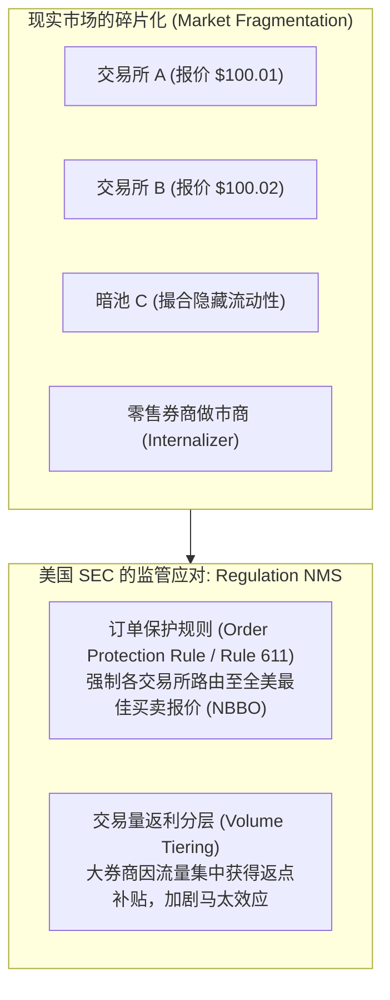
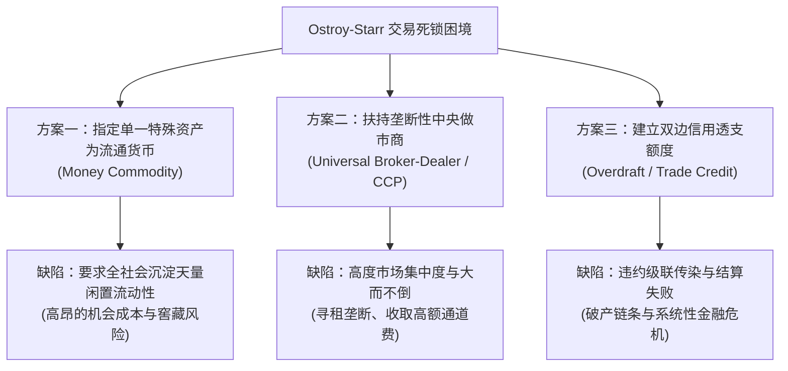

# Lec 3 分布式账本作为信息问题的解决方案（Distributed Ledgers as a Solution to an Information Problem）

> **授课教师**：Robert M. Townsend（MIT 经济学系 Killian 讲席教授）  
> **长标题**：分割市场、政策目标、监管对策与作为技术方案的分布式账本（Fragmented Markets, Policy Objectives, Regulatory Solution, Distributed Ledger as Technology Solution, Statics）

## TL;DR

- 传统监管（如美股 Reg NMS）试图通过统一价格消除市场分割，但仅靠统一报价无法解决去中心化双边交易中的信息孤岛。
- 奥斯特罗伊-斯塔尔（Ostroy-Starr）定理证明：在双边等价交换与非负资产约束下，局部信息不可能自发达成帕累托有效出清。
- 传统金融的应对方案是依赖巨额闲置货币缓冲或垄断性做市商，但这带来了高昂的流动性成本与市场势力寻租。
- 分布式账本的本质价值在于**在物理保持去中心化的同时，提供全局共享的信息集中层**，从而以最低流动性实现全市场高效对冲。

## 帕累托最优与一般均衡理论基准

微观经济学评估任何金融基础设施与制度变革的黄金标准是**帕累托最优（Pareto Optimality）**。

在一个包含 $A$ 个参与主体（$a \in A$）与 $L$ 种商品或数字资产（$j \in \{1, \dots, L\}$）的经济体中：
- 主体 $a$ 的初始禀赋为向量 $e^a = (e_1^a, \dots, e_L^a) \in \mathbb{R}_+^L$；
- 消费或最终持有量为 $c^a = (c_1^a, \dots, c_L^a) \in \mathbb{R}_+^L$；
- 主体效用函数为严格单调递增且严格拟凹的 $U^a(c^a)$。

### 中央规划者基准（The Planner's Problem）

中央规划者通过求解社会福利最大化问题确定帕累托有效配置：

$$\max_{\{c^a\}_{a \in A}} \sum_{a \in A} \lambda^a U^a(c^a) \quad \text{s.t.} \quad \sum_{a \in A} c^a \le \sum_{a \in A} e^a$$

其中 $\lambda^a > 0$ 为规划者赋予主体 $a$ 的福利权重。该问题的拉格朗日一阶条件要求：对任意两种商品 $j, k$，所有个体的边际替代率（Marginal Rate of Substitution, MRS）必须处处相等：

$$MRS_{jk}^a = \frac{\frac{\partial U^a}{\partial c_j^a}}{\frac{\partial U^a}{\partial c_k^a}} = \frac{\mu_j}{\mu_k} = MRS_{jk}^b \quad \forall a, b \in A$$

::: theorem 福利经济学第一与第二定理（Arrow-Debreu-McKenzie）
1. **第一定理**：若所有市场完备、信息完全对称且无外部性，任何竞争性瓦尔拉斯均衡（Walrasian Competitive Equilibrium）均为帕累托最优。统一的价格向量 $p = (p_1, \dots, p_L)$ 充当了全市场协调边际替代率的充分统计量；
2. **第二定理**：在凸性假定下，任意给定的帕累托最优配置均可通过一次性无扭曲初始禀赋转移，配合竞争性市场价格体系实现。
:::

## 市场分割与传统监管对策：美国 Reg NMS

现实金融系统远离了阿罗-德布鲁完全市场，高度充斥着**分割市场（Fragmented Markets）**。

以美国股票市场为例，苹果（AAPL）或英伟达（NVDA）的股票不仅在纽约证券交易所（NYSE）或纳斯达克（NASDAQ）挂牌，还同时在十余家受监管交易所、数十家暗池（Dark Pools）以及机构内部撮合系统（Internalizers）中交易。



为了弥合分割，美国证监会（SEC）于 2005 年通过了著名的 **全国市场系统法规（Regulation NMS）**：
- **第 611 条规则（订单保护规则）**：要求任何交易场所不得以劣于全美最优买卖报价（National Best Bid and Offer, NBBO）的价格执行交易。若其他交易所存在更优报价，必须强制路由过去；
- **监管悖论与隐性扭曲**（Ernst & Spatt, 2024）：统一价格并不等于有效市场。各交易所为了抢夺做市商的订单流，发展出复杂的“制造商/提取者返利”（Maker-Taker Fees）与阶梯式交易量分层。这诱发了极具破坏性的利益冲突：散户的订单常常被券商路由至给券商返点最高、但执行质量未必最佳的暗池场所，造成严重的市场微观结构扭曲。

## 局部去中心化交易的不可能性：奥斯特罗伊-斯塔尔定理

即便假定所有交易场所拥有完全一致的公开出清价格 $p = (p_1, \dots, p_L)$，去中心化的点对点交易是否就能自发实现瓦尔拉斯有效配置？

经济学经典文献 **奥斯特罗伊-斯塔尔模型（Ostroy & Starr, 1974, Econometrica）** 给出了震撼性的否定答案。

### 模型环境与数学刻画

设存在 $N$ 个交易者 $i \in \{1, \dots, N\}$。在竞争均衡价格 $p$ 下，每个交易者存在确定的目标超额需求向量（Excess Demand Vector）：

$$z_i(p) = c_i^* - e_i \in \mathbb{R}^L, \quad \text{满足瓦尔拉斯法则 } p \cdot z_i(p) = 0 \text{ 且市场出清 } \sum_{i=1}^N z_i(p) = 0$$

交易必须在一系列**双边配对会面（Pairwise Meetings）**中逐步执行。每一轮会面中，交易者 $i$ 与交易者 $j$ 交换资产向量 $\Delta x_{ij} \in \mathbb{R}^L$。

::: definition 交易的物理与经济约束（Condition A: Quid Pro Quo）
双边点对点交易必须严格满足两大硬约束：
1. **即时等价交换约束（Quid Pro Quo）**：由于缺乏超越交易的第三方强制执行力，任何一次双边会面中的交割必须即时价值对等，不允许无担保赊账：
   $$p \cdot \Delta x_{ij} = 0$$
2. **非负资产持仓约束（Non-negativity / Solvency）**：交易者在任意中间时刻持有的任意资产数量不能为负（严禁未授权做空或凭空透支）：
   $$x_i^{(t)} = e_i + \sum_{\tau \le t} \Delta x_i^{(\tau)} \ge 0$$
:::

### 信息结构的三种层级

Ostroy 和 Starr 考察了交易者在算法决策时可用的不同信息集：
- **信息结构 $C$（全局集中共享信息）**：所有交易者获知全市场的超额需求矩阵 $Z = (z_1, \dots, z_N)$ 与配对拓扑结构；
- **信息结构 $D.1$（拥有特定单项货币信息）**：交易者知道某一种全市场公认货币的存在及其估值；
- **信息结构 $D.3$（纯粹局部去中心化信息）**：交易者 $i$ 仅知道自己的超额需求 $z_i(p)$，以及自身过去的双边历史交易，完全不知道其他节点的供需状态。

::: theorem 奥斯特罗伊-斯塔尔不可能性定理（Ostroy-Starr Impossibility Theorem, 1974）
- **定理 1（充分性）**：在信息结构 $C$ 下，存在确定性的双边交易规则，使得全市场在有限单轮内完全出清，达成帕累托最优配置；
- **定理 2（不可能性）**：在纯粹局部信息结构 $D.3$ 下，**不存在任何去中心化交易规则**，能够在满足等价交换（Quid Pro Quo）与非负持仓约束的前提下，保证全市场在有限轮次内达成帕累托最优出清！
:::

::: example 双边非对称交错困境
假设有三位交易者 $\{A, B, C\}$ 与三种商品 $\{1, 2, 3\}$，价格均为 1：
- 交易者 A 持有商品 1，需要商品 2；
- 交易者 B 持有商品 2，需要商品 3；
- 交易者 C 持有商品 3，需要商品 1。
若 A 与 B 在第一轮会面，虽然 A 极其渴望 B 手中的商品 2，但 A 只能提供商品 1，而 B 根本不需要商品 1。在严格的 Quid Pro Quo 约束下，二者无法达成任何交易（$\Delta x_{AB} = 0$）！交易立即锁死陷入死锁。双边局部信息完全无法感知到“C 需要商品 1”这一间接闭环。
:::

## 传统制度妥协方案及其内在缺陷

为了绕开 Ostroy-Starr 定理所揭示的死锁，人类在漫长的金融史中发明了三种制度折衷方案，但每一种都伴随着沉重的代价：



### 妥协一：货币作为通用媒介（Theorem 4）

- **定理 4 逻辑**：如果全社会预先选定一种通用货币 $m$，且**每个交易者 $i$ 在期初均持有足够支付其所有购买需求的货币存量**：
  $$e_i^m \ge \sum_{j: z_{ij} > 0} p_j z_{ij}$$
  则在局部信息 $D.1$ 下，单轮双边交易可以顺利完成。
- **代价与弊端**：这要求极其高昂的前置流动性沉淀！资本被强制闲置在低收益流动性资产上（Martin & McAndrews, 2008；英格兰银行流动性节约机制指引）。

### 妥协二：超级中介商与做市商仓库（Theorem 3）

- **定理 3 逻辑**：指定某单一交易者 $K$ 作为全市场的中央对手方（CCP）或做市商巨头。该节点拥有全品类资产的天量库存，所有普通人只需与该巨头单边交易。
- **代价与弊端**：导致极端危险的市场垄断势力！
  - **核心银行服务垄断**（Alcazar et al., 2024, 堪萨斯联储报告）：美国核心银行处理系统被 FIS、Fiserv 和 Jack Henry 三大巨头垄断（覆盖超 70% 银行与 50% 信用社）；
  - **外汇交易做市垄断**：花旗、德银、瑞银垄断了绝大多数全球货币做市，中小国家货币被完全边缘化。

## 技术解决方案：分布式账本的信息集中本质

在此刻，Townsend 教授揭示了分布式账本技术（DLT）真正的革命性所在：

::: definition DLT 的信息本质：物理去中心化与信息完全集中
分布式账本并不是简单的“分布式存储”，它的真正经济学贡献在于：**在保持资产托管与交易执行去中心化的同时，在信息层重建了 Ostroy-Starr 定理中的信息结构 $C$（全局透明的超额需求与账目共享）**。
:::

```text
传统中心化方案：
[ 物理集中 / 账户集中 / 控制权集中 ]  --->  带来垄断、寻租与单点故障

传统去中心化方案（纯双边点对点，无 DLT）：
[ 物理去中心化 / 信息孤岛 ]            --->  触发 Ostroy-Starr 死锁，无法有效出清

分布式账本 (DLT) 架构：
[ 物理去中心化 ]  +  [ 密码学全网状态信息共享 (Structure C) ]
       ===> 在消除单点垄断的同时，恢复帕累托最优出清能力！
```

通过共享账本，每一个节点虽然只管理自己的私钥，但整个网络通过智能合约算法可以实时计算出全局最优的撮合路径与抵销链条，不再需要每个节点随身携带庞大的现金缓冲，也不再需要向中心化做市商缴纳高昂的买卖价差（Spread）。

## 我的理解与洞见

::: insight
传统经济学界对比特币和区块链最大的指责往往是：“点对点现金交易在历史上早已有之（如以物易物或金银直接交割），为何还需要专门发明一个复杂的分布式账本？”

Ostroy-Starr 定理给出了最强有力的反驳：**纯粹的点对点双边交易在数学上是注定低效甚至死锁的**。没有全局信息的盲目双边碰头，要么需要每人携带天量黄金（流动性闲置），要么退化为依赖大型当铺和中央钱庄（中介寻租）。中本聪与现代 DLT 的真正突破，不是消灭中介后退回到原始的以物易物，而是**用点对点网络上的共享状态机，构建了一个‘无须特权主体的全网信息中枢’**。它使得去中心化交易主体第一次能够在拥有全局状态证明的前提下，以原子方式达成多边对冲。
:::

## 常见认知误区与概念混淆

::: pitfall
- **误以为“统一价格就能保证有效交易”**：许多监管者和工程师认为，只要将所有交易所的报价接入一个统一的 API（如美股 NBBO 或加密聚合器），市场就自然统一了。Ostroy-Starr 定理证明，即使所有节点面对相同的出清价格，缺乏全局持仓与需求匹配信息的双边执行依然会导致交易中断。
- **将“中介的信用风险”与“中介的信息职能”混为一谈**：传统做市商之所以能够赚取暴利，是因为他们承担了“信息汇总”与“库存垫资”的双重职能。去中心化金融的使命是用开源代码接管其“信息汇总与撮合”职能，从而消除其因信用中介和垄断地位产生的寻租空间，而不是全盘否定做市撮合本身的数学必要性。
:::

## 核心参考文献与材料链接

- **奠基性理论论文**：Joseph M. Ostroy and Ross M. Starr (1974), [“Money and the Decentralization of Exchange”](https://www.jstor.org/stable/1914292), *Econometrica*, 42(6): 1093–1113.
- **微观结构监管**：Thomas Ernst and Chester Spatt (2024), “Regulating Market Microstructure”, *Journal of Financial Economics*.
- **流动性节约机制**：Antoine Martin and James McAndrews (2008), [“An Economic Analysis of Liquidity-Saving Mechanisms”](https://www.newyorkfed.org/research/epr/08v14n2/0809mart.html), *FRBNY Economic Policy Review*.
- **银行服务垄断实证**：Alcazar et al. (2024), “Market Structure of Core Banking Services Providers”, Federal Reserve Bank of Kansas City.
- **官方公开课视频**：[MIT OCW Lecture 3 on YouTube](https://www.youtube.com/watch?v=Fj4yX8n5Tss)
