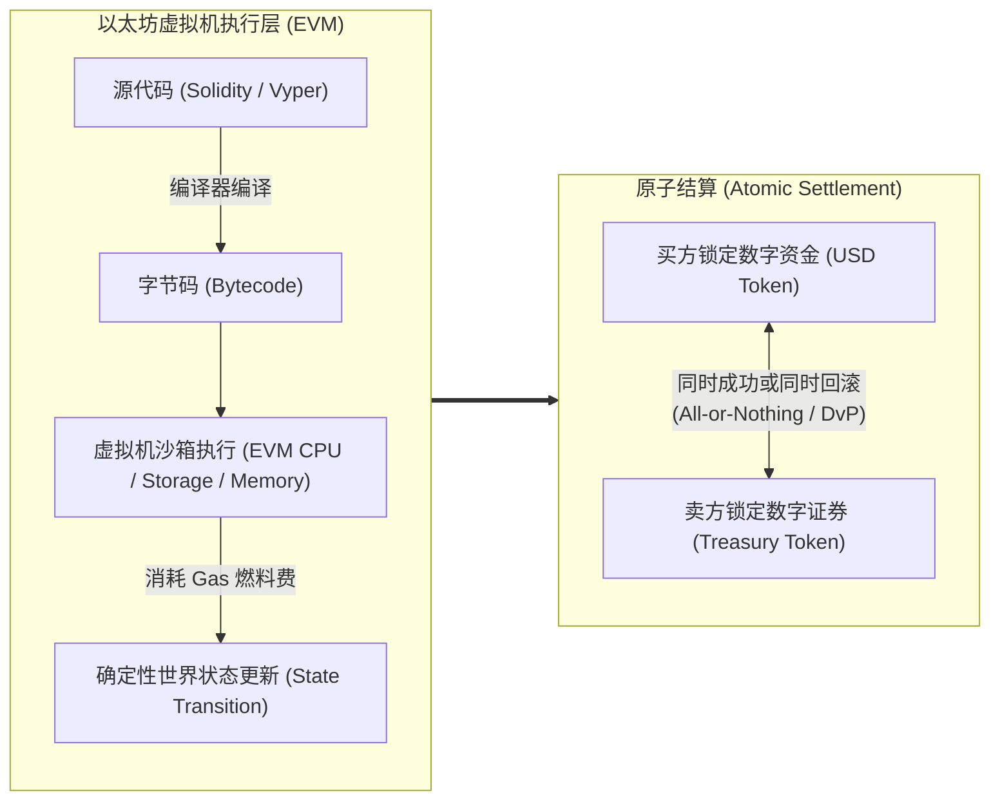
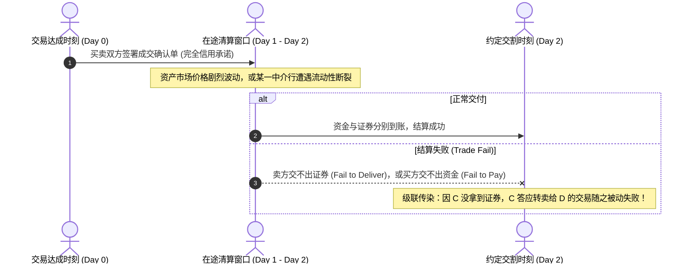
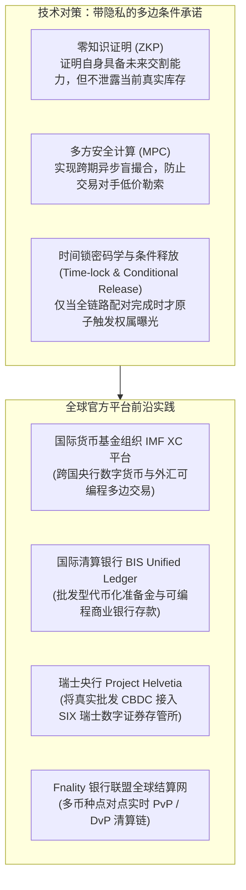

# Lec 5 代币化与可编程资产（Tokenized and Programmable Assets）

> **授课教师**：Robert M. Townsend（MIT 经济学系 Killian 讲席教授）  
> **长标题**：动态账本、原子交易与结算、多边平台、传统遗留系统与交易失败（Dynamic Ledgers, Platforms, Atomic Trade and Settlement, Legacy Systems and Trade Fails）  
> **核心文献**：Lee, Martin and Townsend (2024), *"Optimal Design of Tokenized Markets"*; Fleming & Garbade (2005), *"Explaining Settlement Fails"*.

## TL;DR

- 传统金融的交易与结算是时间分离的（如 T+1/T+2），这种时滞导致严重的结算失败（Trade Fails）与系统性级联违约。
- 基于 DLT 的代币化与智能合约将交易与结算坍缩为一个不可分割的瞬间原子操作（DvP），从根本上消除了交割失败风险。
- 然而，李-马丁-汤森（Lee-Martin-Townsend, 2024）模型证明：如果资产只能在持有后才能被编程，做市商的中介身份与库存暴露将诱发严重的“敲竹杠”（Hold-up）议价困境。
- 解决敲竹杠需要引入隐私密码学机制（如条件释放与零知识证明），使原子结算在不泄露做市商交易历史的前提下完成。

## 动态账本与以太坊虚拟机（EVM）

传统财务会计的资产负债表是在特定离散时点（如季末、年末）对静态存量的截面快照。而在现代计算机科学中，以太坊等区块链系统实现的是**动态账本（Dynamic Ledgers）**：它追踪的是资产在连续时间轴上、依据特定外部状态变化所经历的精确流转路径。

### EVM 的计算架构特征

1. **图灵完备沙箱环境**：EVM 在物理隔离的沙箱中执行代码，任何合约崩溃或异常不会破坏物理主机的底层操作系统；
2. **确定性状态机复制**：全网数万个验证节点独立运行相同的 EVM 实例，执行相同的字节码，确保每一笔交易在全世界所有机器上输出完全一致的新状态根；
3. **消息调用（Message Calls）**：合约之间可以通过内部消息互相调用，触发资产转移、嵌套数据修改或部署子合约，构成了金融合约“可组合性”（Composability，常被称为“金融乐高”）的基础。

## 传统金融遗留系统的沉疴：结算风险与交易失败

在现代传统资本市场中，证券交易（Trade）与实际资产权属交割（Settlement）存在着显著的**时间断层**（如 T+2 或 T+1 结算周期）。在交易达成后至交割完成前的这几天内，资产所有人需要通过复杂的托管行、清算所、经纪商网络下发报文指令。

### 交易失败（Trade Fails）的毁灭性冲击

根据纽约联储经典研究（Fleming & Garbade, 2005）及美联储公开数据：
- **2008 年金融海啸峰值期**：美国国债市场的每日交割失败金额一度突破 **4000 亿美元/天**！
- **失败原因**：除技术故障（如 1985 年纽约银行计算机系统崩溃、9/11 事件通信中断）外，主要根源是**微观博弈激励失效**。在极低利率或危机环境下，交易对手方故意推迟交付所面临的罚息极其微弱，导致大量金融机构选择策略性赖账；
- **级联多米诺骨牌效应（Cascading Fails）**：现代华尔街充斥着复杂的**再质押（Rehypothecation）**与回购交易。机构 A 欠机构 B 某只特定债券，B 已经预先承诺将其借给机构 C，C 又已将其卖空给 D。只要链条前端发生单点失败，全市场的交易链条将发生大面积爆仓违约。

## 代币化与原子结算：交割即支付（DvP）

基于分布式账本的资产代币化（Tokenization）带来了制度层面的物理性颠覆：

::: definition 原子结算（Atomic Settlement）与 DvP
在可编程智能合约中，资产的转移与资金的清偿被封装在同一个区块链事务内部。**交割即支付（Delivery versus Payment, DvP）**通过原子性保证：
$$\text{State Transition} = \begin{cases} 
(\text{Securities} \to \text{Buyer}) \land (\text{Cash} \to \text{Seller}), & \text{若双方资产余额均满足} \\
\text{Revert to Original State}, & \text{若任意一方条件不满足}
\end{cases}$$
系统内生消除了“付了钱拿不到货”或“交了货收不到钱”的赫斯塔特风险（Herstatt Risk / Settlement Risk）。交易与结算的时间差被彻底压缩为零，从根本上消灭了交易失败。
:::

## 可编程资产的隐秘代价：李-马丁-汤森模型（Lee-Martin-Townsend, 2024）

原子结算消灭了结算失败，是否意味着金融市场从此毫无摩擦？

Townsend 教授与其合作者（Todd Keister、Antoine Martin 等人）在 2024 年发表的重磅工作论文《Optimal Design of Tokenized Markets》中，给出了发人深省的反转定理：**简单的代币化可编程性，会毁灭做市商中介机制，诱发严重的“敲竹杠”（Hold-up）与议价暴露风险**！

### 模型设定与时间线

设存在三个风险中性的交易主体 $i \in \{A, B, C\}$，全市场有一份长寿命独特资产（Long-lived Asset），初始所有权归 $A$ 所有。整个经济活动被划分为两个截然不同的阶段：

1. **交易撮合阶段（Trading Stage, $t = m_1, m_2$）**：
   - 交易者之间发生两次连续的双边会面；
   - 关键结构在于：**$A$ 与 $C$ 从不直接相遇**！$B$ 是全市场唯一的做市商与经纪中介（Broker-Dealer），负责在 $A$ 与 $C$ 之间搬运资产；
   - 会面顺序具有随机性：要么 $A$ 与 $B$ 先会面，要么 $B$ 与 $C$ 先会面，且真实的会面顺序只有做市商 $B$ 自身知晓。
2. **结算与持有效用阶段（Settlement Stage, $t = 1, 2, 3$）**：
   - 资产在不同时点由不同人持有会产生异质化的私人效用，这构成了跨期转让的互利基础；
   - 主体 $A$ 在 $t = 3$ 拥有最高效用 $H$，在 $t = 1, 2$ 效用仅为 $L$；
   - 主体 $B$（做市商）在 $t = 1$ 拥有高效用 $H$，在 $t = 2, 3$ 效用为随机变量 $\tilde{M}$（以概率 $\lambda_B$ 取得正效用 $M$，以概率 $1-\lambda_B$ 效用归零）；
   - 主体 $C$ 在 $t = 2$ 拥有最高效用 $\tilde{H}$（以概率 $\lambda_C$ 取得最高效用 $H$，否则为 0），在其他时点效用为 0；
   - 效用排序满足严格阶梯关系：$H > M > L > 0$。

在无摩擦的环境中，理想的社会有效配置显而易见：资产在 $t=1$ 应借给 $B$ 使用，在 $t=2$ 转借给 $C$，在 $t=3$ 归还给初始所有者 $A$。此时全社会总剩余最大化。

### 传统遗留系统的优势：隐匿交易进度

在传统金融系统中，交易与结算完全脱钩（Decoupling）：
- 做市商 $B$ 在与 $C$ 谈判借出资产时，**无需向 $C$ 证明自己手头上是否已经成功向 $A$ 借到了该资产**；
- $B$ 可以隐藏自己与 $A$ 的会面历史。因此 $C$ 不知道 $B$ 的真实议价底牌，双方能够按照各自的事验预期剩余完成定价，$B$ 可以安全地扮演跨期做市商角色。

### 代币化系统的致命陷阱：潜在敲竹杠困境（Latent Hold-Up Problem）

然而，在一个纯粹透明的代币化系统（Tokenized System）中：
- **物理硬约束**：智能合约要求只有当前真正持有资产代币私钥的主体，才能对该资产签署未来的转移转借逻辑；
- **信息完全暴露**：当 $A$ 与 $B$ 先完成交易后，$B$ 获得了代币并编程锁定了未来的归还合约；当 $B$ 随后会见 $C$ 时，$C$ 在链上**一览无余地查到 $B$ 已经把资产拿到了手里**！
- **敲竹杠博弈爆发**：
  - $C$ 明确知道 $B$ 在 $t=2$ 对该资产的自身效用仅为 $\tilde{M}$（甚至可能为 0）；
  - $C$ 知道 $B$ 无法将资产再卖给别人（因为 $A$ 和 $C$ 是仅有的其他主体），$B$ 已经为借入资产向 $A$ 支付了沉没成本！
  - $C$ 立即利用这一极其不利的议价暴露，对 $B$ 进行**极致的“低价勒索”（Low-ball Offer）**，只给 $B$ 提供微薄的贴现对价；
  - **市场崩溃的反向推导**：做市商 $B$ 预见到自己一旦先向 $A$ 拿货，就会在后续会面中被 $C$ 敲竹杠勒索导致亏损；因此，**$B$ 选择拒绝在前期向 $A$ 借入资产！中介功能瘫痪，全市场交易彻底停滞！**

::: theorem 代币化市场的敲竹杠不可能定理（Lee, Martin & Townsend, 2024）
若缺乏隐私保护机制，纯粹透明的链上代币化与即时原子锁定，虽然消除了履约失败（Trade Fails），但剥夺了金融中介在跨期异步交易中隐藏其库存与交易进度的能力。这种信息外溢将诱发严重的敲竹杠问题，导致做市商中介意愿归零，反向摧毁帕累托有效资产流转。
:::

## 解决方案与全球央行平台架构

为了兼得“消除结算失败”与“避免敲竹杠信息泄露”两大优势，前沿金融工程与国际组织正在推动融合密码学隐私与可编程清算的全新平台范式：

### 关键隐私技术的制度嵌入

1. **零知识证明（Zero-Knowledge Proofs, ZKP）的交割承诺**：交易中介 $B$ 无需向买方 $C$ 透露其获得资产的具体时间戳、历史进货价格或当前持仓规模，只需生成一份简洁的零知识证明，从数学上向合约证明：“我拥有在交割日向合约合法转移该资产代币的有效权利”。这种设计既实现了代码化强制履约，又彻底切断了对手方的敲竹杠勒索途径。
2. **多方安全计算（MPC）与时间锁条件释放**：将交易的达成指令与资产代币的实际权属解密状态绑定。在所有链条参与方完成多边确认之前，资产虽然处于智能合约的锁定监管中，但其真实持有人信息被多方私钥分片加密。唯有当全网闭环形成时，状态机才同步解密并执行原子划分。

### 全球多边央行基础设施实验

- **国际货币基金组织 IMF XC 平台（Adrian et al., 2022）**：针对跨境多币种汇兑痛点，建立主权隔离的可编程外汇清算平台。各国中央银行保持自身主权货币政策独立性，同时允许合规商业银行在 XC 共享记账层上部署智能合约，实现央行数字货币之间无交易对手风险的即时 PvP（Payment versus Payment）对冲与流动性节省；
- **国际清算银行 BIS Unified Ledger 构想**：将批发型 CBDC、商业银行代币化存款和政府公债统筹在同一个合规账本上，彻底打通跨银行存款支付与跨资产证券交割，使清算不再依赖外部多层级报文往复对账；
- **瑞士央行 Project Helvetia Phase 2 实证**：全球首个将中央银行法币代币直接接入国家级证券存管系统（SIX Digital Exchange, SDX）的生产级试点，验证了真实股票债券与批发型 CBDC 的秒级 DvP 原子交割，在真实银行间市场证明了可编程交割的可行性；
- **Fnality 全球支付系统**：由十余家全球系统重要性银行（G-SIBs）联合发起的机构级数字支付网络，通过在央行全额存管法定现金并映射为结算代币，消除跨国大额资金调拨的跨时区在途风险。

## 我的理解与洞见

::: insight
Lee, Martin & Townsend (2024) 这篇论文为整个区块链与金融科技学术界敲响了至关重要的警钟。在工程师的直觉中，“越透明、越即时、越可追溯”往往被默认为绝对的善。传统加密爱好者常说：“区块链消灭了中介，消灭了结算延迟，这是完美的进步。”

然而，经济学最深刻的洞察恰恰在于：**信息透明并不总是提高效率的，适度的信息模糊（Information Opacity）有时是维持市场中介与做市流动性所必需的润滑剂**。

在传统华尔街，做市商之所以敢于动用自身资产负债表吃下数十亿美元的巨额抛单，正是因为有 T+2 结算周期和私密暗池保护其库存不被竞争对手侦测到。如果将所有交易强行搬上一览无余的公链，每一笔持仓变动和进货成本都被链上分析工具实时追踪（MEV 机器人与链上巨鲸监测），做市商将退化为毫无议价能力的待宰羔羊。**未来的代币化金融基础设施，绝不能盲目崇拜全网广播与裸奔式透明，必须在底层将智能合约与隐私密码学（ZKP/MPC）深度交织**，唯有如此，才能在铲除结算风险的同时，保全现代金融市场的高流动性与厚度。
:::

## 常见认知误区与概念混淆

::: pitfall
- **误以为“代币化（Tokenization）等于发行加密货币炒作”**：在央行与机构金融语境下，代币化是指用分布式的不可伪造数字凭证（Digital Bearer Instrument）映射现实中的合规金融资产（如美国国债、银行商业票据、碳排放权配额）。代币化关注的是结算效率与编程逻辑，而非凭空虚构非生息代币进行二级市场投机。
- **误以为“智能合约只要部署了就绝对安全”**：原子结算虽然消除了对手方交割违约风险，但放大了“代码流动性陷阱”。一旦交易的某一个前置条件被攻击者利用预言机操纵或闪电贷攻击（Flash Loan Attack）恶意触发，资产将在一个区块内被瞬间洗劫且不可逆回滚，传统金融中依赖人工干预和 T+2 紧急冻结的最后安全阀门将不复存在。
:::

## 核心参考文献与材料链接

- **经典前沿论文**：Lee, Martin, and Townsend (2024), “Optimal Design of Tokenized Markets”, *Federal Reserve Bank of New York Staff Reports*.
- **交割失败实证研究**：Michael J. Fleming and Kenneth D. Garbade (2005), [“Explaining Settlement Fails”](https://www.newyorkfed.org/research/current_issues/ci11-9.html), *Current Issues in Economics and Finance*, Federal Reserve Bank of New York.
- **国际多边平台方案**：Tobias Adrian et al. (2022), [“A Multi-Currency Exchange and Contracting Platform”](https://www.imf.org/en/Publications/WP/Issues/2022/11/04/A-Multi-Currency-Exchange-and-Contracting-Platform-525388), IMF Working Paper.
- **瑞士央行数字试验**：Swiss National Bank and BIS Innovation Hub (2022), [“Project Helvetia Phase II: Settling tokenised assets in wholesale CBDC”](https://www.bis.org/publ/othp45.pdf).
- **官方公开课视频**：[MIT OCW Lecture 5 on YouTube](https://www.youtube.com/watch?v=Fj4yX8n5Tss)
