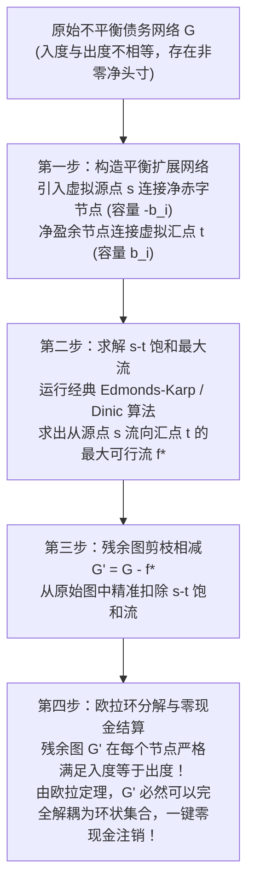

# Lec 6 多边贸易信用抵销网络与图流算法（Multilateral Trade Credit Set-off, MTCS）

> **特邀主讲**：Tomaž Fleischman（Informal Systems；斯洛文尼亚与萨丁岛 Sardex 互助清算体系架构师）  
> **联合授课**：Robert M. Townsend（MIT 经济学系 Killian 讲席教授）  
> **核心文献**：Boissay, Fleischman, Dini et al. (2025), *"Multilateral Trade Credit Setoff"*; Fleischman, Dini and Littera (2020), *"Liquidity-Saving through Obligation-Clearing and Mutual Credit"*.

## TL;DR

- 实体经济中广泛存在的拖欠货款（Late Payments）会引发流动性级联冻结，导致大量账面盈利的企业陷入被动破产。
- 企业间的应收与应付账款构成加权有向图，其中的“债务闭环”（Cycles）可以在数学上实现完全零现金的多边互相对冲。
- 在包含数十万企业的大规模网络中直接搜索闭环是组合爆炸的 NP 难题，弗莱施曼算法将其巧妙重构为“虚节点网络流问题”。
- 通过引入虚拟源汇点并求解饱和 $s-t$ 最大流，残余图被证明必然是节点度数严格守恒的平衡流，可在秒级内解耦并出清百亿规模债务。

## 实体经济的拖欠顽疾：流动性网格死锁

在现代工商业供应链中，商业信用（Trade Credit，即赊销与延迟付款协议）占据了企业短期营运资本的大半壁江山。根据欧洲支付报告（European Payment Report）与特许公认会计师公会（ACCA）的统计：
- 超过 80% 的欧洲与英国中小企业长期遭受**逾期付款（Late Payments）**的折磨，平均实际支付周期比合同约定推迟 30 至 90 天；
- **拖欠的宏观破坏性**：拖欠并非孤立事件。下游大企业拖欠中游供应商货款，中游企业由于资金链紧绷，被迫顺延拖欠上游原材料商。流动性在链条中被逐步抽干，最终导致微观层面健康、订单饱满的企业因为瞬间现金流断裂而发生“猝死性破产”。

在上图简化的三主体案例中：
- 表面上看，每家企业都在催促外部资金救急；
- 但深入观察有向拓扑结构即可发现：**Alice 欠 Bob 1 万，Bob 欠 Charlie 1 万，Charlie 欠 Alice 1 万**。
- 这 1 万元的债务构成了一个**闭合有向环（Directed Cycle）**！如果三家企业同时坐在一起签署协议：“我们各自注销对彼此的 1 万元债务”，则**全市场无需一分钱外部现金输入，即可凭空消除 3 万元的名义债务**！Alice 对 Bob 仅剩未结清的 1 万元净债务。

## 债务拓扑网络与组合爆炸挑战

我们将整个经济体中所有逾期未结清的商业信用票据抽象为一个加权有向图：

::: definition 债务网络图模型（Obligation Graph Model）
设经济体包含 $N$ 家企业，构成图 $G = (V, E, W)$：
- 节点集合 $V = \{1, 2, \dots, N\}$ 代表企业；
- 有向边 $(i, j) \in E$ 代表企业 $i$ 欠企业 $j$ 已经逾期的债务（$i$ 为债务人，$j$ 为债权人）；
- 边的权重 $W_{ij} > 0$ 代表该笔欠款的账面金额，统一以法定货币计价。

企业 $i$ 的**净头寸（Net Position）**定义为外部总应收款减去总应付款：
$$b_i = \sum_{k: (k, i) \in E} W_{ki} - \sum_{j: (i, j) \in E} W_{ij} = \text{Inflow}_i - \text{Outflow}_i$$
- 若 $b_i < 0$：企业 $i$ 处于**净赤字（Deficit）**状态（付出的多于收回的）；
- 若 $b_i > 0$：企业 $i$ 处于**净盈余（Surplus）**状态（收回的多于付出的）；
- 若 $b_i = 0$：企业 $i$ 处于**平衡（Balanced）**状态。
:::

### 组合爆炸难题

在现实中，国家级供应链网络包含数十万至数百万家企业、数千万笔发票。在一个拥有 $10^6$ 个节点的大图中直接寻找所有长度可能从 3 到数百不等的有向简单环（Simple Cycles），在计算复杂性理论上属于经典 NP 难题（Johnson 环查找算法的时间复杂度随环数量指数级爆炸）。在算力上，直接枚举环是完全不可行的。

## 弗莱施曼 MTCS 算法：网络流重构的破局

特邀讲师 Tomaž Fleischman 与合作者提出了一项革命性的算法构想：**放弃盲目搜索离散环，将债务对冲转化为图论中的连续“最大流/最小费用最大流（MCMF）”问题**！

### 算法数学推导步骤

1. **构造扩展平衡网络**：
   - 引入虚拟超级源点 $s$（Source）与超级汇点 $t$（Sink）；
   - 对每一个净赤字节点 $i$（$b_i < 0$），添加有向边 $(s, i)$，容量设为 $C_{si} = -b_i$；
   - 对每一个净盈余节点 $j$（$b_j > 0$），添加有向边 $(j, t)$，容量设为 $C_{jt} = b_j$；
   - 原始网络内部的边 $(i, j) \in E$ 保留，其容量上限直接设为其原始债务金额 $W_{ij}$。
2. **求解饱和 $s-t$ 最大流**：
   - 在扩展图上运行最大流算法，计算出从 $s$ 经过内部债务网络流向 $t$ 的最优网络流 $f^*$；
   - 物理含义：$s-t$ 最大流精确代表了**那些无法在内部形成闭环对冲、必须依赖外部净注水与净排水的“单向沉淀流”**。
3. **残余图相减与欧拉循环守恒**：
   - 构造新网络 $G' = (V, E, W')$，其中每条内部边的权重为原始金额减去该边承载的 $s-t$ 流：
     $$W'_{ij} = W_{ij} - f_{ij}^*$$
   - **核心数学性质验证**：对于网络中的任意内部节点 $i \in V$，在扣除 $s-t$ 流之后，其残余流入量与残余流出量必然**严格相等**：
     $$\sum_{k} W'_{ki} = \sum_{j} W'_{ij} \quad \forall i \in V$$

::: theorem 欧拉循环抵销定理（Fleischman et al., 2020）
若一个有向图 $G'$ 在每个节点上均满足流入量等于流出量（即满足基尔霍夫流守恒定律），则该图可以被多项式时间算法**严格且完全地分解为一组不相交的有向闭合回路族 $\{\mathcal{C}_1, \mathcal{C}_2, \dots, \mathcal{C}_m\}$**。  
因此，$G'$ 中的所有债务可以通过多边清算机制**以 100% 零现金消耗完全注销**，且不改变任何参与主体的净资产。
:::

## 斯洛文尼亚与意大利真实历史数据实证

MTCS 算法绝非象牙塔内的纯数学玩具，它拥有极其辉煌的宏观实证战绩：

### 斯洛文尼亚国家级法定多边对冲（AJPES）

- **历史背景**：1991 年南斯拉夫解体后，斯洛文尼亚面临剧烈的货币断裂与恶性通胀危机，全境企业深陷三角债泥潭；
- **制度落地**：斯洛文尼亚议会通过特别立法，强制全国所有面临逾期发票的企业定期向国家支付机构（现为 AJPES）提交应收应付账款清单；
- **实证效果**：在 1991–1994 年危机期间，该系统每月运行一次，**平均每次运行无现金直接注销掉全国 15% 至 20% 的企业总未结债务**；在 2008–2012 年欧债危机期间，该系统再次启动，单月最高注销债务超 10 亿欧元，拯救了数万家中小企业的生命。

### 意大利 InfoCert B2B 大规模实证拓扑（2019–2020）

研究团队利用意大利电子发票提供商 InfoCert 覆盖全意大利的企业真实交易大数据进行算法回溯：
- **无标度网络拓扑（Scale-Free Topology）**：企业债务网络的出入度分布严格服从**幂律分布（Power-law Distribution）**，极少数核心中介企业拥有成千上万条连接，绝大多数企业仅有少量连接；
- **对冲能力上限**：纯粹基于闭环的 MTCS 在意大利全样本中平均每月可注销 8% 至 12% 的总债务。制约对冲比例的瓶颈并非算法效率，而是网络拓扑中存在大量“树枝状”（Dangling Tree Branches）的终端买家与源头卖家。

## 杠杆倍增：外部流动性注入与网络流优化

当纯闭环对冲达到物理上限后，如果政府或商业银行有一笔紧急纾困流动性预算 $M$，应当如何投放？

::: definition 最优流动性注入乘数（Liquidity Injection Multiplier）
将扩展图中的超级源点 $s$ 与超级汇点 $t$ 合并为一个由外部银行控制的**流动性注入源节点**。通过对非闭环路径赋予边权重（成本参数），利用**最小费用最大流（MCMF）**算法求解：
$$\max_{\text{Injections}} \frac{\text{全网总清偿债务金额}}{\text{外部注入现金资本}} = \kappa > 1$$
在斯洛文尼亚与萨丁岛实践中，精心计算的流动性定向注入往往能产生 **3 至 8 倍的债务消除乘数**，资金在沿着拓扑链条穿透后最终流回注水源头，实现财政纾困资金的高效无损循环。
:::

## 我的理解与洞见

::: insight
传统宏观经济学在面对实体经济流动性危机时，工具箱往往极其匮乏：除了央行降准降息、通过商业银行拼命向市场发放信贷（债务展期），几乎别无他法。然而在经济下行期，银行由于顺周期风险厌恶往往“惜贷”，低成本资金在金融体系内空转，根本无法流向真正干渴的供应链末梢中小企业。

Tomaž Fleischman 的 MTCS 算法展示了一种**全新的货币拓扑学哲学**：
**流动性匮乏并不等于资本匮乏，它往往只是账务网络拓扑上的‘回路堵塞’**。企业手头没有现金，并不意味着它们没有偿付能力；它们手里握着的大量应收账款本身就是真金白银的资产，只是被单向线性的支付制度卡死了流通环节。

通过引入图论网络流算法，我们可以在纯数学维度上将原本死锁在企业资产负债表底层的沉淀商业信用‘就地原子对冲’。**这是计算机科学赋能宏观金融系统设计的巅峰范例之一**：它无需让任何一家企业背负新的利息债务，亦无需印钞引发通货膨胀，仅凭一行优雅的图算法，就能为实体经济凭空释放出数百亿的真实流动性空间。
:::

## 常见认知误区与概念混淆

::: pitfall
- **误以为债务抵销会损害债权人的合法权益**：抵销操作严格遵循“等额扣减”原则。例如企业 A 应收 B 10 万元且应付 C 10 万元，在完成 10 万元抵销后，A 的应收和应付同时归零，其**净资产（Net Worth）完全保持不变**，但资产负债表大幅去杠杆，资产周转率瞬间飞跃，彻底免除了坏账暴露风险。
- **误将 MTCS 与简单保理（Factoring）混淆**：银行保理业务是金融中介以高额贴现折扣（如收取 5%-10% 手续费）收购企业应收账款，本质上是高利贷式的单边垫资转嫁风险；而 MTCS 是多边协同网络，企业之间地位平等，无需向银行让渡折价贴现，具有极强的普惠性。
:::

## 核心参考文献与材料链接

- **最新工作论文**：Frédéric Boissay, Tomaž Fleischman, Paolo Dini et al. (2025), “Multilateral Trade Credit Setoff”, BIS & Informal Systems Working Paper.
- **中小企业流动性实证**：Tomaž Fleischman, Paolo Dini, and Giuseppe Littera (2020), [“Liquidity-Saving through Obligation-Clearing and Mutual Credit: An Effective Monetary Innovation for SMEs in Times of Crisis”](https://www.mdpi.com/1911-8074/13/12/295), *Journal of Risk and Financial Management*, 13(12): 295.
- **图论经典教材**：Thomas H. Cormen et al. (2001), *Introduction to Algorithms*, Part VI: Graph Algorithms (Maximum Flow & Network Simplex), MIT Press.
- **官方公开课视频**：[MIT OCW Lecture 6 on YouTube](https://www.youtube.com/watch?v=Fj4yX8n5Tss)
