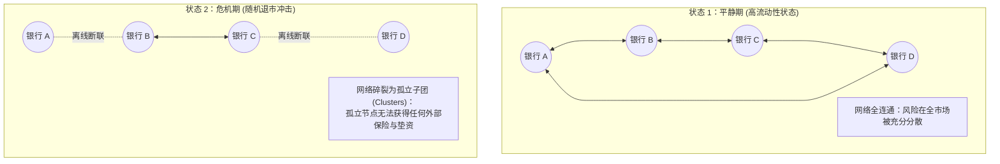
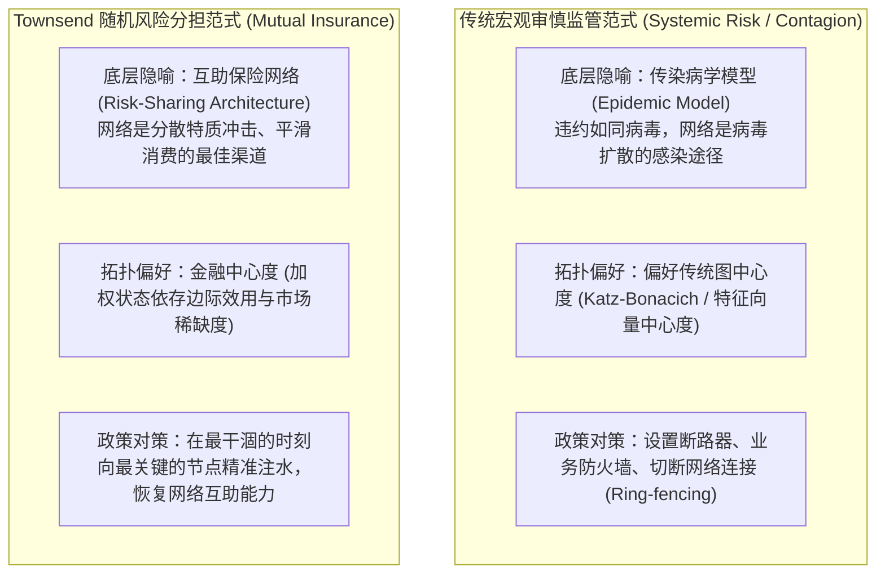

# Lec 7 随机金融网络与关键节点流动性注入（Stochastic Financial Networks）

> **授课教师**：Robert M. Townsend（MIT 经济学系 Killian 讲席教授）  
> **长标题**：流动性与关键参与者的价值 vs 传染动力学：强化市场还是限制市场（Liquidity and the Value of Key Players versus Contagion Dynamics: Enhance or Limit Markets）  
> **核心文献**：Arun Chandrasekhar, Robert M. Townsend, and Juan Xandri (2022), *"Financial Centrality and The Value of Key Players"*; Bech and Atalay (2010), *"The topology of the federal funds market"*; Acemoglu, Ozdaglar, and Tahbaz-Salehi (2015), *"Systemic Risk and Stability in Financial Networks"*.

## TL;DR

- 金融网络存在内生的时变参与冲击（Search Frictions），实际可参与撮合的子图随自然状态与流动性动态演化。
- 钱德拉塞卡-汤森-桑德里（CTX, 2022）提出了“金融中心度”（Financial Centrality），用于测度在特定节点注入流动性的边际社会福利价值。
- 最有价值的注水节点并非资产规模最大的大机构，而是在全市场流动性干涸、平均收入暴跌及相关性极高的萧条状态中依然坚守做市的节点。
- 传统监管文献过度将网络视为“金融瘟疫传染渠道”并主张分割隔离；而微观风险分担理论证明网络是正向互助渠道，政策应定向强化关键做市中枢。

## 动态随机网络：市场参与的随机冲击

在传统一般均衡与网络金融学模型中，网络拓扑结构往往被假定为静态、固定的图。然而在真实的同业拆借市场（如美联储联邦基金市场 Fedwire，Bech & Atalay, 2010）或乡村信贷网络中：
- 交易主体的连接关系在每一天甚至每一小时都在剧烈变动；
- 受制于搜寻摩擦（Search Frictions，Duffie et al., 2005）、监管指标达标时点或突发运营障碍，某些机构在特定日期会**暂时退出市场**（Inertia / Market Participation Shocks）。

### 随机网络的形式化设定

设经济体包含 $n$ 个风险厌恶主体 $I = \{1, 2, \dots, n\}$：
1. **偏好与禀赋**：
   - 每个主体具有常绝对风险厌恶（CARA）效用函数：
     $$u_i(c_i) = -\frac{1}{r_i} \exp(-r_i c_i)$$
     其中 $r_i > 0$ 为绝对风险厌恶系数；
   - 收入冲击服从多维正态分布：$y = (y_1, \dots, y_n)' \sim \mathcal{N}(\mu, \Sigma)$，协方差矩阵 $\Sigma \succ 0$ 捕捉了主体间的特质与系统性风险暴露。
2. **随机参与状态变量**：
   - 设 $\zeta = (\zeta_1, \dots, \zeta_n) \in \{0, 1\}^n$ 为指示向量，描述当前自然状态下哪些节点能够进场交易；
   - 若 $\zeta_i = 0$：主体 $i$ 无法接入市场，只能自生自灭，消费等于自身受冲击收入：$c_i = y_i$；
   - 若 $\zeta_i = 1$：主体 $i$ 接入当前活跃的连通子图（Cluster $\mathcal{C}(\zeta)$），与其同伴签署最优风险分担智能合约。

## 金融中心度（Financial Centrality）的微观定义

当中央银行或财政部拥有一笔有限的外生流动性（如紧急贴现窗口贷款或注资额度 $\epsilon > 0$）时，应当将资金注入哪一家金融机构？

Chandrasekhar, Townsend & Xandri (2022) 提出了具有里程碑意义的**金融中心度（Financial Centrality, $FC_i$）**测度：

::: definition 金融中心度（Financial Centrality）
定义节点 $i$ 的金融中心度 $FC_i$ 为：**在所有可能发生自然状态中，在主体 $i$ 处于活跃交易状态（$\zeta_i = 1$）的前提下，向主体 $i$ 注入边际资源 $\epsilon > 0$ 所能带来的事前边际社会福利提升**：
$$FC_i := \frac{\partial \mathcal{W}}{\partial e_i} \Bigg|_{\zeta_i = 1} = \mathbb{E} \left[ \sum_{j \in \mathcal{C}(\zeta)} \lambda_j \frac{\partial u_j(c_j)}{\partial e_i} \,\Bigg|\, \zeta_i = 1 \right]$$
其中 $\mathcal{W} = \sum_{j} \lambda_j \mathbb{E}[u_j(c_j)]$ 为社会福利函数。
:::

### 正向传染效应（Positive Contagion）

这一测度揭示了一个深刻的经济学机制：**流动性注水具有正向传染乘数**。
向节点 $i$ 注入一单位现金，并不仅仅改善 $i$ 自身的资产负债表与消费：
- 由于 $i$ 与其所属子图 $\mathcal{C}$ 内的其他节点签署了风险互助与拆借协议；
- 这笔边际资源会沿着交易网络**自发涟漪式扩散**至所有直接和间接交易对手；
- 只要节点 $i$ 能够参与交易，救助节点 $i$ 等同于拯救了整片网络连通簇。

## 最具价值节点的核心特征

在 CARA-正态基准模型下，Townsend 等人严格推导出了决定节点金融中心度高低的四个核心经济学维度：

::: theorem 关键做市商节点的价值决定定理（CTX, 2022）
一个节点的金融中心度 $FC_i$ 最高（即被救助价值最大），当且仅当满足以下四大约束特征：
1. **稀缺做市状态匹配（Scarcity of Market Participation）**：该节点活跃的自然状态，恰恰是全网其他大量节点因恐慌而退市、市场总参与人数极低的萧条时期（雪中送炭，而非锦上添花）；
2. **极端宏观系统性冲击（Aggregate Income Scarcity）**：该节点所属子图面临极低的平均可支配收入（全员边际效用 $\mathbb{E}[u'(\cdot)]$ 处于极高水平）；
3. **高正相关性网络风险（Positive Shock Covariance）**：子图内部各节点的收入冲击呈现高度正相关，此时单纯依靠子图内部自发对冲无法化解风险，最急需外部流动性输入；
4. **高风险厌恶集群（High Cluster Risk Aversion）**：子图内其他主体具有极高的风险厌恶系数 $\sum_{j} r_j$。
:::

### 定价对偶性：阿罗-德布鲁个体参与债券

理论分析进一步证明，金融中心度不是抽象的主观福利测度，它在完备金融市场中具有完全市场化的对偶定价：

$$P_i^{\text{Participation}} = \mathbb{E} \left[ m(\zeta, y) \cdot \mathbb{I}_{\{\zeta_i = 1\}} \right] \propto FC_i$$

在阿罗-德布鲁证券体系下，**一个主体的金融中心度，精确等于‘当且仅当该主体在特定日期进入市场交易时支付 1 单位红利’的参与期权债券的无套利市场价格**。

在泰国乡村金融调研实证中，长期充当跨家族桥梁中介的农户，其消费水平在全生命周期内均享有显著的正向风险溢价——村民们愿意在平时向这些关键中介让渡利润，以换取他们在流动性干涸时留守市场提供关键信用通道。

## 金融传染（Contagion）与风险分担的范式对决

在此处，Townsend 教授对宏观审慎监管（如巴塞尔协议 III）中风靡一时的**系统性风险与金融传染文献**（如 Eisenberg & Noe, 2001 清算模型；Acemoglu, Ozdaglar, Tahbaz-Salehi, 2015 传染动力学）提出了极为尖锐的理论批评：

### 两种范式的关键分歧

| 比较维度 | 传统金融传染文献（Contagion Literature） | Townsend 风险分担框架（Financial Centrality） |
|---|---|---|
| **网络的作用** | **负向外部性**：将单家银行的坏账损失放大为系统性雪崩 | **正向互助性**：通过多边对冲，将特质风险分摊至全市场吸收 |
| **关键节点识别** | **图论网络中心度**：度数最多、连接资产规模最大的节点（大而不倒） | **状态边际福利价值**：在恶劣状态下提供流动性连通性的做市商 |
| **监管干预哲学** | **限制与隔离**：强行拆分大型机构，设置跨境流动性壁垒 | **赋能与注水**：通过智能合约与公开承诺，激励关键节点在危机中履约 |

::: theorem 中心度错位推论（Misalignment of Centralities）
在包含宏观收入冲击的真实经济体中，**传统图论中的高特征向量中心度（Eigenvector Centrality）或度中心度节点，与社会福利最优注水的金融中心度（Financial Centrality）节点常常是严重脱节的**。  
若监管者机械地依据资产负债表规模或传统度数实施救助，往往会把宝贵的央行流动性浪费在自我对冲能力充足的大行身上，而任由真正维系市场清算命脉的关键边缘节点断裂。
:::

## 我的理解与洞见

::: insight
中央银行在历次金融危机中的救助政策（如 2008 年美联储救助贝尔斯登与 AIG、2023 年救助硅谷银行 Signature Bank），长期饱受社会舆论与学术界关于“道德风险”（Moral Hazard）与“大而不倒”（Too Big to Fail）的激烈指责。纳税人最强烈的质疑是：凭什么用公共财政去挽救特定的华尔街私营机构？

Townsend 教授的随机金融网络理论，为这一世纪难题提供了**基于第一性原理的严密量化标尺**。

救助的核心理由绝不应该是“这家机构牌子大”或“这家机构资产多”；**唯一的经济学正当性在于其在多边网络中的‘金融中心度’（$FC_i$）**。如果一家做市商机构倒闭会使得数百家中小企业与下游银行退化为‘孤岛子图’，从而使整个经济丧失风险分散能力，那么向其定向注入流动性所拯救的，实际上是整张网络上的无辜实体。

未来的去中心化金融协议（DeFi）与央行数字货币流动性调度，应当将这种“状态依存的网络中心度算法”写进自动化安全阀中：**不再依赖央行行长在闭门会议上的主观政治博弈，而是由智能合约根据链上实时的网络连通拓扑，自主判定最优注水靶点**，从而在根除腐败寻租的同时，将系统性危机的波及范围压缩至最低。
:::

## 常见认知误区与概念混淆

::: pitfall
- **误以为度数最高（连接最多）的节点永远最重要**：在牛市平静期，枢纽大行的度数极高，但此时市场各处资金泛滥，边际效用极低；而在危机萧条期，一家中型做市商如果能够连通两个原本完全脱节的区域市场，其边际社会福利价值（$FC_i$）可能数十倍于平时的大型商业银行。
- **误以为建立“金融防火墙”是绝对安全的**：许多监管机构倾向于推行“围栏原则”（Ring-fencing），限制本国银行跨国或跨市场拆借。但网络经济学证明，过度设置人为壁垒直接切断了风险分担的闭环链路，使得局部小冲击无法被全网吸收，反而在受限制的局部区域内迅速蓄积为毁灭性的特大危机。
:::

## 核心参考文献与材料链接

- **核心前沿论文**：Arun Chandrasekhar, Robert M. Townsend, and Juan Xandri (2022), “Financial Centrality and The Value of Key Players”, *Working Paper*.
- **系统性风险经典理论**：Daron Acemoglu, Asuman Ozdaglar, and Alireza Tahbaz-Salehi (2015), [“Systemic Risk and Stability in Financial Networks”](https://www.aeaweb.org/articles?id=10.1257/aer.20130456), *American Economic Review*, 105(2): 564–608.
- **同业拆借拓扑实证**：Morten L. Bech and Engin Atalay (2010), [“The topology of the federal funds market”](https://www.sciencedirect.com/science/article/pii/S0378437110005705), *Physica A: Statistical Mechanics and its Applications*, 389(22): 5223–5246.
- **搜寻摩擦与资产定价**：Darrell Duffie, Nicolae Gârleanu, and Lasse Heje Pedersen (2005), [“Over-the-Counter Markets”](https://www.jstor.org/stable/3598888), *Econometrica*, 73(6): 1815–1847.
- **官方公开课视频**：[MIT OCW Lecture 7 on YouTube](https://www.youtube.com/watch?v=Fj4yX8n5Tss)
