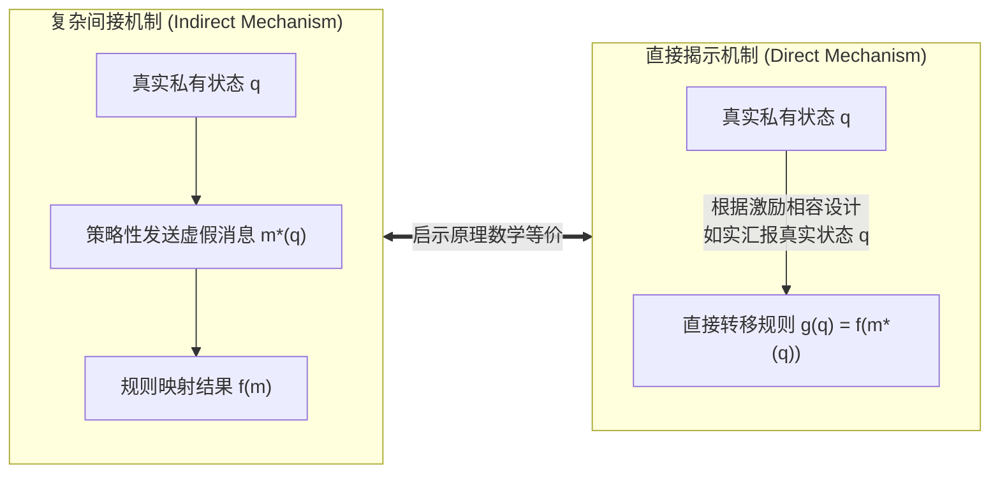
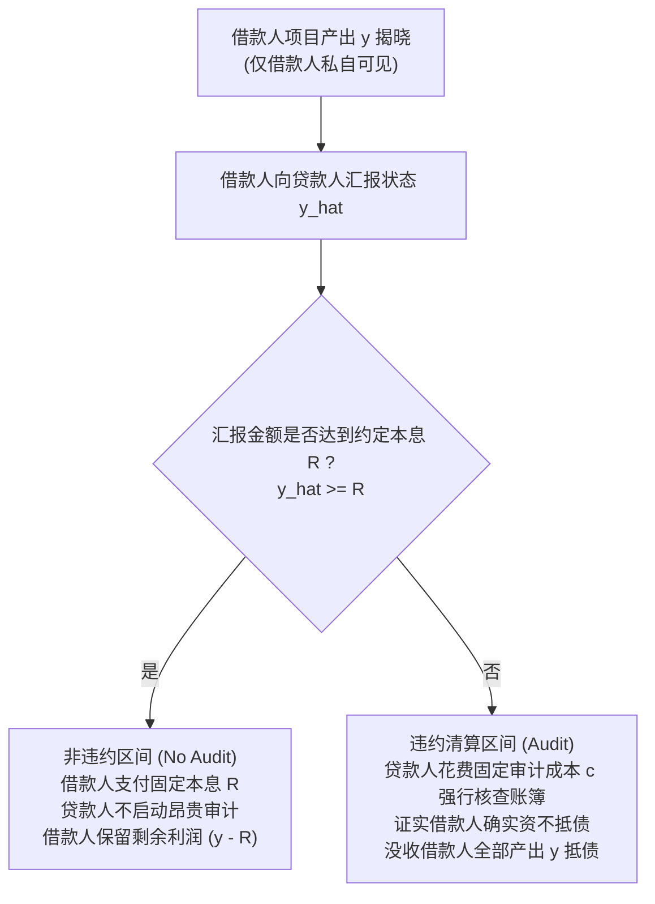
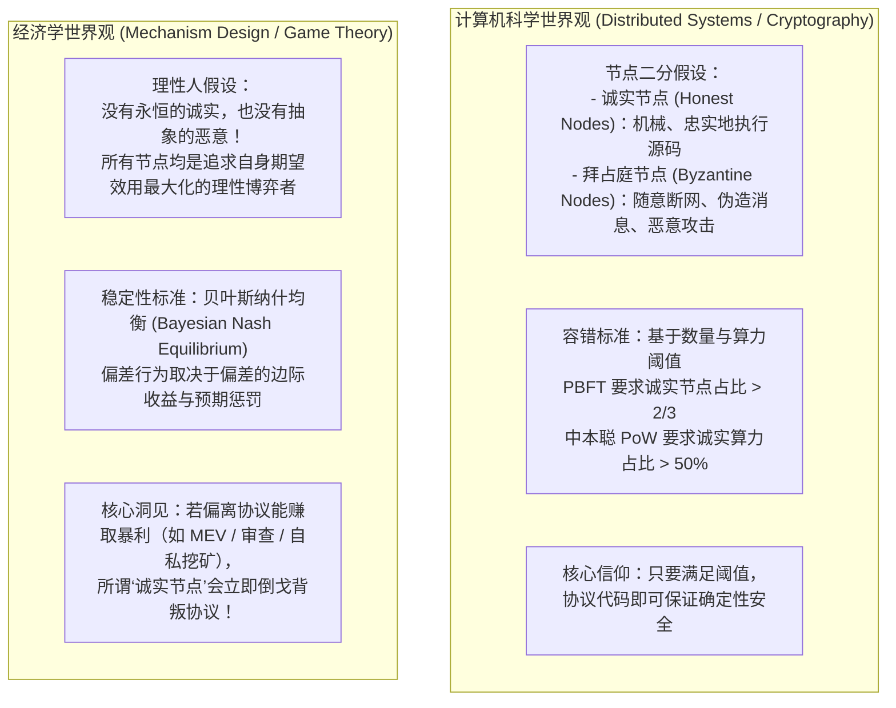

# Lec 8 机制设计与激励 vs 协议与信任（Mechanism Design and Incentives vs. Protocols and Notions of Trust）

> **授课教师**：Robert M. Townsend（MIT 经济学系 Killian 讲席教授）  
> **长标题**：私有信息、如实报告与行动激励、拜占庭将军问题、经济学与计算机科学在算法与信任视角上的根本分野（Private Information, Incentives to Report and Take Actions, Byzantine Generals Problem, Differences Between Economics and Computer Science Approaches to Algorithms and Trust）  
> **核心文献**：Robert M. Townsend (1979), *"Optimal Contracts and Competitive Markets with Costly State Verification"*, *JET*; Tuomas Sandholm (2008), *"Computing in Mechanism Design"*; Raphael Auer, Cyril Monnet, and Hyun Song Shin (2021), *"Distributed Ledgers and the Governance of Money"*.

## TL;DR

- 启示原理（Revelation Principle）证明：任何复杂间接通信机制，均可在数学上等价简化为“如实报告私有状态”的直接激励相容机制。
- 汤森（Townsend, 1979）昂贵状态验证模型推导出了标准债务契约的最优性：未违约时不审计，违约时强制审计并没收全部剩余。
- 计算机科学将节点二分为“忠实执行代码的诚实节点”与“任意攻击的拜占庭节点”，将信任简化为容错阈值（如 $< 1/3$ 或 $< 50\%$）。
- 经济学则认为没有绝对的诚实或恶意，所有主体皆为自利博弈者；区块链协议若不满足贝叶斯纳什均衡的激励相容性，必将被策略性作恶摧毁。

## 私有信息与启示原理（Revelation Principle）

在现实经济中，个体的财富禀赋、生产成本、投资收益以及风险暴露通常是**私有信息（Private Information）**。任何资源分配机制必须依赖参与者自发汇报的信息来决定转移支付。

### 启示原理的数学推导

考虑纯交换经济环境：
- 主体 1（农庄代表）的当期收成 $q \in \Theta$ 为其独占的私有信息，发生概率分布为 $p(q)$；
- 主体 2（中央修道院/保险人）持有可公开观察的常数资产 $W$；
- 设原始间接机制允许主体 1 在任意抽象消息空间 $M$ 中挑选消息 $m \in M$，机制根据消息执行转移支付 $f(m)$。

主体 1 观察到自身真实收成 $q$ 后，求解其最优消息：

$$m^*(q) = \arg\max_{m \in M} U^1(q - f(m))$$

这意味着，对于任意其他可行消息 $m \in M$：

$$U^1(q - f(m^*(q))) \ge U^1(q - f(m)) \quad \forall m \in M$$

特别地，若主体 1 假装自己的状态是另一个状态 $\tilde{q} \in \Theta$，并发送原本在 $\tilde{q}$ 下才会发送的最优消息 $m^*(\tilde{q})$，其效用必然弱劣于发送 $m^*(q)$：

$$U^1(q - f(m^*(q))) \ge U^1(q - f(m^*(\tilde{q})))$$

现在构造一个新的**直接机制（Direct Mechanism）**，其消息空间直接就是状态空间 $\Theta$，转移函数定义为 $g(q) \equiv f(m^*(q))$。代入上式即得：

$$U^1(q - g(q)) \ge U^1(q - g(\tilde{q})) \quad \forall q, \tilde{q} \in \Theta$$

::: theorem 启示原理（Revelation Principle, Myerson / Dasgupta-Hammond-Maskin）
任何能够由任意复杂间接博弈机制实现的受约束有效配置，均可以通过一个**直接机制**实现，在该机制中：
1. 参与者只需直接汇报其私有状态；
2. **如实汇报（Truth-telling）构成全员的弱占优或贝叶斯纳什均衡**；
3. 这一不等式即为著名的**激励相容约束（Incentive Compatibility Constraint, IC）**。
:::

## 汤森昂贵状态验证模型（Townsend CSV, 1979）与标准债务契约

当主体可能隐瞒收入时，如果验证真实收入需要付出昂贵的审计成本，最优金融契约的形式是什么？

这便是微观经济学契约理论的里程碑之作——**汤森昂贵状态验证模型（Costly State Verification, Townsend 1979）**。

### 模型的数学规划表述

- 借款人投资需要筹集资本，期末产生随机产出 $y \in [\underline{y}, \bar{y}]$，概率密度为 $f(y)$；
- 贷款人无法直接观察 $y$。若要观察，必须支付固定审计成本 $c > 0$；
- 契约由两个函数构成：**审计决策指标** $S(y) \in \{0, 1\}$ 与 **还款规则** $R(y)$。

最优契约求解在满足贷款人零利润（资金成本为 $I$）的前提下，最大化借款人期望效用：

$$\max_{S(y), R(y)} \int_{\underline{y}}^{\bar{y}} [y - R(y)] f(y) dy$$

$$\text{s.t.} \quad \int_{\underline{y}}^{\bar{y}} [R(y) - c \cdot S(y)] f(y) dy \ge I \quad (\text{贷款人参与约束 IR})$$

$$y - R(y) \ge y - R(\tilde{y}) \quad \forall y, \tilde{y} \text{ 满足 } S(\tilde{y}) = 0 \quad (\text{未审计状态下的真实报告约束 IC})$$

::: theorem 最优标准债务契约性质（Townsend, 1979）
求解上述规划问题可得最优契约为经典的**标准债务契约（Standard Debt Contract）**：
1. 存在一个内生的临界门槛 $R^*$（即债务面值/本息）；
2. 当 $y \ge R^*$ 时，**不进行审计**（$S(y) = 0$），借款人支付固定的无风险金额 $R(y) = R^*$；
3. 当 $y < R^*$ 时，**必然触发确定性审计**（$S(y) = 1$），贷款人核查真实产出并剥夺借款人全部剩余资产：$R(y) = y$；
4. **经济学直觉**：为了最小化全社会的无效审计死重损失（Deadweight Audit Cost $c$），契约必须在借款人偿付能力充足时给予其固定的索取权，只有在借款人声称无力全额偿还时，才施加毁灭性的审计与抵押品没收惩罚。
:::

## 协议无需物理规划者：智能合约代码化实现

Townsend (1979) 与传统机制设计文献常常假定存在一个德高望重的“第三方清算所”或“法官”来保管账簿并收取审计费。Townsend 教授在第 8 讲中明确指出：**机制设计完全可以通过智能合约去中心化执行**：

1. **规则代码化哈希公开**：激励相容的转移函数 $g(q)$ 在事前被编译为开源智能合约并部署上链，其字节码哈希公开广播，形成全局可信承诺；
2. **原生资金托管（Escrow）**：各方在期初根据可能的最大违约暴露将保证金代币锁定在合约地址中；
3. **状态机消息上链**：主体 1 发送的报告 $q$ 作为一笔交易调用合约接口，合约内部的状态机根据预设分支自动划拨资金或触发链上仲裁逻辑；
4. **完全摆脱中心化权力**：整个执行流程在数学上闭环，没有任何特权主体能够更改游戏规则或从事寻租侵占。

## 计算机科学协议 vs 经济学机制设计的哲学冲突

计算机科学界与经济学界在“如何定义信任”与“如何处理系统故障”上，存在着极为深刻的本体论断层：

### 两种世界观的系统性对比

| 比较维度 | 计算机科学分布式协议（CS Protocol） | 经济学机制设计（Economic Mechanism） |
|---|---|---|
| **参与主体属性** | **自动机状态机**（运行代码脚本） | **战略博弈者**（拥有目标函数与私人信念） |
| **偏离协议的原因** | **硬件故障、网络延迟或遭黑客劫持** | **深思熟虑的自利决策**（发现套利漏洞） |
| **鲁棒性判据** | **拜占庭容错界**（$f < n/3$ 或 $50\%$ 算力） | **激励相容性**（满足 IC 与 IR 约束） |
| **经典模型隐喻** | **经典拜占庭将军问题**（忠诚将军 vs 叛徒刺客） | **全局博弈与协调协调**（Morris-Shin 支付矩阵） |

::: theorem 协议激励相容性定理（Economics View of Consensus）
在无许可公共区块链中，任何共识协议（如 PoW、PoS）在微观经济学本质上都是一个**动态无限期博弈机制**。  
即使代码中白纸黑字写明了验证规则，如果“遵从代码规则”不是全体验证者在给定他人策略时的**贝叶斯纳什均衡**，协议就必然发生崩溃。计算机科学所假设的“超过半数诚实算力”，在面对足以改变收益结构的经济诱惑时，根本不是独立的外生假定，而是内生于利益分配的脆弱假象。
:::

### 现实案例剖析：MEV 与自私挖矿

- **自私挖矿（Selfish Mining, Eyal & Sirer, 2014）**：计算机科学家曾认为中本聪共识在 $50\%$ 算力以下绝对安全。然而博弈论分析表明，拥有 $33\%$ 甚至更少算力的矿工，通过策略性扣留新区块并在竞争对手出块时抢先广播，可以获得超额期望收益。遵从原版比特币代码并不是纳什均衡！
- **最大可提取价值（Maximal Extractable Value, MEV）**：验证节点（Validators）为了获取链上套利与三明治清算利润，利用打包交易的绝对排序权，随意重排、插入或审查普通用户的交易。这种行为完全符合 EVM 协议的技术规范，但在经济上构成了严重的掠夺性寻租。

## 我的理解与洞见

::: insight
计算机科学家与区块链极客常常有一种“唯代码主义”的技术迷思，即所谓的“代码即法律”（Code is Law）——他们相信只要把规则写成聪明的智能合约或共识算法，就能建立一个完美无瑕的无需信任的世界。

Townsend 教授的机制设计视角，给了这种技术浪漫主义一记响亮的耳光。

**代码可以决定程序的语法正确性（Syntactic Correctness），但永远无法单方面决定人类参与者的经济理性**。将系统节点武断地划分为‘诚实军团’与‘拜占庭恶魔’是极其幼稚的建模方法。在华尔街和现实金融世界中，从没有哪家对冲基金会因为‘代码写着应该这么做’就放弃攫取数十亿美元套利利润的机会。

每一行链上共识规则、手续费拍卖机制（如 EIP-1559）以及流动性质押协议，其本质都是在向全网抛出一个微观博弈的报酬矩阵。**如果一项区块链协议的设计者不懂得机制设计与启示原理，其设计的协议即便通过了形式化代码验证，也终将在金融资本基于冷酷博弈论利益驱动的‘策略性偏离’面前土崩瓦解**。未来的顶级金融协议架构师，必须是机制设计理论家与密码学工程师的合体。
:::

## 常见认知误区与概念混淆

::: pitfall
- **误将“拜占庭容错率”当做经济安全保障**：拥有 67% 的权益质押率（PoS）并不意味着网络有不可逾越的护城河。如果链上衍生品协议中锁定的流动性价值（Total Value Locked, TVL）远远超过质押代币的总市值，验证节点通过恶意重组区块链发起双花攻击所能掠夺的外部利益，将数倍于被 Slash 罚没的质押金，理性验证者必然选择合谋发动攻击。
- **误以为“启示原理意味着现实中不存在隐藏信息”**：启示原理不是说现实中所有人都自动变成圣人说真话；它的数学含义是，机制设计者必须精心设计转移支付与惩罚结构（如同 Townsend 1979 的违约全额没收），使得在所有的谎言选择中，“说实话”恰好是参与者自私自利算盘打下来最划算的策略。
:::

## 核心参考文献与材料链接

- **最优契约奠基论文**：Robert M. Townsend (1979), [“Optimal Contracts and Competitive Markets with Costly State Verification”](https://www.sciencedirect.com/science/article/pii/0022053179900310), *Journal of Economic Theory*, 21(2): 265–293.
- **计算机制设计综述**：Tuomas Sandholm (2008), “Computing in Mechanism Design”, *The New Palgrave Dictionary of Economics*.
- **央行对分布式账本的治理评估**：Raphael Auer, Cyril Monnet, and Hyun Song Shin (2021), [“Distributed Ledgers and the Governance of Money”](https://www.bis.org/publ/work924.htm), Bank for International Settlements (BIS).
- **自私挖矿开创性文献**：Ittay Eyal and Emin Gün Sirer (2014), [“Majority is not Enough: Bitcoin Mining is Vulnerable”](https://www.cs.cornell.edu/~ie53/publications/btcProcFC.pdf), *Financial Cryptography and Data Security*.
- **官方公开课视频**：[MIT OCW Lecture 8 on YouTube](https://www.youtube.com/watch?v=Fj4yX8n5Tss)
