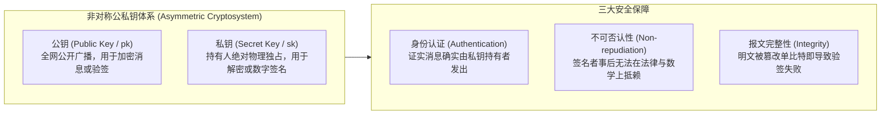
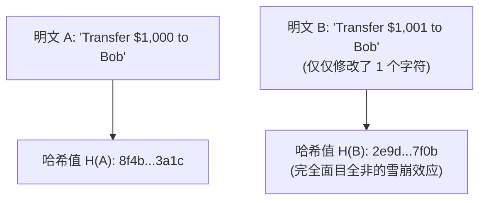
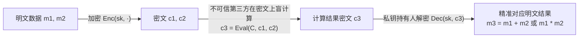
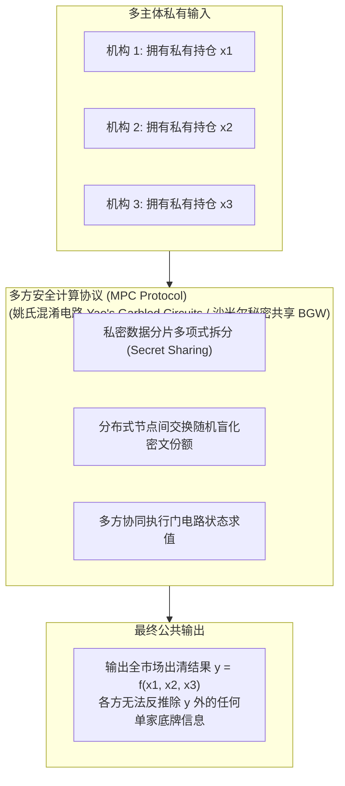
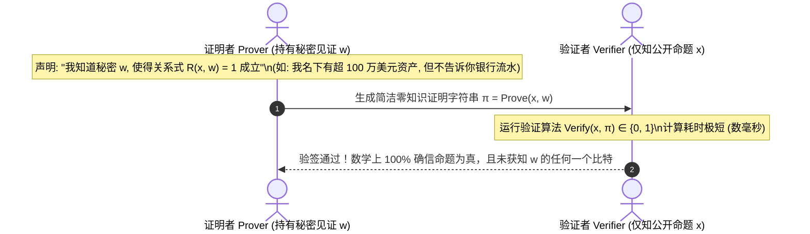

# Lec 9 现代加密学核心概念与原语（Modern Encryption: Key Concepts）

> **授课教师**：Robert M. Townsend（MIT 经济学系 Killian 讲席教授）  
> **长标题**：公钥与私钥、编码报文、哈希函数、密码学难题、全同态加密、多方安全计算与零知识证明（Public and Private Keys, Encoded Messages, Hashes, Cryptographic Puzzles, Fully Homomorphic Encryption, Multiparty Computation, Zero Knowledge Proofs）  
> **核心文献**：Ran Canetti, Amos Fiat, and Yannai A. Gonczarowski (2023), *"Zero-Knowledge Mechanisms"*; Craig Gentry (2009), *"Fully Homomorphic Encryption Using Ideal Lattices"*; Ronald L. Rivest, Adi Shamir, and Leonard Adleman (1978), *"A Method for Obtaining Digital Signatures and Public-Key Cryptosystems"*.

## TL;DR

- 现代密码学建立在柯克霍夫原则之上：算法与密文完全公开，系统的安全性完全依赖私钥的数学单向陷门。
- 密码学哈希函数提供抗碰撞性与雪崩效应，默克尔树以对数复杂度实现去中心化大数据的轻量级存在性证明。
- 全同态加密（FHE）支持在密文上直接进行加法与乘法运算，无需解密即可将计算任务外包给不可信的云端或区块链。
- 零知识证明（ZKP）与多方安全计算（MPC）使多方主体能够在完全不泄露私有估值与财务隐私的前提下协同出清市场。

## 现代密码学的基石：从秘密通信到契约承诺

在金融系统设计的第三大支柱中，**加密学（Encryption）**并非仅仅是保护黑客攻击的防御工具，而是构建不可违约契约与保护私有信息的核心数学基础设施。

现代加密学与古代密码学（如凯撒移位密码）存在根本性的范式跃迁：

::: definition 柯克霍夫原则（Kerckhoffs's Principle）
一个密码系统的安全性，**绝不能依赖于算法本身或传输密文的保密（Security through Obscurity）**。即使算法细节、数学方程、源码与所有截获的密文完全对全世界公开发布，只要唯一的**私钥（Private Key）**未被泄露，系统在计算复杂度意义上就必须是坚不可摧的。
:::

### 单向陷门函数（Trapdoor One-Way Functions）

公私钥体系之所以能够成立，仰赖于计算复杂性理论中的**单向陷门函数**：
- **正向计算极其容易**：已知输入 $x$，计算 $y = f(x)$ 只需多项式时间；
- **反向求逆极其困难**：已知输出 $y$，在没有额外提示时求 $x = f^{-1}(y)$ 在多项式时间内计算不可行（如大整数质因数分解困难性 RSA、椭圆曲线离散对数困难性 ECDSA）；
- **陷门存在性**：一旦掌握特定的辅助信息（即私钥/陷门 $k$），反向求逆 $x = f_k^{-1}(y)$ 瞬间退化为极低复杂度的确定性计算。

## 密码学哈希函数与默克尔树

密码学哈希函数（Cryptographic Hash Function）将任意长度的二进制明文数据串 $M \in \{0, 1\}^*$ 映射为固定长度的哈希值 $h \in \{0, 1\}^k$（如 SHA-256 映射为 256 比特）。

### 优秀哈希函数的四大安全准则

1. **单向抗原像性（Pre-image Resistance）**：给定任意哈希值 $h$，寻找任何明文 $m$ 满足 $H(m) = h$ 在计算上不可行（暴力枚举复杂度为 $\mathcal{O}(2^k)$）；
2. **抗第二原像性（Second Pre-image Resistance）**：给定固定明文 $m_1$，寻找不同的明文 $m_2 \neq m_1$ 满足 $H(m_1) = H(m_2)$ 在计算上不可行；
3. **强抗碰撞性（Collision Resistance）**：寻找任意两个不相同的明文对 $(m_1, m_2)$ 满足 $H(m_1) = H(m_2)$ 在计算上不可行（基于生日悖论，攻击复杂度约为 $\mathcal{O}(2^{k/2})$）；
4. **雪崩扩散效应（Avalanche Effect / Diffusion）**：原始明文发生单个比特的微小翻转，输出哈希值中平均超过 50% 的比特位发生无规律剧烈突变，杜绝任何渐进拟合猜测。

::: example 默克尔树（Merkle Tree）与对数复杂度验证
在包含 $2^{20} \approx 100$ 万笔交易的巨型区块中，若要向一台手机轻节点证明第 543,210 笔交易确实已被全网确认：
- 传统方法需要下载整块 100 万笔交易（数百 MB 流量）；
- 利用默克尔树，节点只需从服务器下载沿树向上攀爬的 $20$ 个对数兄弟节点哈希值（仅 $20 \times 32 = 640$ 字节！）；
- 本地经过 20 次哈希迭代计算，若结果与区块头的默克尔根严格匹配，即可在万分之一秒内以数学确定性确信该交易的有效性。
:::

## 全同态加密（Fully Homomorphic Encryption, FHE）

传统加密技术面临严重的“计算悖论”：数据一旦加密变成密文，就如同一本被铁锁锁死的天书；如果想要让计算机对数据进行分析、统计或运行智能合约，必须**先用私钥将数据解密为明文**。然而，解密意味着云端服务器或区块链矿工能够完全窥探企业的商业机密与用户隐私。

克雷格·金特里（Craig Gentry, 2009）利用理想格密码学（Ideal Lattices）打破了这一百年困局，发明了**全同态加密（FHE）**。

::: definition 全同态加密形式化性质
设 $(\text{KeyGen}, \text{Enc}, \text{Dec}, \text{Eval})$ 为密码方案。对于明文空间上的加法群与乘法环运算，存在对应的密文同态加法算子 $\oplus$ 与密文同态乘法算子 $\otimes$：
$$\text{Dec}_{sk}(\text{Enc}_{pk}(m_1) \oplus \text{Enc}_{pk}(m_2)) = m_1 + m_2$$
$$\text{Dec}_{sk}(\text{Enc}_{pk}(m_1) \otimes \text{Enc}_{pk}(m_2)) = m_1 \times m_2$$
由于任何经典计算机程序（包括图灵机算法与智能合约）都可以被布尔逻辑门完全分解为**异或门（加法）**与**与门（乘法）**的组合，因此 FHE 理论上允许在**完全不解密的前提下，对密文执行任意复杂的图灵完备程序计算**！
:::

## 多方安全计算（Secure Multi-Party Computation, MPC）

在许多跨机构金融业务中，各方并不希望将数据委托给任何单一云端，而是希望在**互不信任的多家机构之间协同计算**。

姚期智（Andrew Yao, 1982）提出的“百万富翁问题”开创了多方安全计算（MPC）：两位富翁想在不透露各自具体财富数额的前提下，比较谁比谁更富有。

::: definition 沙米尔门限秘密共享（Shamir's $(k, n)$ Threshold Secret Sharing）
为了将主权秘密 $S$ 分散托管在 $n$ 个互不信任的节点中，并在任意 $k$ 个节点联合时即可恢复秘密（但少于 $k$ 个节点时绝对无法获取关于 $S$ 的任何有效信息）：
1. 在有限域 $\mathbb{F}_p$ 上随机选取一个 $k-1$ 次多项式：
   $$f(x) = S + a_1 x + a_2 x^2 + \dots + a_{k-1} x^{k-1} \pmod p$$
   其中常数项 $f(0) = S$ 即为秘密原像；
2. 将 $n$ 个不同的评估点分片 $s_i = (i, f(i))$ 分别派发给 $n$ 个参与节点；
3. **拉格朗日多项式插值重构**：任意集齐 $k$ 个分片的节点集合可以通过插值唯一重构 $f(x)$ 并计算 $f(0) = S$；而任意 $k-1$ 个分片在数学上等可能对应域中的任何一个秘密，信息论安全（Information-Theoretically Secure）。
:::

## 零知识证明（Zero-Knowledge Proofs, ZKP）

零知识证明（Goldwasser, Micali & Rackoff, 1985）是现代密码学中最令人叹为观止的理论杰作。它允许证明者（Prover）向验证者（Verifier）确凿证实某个命题是正确的，而验证者在此过程中**得不到任何关于该命题真实证据的额外信息**。

### 零知识证明的三大公理级性质

1. **完备性（Completeness）**：若公开命题为真且证明者诚实拥有有效见证 $w$，验证者以概率 1 必然接受证明；
2. **可靠性/健全性（Soundness）**：若公开命题为假，任何心怀叵测的作恶证明者，即便拥有无限算力，能够伪造出让验证者接受的虚假证明的概率是微不足道的（Negligible Probability）；
3. **零知识性（Zero-Knowledge）**：验证者在交互中获取的全部信息序列，可以被一个根本不知道秘密 $w$ 的模拟器（Simulator）完美随机生成，这意味着验证者没有吸收任何属于秘密的有效信息。

::: theorem 简洁非交互式零知识论证（zk-SNARKs 与 zk-STARKs）
在去中心化账本中广泛应用的 zk-SNARKs（Succinct Non-interactive ARguments of Knowledge）通过算术电路化（R1CS / PLONK），将复杂的交易逻辑转化为多项式可除性判定：
- **简洁性（Succinctness）**：生成的证明 $\pi$ 长度通常只有几百字节；
- **非交互性（Non-interactive）**：无需证明者与验证者在线往复对话，通过 Fiat-Shamir 变换一次性生成并嵌入区块链上供全网任何人永久即时校验；
- **验证高速性**：验证计算耗时与原始被证明程序的计算复杂度完全解耦，仅需几个配对群双线性映射（Bilinear Pairings）运算，成本极低。
:::

## 我的理解与洞见

::: insight
现代加密原语（FHE、MPC、ZKP）的成熟，正在彻底重写微观经济学契约理论与信息经济学的底层假设。

在半个世纪以前，阿克洛夫（George Akerlof）讨论旧车市场柠檬困境、斯彭斯（Michael Spence）讨论劳动力市场信号发送、罗斯柴尔德与斯蒂格利茨（Rothschild-Stiglitz）讨论保险市场逆向选择时，**他们都不得不假定：‘消除信息不对称的唯一途径，就是逼迫拥有私有信息的一方在现实中脱下底裤、把机密账本或私人文凭赤裸裸地公开展示’**。这种展示在现实中极其痛苦且充满商业泄密风险（比如企业不敢向银行展示所有客户名单以防被中介撬走客户）。

**零知识证明与同态加密的本质，是人类历史上第一次在数学上实现了‘信息的确证性’与‘信息的保密性’的完美解耦**。

借款人可以向智能合约证明自己完全符合偿付能力指标，而无需向任何机构泄露自己的现金流明细；跨国银行可以在 MPC 网络中联合计算系统性风险敞口，而无需让对手方窥视自己的资产负债表底牌。**密码学不再是简单的安全补丁，它成为了在保护绝对商业主权的前提下消除一切信息摩擦的‘经济学圣杯’**。
:::

## 常见认知误区与概念混淆

::: pitfall
- **混淆“哈希函数的不可逆”与“绝对无法破解”**：哈希函数是不可逆的单向函数，但不代表其输出是完全防破解的。如果明文的可能取值空间极小（例如只有“是”或“否”、或者仅为一个 6 位纯数字密码），攻击者可以通过彩虹表（Rainbow Table）对全空间进行预先哈希比对，瞬间还原明文。防范该风险必须引入足够的随机盐（Salt）与混淆熵。
- **误以为“零知识证明只需要极少计算算力”**：验证 zk-SNARK 证明的计算量确实极其轻量（毫秒级、消耗极低 Gas）；但**生成证明（Prover Time）需要消耗极其庞大的内存与矩阵傅里叶变换（FFT/MSM）算力**。在当前工程实践中，在手机或网页端直接生成复杂的 ZK 证明往往会导致发热卡顿，通常需要通过可信执行环境（TEE）或专用硬件加速芯片分步外包。
:::

## 核心参考文献与材料链接

- **密码学机制前沿**：Ran Canetti, Amos Fiat, and Yannai A. Gonczarowski (2023), [“Zero-Knowledge Mechanisms”](https://arxiv.org/abs/2104.09506), *FOCS & arXiv*.
- **全同态加密奠基**：Craig Gentry (2009), [“Fully Homomorphic Encryption Using Ideal Lattices”](https://crypto.stanford.edu/craig/craig-thesis.pdf), *STOC*, ACM.
- **零知识证明开创性文献**：Shafi Goldwasser, Silvio Micali, and Charles Rackoff (1985), [“The Knowledge Complexity of Interactive Proof-Systems”](https://dl.acm.org/doi/10.1145/22145.22178), *SIAM Journal on Computing*.
- **秘密共享经典论文**：Adi Shamir (1979), [“How to Share a Secret”](https://dl.acm.org/doi/10.1145/359168.359176), *Communications of the ACM*, 22(11): 612–613.
- **官方公开课视频**：[MIT OCW Lecture 9 on YouTube](https://www.youtube.com/watch?v=Fj4yX8n5Tss)
