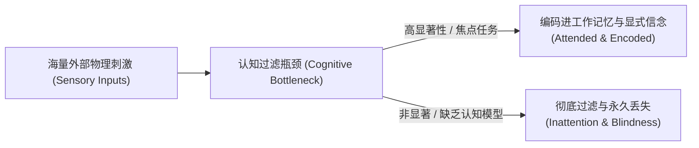
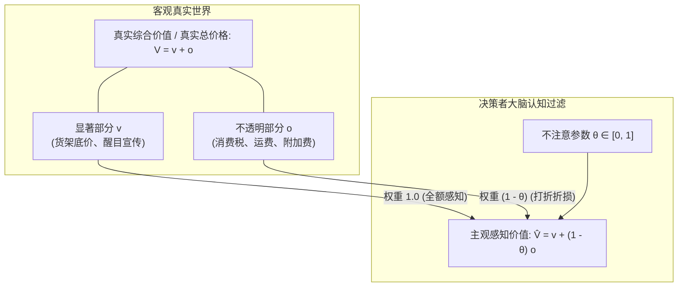
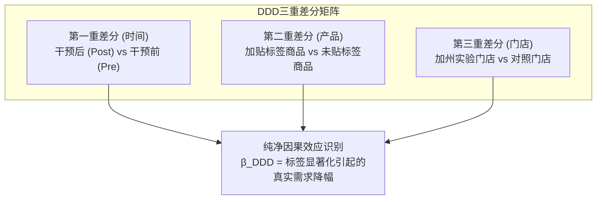
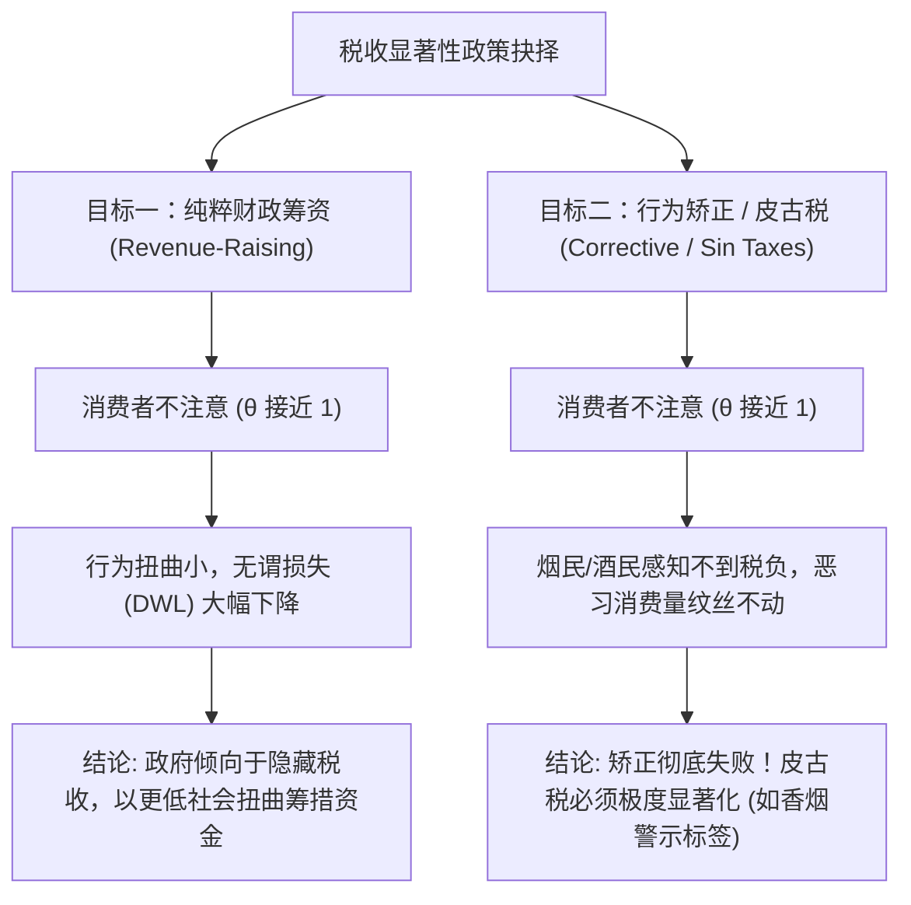
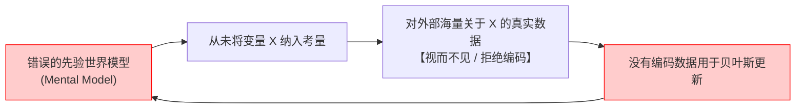
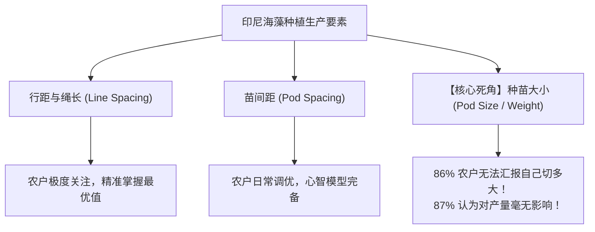
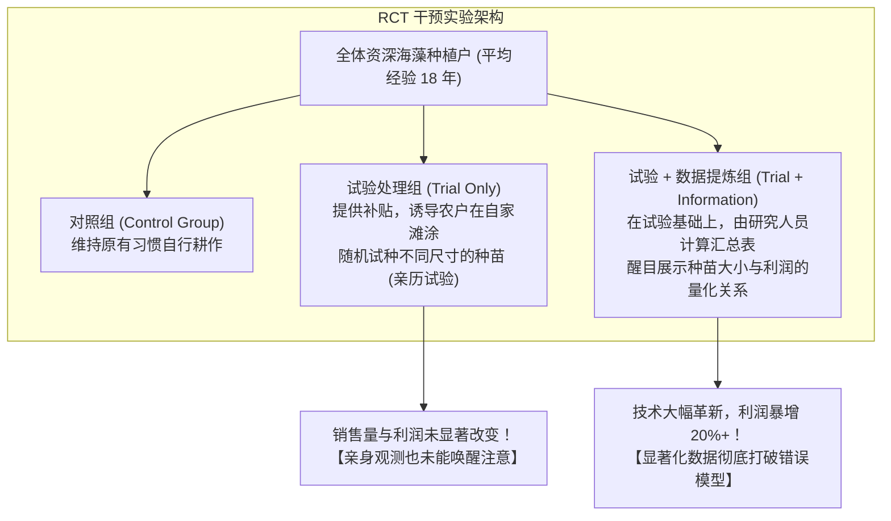

# Lec 14 有限的注意力

回顾上半学期的历程，我们几乎把全部心力倾注在人类偏好的研究上：

1. **时间偏好（Time Preferences）**：我们打破了 Samuelson 指数贴现模型，构建了拟双曲贴现 $\beta-\delta$ 框架，推导了天真型、老练型与部分天真型的主体决策，探讨了截止日自控、发薪日效应以及信用卡诱惑利率；
2. **风险偏好（Risk Preferences）**：我们证明了期望效用理论（EUT）在面对小额风险时的致命坍塌（Rabin 校准定理），建立了 Kahneman-Tversky 前景理论，剖析了损失厌恶、反射效应与 Kőszegi-Rabin 参照依赖；
3. **社会偏好（Social Preferences）**：我们探讨了独裁者博弈、最后通牒博弈、信任博弈与公共品自愿提供，解构了人类对纯粹利他、分配不平等厌恶（Fehr-Schmidt 模型）以及意图互惠的深刻追求。

从今天开始，我们将正式进入课程的第二大核心支柱——**信息与信念（*Information and Beliefs*）**。

在标准新古典微观经济学中，关于“信息”的处理方式极其简单粗暴：

- 理论假定：人们拥有完全信息；或者假定人们是无所不能的贝叶斯推断机器（Perfect Bayesian Updaters）；
- 面对任何新的证据，人们不仅掌握世界上所有可用的数据，而且能够零摩擦、零计算成本地反解后验概率。

然而在现实世界中，人类决策面临的第一道物理屏障不是缺乏偏好，而是**有限注意力（Limited Attention）**。

大家每天被多少条手机弹窗通知轰炸？大家在看文献、做微积分推导时，能同时听清周围人在聊什么吗？为什么超市里许多明显不划算的包装能够畅销无阻？为什么华尔街最精明的交易员会对早已公开的重大医学专利视而不见？

这就是我们今天与下节课的主题：

1. 人类注意力的心理学与神经生物学局限；
2. 经济学家如何将“有限注意力”形式化为一个优雅且可检验的数学模型？
3. Chetty, Looney & Kroft (2009, AER)：税收显著性与超市三重差分实验；
4. Hanna, Mullainathan & Schwartzstein (2014, QJE)：在拥有长达 18 年经验且数据完全免费的环境中，为什么人类依然无法“从经验中学习”？

## TL;DR

- **人类认知的物理限制**：注意力不是无限充裕的超级计算机，而是具有极强漏斗约束的稀缺资源。心理学上的“变化盲视”、“大猩猩视盲”和“双耳分听”揭示了我们对绝大多数未经显著化的环境刺激视而不见；
- **大额金融市场的印证**：EntreMed 的真实历史告诉我们，即便是公开透明的科学突破，也唯有在获得头版头条的“显著性包装”之后，才能激荡起数百亿美元的资本浪潮；
- **DellaVigna (2009) 理论基准**：$$\hat{V} = v + (1 - \theta) o$$
  通过将主观价值拆解为显性与隐性维度，我们为行为公共财政学奠定了微观数理基础；
- **Chetty et al. (2009) 税收显著性**：超市现场标签实验证实 $\theta \approx 0.75$，宏观啤酒面板证实 $\theta \approx 0.94$。这一发现颠覆了传统税制设计：筹资型税收的不注意有助于缩减无谓损失，但矫正型皮古税（Sin Taxes）若不显著化则完全形同虚设；
- **Hanna et al. (2014) 学习与注意力的死锁**：经验不能自动熨平无知！Schwartzstein 的认知模型揭示了“**模型决定注意，注意决定编码，编码决定更新**”的闭环。印尼海藻农户的悲剧向我们证明：缺乏正确的概念模型，18 年的真金白银经验也无法教会人们优化关键生产要素。

## 认知心理学实验基石：注意力的物理瓶颈

在经济学家涉足注意力研究之前，认知心理学家在过去半个世纪中完成了一系列震撼人心的实证检验。



### 1. 变化盲视（*Change Blindness*）

最著名的现场实验之一来自 Simons & Levin (1998)：

- 实验人员假扮成一名迷路的行人，在康奈尔大学校园里拦住不知情的过路人问路；
- 在两人正对着地图交谈的过程中，两名搬运工人抬着一扇巨大的木质门板，极其粗暴地直接从问路者与受试者中间横穿过去；
- 就在门板遮挡视线的短短一秒钟内，原本的问路者迅速蹲下躲在门板后撤离，换成了另一名身高、体型、发型、衣着甚至嗓音完全不同的实验员继续发问；
- **惊人结果**：超过 50% 的受试者完全没有察觉到眼前的谈话对象已经换了一个人！他们若无其事地继续给完全不同的人指路。
- 类似实验在快餐柜台后也得到了完全一致的复现：顾客低头掏钱包签字的一瞬间，柜台服务员蹲下换成了另一个人站起来递上托盘，大多数顾客对此毫无知觉。

### 2. 无意视盲（*Inattentional Blindness*）

Simons & Chabris (1999) 的传球实验是心理学史上引用率最高的经典实验之一：

- 受试者被要求观看一段短视频：两支球队（一组穿白衣服，一组穿黑衣服）在一个狭小的房间内互相传篮球；
- 教授或实验员给受试者下达一个极其明确的认知任务：“**请高度专注于白队队员，在心里准确计算他们传球的总次数（包括空中传球与击地传球）**”；
- 视频播放到中途，一个身高近两米、身穿全身大猩猩毛皮玩偶服的人大摇大摆地走进画面正中央，面对镜头站立，用力用双手捶打自己的胸口，然后转身缓缓走出画面，整个过程持续了整整 9 秒钟；
- 视频结束后，当实验员询问：“你们数出了多少次传球？”大多数人给出了准确的数字；
- 但当被问及：“**在这个过程中，你们有没有发现任何异常？比如有没有看到一只大猩猩？**”
- 全场实测统计：整整 50% 的正常成年人坚决否认看到任何大猩猩，甚至认为实验员在故意开玩笑戏弄他们！直到将视频重放并不分配数数任务时，他们才目瞪口呆。
- **机制解释**：人类大脑的视觉与意识处理系统存在着极其严密的选择性滤网。当你把宝贵的认知带宽全部配置给“白队传球”这个维度时，所有不符合这一维度的输入都会被低层感知系统静默丢弃，根本无法穿透并进入显式意识。

### 3. 双耳分听实验

Colin Cherry (1953) 与 Donald Broadbent (1958) 设计的双耳分听范式：

- 给受试者佩戴立体声耳机，左右两只耳朵同时播放两段完全不同且独立的语音文本（例如左耳播放政治演讲，右耳播放童话故事）；
- 要求受试者进行“跟读任务（Shadowing）”：必须实时、无延迟地把左耳听到的每一个单词大声朗读出来；
- 实验结束后测试受试者对右耳（非注意耳）内容的记忆：
  - 受试者能够分辨右耳的声音是人类嗓音还是蜂鸣噪音，也能分辨说话者是男性还是女性；
  - 但对于右耳讲述的内容、语言从英语切换成德语、甚至将同一段音频倒放，受试者完全一无所知！
  - 认知负荷一旦被主任务占满，非注意通道的语义信息将遭遇断崖式湮灭。

### 4. 注意力的动态损耗与环境侵蚀

**注意力不仅总量有限，而且极度脆弱。**

- 物理环境与感官剥夺：噪音、极端高温、空气污染会严重剥夺工作记忆容量；
- 现代数字技术分心：智能手机、社交媒体推送通知不断制造任务切换成本。大家在图书馆复习时，只要手机屏幕每隔 5 分钟亮一下，你深度思考的连续性就被彻底撕裂；
- 贫困与稀缺性心智（*Scarcity Mindset*）：在课程第 21 讲中，我们将详细研读 Mani et al. (2013) 发表在《Science》上的重磅研究。当一个极度贫困的人每天为了下一顿饭的口粮、为了下个月的房租账单焦虑得夜不能寐时，这种财务压力会像大猩猩实验中的传球任务一样，强行占满他绝大部分的认知带宽，导致他在智商测试、农业生产决策或子女教育规划上表现出相当于整整一整夜没睡觉的认知能力骤降。

## 高风险金融市场实证

**学生提问（Alex）**：“教授，这些心理学实验很有趣，但它们大多发生在实验室或日常琐事中。在真实的大额经济市场（比如华尔街股票市场）里，有千亿美元的资金在博弈，有成千上万年薪百万的分析师、高频算法和对冲基金在紧盯每一个信息源。在那种环境下，哪怕散户注意力有限，机构的套利机制（Arbitrage）难道不会迅速把注意力不足的偏差熨平（*Smooth out*）吗？”

教授的回答：“熨斗”烫不平。 下面是一个具体实例。

**真实事件的戏剧性全貌**

- **研究背景**：1997 年底，哈佛医学院儿童医院著名的 Judah Folkman 博士团队在实验室中发现，两种名为血管抑素（Angiostatin）和内皮抑素（Endostatin）的蛋白质能够通过切断肿瘤血管供应，彻底萎缩实验室老鼠体内的多种恶性肿瘤。拥有该药物商业开发独家授权的公司是一家名为 **EntreMed（纳斯达克代码：ENMD）** 的小型生物制药企业。
- **第一次信息发布（1997 年 11 月 27 日）**：
  - 顶级学术期刊《Nature》正式发表了该突破性研究论文；
  - 同一天，《纽约时报》在报纸内页不起眼的 **第 A28 版**（科技版角落）刊登了一篇关于该发现的客观报道；
  - **市场反应**：当天 EntreMed 股价从 \$11.88 适度上涨至 \$15.25，成交量有所放大，但在随后的两三个月内，股价平稳回落至 \$12 左右。
  - **新古典金融学判定**：在半强有效市场假说（Semi-Strong Form EMH）下，该重大科学发现已经成为公共信息（Public Information），被所有专业投资者完全知晓并定入资产价格中。
- **第二次“信息发布”（1998 年 5 月 3 日，星期天）**：
  - 距离《Nature》论文发表整整过去 5 个月后，《纽约时报》在周日版的**头版头条（Front Page）**刊登了一篇长篇报道，标题极具冲击力，引用了诺贝尔奖得主詹姆斯·沃森（James Watson，DNA 双螺旋发现者之一）的极度乐观言论：“Judah Folkman 将在两年内攻克癌症！”；
  - **关键事实核查**：这篇报道中**没有包含任何哪怕一丁点新的科学实验进展或临床试验数据**！报道全文引述的全部是 1997 年 11 月那篇《Nature》论文中已经披露的老鼠实验结果！
- **震撼全球的资本狂欢（1998 年 5 月 4 日，星期一）**：
  - 星期一上午美股开盘，EntreMed 股价从前一交易日收盘的 \$12.06 **直接暴拉至 \$85.00**！开盘涨幅超过 **700%**！
  - 当天最终收盘于 \$51.81，单日成交量高达创纪录的 **4400 万股**（此前该股票日均成交量仅为几万股）；
  - 更夸张的是，这种非理性狂热甚至扩散到了全行业：其他从事类似肿瘤血管研究、但根本没有该药物授权的生物科技公司，股价在当天也普遍暴涨 30% 至 50%；
- **泡沫崩溃（1998 年 11 月 12 日）**：
  - 半年后，《华尔街日报》在头版披露，其他独立的科学实验室在重复试验中未能成功复现 Folkman 博士在老鼠身上的神奇疗效；
  - 消息一出，EntreMed 股价单日暴跌 24%，并在随后数月内一路阴跌打回原形。

同样的一份客观科学事实，在 1997 年 11 月作为内页 A28 版报道时，几乎没有激起任何波澜；而到了 1998 年 5 月，仅仅因为被搬到了《纽约时报》周日头版，配上了极具显著性的排版和吸睛标题，居然能凭空创造数十亿美元的市值变动！

这向我们血淋淋地证明：**信息的可获得性（Availability）绝对不等于信息的显著性（Salience）**。即使在以高智商、高算力和巨额利益驱动著称的公开资本市场上，注意力的分配也是极度不均匀的。

**延伸现实案例：同名乌龙代码 Zoom (ZOOM vs. ZM)**  
2020 年初新冠疫情暴发，视频会议软件 Zoom Video Communications 业绩井喷。散户投资者在手机炒股 App 上蜂拥买入，但由于注意力涣散且未仔细甄别代码，大量资金疯狂涌入了一家早已停止实质运营、注册在场外的微型破壳公司 **Zoom Technologies（代码：ZOOM）**，使其股价在几周内暴涨逾 1800%！而真正的视频会议巨头 Zoom 的官方交易代码其实是 **ZM**。美国证监会（SEC）不得不紧急对代码为 ZOOM 的壳公司实施停牌干预。

## 有限注意力的微观理论基准模型

作为严谨的经济学者，我们不能仅仅停留在讲述有趣的心理学案例。我们需要把这种“对部分属性的忽视”写进经济主体的效用最大化问题中。 Stefano DellaVigna 在其 2009 年发表于《Journal of Economic Literature》的综述巨著中，，提出了一个极其通用、优雅且富有实证操作性的理论模型。

### 1. 价值分解与感知价值

假设一个经济主体正在评估一个商品或行动方案。该方案的**真实客观总价值（True Value）** $V$ 可以被自然拆解为两部分：
$$V = v + o$$
其中：

- $v$：**显著属性（Visible / Salient Component）**。例如摆在货架上加粗放大的标价、汽车的裸车售价、手机的月租基础费；
- $o$：**不透明 / 隐性属性（Opaque / Non-Salient Component）**。例如结账时才加征的消费税、网购结算时才弹出的物流运费、打印机极其昂贵的替换墨盒、银行卡隐藏的跨行取现手续费。



在新古典框架下，理性人毫无疑问会计算 $\hat{V} = V = v + o$。但在现实中，由于认知瓶颈，决策者的**主观感知价值（Perceived Value）**表示为：
$$\mathbf{\hat{V}(v, o) = v + (1 - \theta) o}$$

这里，$\theta \in [0, 1]$ 是我们整个理论的核心参数——**不注意参数（Inattention Parameter）**：

- **基准情况一：$\theta = 0$（完全理性 / 充分注意）**： $$\hat{V} = v + (1 - 0)o = v + o = V$$
  决策者对隐性维度给予了与显性维度完全一致的权重，完全符合新古典传统理性人假设；
- **极端情况二：$\theta = 1$（完全忽视 / 彻底盲目）**：$$\hat{V} = v + (1 - 1)o = v$$，
  决策者对隐性维度视而不见，其消费决策完全只由货架上的显著价格 $v$ 驱动；
- **现实常态：$0 < \theta < 1$（部分不注意 / 认知阻尼）**：决策者隐约知道存在税收或额外费用，但在大脑快速权衡时对这部分成本进行了严重折价。

### 2. 价格与税收形式化表述及弹性推导

现在我们将该模型引入具体的消费与税收情境中：

- 设某种商品的税前货架标价为 $p$；
- 法律规定的从价销售税率为 $t$（在结账时以乘数 $(1+t)$ 结算）；
- 商品的真实含税总价格为 $P = p(1+t)$。为了对数线性化的数学简便，我们将其近似写为 $P \approx p + t$（在税率较低时极为精确）；
- 决策者所面临的感知价格 $\hat{P}$ 为：
  $$\mathbf{\hat{P}(p, t) = p + (1 - \theta) t}$$

设消费者的真实需求函数由感知价格决定：$Q = D(\hat{P}) = D(p + (1 - \theta) t)$。

现在，我们分别推导需求量对“显著货架价格 $p$”与对“非显著税率 $t$”的响应弹性：

1. **需求的价格弹性（Price Elasticity）**：$$\eta_{D, p} = \frac{\partial \log D}{\partial \log p} = \frac{p}{D} \cdot \frac{\partial D}{\partial \hat{P}} \cdot \frac{\partial \hat{P}}{\partial p} = \frac{p}{D} \cdot D'(\hat{P}) \cdot 1$$
2. **需求对税率的弹性（Tax Elasticity）**：$$\eta_{D, 1+t} = \frac{\partial \log D}{\partial \log(1+t)} \approx \frac{\partial \log D}{\partial t} = \frac{1}{D} \cdot \frac{\partial D}{\partial \hat{P}} \cdot \frac{\partial \hat{P}}{\partial t} = \frac{1}{D} \cdot D'(\hat{P}) \cdot (1 - \theta)$$

对比上述两式，立即得到一个极其关键的对偶比值关系：$$\mathbf{\frac{\partial \log D / \partial \log(1+t)}{\partial \log D / \partial \log p} = 1 - \theta}$$

将 $\theta$ 移项反解出来： $$\mathbf{\theta = 1 - \frac{\eta_{D, 1+t}}{\eta_{D, p}}}$$

这个公式的经济学美感在于：

- **如果新古典理性假设成立（$\theta = 0$）**：由于消费者只在乎自己口袋里最终被掏走了多少钱，消费者对“货架标价上涨 1%”与对“结账税率上涨 1%”的反应应当**完全一模一样**，即 $\eta_{D, 1+t} = \eta_{D, p}$；
- **如果存在有限注意力（$\theta > 0$）**：消费者对隐藏在账单背后的税率变动将表现得极为迟钝（$\eta_{D, 1+t} < \eta_{D, p}$）。我们只需在实证数据中同时测出这两个弹性，就能直接识别出人类心智中的不注意参数 $\theta$！

### 3. 实证支柱——消费者对销售税的有限注意力

如何检验上面的理论？Raj Chetty、Adam Looney 与 Kory Kroft 于 2009 年在《美国经济评论》（AER）上发表的论文《Salience and Taxation: Theory and Evidence》，堪称公共财政与行为经济学跨界融合的世纪经典。

```text
常规货架标签 (默认现状):
+-------------------------------------+
|  Crest 3D 美白牙膏                   |
|  $4.99                             |
+-------------------------------------+
(消费者结账时需在柜台额外加付 7.375% 销售税，总计 $5.36)

处理组实验货架标签 (干预干预):
+-------------------------------------+
|  Crest 3D 美白牙膏                   |
|  $4.99  + 销售税 $0.37              |
|  含税总价: $5.36                    |
+-------------------------------------+
```

#### 制度背景：美国的消费税 vs 销售税

在美国的商品流通过程中，存在两种机制完全不同的税种：

1. **销售税（Sales Tax）**：绝大多数日用百货征收的税种（各州税率通常在 4%~9% 不等）。法律和行业惯例规定，货架标价只显示税前净价，销售税在收银机扫描商品后才被系统自动计算并加总。这意味着税收在决策瞬间是非显著的（Opaque / Non-Salient）；
2. **特定消费税（Excise Tax）**：针对烟草、酒精、汽油等特定商品征收的消费税。法律规定这部分税款必须预先计入货架标价中。这意味着税收在决策瞬间是高度显著的。

这种天然的制度差异为经济学家提供了绝佳的研究温床。

#### 超市田野实验：三重差分设计

Chetty 和合作者们与北加州一家拥有巨型客流量的连锁超市合作，开展了一项持续 3 周的现场实验。

#### 实验干预设计

- 挑选了该超市中的 **750 种应税个人护理用品**（洗发水、化妆品、止汗露、护肤品等）；
- 在处理周期内，研究人员将这些商品原本只写有税前价格的普通价签，更换为特别制作的“**显著含税标签**”；
- 新标签不仅用大号字体标明税前价格（如 \$4.99），还在下方清晰、醒目地写明：“+ 销售税 \$0.37 = **最终含税总价 \$5.36**”。
- 该干预在物理上没有改变商品的任何实质售价，唯一的改变是**将决策瞬间的不注意参数强制压低至 $\theta \to 0$**！

#### 计量识别策略：三重差分

为了排除季节性波动、促销活动、店面客流等一切潜在混杂因素，作者构建了精妙的“三重差分”架构：

1. **第一重差分（时间维度）**：干预后周次（Post）对比干预前周次（Pre）；
2. **第二重差分（产品维度）**：同一家超市内部受处理的个护商品（Treated Category）对比隔壁货架不受处理的对照类目商品（Control Category）；
3. **第三重差分（门店维度）**：实施标签更换的目标实验门店（Treated Store）对比同链条下地理位置与客群结构相近的 2 家控制门店。



##### 计量模型设定

$$Y_{cst} = \alpha + \beta_1 (\text{TreatedStore}_s \times \text{TreatedCat}_c \times \text{Post}_t) + \mathbf{X}_{cst}\gamma + \varepsilon_{cst}$$， 其中 $Y_{cst}$ 为门店 $s$ 中商品类别 $c$ 在时间 $t$ 的平均周销售量。

##### 实验结果与参数反解

1. **真实需求变动**：在贴上含税总价标签后，处理组商品的平均周销售量显著下降了 **2.20 单位**（销售量基准约为 25 单位），降幅达到惊人的 **8.8%**（$p < 0.01$）！
2. **反解不注意参数 $\theta$**：
   - 当地的法定销售税率为 $t = 7.375\%$；
   - 根据历史价格变动数据，估计出的常规价格弹性为 $\eta_{D, p} = 1.59$；
   - 如果消费者此前对销售税完全充分注意（$\theta = 0$），将已经知晓的含税价格写在标签上，对需求的影响应当为 0；
   - 结合需求对数线性模型：
     $$\Delta \log Q \approx -\theta \cdot t \cdot \eta_{D, p}$$
     代入真实数据：
     $$-0.088 \approx -\theta \times 0.07375 \times 1.59$$
     $$\mathbf{\hat{\theta} \approx \frac{0.088}{0.07375 \times 1.59} \approx 0.75}$$

**核心结论**：在普通超市购物环境中，消费者在货架前做出决策时，对隐性销售税的注意力权重仅有约 $1 - 0.75 = 0.25$。换言之，**消费者对每 1 美元的非显著销售税，主观上仅仅感知到了 25 美分**！

---

### 4. 跨州非实验面板数据：啤酒消费税 vs 销售税

为了验证上述结论是否具有外部有效性，Chetty 等人利用 1970 至 2003 年美国各州啤酒消费与税率变动的超大型长面板数据进行了二次检验。

- **显著的特定税（Excise Tax）**：由联邦和州政府按每加仑啤酒定额征收，直接计入啤酒零售标价；
- **不显著的通用销售税（Sales Tax）**：按商品零售额比例结账时征收。

#### 实证估计结果对比

| 变量指标            | 显著的啤酒消费税（Excise Tax）    | 不透明的通用销售税（Sales Tax） |
| :------------------ | :-------------------------------- | :------------------------------ |
| **税收显著度**      | 极高（直接体现在货架标价中）      | 极低（收银台结账附加）          |
| **需求弹性 $\eta$** | **$-0.88$**（$t$ 统计量显著为负） | **$-0.03$**（与 0 无显著差异）  |

根据我们的反解理论公式：
$$\hat{\theta} = 1 - \frac{\eta_{D, \text{sales}}}{\eta_{D, \text{excise}}} = 1 - \frac{-0.03}{-0.88} \approx \mathbf{0.94}$$

在长达 30 年的大样本宏观真实消费数据中，消费者对非显著销售税的不注意参数高达 **0.94**——这表明，绝大多数人在买啤酒时，其行为表现与完全忽视（$\theta = 1$）几乎别无二致！

---

### 5. 深度政策探讨：公共财政视角下，税收显著性的双刃剑效应

现在请大家思考一个公共经济学中极其深奥的问题：作为政府政策制定者，税收究竟是越显著越好，还是越隐蔽越好？



维度一：纯粹筹资型税收（Revenue-Raising Taxes）

- 根据经典公共财政理论（如 Ramsey 税收法则），税收征收之所以会带来**无谓损失（Deadweight Loss / Excess Burden）**，是因为税收扭曲了相对价格，使得消费者改变了原本最优的消费选择（比如因为税高而被迫减少工作或放弃消费自己偏好的商品）；
- **如果消费者对税收是不注意的（Inattentive）**：
  消费者面对税收不会大幅减少消费（需求无弹性），税收对真实经济行为的扭曲反而大大降低！
- **惊人推论**：为了最小化全社会的效率损失，政府在征税时似乎应当故意让税收变得极其不透明！通过隐藏税款，既能把钱收到国库，又不会引发过度扭曲。

维度二：矫正型皮古税（Pigouvian Taxes on Sin Goods）

> **课堂互动（Maya）**：“教授，但有些税收的目的根本不是为了收钱，而是为了阻止人们做坏事，比如烟草税、碳税、含糖饮料税！”

**Frank Schilbach 教授**：Maya 说得一针见血！

- 对于具有负外部性（Externalities，如二手烟、酒驾撞人、碳排放污染）或内部性（Internalities，现时偏差导致的自我伤害、暴饮暴食、早逝）的“罪恶品（Sin Goods）”；
- 政府征税的核心目的**根本不是充盈国库，而是强行改变消费者的行为模式，使其压减消费量**！
- 如果你对香烟征收了极高的皮古税，但烟民在柜台买烟时因为税收不显著而根本感知不到价格上涨，那么香烟销量将丝毫不减，负外部性与健康悲剧将继续上演！
- **政策铁律**：**所有具有矫正性质的税收，必须被赋予最高的显著性！** 这就是为什么世界各国政府要求香烟包装盒上必须印制巨幅腐烂肺部照片、标明高昂税负，并且必须将税收直接打入货架单价中。

维度三：穷人与富人的异质性困境（José 的提问）

> **学生提问（José）**：“如果穷人和富人的注意力分配不同怎么办？穷人会不会因为每一分钱都很珍贵而算得很清楚？”

**Frank Schilbach 教授**：这是一个极具前沿价值的研究课题。

- 一方面，根据价格敏感性，穷人更需要精打细算；
- 但另一方面，正如下节课与第 21 讲将讨论的，穷人承受着极其沉重的生活认知负荷，在超市算心算税率的脑力极其稀缺。如果非显著税收让低收入家庭在收银台前遭遇意外预算超支，这将导致严重的不公平与福利折损。

## 认知理论深化：为什么经验无法消除不注意？

**Frank Schilbach 教授**：现在我们来到本节课最激动人心的理论反思。传统芝加哥学派经济学家在读完 Chetty 的论文后，往往会提出第二道防线：

**经典质疑**：“好吧，在超市里买洗发水，消费者不注意税收，是因为每单涉及的金额只有几毛钱，为了几十美分花费脑力去心算是不理性的（Rational Inattention）。但是，如果一项决策对个人的生计至关重要，如果错误的注意力分配会让人损失惨重，并且一个人在一生中每天都在重复这一生产活动长达数十年——难道在长期试错和经验积累下，人们还学不会注意最重要的信息吗？”

换句话说：**长期的市场经验与学习机制（Learning），难道无法彻底消灭注意力不足吗**？

### 1. 理性疏忽理论的盲区

由诺贝尔奖得主 Christopher Sims 开创的“理性疏忽”框架认为：

- 人类就像一个拥有固定信道容量的香农信息接收机；
- 人们清楚地知道世界上存在哪些变量及其潜在回报，人们在最优边际条件下选择配置注意力：“因为这道菜对我健康不重要，所以我理性地选择不看它”。

但这个理论有一个致命的前提假设：决策者已经预先拥有了关于外部世界的“正确模型（Correct Model of the World）”！

如果你根本连“这个变量可能很重要”的概念都没有，你又如何能“理性地计算其信息价值并决定是否配置注意力”呢？



### 2. 生动的医学生活隐喻

- **头痛与食物过敏**：假设你经常饱受偏头痛的折磨。你去看医生，医生问你：“每次头痛是不是在吃了某种特定食物（比如含有麸质的面包或奶酪）之后加重的？”你的回答大概率是：“医生，我完全不知道！”
  为什么不知道？你明明活了 20 多年，每天吃三顿饭，每天都有关于“吃了什么”和“是否头痛”的丰富数据。数据是完全免费且唾手可得的！
  原因在于：**在医生提出这个假说之前，你的大脑中根本没有‘食物成分会导致头痛’这个心智模型！** 你每天虽然吞下了食物，但你从未把“吃了什么”和“头痛”在记忆中进行关联编码。数据从你眼前流过，但没有留下任何痕迹。
- **产褥热与洗手历史悲剧（Semmelweis 案例）**：在 19 世纪中叶的维也纳总医院，大量健康的产妇在入院分娩后死于产褥热（Childbed Fever）。当时的医学泰斗们提出了无数光怪陆离的理论：医院空气中的恶臭瘴气（Miasma）、产妇由于男医生在场而羞愧受惊导致的神经衰竭。真正的致死原因其实简单得令人发指：**医生们在刚刚解剖完腐烂尸体后，手都没洗就直接去给产妇接生，将致命病菌直接带入了产妇体内！**
  当时的医生们明明每天都在记录死亡率，甚至有些注重个人整洁的医生无意中洗了手，其接生病房的死亡率显著偏低。为什么长达几十年无人发现这一规律？因为在人类发现微生物与细菌之前，医生的“世界模型”中根本不存在“肉眼看不见的微小细菌能致死”这个概念。没有人把“洗手与否”作为一个变量去记录，因此几万条产妇的生命数据也无法让他们自发“学到”正确的医学知识！

---

### 3. 选择性注意力与信念模型

Josh Schwartzstein（哈佛大学教授，MIT 博士校友）在 2014 年发表于《Journal of Political Economy》上的经典论文《Selective Attention and Learning》，用严密的数学刻画了这一认知锁定机制：

1. **认知闭环方程**：
   $$\mathbf{\text{今日信念 (Beliefs}_t\text{)}} \implies \mathbf{\text{今日注意力与编码 (Attention}_t\text{)}} \implies \mathbf{\text{明日信念更新 (Beliefs}_{t+1}\text{)}}$$
2. **机制剖析**：
   - 决策者只对自己**主观认为重要的维度**进行注意力分配和信息编码；
   - 如果一个人的先验信念认为变量 $X$ 对生产函数毫无影响（先验概率 $P(\text{Impact of } X) = 0$），那么在每一期的日常生产中，大脑将自动将关于 $X$ 的所有观测信号当作噪音过滤掉；
   - 由于关于 $X$ 的历史数据从未被记录在工作记忆或笔记本中，未来的贝叶斯更新根本无从发生！
   - **核心推论**：如果一个人的世界模型从一开始就是错误的，无限充裕的免费数据也无法让他纠正错误！有限注意力可以产生任意巨大的永久性福利损失。

---

## 实证支柱二——印尼海藻种植户的田野实验

为了在最硬核的现实生产环境中实证检验 Schwartzstein 的理论，Rema Hanna、Sendhil Mullainathan 和 Josh Schwartzstein 远赴印度尼西亚巴厘岛附近的努沙佩尼达岛（Nusa Penida），完成了一项极具震撼力的田野实验——**《Learning through Noticing: Theory and Evidence from a Field Experiment》**。



### 1. 为什么选择印尼海藻养殖（Seaweed Farming）？

这是一个绝佳的经济学实验室：

- **生产极具重要性**：海藻养殖是当地数万农户家庭唯一的现金收入来源，关乎一家老小的温饱，绝非无所谓的零花钱；
- **经验极其深厚**：参与实验的农户平均从事海藻种植长达 **18 年**！他们绝非新手，而是世代相传的老农；
- **文化素养高**：当地农户绝大多数具备良好的读写和基础算术能力（Literacy Rate > 80%）；
- **生产流程高度模块化与高频重复**：
  - 农户在浅海滩涂打下木桩；
  - 在木桩之间拉上绳索；
  - 将上一季收获的成熟海藻切成小块（称为**种苗 / Pods**）；
  - 将这些种苗按照一定的间隔绑在绳索上，浸泡在海水中自然生长；
  - 生产周期极短，每 30 至 40 天就能完整收获一轮！
  - 这意味着每位农户一生中至少经历了 **150 到 200 轮完整的生产周期**，经手了成千上万个海藻种苗。

### 2. 基线调查中的震撼发现：不可思议的认知死角

研究团队派遣调查员对所有养殖户进行了详尽的基线生产方式勘测：

1. **关于绳索长度与行距（Line Spacing）**：
   农户们对答如流！他们能极其精确地报出自己拉了多长的绳子、两根绳子之间隔了多少厘米，并且他们的回答与农技专家的最优推荐值完全吻合。他们日常不仅严格测量，还会主动根据潮汐微调；
2. **关于种苗大小（Pod Size / Weight）**：
   - 当调查员询问：“**请问你平时下种时，切下来的海藻种苗平均有多重？**”
     **整整 86% 的资深农户目瞪口呆，坦言自己从未称过，根本不知道有多大！**
   - 当调查员追问：“**那么按照你的经验，把种苗切得大一点还是小一点，哪种能获得最高利润？最优的种苗重量是多少？**”
     **整整 87% 的农户完全无法回答，甚至普遍认为种苗大小对最终产量‘毫无影响’！**

在长达 18 年的摸爬滚打中，农户们的大脑模型中只容纳了“绳长”和“行距”，而把“种苗切割大小”彻底当成了无关痛痒的生产副产品。

### 3. 实验干预设计与组别划分

研究团队决定设计一个两阶段的随机对照田野实验（RCT）：



- **组别一：纯对照组（Control）**：维持原有种植习惯不变；
- **组别二：亲身试验组（Trial Only）**：
  - 研究人员提供实验物资和资金补偿，诱导农户在自家的浅海滩涂划出一块专用试验田；
  - 强制要求农户按照随机分配的不同种苗重量（例如大苗、中苗、小苗）进行并排试种；
  - **核心设计意图**：传统经济学认为，农户之所以不知道，是因为没有做过对比实验。现在研究团队出资让你在自己地里亲身做了实验，农户每天看着不同大小的苗生长、收获、称重，**拥有了完全的第一手客观数据**！
- **组别三：试验 + 显著信息提炼组（Trial + Summarized Information）**：
  - 农户同样完成上述试验；
  - 但在试验收获后，研究人员不仅帮农户记录数据，还把试验结果制作成一张**极其简单、醒目的对比小卡片**，上面清晰计算并写明：“根据您地里的实测，种苗重量为 150g 时，每米绳索的净产出比 80g 种苗高出整整 35%，扣除种苗成本后纯利润增加 XX 卢比”！

### 4. 实验结果：没有显著化，经验一文不值！

| 实验处理组别                          | 对农户后续种植行为的改变             | 海藻总产量与净利润的提升幅度 |
| :------------------------------------ | :----------------------------------- | :--------------------------- |
| **纯亲身试验组（Trial Only）**        | **无统计显著改变（约等于 0）**       | **未发生显著提升**           |
| **试验 + 数据提炼组（Trial + Info）** | **绝大多数农户迅速将种苗调整至最优** | **总收益暴增 20% 以上！**    |

#### 实证发现的深刻理论震撼

1. **亲身经历并未带来主动学习**：
   在“纯亲身试验组”中，农户们虽然亲手切了不同大小的苗，亲手将它们绑在绳子上，并亲手收割了它们。但因为在他们的先验世界模型中“种苗大小是无关紧要的”，**他们根本没有将收获的重量差异归因于种苗大小**（他们误以为是某根绳子位置更好、水流更顺、阳光更充足）；
2. **显著化的信息卡片创造了奇迹**：
   农户们完全具备理解算术的能力。当外生干预强行把他们涣散的注意力拉回到“种苗大小”这一维度，并将因果关系黑字白纸呈现出来时，他们才恍然大悟！
3. **安慰剂检验（Placebo Check）**：
   对于农户原本就已经高度留意的维度（如绳索间距），研究团队提供的数据汇总卡片**没有产生任何行为改变**。因为在这些维度上，农户的大脑模型早已处于最优状态。

**Frank Schilbach 教授**：请大家记住这篇论文的标题——**《Learning through Noticing》**！你不注意的事情，你永远学不会。哪怕你拥有全世界最完备的数据库、哪怕你在该行业深耕了半辈子，如果你的先验认知模型存在盲区，海量的数据对你来说就只是一堆静止的背景噪音。

## 下节预告

在下节课（Lecture 15）中，我们将继续沿着信念系统这一宏大主题深入探索：

- 当人们对“自己未来的偏好”产生注意力与认知偏差时，会发生什么？我们将探讨**投射偏差（Projection Bias）**（为什么饿肚子时去超市会买下整整一推车多余的食物？为什么在下雪天人们会蜂拥购买四驱敞篷车并在夏天后悔？）；
- 以及人们如何从“持有某种特定信念”中直接榨取效用——**信念效用与自欺欺人（Belief Utility and Self-Deception）**。

## 参考文献与拓展阅读

1. **DellaVigna, Stefano (2009)**. "Psychology and Economics: Evidence from the Field." *Journal of Economic Literature*, 47(2): 315-372.
2. **Huberman, Gur, and Tomer Regev (2001)**. "Contagious Speculation and a Cure for Cancer: A Tale of Two News Stories." *The Journal of Finance*, 56(1): 387-396.
3. **Chetty, Raj, Adam Looney, and Kory Kroft (2009)**. "Salience and Taxation: Theory and Evidence." *American Economic Review*, 99(4): 1145-1177.
4. **Hanna, Rema, Sendhil Mullainathan, and Joshua Schwartzstein (2014)**. "Learning through Noticing: Theory and Evidence from a Field Experiment." *The Quarterly Journal of Economics*, 129(3): 1311-1353.
5. **Schwartzstein, Joshua (2014)**. "Selective Attention and Learning." *Journal of Political Economy*, 122(6): 1423-1452.
6. **Simons, Daniel J., and Christopher F. Chabris (1999)**. "Gorillas in Our Midst: Sustained Inattentional Blindness for Dynamic Events." *Perception*, 28(9): 1059-1074.
7. **Simons, Daniel J., and Daniel T. Levin (1998)**. "Failure to Detect Changes to People during a Real-World Interaction." *Psychonomic Bulletin & Review*, 5(4): 644-649.
