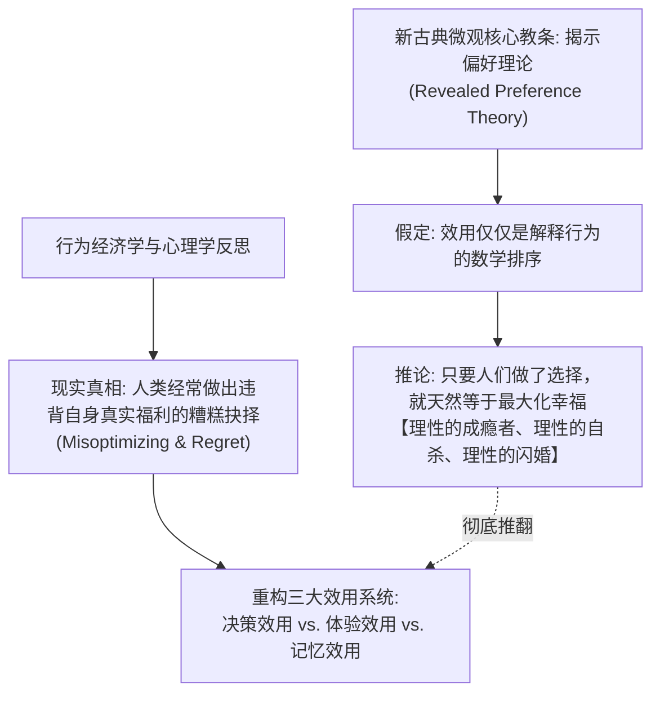
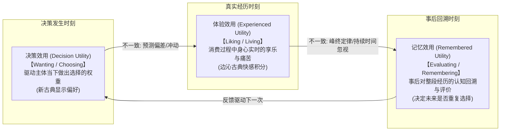
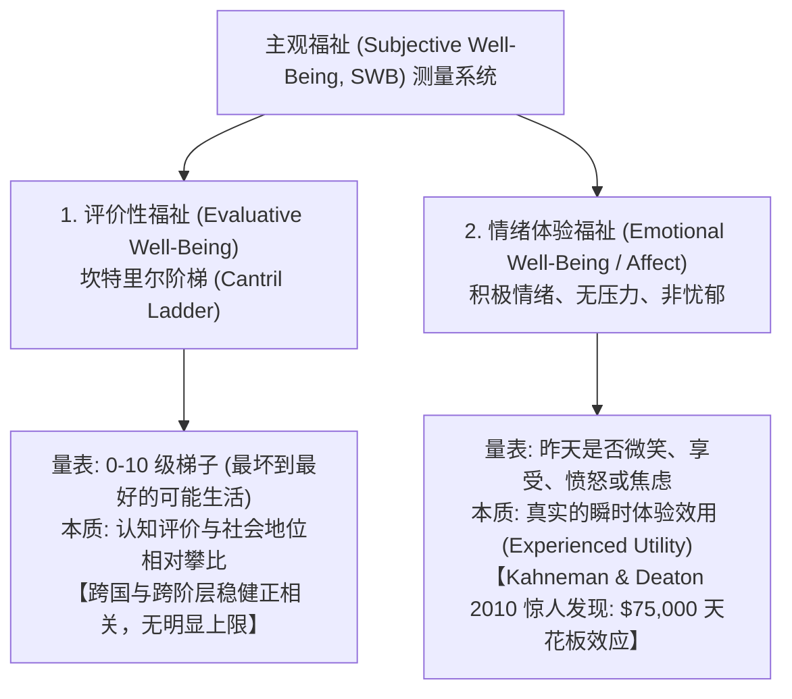
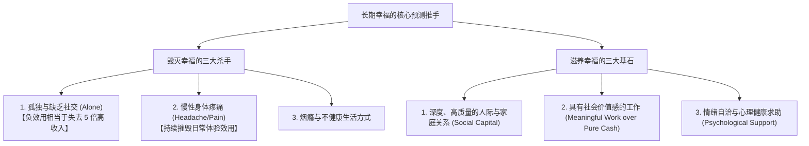
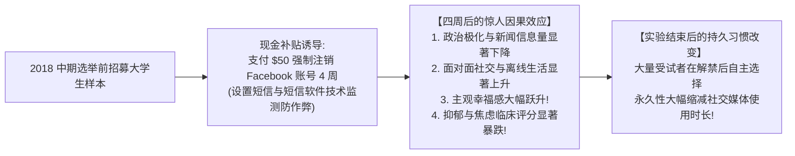

# Lec 22 幸福与心理健康

## TL;DR

- 区分决策效用（选择时展现出的预期）与体验效用（经历时实际产生的感受）。
- 峰终定律（Peak-End Rule）表明记忆评价受制于体验的最强点和结尾，而非持续时间的积分。
- 梳理主观幸福感（SWB）的测量维度：生活满意度、即时情绪与生活意义感。
- 探讨心理健康对劳动生产率、决策质量的深远影响，主张将心理干预作为关键经济政策。

## 理性选择能否等同于福祉最大化？

今天我们将探讨一个处于经济学核心、但长期被正统新古典理论避而不谈的课题——**幸福与心理健康（Happiness and Mental Health）**。



### 1. 新古典微观中的“理性”神话与成瘾悖论

在正统经济学（如 14.01、14.03）中，“理性” 被赋予了一个极其技术化、甚至略带诡辩色彩的定义：

- 只要信念、偏好与行为之间保持逻辑上的互洽（Mutually Consistent），经济学家就能写出一个效用函数 $u(x)$ 来解释这一行为；
- 一旦写出效用函数，经济学家就会顺理成章地给这个函数赋予规范性含义（Normative Meaning）：“既然你选择了选项 A，说明 A 能让你更幸福！”
- **荒谬的极端推论**：著名经济学家 Gary Becker 和 Kevin Murphy 在 1988 年发表了轰动一时的《理性的成瘾理论》（*A Theory of Rational Addiction*）；在他们的模型中，一个骨瘦如柴、家破人亡的可卡因吸毒者 Jack，每一针注射都是经过深思熟虑的完全跨期理性选择！如果 Jack 嘴上天天喊着“我想戒毒”，但在行动上依然去买毒品，新古典理论会冷酷地判定：“想戒毒只是廉价口嗨；买毒品才是真实的揭示偏好。因为戒断反应的痛苦超过了吸毒的危害，所以吸毒对他而言就是最优解！除非他抢劫他人产生负外部性，否则政府绝不该禁止毒品！”

### 2. 人们真的在最大化自身福祉吗？

大家在经历了一整个学期的拟双曲贴现、现时偏差、投射偏差和注意力不足之后，真的相信吸毒者、冲动消费破产者是在最大化自己的长远幸福吗？心理学家 Nisbett & Wilson (1977) 早在半个世纪前就证明：**人类根本不清楚自己为什么做出某些决定**。

如果我们在超市货架上把商品换个顺序、如果我们在发卷前让你写下身份证的后两位进行锚定，你的选择就会发生翻天覆地的剧变；如果一个小小的锚点就能操纵你的“选择”，我们凭什么坚信这些选择真实反映了你的内在幸福？

## Kahneman 的效用三元论：决策、体验与记忆

为了彻底厘清理性选择与真实福祉的裂隙，2002 年诺贝尔经济学奖得主丹尼尔·卡尼曼（Daniel Kahneman）提出了具有划时代意义的“效用三元论”：



### 1. 核心概念辨析

1. **决策效用（Decision Utility）**：
   - 概念：在做出选择的那一刻，主观权衡并决定行动方向的效用（Wanting）；
   - 对应新古典正统：这就是你在微观经济学考卷上求导最大化的 $U(x)$；
2. **体验效用（Experienced Utility）**：
   - 概念：在真实消费该商品或经历该事件的每一个切片瞬间，大脑感觉皮层与情绪系统所实时体验到的快乐与痛苦（Liking）；
   - 溯源：直接回归杰里米·边沁（Jeremy Bentham）的功利主义原意——“痛苦与快乐的净流量”；
3. **记忆效用（Remembered Utility）**：
   - 概念：在一段经历彻底结束之后，大脑在事后回忆、加工并固化下来的主观评价（Remembering）。**至关重要的是：人类下一次做决策时，依赖的不是客观的体验效用，而是带有严重系统性偏差的记忆效用！**

### 2. 体验效用的物理测量手段

经济学家如何摆脱对主观问卷的依赖，直接捕捉客观的“体验效用”？

- **生态瞬时评估法（Ecological Momentary Assessment, EMA）**：通过智能手机随机弹出提醒，要求受试者实时汇报当下正在做的事以及 0-10 分的快乐度，消除事后回忆滤镜；
- **生理自主神经测量（Autonomic Measures）**：心率变异性（HRV）、皮肤电反应（GSR，出汗程度测谎）、血压波动；
- **神经科学成像（fMRI / EEG）**：大脑伏隔核（Nucleus Accumbens，奖赏中枢）的多巴胺激活 vs 杏仁核（Amygdala，恐惧中枢）的神经放电；
- **微表情分析（Facial Action Coding System, FACS）**：测量杜氏笑容（Duchenne Smile，眼轮匝肌收缩的真笑）与肌肉紧绷。

---

## 三、记忆效用两大铁律：持续时间忽视与峰终定律

**Frank Schilbach 教授**：为什么“体验效用”与“记忆效用”会出现灾难性的脱节？

按照微观数学逻辑，如果一个人在时间区间 $[0, T]$ 内经历了连续的痛苦函数 $p(t) \ge 0$，那么这段经历的客观总痛苦应该严格等于微积分积分：
$$\text{Total Pain}_{\text{Objective}} = \int_0^T p(t) \, dt$$
时间 $T$ 越长，总痛苦必然单调递增（Monotonicity Axiom）。然而，Kahneman 等人的大量实验表明，人类大脑的记忆引擎根本不做微积分积分！它只遵循粗暴的**峰终定律（Peak-End Rule）**与**持续时间忽视（Duration Neglect）**。

$$\mathbf{\text{Remembered Pain} \approx \frac{\text{Pain}_{\text{Peak}} + \text{Pain}_{\text{End}}}{2}}$$

### 1. 经典冷水浸泡实验（Cold Pressor Task, Schreiber & Kahneman 1993）

- **短试次（Short Trial）**：受试者将手伸入 14°C 的冰水中持续 **60 秒**，随后立刻拔出擦干；
- **长试次（Long Trial）**：受试者将手伸入 14°C 冰水中持续 **60 秒**；但在第 60 秒时，实验员悄悄向水槽中注入温水，使水温在接下来的 **30 秒** 内缓缓上升至 15°C（总时长 **90 秒**）。
- **客观物理事实**：15°C 的水依然令人极度难受，没有任何人会主动愿意把手泡进 15°C 水里。长试次包含了短试次的全部 60 秒折磨，**外加整整 30 秒额外的疼痛**！
- **震撼抉择**：当实验员要求受试者在两个试次中二选一进行重复时：
  **超过 65% 的受试者果断选择了总受苦时间长达 90 秒的“长试次”！**
- **微观机制剖析**：
  在短试次中，结束时水温是 14°C，记忆留下了最痛苦的定格；
  在长试次中，结束时水温回升到 15°C，大脑捕捉到了“正在变好”的信号。**结尾（End）的缓和彻底掩盖了持续时间（Duration）的延长！**

---

### 2. 真实临床应用：结肠镜检查（Redelmeier & Kahneman 1996）

- **医学背景**：早期的结肠镜检查没有深度麻醉，探头在肠道内移动会引发阵发性剧痛，许多患者因此抗拒复查，延误结直肠癌的早期发现；
- **实验操纵**：
  - 对照组：完成常规检查后立即拔出探头；
  - 处理组：完成检查后，医生**故意将探头静置在直肠内整整一分钟不动**，然后再缓缓拔出；
- **临床结果**：虽然检查总时间被无端延长了一分钟，但由于这一分钟内探头静止无痛，处理组患者对整场手术的回忆痛苦评分暴跌，**在随后的数年内，处理组患者定期回医院复查结肠镜的依从性提升了整整 50% 以上！**
- **启示**：在所有服务与体验设计中（从迪士尼排队到牙科就医），**结尾的体验权重千百倍于过程中的平淡时刻**。

---

## 四、主观福祉的测量：坎特里尔阶梯与 7.5 万美元收入之谜

**Frank Schilbach 教授**：当我们从局部的瞬时体验跳升到宏观的人生福祉时，经济学家和盖洛普（Gallup）通常使用两类截然不同的问卷工具：



### 1. 坎特里尔阶梯（Cantril Ladder）

- **提问方式**：“想象有一座从 0 到 10 级的梯子，0 级代表你所能想象的最糟糕生活，10 级代表最完美的生活。你觉得自己目前站在哪一级？”
- **特征**：唤醒的是**认知层面的生活满意度（Life Satisfaction）**。因为梯子天然具有阶级与等级隐喻，受访者在作答时，不可避免地会把自己与身边的同事、邻居进行**社会比较（Social Comparisons）**。

---

### 2. Kahneman & Deaton (2010, PNAS) 7.5 万美元收入天花板之谜

安格斯·迪顿（Angus Deaton，2015 诺奖得主）与卡尼曼利用盖洛普对 45 万名美国成年人的每日抽样调查，系统测算了收入对两类福祉的非线性冲击：

```text
主观福祉分值
  ^
  |                                   / [坎特里尔生活满意度阶梯 (持续上升)]
  |                                  /
  |                                 /
  |   -----------------------------+ [积极情绪与无压力天花板 (7.5 万美元见顶)]
  |  /
  | /
  |/
  +--------------------------------------> 家庭年收入 (对数尺度)
               $20k        $40k       $75k      $150k
```

#### 震撼的实证分流

1. **对于坎特里尔生活满意度阶梯（Cantril Ladder）**：
   随着年收入从 \$10,000 上升到 \$150,000 甚至更高，曲线呈现严格的对数线性单调递增！收入越高，人们在梯子上的自我评价越高，**不存在任何天花板（Ceiling Effect）**；
2. **对于积极情绪体验（Positive Affect / Stress-Free）**：
   - 当年收入在 **\$0 到 \$75,000** 之间时，每增加一万美元，贫穷带来的痛苦、焦虑和绝望都会被急剧驱散；
   - **一旦家庭年收入突破 \$75,000（相当于当时中产阶级上层门槛）**：
     曲线彻底变成了水平直线！
     **无论是赚 \$75,000、\$150,000 还是 \$300,000，人们每天微笑的频率、体验到的快乐以及免于日常压力的概率完全一样！**

**Frank Schilbach 教授**：这一发现极其深刻：
更多的金钱确实能让你在给人生打分时给出更高的数字（因为你买得起豪车豪宅，在与别人攀比中赢得了优越感）；
**但金钱在越过温饱与安全线后，几乎无法在神经生理层面让你在日常生活中的每一分钟活得更快乐！**

---

### 3. 反贫困项目对精神健康的因果证明（Ridley et al. 2020, Science）

- 很多保守派经济学家长期声称：“穷人之所以贫困，是因为他们本身具有懒惰或抑郁的气质（逆向因果）”；
- Matthew Ridley、Gautam Rao、Frank Schilbach 与 Vikram Patel 于 2020 年发表在《Science》上的重磅综述《Poverty, Depression, and Anxiety: Causal Evidence and Mechanisms》，汇集了全球数十个随机对照试验（RCT）：
  - **无条件现金转移支付（UCT）**（如 GiveDirectly 项目向非洲极贫农户直接打款 \$1,000）；
  - **因果结论**：纯粹的现金注入以极高的统计显著性大幅削减了抑郁症与焦虑症的临床筛查得分！**贫困本身就是摧毁人类心理健康与认知带宽的罪魁祸首。**

---

## 五、长期幸福的决定因素：盖洛普 45 万人超大样本回归

**Frank Schilbach 教授**：如果金钱在越过中产门槛后对日常情绪的边际效用趋近于零，那么在人类漫长的一生中，究竟什么才是决定幸福的真正推手？

研究人员利用盖洛普 45 万美国人的微观大样本，建立了一个以“高收入（年收入高于中位数）”为基准归一化（标准化系数设为 $1.0$）的横截面预测模型：

| 变量特征（是否具备该特征）    | 积极情绪（Positive Affect）相对预测权重 | 摆脱忧郁（Not Blue）相对预测权重 | 摆脱压力（Stress-Free）相对预测权重 | 坎特里尔阶梯分值相对预测权重 |
| :---------------------------- | :-------------------------------------: | :------------------------------: | :---------------------------------: | :--------------------------: |
| **高收入（基准锚点）**        |               **$1.00$**                |            **$1.00$**            |             **$1.00$**              |          **$1.00$**          |
| **年长者（Old Age）**         |                 $+1.33$                 |             $+1.89$              |               $+2.42$               |           $+0.12$            |
| **有宗教信仰（Religious）**   |                 $+1.16$                 |             $+0.85$              |               $-0.05$               |           $+0.28$            |
| **严重头痛/身体慢性疼痛**     |            $\mathbf{-4.12}$             |         $\mathbf{-4.63}$         |          $\mathbf{-3.87}$           |           $-1.15$            |
| **长期吸烟（Smoker）**        |                 $-0.95$                 |             $-1.21$              |               $-1.08$               |           $-0.62$            |
| **处于极度孤独状态（Alone）** |            $\mathbf{-4.89}$             |         $\mathbf{-5.12}$         |          $\mathbf{-2.98}$           |       $\mathbf{-1.76}$       |



### 1. 数据的震撼启示

1. **孤独是福祉的头号杀手（The Devastating Cost of Loneliness）**：
   在积极情绪与忧郁回归中，**“孤独一人（Alone）”的负面系数高达 $-4.89$ 到 $-5.12$！** 这意味着，孤独对日常幸福的摧毁力，相当于把一个高收入者打入贫困底层的整整 5 倍！
2. **慢性生理疼痛的破坏力**：
   头痛与慢性身体疼痛的负系数高达 $-4$ 以上。新古典模型往往忽视健康作为存量资产的折旧，而身体的不适会瞬间抵消一切物质享受；
3. **老龄化的幸福红利**：
   在控制健康状况后，老年人普遍比青年人展现出更低的生活压力与更高的积极情绪（心理学上的“社会情绪选择理论”：老年人更善于剔除无意义社交、专注当下温暖）。

---

### 2. 临终关怀病房的终极省思：人生五大遗憾

澳大利亚著名临终关怀护士布朗妮·维尔（Bronnie Ware）长期记录垂危病人在生命最后几周的真诚忏悔，提炼出了著名的《人生五大遗憾》（*Top 5 Regrets of the Dying*）：

1. *“我希望当初有勇气过属于自己的生活，而不是按别人的期望苟活”*；
2. *“**我希望我当初没有把那么多生命白白浪费在疯狂加班上（I wish I hadn't worked so hard）**”*；
3. *“我希望当初能有勇气勇敢表达自己的真实感受”*；
4. *“**我希望当初能一直与老朋友们保持联系、珍惜友谊（I wish I had stayed in touch with my friends）**”*；
5. *“我希望当初能让自己活得更快乐一点”*。

**Frank Schilbach 教授**：大家请看，在生命走到尽头的那一刻，**没有任何一个人在忏悔自己‘当年要是能再多做一次投行并购、多赚一百万美元就好了’！** 人们所有的刻骨遗憾，无一例外全是指向了被工作挤占的家庭时间、被疏远的朋友圈子以及被压抑的真实自我。

作为 MIT 顶尖的年轻人，大家未来面临着无数高薪金融机构与大厂的诱惑。追求财富无可厚非，但如果这份财富是以彻底摧毁身体健康、丧失亲密朋友、从事毫无社会意义的掠夺性工作为代价，从一生的生命周期效用来看，这无疑是一场彻底失败的投资！

---

## 六、社交媒体对心理健康的因果毒性：Facebook 戒断 RCT（Allcott et al. 2020）

**Frank Schilbach 教授**：在当代大学生的日常生活中，究竟是什么在系统性掠夺大家的注意力和幸福感？

Hunt Allcott、Luca Braghieri、Sarah Eichmeyer 和 Matthew Gentzkow 于 2020 年在顶级期刊《美国经济评论》（AER）上发表了一篇里程碑式的现场实验——**《The Welfare Effects of Social Media》**。



### 1. 实验设计与激励相容机制

- 在 2018 年美国高度极化的国会中期选举前夕，作者招募了数千名重度 Facebook 用户；
- **付费戒断机制**：通过反向竞价拍卖，平均向处理组用户支付约 **\$50** 美元，要求他们**彻底注销并停用 Facebook 账号整整 4 周**；
- 研究团队开发了自动化程序每日实时监测其账号状态，确保受试者没有违规登录。

---

### 2. 核心实验发现

1. **主观福祉的全面爆发**：
   仅仅戒断 Facebook 一个月，处理组大学生的主观生活满意度提升了 **$0.09$ 个标准差**，抑郁与焦虑临床指标改善了 **$0.12$ 个标准差**！这一改善幅度相当于传统心理咨询干预或抗抑郁药物治疗效果的近四分之一；
2. **政治偏见的降温**：
   社交媒体算法推送的愤怒煽动性内容被物理屏蔽，受试者的政治极化程度显著降低；
3. **强大的后验学习与戒断惯性**：
   当为期 4 周的实验结束、用户不再拿补贴时，处理组用户的 Facebook 日均使用时长**在数月内持续下降了 20% 以上**，相当一部分人选择永久注销！

**Frank Schilbach 教授**：为什么一个让人不快乐的产品，大家每天还要刷好几个小时？

- **现时偏差与自控崩溃**：拿起手机滑动屏幕带来的多巴胺刺激发生在当下（Immediate Gratification），而虚度光阴的自责发生在深夜；
- **社会比较的剧毒（Upward Social Comparison）**：每个人在朋友圈和 Instagram 上都只展示自己精修过的奢华旅行、米其林大餐和成功瞬间。天天浏览这些虚假的精装朋友圈，会让人产生严重的相对剥夺感，误以为全世界只有自己过得灰头土脸；
- **网络外部性的人质绑架**：当身边的所有同学都在通过群聊组织派对时，单方面退出的社交搜寻成本极高。

---

## 全课总结与人生行动倡议

**Frank Schilbach 教授**：让我们用几分钟时间，把今天这一讲关于幸福的实证发现，转化为每一位同学可以立刻执行的人生行动方案：

1. **破除新古典“显示偏好即幸福”的迷信**：
   你的决策效用（当下想要的）往往被算法、冲动和广告所绑架，它根本不代表你的体验效用。学会老练地审视自己的欲望；
2. **利用峰终定律优化你的关键经历**：
   在备考、旅行、演讲或约会时，精心设计一个温暖、放松的**结尾（End）**，它将在你的记忆中永久闪闪发光；
3. **坚决捍卫健康与深度社交资产**：
   如果一份高薪工作要求你每周工作 100 小时、牺牲运动、断绝与所有好朋友的联系，请清醒地认识到：哪怕它付给你 \$200,000，从你一生的福祉贴现流来看，这也是一笔彻底亏本的买卖；
4. **像对待体育教练一样对待心理支持**：寻求心理咨询绝不代表你患有严重的精神疾患。优秀的心理治疗师就像网球教练一样，能够帮你纠正扭曲的人生目标函数，教你如何老练地自洽与幸福；
5. **勇敢地进行自我小实验（Experimenting with Your Life）**：给自己设定一个小挑战：试着把手机上的社交软件卸载两周，试着每天早睡一小时，试着给久未联系的挚友手写一封感谢信。不要让默认选项与认知惯性偷走你本该灿烂的一生！

## 参考文献与拓展阅读

1. **Kahneman, Daniel, Peter P. Wakker, and Rakesh Sarin (1997)**. "Back to Bentham? Explorations of Experienced Utility." *The Quarterly Journal of Economics*, 112(2): 375-405.
2. **Kahneman, Daniel, and Angus Deaton (2010)**. "High Income Improves Evaluation of Life but Not Emotional Well-Being." *Proceedings of the National Academy of Sciences (PNAS)*, 107(38): 16489-16493.
3. **Schreiber, Charles A., and Daniel Kahneman (1993)**. "Determinants of the Retrospective Evaluation of Pain: The Peak-End Rule." *Journal of Personality and Social Psychology*, 65(1): 45-56.
4. **Redelmeier, Donald A., and Daniel Kahneman (1996)**. "Patients' Memories of Painful Medical Treatments: Real-Time and Retrospective Evaluations of Two Minimally Invasive Procedures." *Pain*, 66(1): 3-8.
5. **Allcott, Hunt, Luca Braghieri, Sarah Eichmeyer, and Matthew Gentzkow (2020)**. "The Welfare Effects of Social Media." *American Economic Review*, 110(3): 629-676.
6. **Ridley, Matthew, Gautam Rao, Frank Schilbach, and Vikram Patel (2020)**. "Poverty, Depression, and Anxiety: Causal Evidence and Mechanisms." *Science*, 370(6522): eaay0214.
7. **Becker, Gary S., and Kevin M. Murphy (1988)**. "A Theory of Rational Addiction." *Journal of Political Economy*, 96(4): 675-700.
