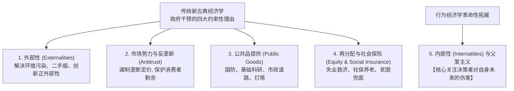
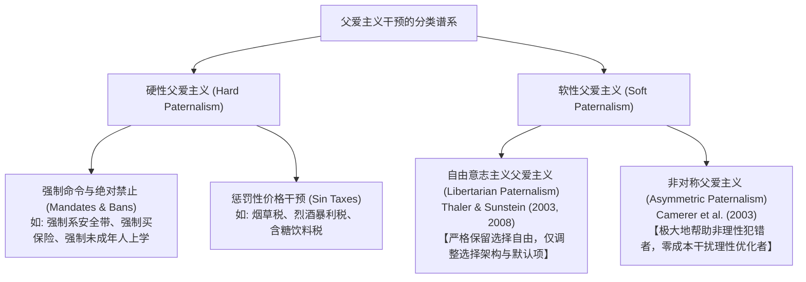
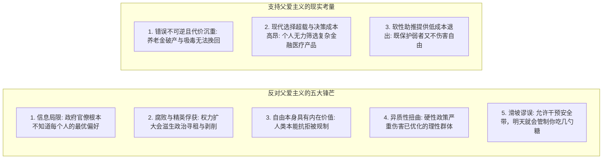
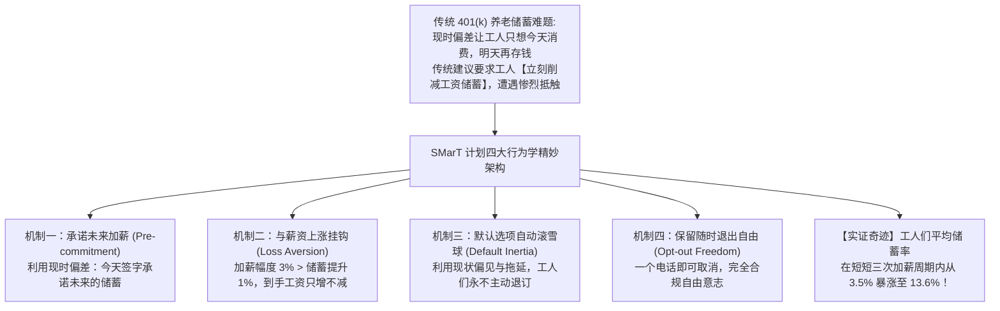
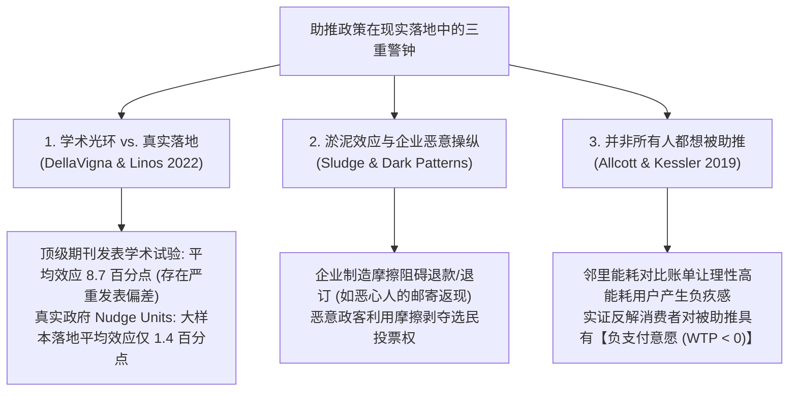
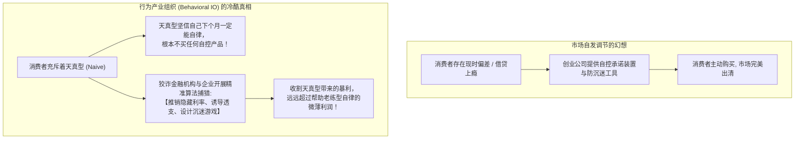

# Lec 23 行为主体的公共政策

> MIT 14.13 · Psychology and Economics · 主讲 Frank Schilbach

## TL;DR

- 核心命题：当现实世界中的经济主体充斥着有限理性、现时偏差与认知盲区时，政府干预的伦理边界在哪里？市场竞争究竟是在自发修复偏差，还是在变本加厉地收割消费者的弱点？
- 经典政策标杆：明日多储蓄计划
- 助推的局限、现实警钟与淤泥效应
- 市场能否自发解决偏差？现实中，企业最大的利润往往来自于**精准识别、引诱并收割天真型消费者**（如信用卡隐藏暴利、健身房天价年卡）；由于天真型主体从不认为自己需要帮助，帮助性契约的市场需求天然遭到窒息，呼唤监管机构的刚性介入。

## 政府干预个人选择的第五种理由：内部性

在深入行为政策之前，让我们先回到每一位 MIT 经济系本科生大一《微观经济学原理》（14.01）或中级微观（14.04）课堂上学到的底层基准：



在标准新古典理论中，自由市场在完全竞争和完备契约下是帕累托最优的（福利经济学第一定理）。政府被允许介入的合法性理由极其严苛：

1. **外部性**：主体行为对第三方造成了未通过价格体现的溢出效应（如钢厂排污损害下游居民健康、吸烟导致身边人吸二手烟）；
2. **反垄断与竞争政策**：当存在垄断者时，价格高于边际成本导致无谓损失（*Deadweight Loss*）；
3. **公共品**：非排他性与非竞争性导致私人市场搭便车、供给严重不足；
4. **宏观调控与再分配**：市场虽然追求效率，但无法保证分配公平。政府通过累进税、失业保险与社会保障网实现社会稳定。

**Frank Schilbach 教授**：大家请注意：在过去 200 年的正统微观经济学中，根本不存在“为了决策者自身的利益而阻止其做选择”的政策合法性空间！ 新古典假定，只要没有外部性，一个心智正常的成年人选择在沙发上吃一整天薯片、把全部积蓄买彩票输光，那也是他在完全理性下的效用最大化选择。而行为经济学彻底颠覆了这一底层神话——**内部性（*Internalities*）**横空出世！

> 什么是内部性？ 根源是什么？

**对偶类比**：

- *外部性*：个人决策强加给**外部社会他人**的未定价成本/收益；
- *内部性*：个人决策在当下强加给**自己未来的潜在自我（Future Self）**的未充分权衡的净损害/收益！

**机制根源**：由于现时偏差、**注意力有限**、**投射偏差**或**有偏信念**，决策者在当期的微观优化中，系统性低估了当下享乐在未来需要偿还的沉重代价。

### 父爱主义的精确定义

在日常语境中， 父爱主义（*Paternalism*，家长主义）常常带有一丝贬义，让人联想到专横的独裁管制。哈佛大学著名行为经济学家 David Laibson 给出了一个极其科学中立的学术定义：

::: definition **父爱主义（*Paternalism*, Laibson 定义）**
An attempt to influence or control people's conduct for their own good. In other words, when the motivation for the intervention is NOT about externalities.为了人们自身的利益而试图影响或控制其行为的干预尝试。换言之，政策干预的核心动机**绝非出于消除对外部第三方的外部性**
:::



### 硬性父爱主义 vs 软性父爱主义

**硬性父爱主义**：

- *特征*：实质性改变预算约束集合或商品相对价格，甚至直接剥夺合法选择权；
- *政策手段*：
  - **法律禁令**：禁止出售未通过 FDA 严格测试的药品、禁止重婚与一夫多妻、禁止特定毒品交易；
  - **强制命令**：强制汽车驾驶员佩戴安全带、强制骑摩托车戴头盔、剑桥市在疫情期间规定不戴口罩罚款 \$300、法律强制所有儿童接受义务教育；
  - **重税矫正（Sin Taxes）**：对香烟、烈酒、电子烟征收数倍于成本的消费税。

**软性父爱主义的两大旗帜**：

- 自由意志主义父爱主义：“自由意志主义”意味着完全保留选择自由，任何人只要愿意，可以极其低廉地选择退出（*Opt-out*）；“父爱主义”意味着选择架构必须做出善意设定**，引导主体做出最好的选择。
- 非对称父爱主义：政策设计追求一种极高的福利不对称性：$$\Delta W_{\text{Behavioral}} \gg 0 \quad \text{且} \quad \Delta W_{\text{Rational}} \approx 0$$。 设想人群中一半是容易拖延糊涂的行为主体，另一半是完全理性的精算师。一个优秀的非对称政策（如自动加入 401k 养老金）让糊涂主体免于晚年破产，而理性主体只需在电脑上点一下“退出”就能维持原状，全社会总福利纯增进。（Asymmetric Paternalism, Camerer, Issacharoff, Loewenstein, O'Donoghue & Rabin 2003）

## 反对与支持父爱主义的经典大论战

在公共政策领域，没有任何话题能像父爱主义这样引发如此激烈的哲学交锋。



### 1. 反对父爱主义的核心理由

1. **政府不是全知全能的上帝**：政府官僚同样是由会犯错、有偏见、注意力有限的人组成的。官僚怎么可能比个人更清楚“什么样的卡路里摄入”最适合某一位公民？
2. **监管俘获与政治寻租：一旦赋予政府以“为了你好”的名义审查商品的权力，大财团和行业协会就会蜂拥游说，利用父爱主义法案打压竞争对手、谋取私利；
3. **选择自由本身的效用价值（Intrinsic Value of Freedom）**：哪怕我的选择不是物质最优的，但“能够自主决定命运”本身就是人类尊严的核心组成部分；
4. **群体异质性引发的误伤**：人群中总有人是真正享受吸烟、能够完全内化风险的理智成年人。对香烟一刀切征收暴利税，实质上是对这一理性群体的纯粹福利掠夺；
5. **滑坡谬误（The Slippery Slope）**：如果政府今天能强制你骑车戴头盔，明天政府就能规定你每餐只能吃几克盐，后天就能规定你几点必须上床睡觉！

### 2. 支持父爱主义的现实底线

1. **人类在特定领域的系统性惨败**：在复利计算、养老金跨期配置、慢性病预防等复杂领域，人类认知漏洞百出；更糟糕的是，很多错误是不可逆的——当你 65 岁发现自己一分钱养老金都没有时，你已经没有机会重新活一次；
2. **委托代理与信息不对称的高额交易成本**：面对市场上成百上千种狡诈的理财欺诈与保险细则，让每一个普通人花费几个月自学金融微积分去识别陷阱是极度低效的；由监管机构直接剔除那些纯属欺诈的“劣质霸王条款”，具备巨大的社会规模经济；
3. **软性父爱主义化解了大部分攻击**：上述几乎所有反对声音针对的都是“硬性强制”；而以助推为代表的软性方案，既没有剥夺选择权，又保留了低成本退出通道，以极低的财政预算挽救了数以万计的家庭。

## 经典标杆案例：明日多储蓄计划

**Frank Schilbach 教授**：如何将行为经济学理论转化为世界级的公共政策？理查德·塞勒（Richard Thaler，2017 诺贝尔奖得主）与什洛莫·贝纳茨（Shlomo Benartzi）于 2004 年在《Journal of Political Economy》发表的经典之作——**《Save More Tomorrow™: Using Behavioral Economics to Increase Employee Saving》**，是整个行为经济学史上最璀璨的宝石。



### 1. 现实制度困境与传统方案的失败

- **制度背景**：在美国，传统由雇主统包的确定给付型养老金（DB 计划）被广泛由员工自主配置的 401(k) 计划（DC 计划）取代。工人们必须自己决定从每月工资中拿出百分之多少投入养老基金；
- **传统咨询方案的崩溃**：某大型制造企业聘请了顶尖的专业理财顾问，顾问与工人们一对一坐下来，做出了极其理性的数学推导：“为了保证退休后不挨饿，你们必须立刻把每月储蓄率从 3% 强行拔高到 10%！”
- **工人的本能反应**：这意味着工人下个月的到手支票立刻要缩水好几百美元！绝大多数工人以“手头太紧、下个月再说”为由断然拒绝。

### 2. SMarT 计划的四部曲行为学架构

塞勒和贝纳茨接手了这批被理财顾问放弃的“顽固不储蓄工人”，为他们量身定制了 SMarT 方案：

1. **拥抱现时偏差（Pre-commitment to Future Hikes）**：
   他们绝不要求工人“今天立刻省吃俭用”，而是走到工人面前说：“大家别紧张，今天一分钱都不用扣！我们只邀请大家签署一份协议：**在未来下一次全厂加薪的那一天，开始启动多储蓄**”；
   *心理学映射*：在双曲贴现 $\beta-\delta$ 模型下，工人今天的边际效用极高，但对未来的钱表现出极高的耐心。对于“未来的自我”，每个人都愿意扮演圣人！
2. **降维击碎损失厌恶（Sidestepping Loss Aversion）**：
   工人对“名义工资下降”具有极其敏感的损失厌恶（$\lambda \approx 2.25$）。SMarT 计划规定：**储蓄率的扣除增幅必须严格小于加薪幅度**！
   例如：工厂全员加薪 3.5%，SMarT 计划只从中截留 1.5% 存入 401(k)，剩余 2.0% 依然真实打入工人的工资卡！工人们眼睁睁看着自己每月的到手现金依然在稳步上涨，**损失厌恶从未被触发**！
3. **借力打力：默认选项与拖延惯性（Harnessing Inertia & Defaults）**：
   一旦工人勾选同意加入，在未来的每一次调薪周期（第 2 次、第 3 次、第 4 次加薪），系统将**自动、默认地**依次将储蓄率递增 1%~2%，直到达到预设的法定上限（如 15%）；
   *心理学映射*：工人天生具有严重的行动拖延和现状偏见。如果每次加薪都需要工人去填一张表，计划就会夭折；而现在默认自动递增，工人们懒得退订，储蓄率便乘上了自动电梯！
4. **捍卫自由意志（Preserving Full Freedom）**：
   工人在任何时间点，只要反悔，只需给 HR 打一个电话就能立刻终止递增并维持现状。

### 3. 震撼全球的实证奇迹

在最早期参与试点的中西部制造企业中，追踪数据显示：

- 那些接受了传统理财顾问建议的人，由于要求当期大幅减薪，许多人半途放弃；
- 而加入 SMarT 计划的这批最初最抗拒储蓄的“后进工人”：
  - 基线平均储蓄率：**$3.5\%$**；
  - 经历第 1 次加薪后升至：**$6.5\%$**；
  - 经历第 2 次加薪后升至：**$9.4\%$**；
  - 经历第 3 次加薪后升至：**$11.6\%$**；
  - 经历第 4 次加薪后高达：**$13.6\%$**！
- **储蓄率在短短数年内翻了近整整 4 倍！退订率不足 2%！** 该计划随后被美国国会直接吸纳进 2006 年《养老金保护法案》（Pension Protection Act），至今已为上千万美国家庭锁定了数千亿美元的养老储备。

## 助推的暗面与现实警钟：学术发表偏差、反向淤泥与福利评估

**Frank Schilbach 教授**：听到这里，大家可能会热血沸腾，觉得助推是无所不能的“免费午餐”。但作为严谨的 MIT 经济学者，我们必须清醒地看到助推在真实政策实践中的暗面与局限。



### 1. 学术研究的发表偏差与真实规模化缩水

Stefano DellaVigna 与 Elizabeth Linos 汇总了行为经济学学术文献与英国行为洞察团队（BIT）等官方智库的实测数据，对比了 26 项著名学术试验（71 种助推） 与 真实政府 Nudge Units 实施的大规模干预：

- **学术期刊发表的助推研究**：平均干预效应高达 **$8.7$ 个百分点**！
- **真实政府智库大样本助推**：平均干预效应收敛至 **$1.4$ 个百分点**！

**原因剖析**：

1. *学术发表偏差（Publication Bias）*：只有那些效应量惊人、极具轰动效应的论文才能登上顶级期刊；成百上千个毫无效果的助推研究静静沉睡在学者抽屉里；
2. *执行精细度与规模化损耗*：学者亲力亲为的小规模干预可以做到极致优化，而一旦由笨拙的官僚体系面对数百万异质性人群推广，效果必然大幅稀释。

**启示**：助推绝非灵丹妙药，不能指望靠改几个默认选项就彻底替代大额基础设施与转移支付等实质性公共投资。

### 2. 反向助推与淤泥：恶意摩擦力的制度武器

既然微小的心理摩擦可以引导良善，那么恶意主体同样可以利用心理摩擦行恶！塞勒和桑斯坦将其命名为**淤泥（*Sludge*）**；

**商业收割案例**：

- **邮寄返现**：商家在广告中宣称巨额折扣，但要求顾客在 14 天内手写长篇表单、剪下包装盒条形码并贴上邮票寄回。商家洞察到绝大多数顾客会被繁琐流程劝退，从而成功实现“用虚假低价诱骗购买，但最终拒不付钱”；
- **健身房与流媒体取消订阅陷阱**：网上加入只需一秒，想要取消必须在特定工作日的工作时间亲自打国际长途电话并接受客服长达半小时的盘问；

**政治制度淤泥**：部分地区的执政者为了压低特定贫困群体或少数族裔的投票率，故意缩减投票站、要求极其繁琐的身份认证流程。清除制度中的淤泥，往往比设计新的助推更能增进社会正义！

### 3. 被助推者的福利测量：并非所有人都愿意被助推

- Hunt Allcott 等人（Allcott & Kessler 2019）评估了著名能源公司 Opower 发送的“邻里能耗对比账单（Home Energy Reports）”：
  账单在电费单旁边醒目印制邻居的低能耗曲线，并给节能家庭打上笑脸，给高耗能家庭打上哭脸。该助推确实降低了 2% 的全社会耗能；
- 但作者进一步设计了激励相容的支付意愿测试：询问用户：“你愿意付多少钱，或者我们付你多少钱，来停止接收这封对比信件？”
- **令人深思的结果**：相当一部分高耗能居民展现出了显著为负的支付意愿（愿意自费 \$1~2 美元让公司闭嘴）！对于那些由于家里老人生病、人口众多而必须大开空调的家庭而言，每个月收到这封指责他们“破坏地球、落后于邻居”的信件，造成了强烈的精神内疚与羞辱感！
- 非对称父爱主义法则的反思：如果你在助推中让一部分人感到被骚扰和痛苦，这封助推在整体福利经济学上就绝非帕累托改善！必须提供便捷的退订开关。

---

## 六、市场能否自发解决行为偏差？行为产业组织的冷酷现实

**Frank Schilbach 教授**：芝加哥学派自由放任学者常说：“如果消费者真的有自控问题，市场上自然会诞生聪明的创业者，提供自控服务来赚大钱，根本不需要政府狗拿耗子！”

这种假设在现实中为何彻底破产？



### 1. 天真型消费者的双重悲剧

回顾 Lecture 5 和 6 中关于拟双曲贴现的研究：

- 市场上最容易被收割的，恰恰是那些对自身自控力极度盲目自信的**天真型（Naïve Agents, $\hat{\beta} = 1 > \beta$）**；
- **市场困境一：帮助性产品没有需求**：
  天真型工人从不认为自己会刷爆信用卡，从不认为自己会沉迷短视频，因此他们绝不会付费去购买任何“自我约束 APP”或“承诺储蓄账户”；
- **市场困境二：收割性产品暴利无限**：
  银行、博彩公司与游戏大厂拥有海量的大数据。他们能精准识别出谁是自控力薄弱的天真型主体，然后向其推送“首月免息、次月隐藏复利高达 28%”的信用卡分期陷阱！
- **资本的理性选择**：在无规制市场上，**设计陷阱收割傻子赚到的钱，千百倍于开发工具帮助自律者赚到的钱！** 自由竞争不仅不会消灭行为偏差，反而会促使全行业在“如何更隐蔽地收割人类认知弱点”上展开恶性内卷！

### 2. 监管机构的刚性底线

这就是为什么我们需要像**美国消费者金融保护局（CFPB）**这样的政府监管机构：必须通过反暴利法、强制信息披露标准、禁止针对弱势群体的掠夺性放贷算法，才能在嗜血的市场中保卫行为主体的根本福祉。

## 全课宏大结语：行为经济学的终极启示与推荐书单

**Frank Schilbach 教授**：课程的最后三分钟，我想抛开所有的数学模型、希腊字母和回归表格，谈谈我们在这 23 节课里共同经历的认知蜕变。 如果要把 14.13 的全部内容凝练成一句话，那就是：

**人类心智不是一台冷酷精密的超级计算机，而是一座由演化本能、情感羁绊、认知局限与社会规范交织而成的奇迹花园。**

```text
+---------------------------------------------------------------------------------+
|                       MIT 14.13 / 14.131 全程终极大复盘                          |
+---------------------------------------------------------------------------------+
| 1. 善待自己 (Self-Compassion):                                                  |
|    当你拖延、冲动消费或在健身房半途而废时，不要陷入无休止的自我贬低。那是人类大脑   |
|    数百万年演化写下的生物本能。承认偏差的存在，老练地设计承诺装置来守护长远梦想。   |
|                                                                                 |
| 2. 理解他人 (Empathy for Others):                                               |
|    当你看到贫困者陷入糟糕的财务抉择、看到他人深陷成瘾泥潭时，切勿站在优越的高地上轻佻 |
|    指责。稀缺性心智正在残酷侵蚀他们的认知带宽。提供制度兜底，而非道德审判。           |
|                                                                                 |
| 3. 谦卑设计 (Mindful Architecture):                                             |
|    无论你们未来是成为宏观决策者、创业公司创始人、产品经理还是量化基金合伙人，在设计每一个 |
|    按钮、每一份契约、每一项政策时，始终对微小的心理摩擦与社会偏好保持敬畏！          |
+---------------------------------------------------------------------------------+
```

### 课后终身阅读推荐书单（Prof. Schilbach's Reading List）

1. **Robert Cialdini (1993)**, *Influence: The Psychology of Persuasion*（《影响力》：社会心理学经典，解构互惠、承诺一致与社会认同）；
2. **Dan Ariely (2008)**, *Predictably Irrational*（《怪诞行为学》：通俗生动的行为经济学入门经典）；
3. **Sendhil Mullainathan & Eldar Shafir (2013)**, *Scarcity: Why Having Too Little Means So Much*（《稀缺》：深刻剖析贫困对认知带宽的占用，第 21 讲核心母本）；
4. **Daniel Kahneman (2011)**, *Thinking, Fast and Slow*（《思考，快与慢》：系统 1 与系统 2、前景理论奠基人巨著）；
5. **Richard H. Thaler (2015)**, *Misbehaving: The Making of Behavioral Economics*（《“错误”的行为》：行为经济学半个世纪的学科颠覆史）；
6. **Michael Lewis (2016)**, *The Undoing Project*（《输赢之谜》：特沃斯基与卡尼曼跨越一生的智识友谊传记）。

感谢大家观看 ～  祝愿大家身心健康、前程似锦！谢谢大家！

## 参考文献与拓展阅读

1. **Thaler, Richard H., and Shlomo Benartzi (2004)**. "Save More Tomorrow™: Using Behavioral Economics to Increase Employee Saving." *Journal of Political Economy*, 112(S1): S164-S187.
2. **Thaler, Richard H., and Cass R. Sunstein (2003)**. "Libertarian Paternalism." *American Economic Review*, 93(2): 175-179.
3. **Thaler, Richard H., and Cass R. Sunstein (2008/2021)**. *Nudge: Improving Decisions About Health, Wealth, and Happiness* (Final Edition). Penguin Books.
4. **Camerer, Colin, Samuel Issacharoff, George Loewenstein, Ted O'Donoghue, and Matthew Rabin (2003)**. "Regulation for Conservatives: Behavioral Economics and the Case for 'Asymmetric Paternalism'." *University of Pennsylvania Law Review*, 151(3): 1211-1254.
5. **DellaVigna, Stefano, and Elizabeth Linos (2022)**. "RCTs to Scale: Comprehensive Evidence from Two Nudge Units." *Econometrica* / *PNAS*, 119(10): e2118878119.
6. **Allcott, Hunt, and Judd B. Kessler (2019)**. "The Welfare Effects of Nudges: A Case Study of Energy Use Social Comparisons." *American Economic Journal: Applied Economics*, 11(1): 236-276.
7. **Thaler, Richard H. (2018)**. "Nudge, Not Sludge." *Science*, 361(6401): 431.
