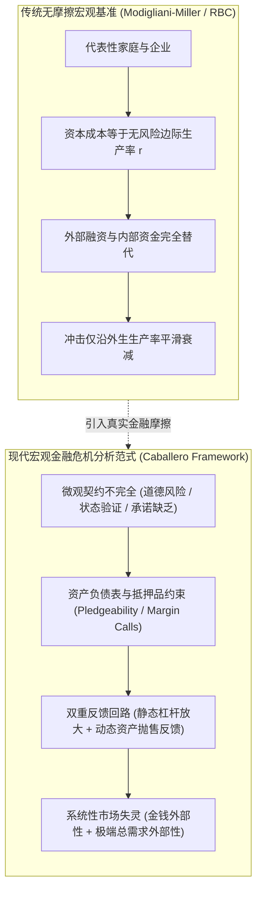

# MIT 14.454 经济危机（Economic Crises）

> **授课教授**：Ricardo J. Caballero（MIT 福特经济学讲席教授、前 MIT 经济学系系主任、NBER 研究员）  
> **授课学期**：Spring 2026（研究生博士核心选修专题，Half-semester / 13-week fast-paced doctoral course）  
> **先修要求**：MIT 14.453 经济波动（Economic Fluctuations，高级宏观经济学核心必修）  
> **官方主页**：[MIT OpenCourseWare (14.454 Spring 2026)](https://ocw.mit.edu/courses/14-454-economic-crises-spring-2026/)  
> **本地原著资料**：仓库 `sources/` 中的讲义课件与经典文献 · [课后习题集](./sources/mit14_454_s26_allproblemsets.pdf)

## TL;DR

- 课程从第一性原理系统推导现代宏观金融摩擦、资产负债表放大、银行挤兑、投机泡沫与流动性陷阱的规范分析模型。
- 确立“微观不对称信息与有限承诺 $\to$ 抵押品约束与中介资本稀缺 $\to$ 资产抛售与流动性黑洞 $\to$ 宏观总需求收缩与长期停滞”的闭环机制。
- 严格剖析金融危机中的两类本质市场失灵：由资产负债表联动引发的金钱外部性（Pecuniary Externality），与名义零利率下限（ZLB）绑架下的总需求外部性（Aggregate Demand Externality）。
- 奠定宏观审慎监管、逆周期资本缓冲、最后贷款人（LLR）、定向流动性注入与债务重组减免的福利经济学边界。

## 课程定位与宏观金融范式转换

在传统新古典综合与标准实际经济周期（RBC）或新凯恩斯主义动态随机一般均衡模型（DSGE）中，金融市场通常被抽象为一个无摩擦的“瓦尔拉斯面纱”。在阿罗-德布鲁完全市场与莫迪利亚尼-米勒定理（Modigliani-Miller Theorem）的基准假定下，企业的资本结构与其投资决策完全解耦，外部融资与内部留存收益完全可替代，金融中介仅仅扮演着无摩擦的储蓄-投资转移中枢。在这种框架下，宏观经济波动被归因于全要素生产率（TFP）的外生技术冲击或货币政策规则的微小偏离，金融体系本身既不创造风险，也不会放大冲击。

然而，2008 年全球金融海啸（GFC）、2020 年新冠疫情早期的离岸美元与国债市场流动性冻结、以及 2023 年以硅谷银行（SVB）为代表的美欧区域银行挤兑危机彻底击碎了上述过于简化的假定。现实世界的金融系统充斥着信息不对称、道德风险、有限承诺与抵押品约束。当负向外部冲击侵蚀借款人或金融中介的资产负债表时，金融约束的内生收紧会触发剧烈的资产抛售（Fire Sales）、信贷挤压与流动性囤积，使原本微小的初始冲击被非线性放大为系统性经济灾难。

MIT 14.454 由当代宏观金融与危机理论权威 Ricardo J. Caballero 教授讲授。作为全美顶尖的博士生宏观专题课程，其核心使命是：**将金融摩擦与异质性资产负债表置于宏观一般均衡的核心位置，把危机视为金融中介与信贷网络内在脆弱性的非线性内生爆发，而非单纯外生技术冲击的被动线性响应**。

本课程的方法论要求我们拒绝无微观基础的随意假定，从基础微观契约理论（状态验证成本、专用性与人力资本不可剥夺性、多主体逆向选择与道德风险）出发，内生推导宏观借贷约束与抵押品要求；随后将微观受约束主体的优化行为嵌入跨期一般均衡框架，揭示宏观层面的系统性外部性失灵，最终为宏观审慎监管、央行流动性救助与危机应对提供坚实的第一性原理支撑。

## 核心理论支柱与分析框架

全课程严密串联宏观金融理论的七大核心支柱，从微观代理问题逐层跃迁至宏观系统性失灵：

1. **抵押品与资产负债表放大（Collateral & Amplification）**：
   - 探究内部资金（Net Worth）为何成为决定投资和产出的关键状态变量。
   - 建立 Bernanke-Gertler (1989) 有成本状态验证（CSV）模型与 Kiyotaki-Moore (1997) 动态信贷周期模型，推导资产价格与借贷能力之间的双向螺旋反馈。
2. **银行中介资本与信贷紧缩（Credit Crunch & Intermediary Capital）**：
   - 基于 Holmstrom-Tirole (1997) 双重道德风险框架，解析知情资本（Informed Capital）对克服企业道德风险的认证职能（Skin in the game）。
   - 对比分析中介资本危机（Credit Crunch）、企业净资产缩水（Collateral Squeeze）与储蓄挤压（Savings Squeeze）的宏观差异。
3. **流动性转型、恐慌挤兑与网络传染（Runs, Panics, and Contagion）**：
   - 从 Diamond-Dybvig (1983) 期限错配与流动性保险模型出发，剖析活期存款与回购市场（Repo Haircut）的序贯服务挤兑。
   - 运用 Allen-Gale (2000) 跨区域不完全清算网络模型与 Caballero-Simsek (2013) 奈特不确定性复杂网络模型，推演小冲击引发全网火灾抛售（Fire Sales）与金融休克的机理。
4. **投机泡沫、资产短缺与投机性增长（Bubbles, Speculation & Growth）**：
   - 解构理性泡沫（Samuelson-Tirole 克服动态无效率）、风险转移泡沫（Allen-Gale 有限责任下拿他人资金博弈）、推迟套利（Abreu-Brunnermeier 同步风险）及异质信念转售期权（Harrison-Kreps）。
   - 拓展至卡瓦列罗前沿：AI 技术革命下的“扁平 MPK 区域”如何孕育投机性增长（Speculative Growth）鞍点路径及其脆弱性。
5. **信贷繁荣与金钱外部性（Credit Booms & Pecuniary Externalities）**：
   - 检验 Lorenzoni (2008) 经典三期模型：分散主体在繁荣期未内生化杠杆对危机期资产抛售价格的负外部性，导致事前系统性“过度借贷”与“过度投资”。
   - 确立针对借贷征税的宏观审慎监管（Macroprudential Policy）的必要性。
6. **流动性陷阱、去杠杆与总需求外部性（Liquidity Trap & Leverage）**：
   - 在 Eggertsson-Krugman (2012) 与 Korinek-Simsek (2016) 框架下，推导借贷约束预期收紧如何迫使借款人剧烈去杠杆。
   - 在名义利率零下限（ZLB）与名义刚性约束下，总需求外部性使去杠杆演化为负和博弈的大衰退，证明债务上限监管与事后债务重组减免的帕累托改进性质。

## 讲义导航与本地教学资源

所有原始课件 PDF、课后习题与解题指南已完整存档于本地目录，支持离线高速查阅：

| 讲次 | 核心主题与理论模型 | 讲义笔记 | 本地官方课件 | 关键文献与延伸资料 |
|:---|:---|:---:|:---:|:---|
| **Lec 1** | **危机全景与现代宏观金融分析范式** 2008 全球危机、新冠流动性踩踏与 2023 硅谷银行事件 | [lec1.md](./lec1.md) | [课件 PDF](./sources/mit14_454_s26_lec1.pdf) | [Caballero (2010 JEP)](https://www.aeaweb.org/articles?id=10.1257/jep.24.4.85) [Caballero (2009 PDF)](./sources/papers/XI-COSTA-LECTURE-CABALLERO-PRINTED.pdf) |
| **Lec 2** | **抵押品约束与金融加速器机制** Bernanke-Gertler (1989) CSV 模型与 Kiyotaki-Moore (1997) 动态信贷周期 | [lec2.md](./lec2.md) | [课件 PDF](./sources/mit14_454_s26_lec2.pdf) | [Bernanke-Gertler (1989)](https://www.jstor.org/stable/1804770) [Kiyotaki-Moore (1997)](https://www.jstor.org/stable/10.1086/262072) |
| **Lec 3** | **信贷紧缩与银行中介资本** Holmstrom-Tirole (1997) 双重道德风险、知情资本监督与信贷配给 | [lec3.md](./lec3.md) | [课件 PDF](./sources/mit14_454_s26_lec3.pdf) | [Holmstrom-Tirole (1997)](https://www.jstor.org/stable/2951252) [Kashyap-Stein (1994 PDF)](./sources/papers/c8334.pdf) |
| **Lec 4** | **流动性转型、挤兑与网络传染** Diamond-Dybvig (1983)、Allen-Gale (2000) 与 Caballero-Simsek 复杂网络火灾抛售 | [lec4.md](./lec4.md) | [课件 PDF](./sources/mit14_454_s26_lec4.pdf) | [Diamond-Dybvig (1983 PDF)](./sources/papers/DD83jpe.pdf) [Caballero-Simsek (2013 PDF)](./sources/papers/Fire%20Sales%20in%20a%20Model%20of%20Complexity.pdf) |
| **Lec 5** | **资产泡沫、投机机制与投机性增长** 资产短缺理性泡沫、风险转移、同步阻滞与 Caballero 劳动替代型 AI 繁荣 | [lec5.md](./lec5.md) | [课件 PDF](./sources/mit14_454_s26_lec5.pdf) | [Caballero-Farhi-Hammour (2006 PDF)](./sources/papers/w12939.pdf) [Abreu-Brunnermeier (2003)](https://scholar.princeton.edu/markus/publications/bubbles-and-crashes) |
| **Lec 6** | **信贷繁荣、金钱外部性与过度借贷** Martin-Ventura (2012) 信贷泡沫与 Lorenzoni (2008) 资产抛售金钱外部性 | [lec6.md](./lec6.md) | [课件 PDF](./sources/mit14_454_s26_lec6.pdf) | [Martin-Ventura (2016 PDF)](./sources/papers/macrebu_pub-1.pdf) [Farhi-Werning (2016 PDF)](./sources/papers/w19313.rev1.pdf) |
| **Lec 7** | **流动性陷阱、去杠杆与总需求外部性** Eggertsson-Krugman (2012) 与 Korinek-Simsek (2016) 名义零下限与过度杠杆 | [lec7.md](./lec7.md) | [课件 PDF](./sources/mit14_454_s26_lec7.pdf) | [Korinek-Simsek (2016)](https://www.aeaweb.org/articles?id=10.1257/aer.20140289) [Guerrieri-Lorenzoni (2017 PDF)](./sources/papers/w17583.pdf) |

### 进阶专题与课后习题配套（Problem Sets）

- **专题延伸讲义（Advanced Topics）**：
  - [Lec 8: 国际资本流动与突发停止（Capital Flows and Sudden Stops）课件 PDF](./sources/mit14_454_s26_lec8.pdf) · [配套文献 (Gourinchas et al. 2001 PDF)](./sources/papers/w8249.pdf)
  - [Lec 9: 金融状况指引与“招募效应”（Financial Conditions Guidance: The Recruitment Effect）课件 PDF](./sources/mit14_454_s26_lec9.pdf)
- **课后综合习题库与官方参考答案**：
  - [全套宏观金融危机综合大作业（All Problem Sets PDF）](./sources/mit14_454_s26_allproblemsets.pdf)
  - [第 1 & 2 题官方解析（Problem 1 & 2 Solutions PDF）](./sources/mit14_454_s26_prob1_2_sol.pdf)：涵盖 Bernanke-Gertler 审计边界与 Kiyotaki-Moore 动态乘数求解。
  - [第 3 & 4 题官方解析（Problem 3 & 4 Solutions PDF）](./sources/mit14_454_s26_prob_3_4_sol.pdf)：涵盖 Holmstrom-Tirole 银行知情资本稀缺与 Diamond-Dybvig 最优流动性配置。
  - [第 5 & 6 题官方解析（Problem 5 & 6 Solutions PDF）](./sources/mit14_454_s26_prob_5_6_sol.pdf)：涵盖 Allen-Gale 环形网络跨期清算与投机泡沫转售期权定价。
  - [第 7 & 8 题官方解析（Problem 7 & 8 Solutions PDF）](./sources/mit14_454_s26_prob_7_8_sol.pdf)：涵盖 Lorenzoni 金钱外部性社会规划者拉格朗日求解与过度借贷税。
  - [第 9 & 10 题官方解析（Problem 9 & 10 Solutions PDF）](./sources/mit14_454_s26_prob_9_10_sol.pdf)：涵盖 Korinek-Simsek 名义零下限总需求凯恩斯乘数与事前帕累托改进证明。

## 学习建议与研究进路

1. **坚持微观契约与宏观一般均衡的严谨闭环**：
   - 宏观金融理论最忌脱离微观摩擦凭空设定借贷约束。在精读每篇讲义时，务必明确：信息结构（谁知道什么）、承诺能力（谁可以在何种状态下违约）与技术特征（资产的流动性与专用性）。
2. **区分“金钱外部性”与“总需求外部性”**：
   - 深入理解福利经济学第一定理在金融摩擦下的失效边界：金钱外部性通过价格机制发生作用，在完全市场下仅是财富转移，唯有在借贷约束依赖于内生价格时才产生无效率；而总需求外部性则由价格刚性与货币政策约束引发，导致非自愿资源闲置，具有普遍的负和特征。
3. **结合现实危机事件校准参数与逻辑直觉**：
   - 将理论推导与 2008 年次贷危机、2020 年市场动荡、2023 年硅谷银行暴雷进行交叉映射，理解央行与宏观审慎监管部门在救市与道德风险权衡中的第一性原理。
