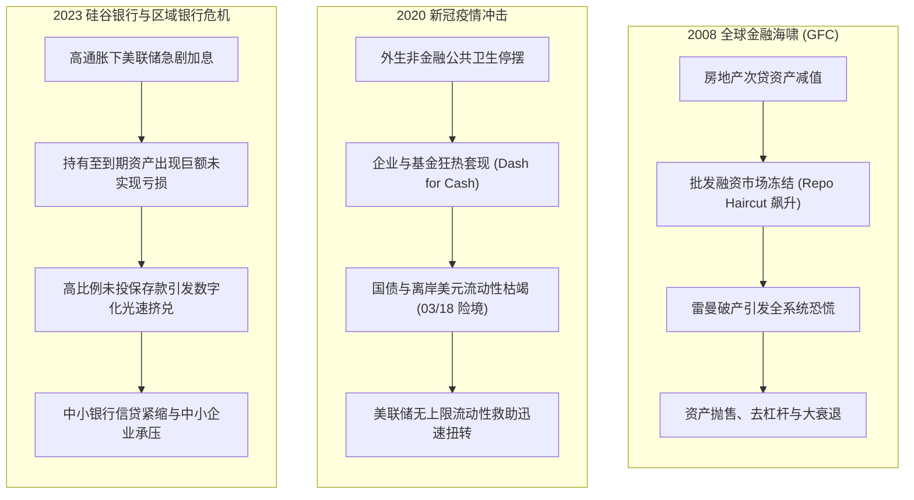
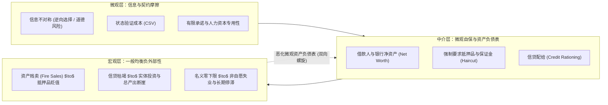

# Lec 1 现代金融危机全景与分析范式（Modern Crises Landscape & Analytical Paradigm）

> **授课教师**：Ricardo J. Caballero（MIT 经济学系讲席教授）  
> **本地官方课件**：[Lec 1 课件幻灯片 PDF](./sources/mit14_454_s26_lec1.pdf)  
> **核心参考文献**：
> - Caballero, R. J. (2010), *"Macroeconomics After the Crisis: Time to Deal with the Pretense-of-Knowledge Syndrome"*, *Journal of Economic Perspectives*, 24(4): 85–102.
> - Caballero, R. J. (2009), [*"Crisis and Reform: Managing Systemic Risk"* (PDF)](./sources/papers/XI-COSTA-LECTURE-CABALLERO-PRINTED.pdf), *Rivista di Politica Economica*, 99(4): 9–64.
> - Luttrell, D., T. Atkinson, & H. Rosenblum (2013), [*"Assessing the Costs and Consequences of the 2007–09 Financial Crisis and Its Aftermath"*](https://fraser.stlouisfed.org/title/economic-letter-6362/assessing-costs-consequences-2007-09-financial-crisis-aftermath-607683), *Dallas Fed Economic Letter*, 8(7).
> - Ball, L. M. (2018), *The Fed and Lehman Brothers*, Cambridge University Press.

## TL;DR

- 现代宏观金融危机并非由单一外生技术冲击引发，而是微观金融摩擦（期限错配、批发融资挤兑、资产负债表脆弱性）在系统层面的非线性集中爆发。
- 比较 2008 雷曼兄弟危机、2020 新冠“现金挤兑”与 2023 硅谷银行事件，揭示现代金融挤兑从传统物理网点向无担保影子银行批发融资和数字化存款的跃迁。
- 微观理性的风险防御策略（如提高抵押折扣率、囤积流动性、缩减放贷）在宏观层面通过资产贱卖与信贷紧缩相互强化，构成灾难性的金钱外部性。
- 确立贯穿全课程的七大危机机制支柱：抵押品放大、中介资本稀缺、协调失灵挤兑、投机泡沫破裂、信贷繁荣反噬、总需求外部性与跨境突发停止。

## 三场标志性危机与现代金融脆弱性解构

在深入微观契约推导之前，Caballero 教授首先通过三场不同时空维度的现实危机案例，剖析现代金融体系的脆弱性解剖结构。

### 1. 2008 年全球金融海啸：批发融资挤兑与资产负债表去杠杆

2008 年 9 月 15 日凌晨 1:45，拥有 158 年历史的华尔街第四大投资银行雷曼兄弟（Lehman Brothers）向纽约南区破产法院提交破产保护申请。

雷曼破产的深层经济学机制在于：
1. **资产负债表极度期限错配**：雷曼持有数百亿美元缺乏流动性的住房抵押贷款证券（MBS）及商业地产资产，但在负债端却极度依赖隔夜回购协议（Overnight Repo）和商业票据等短期无担保/半担保批发融资。
2. **流动性滚存失败（Rollover Crisis）**：当房地产价格下行侵蚀其股本时，交易对手不再相信其偿付能力，要求提高抵押品扣减率（Haircut）或拒绝展期。
3. **政策救助的自由裁量与协调预期破碎**：此前贝尔斯登（Bear Stearns）与房利美、房地美及随后 AIG 均获得美联储紧急救助，而雷曼被放任倒闭，彻底击碎了金融市场的预期协调，引发全市场的挤兑式抛售。

伴随雷曼倒闭，美国金融系统陷入前所未有的休克：
- **市场恐慌指数（VIX）暴涨**，TED 利差（泰德利差，3 个月 Libor 减去 3 个月国债收益率）飙升超过 300 个基点；
- **商业银行不良贷款（NPL）暴增**，金融中介被迫进行痛苦的资产负债表去杠杆（Deleveraging）；
- **对实体经济产生持久冲击**：总需求严重萎缩，失业率飙升，随后陷入长期停滞（Secular Stagnation）与名义利率零下限（ZLB）泥潭。

### 2. 2020 年新冠疫情冲击：外生真实冲击险些转化的金融冻结

2020 年 3 月的 Covid-19 疫情是典型的非金融外生冲击，但它在短短两周内险些演变为一场比 2008 年更惨烈的金融海啸：
- **全球争夺现金（Dash for Cash）**：随着全球封锁令下达，实体企业与非银金融机构面临极端不确定性，纷纷提取银行授信额度并抛售所有流动性资产以锁定现金。
- **2020 年 3 月 18 日流动性崩溃**：就连全球最具流动性的美国国债市场也出现交易商资产负债表承载力耗尽、买卖买方报价严重脱节的极端流动性挤兑。
- **政策干预与“过犹不及”**：美联储吸取 2008 年经验，在 3 月 23 日前迅速推出前所未有的干预组合拳（二级市场企业信贷工具 SMCCF、薪酬保障计划 PPP 融资等），以国家信用背书成功阻止了金融休克。然而，超常规的货币与财政注资为随后的通胀飙升埋下了种子。

### 3. 2023 年硅谷银行（SVB）事件：加息周期下的未实现亏损与数字挤兑

2023 年 3 月以硅谷银行、签名银行（Signature Bank）和第一共和银行（First Republic）为代表的美欧区域性银行危机，展现了数字时代银行脆弱性的全新形态：
1. **加息周期下的资产减值**：美联储在 2022-2023 年间以数十年来最快速度加息超过 500 个基点。低息时期购入的大量长期国债和住房抵押贷款支持证券，在“持有至到期”（HTM）和“可供出售”（AFS）科目中积累了超过 6000 亿美元的未实现账面亏损。
2. **负债端的高浓度与未投保特征**：SVB 的存款客群高度集中在硅谷创投和初创企业，未投保存款（超过 FDIC 25 万美元上限）比例高达 90% 以上。
3. **数字通信与即时清算**：社交媒体（Twitter/Slack）的群体恐慌共振结合手机网上银行，使 SVB 在一天之内遭遇了 420 亿美元的创纪录提款，导致银行瞬间休克。
4. **宏观外溢效应**：资产规模小于 2500 亿美元的美国中小银行承担了全美约 50% 的工商业贷款（C&I Lending）和约 80% 的商业地产贷款（CRE Lending）。区域银行的信贷收缩直接重创了实体中小企业的融资生态。

::: definition 现代金融危机（Modern Financial Crisis）
现代宏观经济危机不仅指实体经济产出的周期性下滑，更是指**金融中介系统（商业银行、影子银行、资产清算与回购网络）在信息不对称、契约不可完全性与资产负债表期限错配的交互作用下，无法继续提供支付清算、信用中介与风险分担功能的系统性瘫痪状态**。
:::

## 贯穿全课的七大宏观金融核心追问

Caballero 教授在开篇提出了贯穿现代危机理论的七大核心问题，这七个问题精确映射到课程后续讲义的理论推导中：

| 追问序号 | 核心经济学机制 | 核心问题陈述 | 对应讲义 |
|:---:|:---|:---|:---:|
| **Q1** | **抵押品与资产负债表** | 金融摩擦如何放大宏观经济冲击？为何抵押品资产的市值对宏观经济波动至关重要？ | [Lec 2: 抵押品与金融加速器](./lec2.md) |
| **Q2** | **银行资本与信贷紧缩** | 什么是信贷紧缩（Credit Crunch）？为什么银行中介资本（Informed Capital）的充足度决定了实体投资水平？ | [Lec 3: 信贷紧缩与中介资本](./lec3.md) |
| **Q3** | **恐慌挤兑与金融传染** | 挤兑与恐慌背后的协调博弈机制是什么？为何局部的微小冲击能够沿着金融清算网络跨市场雪崩式传染？ | [Lec 4: 挤兑、恐慌与网络传染](./lec4.md) |
| **Q4** | **投机泡沫与资产短缺** | 资产泡沫是如何内生形成的？长期低实际利率环境与投机泡沫之间存在何种深刻的内在逻辑联系？ | [Lec 5: 投机泡沫与投机性增长](./lec5.md) |
| **Q5** | **信贷繁荣与过度负债** | 为什么“信贷繁荣必有恶果”？信贷高速扩张期蕴含了何种不可自拔的系统性金钱外部性？ | [Lec 6: 信贷繁荣与金钱外部性](./lec6.md) |
| **Q6** | **去杠杆陷阱与名义刚性** | 为什么全社会的去杠杆努力反而会把经济推向严重的凯恩斯主义流动性陷阱和大衰退？ | [Lec 7: 流动性陷阱与总需求外部性](./lec7.md) |
| **Q7** | **跨境资本流动与突发停止** | 国际资本流动在发展中国家与新兴市场金融危机中扮演了何种推波助澜的角色？ | [Lec 8: 资本流动与突发停止](./sources/mit14_454_s26_lec8.pdf) |

## 宏观金融研究的方法论范式转变

理解现代危机理论，必须实现从新古典宏观模型到非线性金融摩擦模型的方法论跃迁：

::: theorem 危机内生性假说（Caballero 危机理论第一性原理）
在存在信息不对称与有限承诺的现实经济中，个体的自利优化行为无法保证宏观金融稳定。**微观上最审慎的风险控制措施（如追加保证金、提前回收贷款、折价抛售非流动性资产、囤积无风险现金），在宏观一般均衡中会系统性破坏资产价格与总需求，使微观个体的自保策略成为引爆系统性危机的直接推手**。
:::

::: example
- **微观视角**：一家商业银行在面临存款流失时，根据风险价值模型（VaR）理智地抛售流动性较差的国债并停止向中小企业展期贷款，以确保自身存活；
- **宏观反馈**：全行业同时采取该策略，导致国债现券价格剧烈下跌（基差走阔），恶化所有金融机构的未实现亏损，同时迫使实体中小企业因资金链断裂而违约倒闭，反向将商业银行推入坏账激增的死循环。
:::

::: insight
传统宏观经济学将经济波动视为围绕平稳稳态的对称波动（向上繁荣与向下衰退在机制上是对称的）。但现代危机理论揭示了**金融冲击的极度非对称性**：
在繁荣时期，借贷约束不绑定，经济表现类似于平稳无摩擦的瓦尔拉斯世界；然而，一旦负向冲击积累到临界阈值，抵押品和资本约束发生共振绑定，系统便会跨越分岔点（Bifurcation），呈现出具有剧烈滞后效应（Hysteresis）和断崖式下跌的灾难性非线性特征。
:::

::: pitfall
**常见误区：将金融危机单纯归咎于“贪婪”或个别投机者的非理性狂热**。
在现代宏观金融模型中，所有的主体——无论是过度借贷的家庭、扩张资产负债表的银行，还是在危机中恐慌提款的储户——均被设定为具有完全理性的效用最大化或利润最大化主体。危机的根本根源是**市场结构的缺失（Incomplete Markets）与价格/需求外部性导致的私人边际收益与社会边际收益之间的系统性脱节**，而非微观个体的智力失常。
:::
