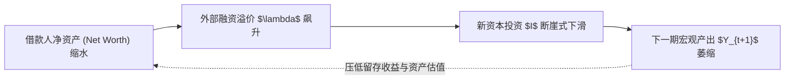
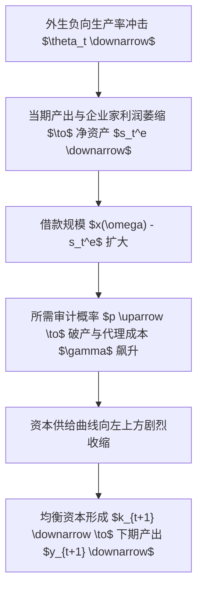
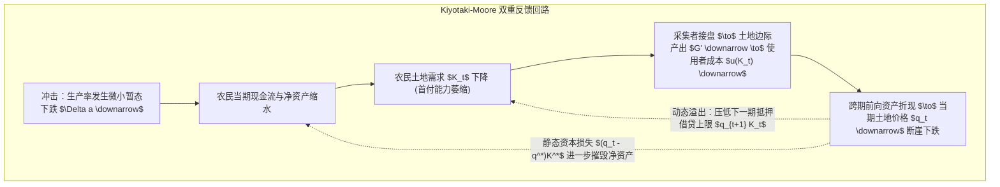

# Lec 2 抵押品约束与金融加速器机制（Collateral and Amplification）

> **授课教师**：Ricardo J. Caballero（MIT 经济学系讲席教授）  
> **本地官方课件**：[Lec 2 课件幻灯片 PDF](./sources/mit14_454_s26_lec2.pdf)  
> **核心参考文献**：
> - Bernanke, B., & M. Gertler (1989), [*"Agency Costs, Net Worth, and Business Fluctuations"* (PDF)](./sources/papers/1804770.pdf), *American Economic Review*, 79(1): 14–31.
> - Kiyotaki, N., & J. Moore (1997), [*"Credit Cycles"*](https://www.jstor.org/stable/10.1086/262072), *Journal of Political Economy*, 105(2): 211–248.
> - Krishnamurthy, A. (2003), *"Collateral Constraints and Its Amplification Mechanism"*, *Journal of Economic Theory*, 111(2): 277–292.

## TL;DR

- 在存在信息与承诺摩擦的经济中，外部融资成本高于无风险利率（$f'(K) = r + \lambda$，其中 $\lambda > 0$ 为外部融资溢价），使得借款人资产负债表净资产成为决定投资的内生核心状态变量。
- Bernanke-Gertler (1989) 模型基于有成本状态验证（CSV），证明当外部借贷需求超过借款人自有资产时，监督成本随杠杆率上升而激增，使暂态技术冲击通过净资产缩水转化为高度持久的宏观衰退。
- Kiyotaki-Moore (1997) 模型基于人力资本不可剥夺性内生导出实物抵押品约束，揭示了资产价格与净资产之间的双重正反馈回路：静态杠杆乘数效应与跨期资产折现定价资本化效应。
- 无摩擦市场下的微小扰动在抵押品约束下被剧烈放大，且资产抛售与抵押品贬值造成的信贷紧缩会导致极为漫长迟缓的“资产负债表型衰退”。

## 金融摩擦的宏观分析基准

在阿罗-德布鲁无摩擦一般均衡中，资本边际产出在无风险利率水平处实现市场出清（$f'(K) = r$）。然而，当借贷双方存在逆向选择或道德风险时，最优契约内生出外部融资溢价（External Finance Premium）$\lambda$：

$$f'(K) = r + \lambda(NW), \quad \lambda'(NW) < 0$$

其中 $NW$ 代表借款人自有的**净资产（Net Worth）**：
- **在新投资端**：$\lambda > 0$ 导致投资不足（Underinvestment）；
- **在存量资产端**：当流动性短缺发生时，$\lambda$ 激增会导致生产性资本被非理性贱卖与无效率销毁（Inefficient Destruction）。

::: definition 外部融资溢价（External Finance Premium）
外部融资溢价指企业通过发行无担保债务或吸收外部股权所必须承担的预期资金成本，与企业运用内部留存收益（自有资金）进行投资的机会成本之间的利差。在完全市场下此利差恒为零；而在不对称信息下，该利差随企业杠杆率的上升（或净资产的耗竭）单调递增。
:::

## Bernanke-Gertler (1989) 有成本状态验证与金融加速器

伯南克与格特勒（1989）将 Townsend (1979) 的有成本状态验证（Costly State Verification, CSV）机制嵌入世代交叠（OLG）宏观动态模型，开创了现代“金融加速器”（Financial Accelerator）理论。

### 1. 经济环境设定

- **时间与主体**：时间 $t = 1, 2, \dots, \infty$。每期出生两类两期寿命主体：
  - **企业家（Entrepreneurs）**：占人口比例 $\eta \in (0, 1)$，拥有不可转让的投资技术与生产项目；
  - **放贷者（Lenders）**：占人口比例 $1 - \eta$，仅拥有储蓄，无生产技术。
- **项目技术**：企业家建构项目需要不可分割的要素投入 $x(\omega)$ 单位产出，其中能力参数 $\omega \sim U[0, 1]$，投资成本函数满足 $x'(\omega) > 0$。
- **产出与风险**：每个项目在 $t+1$ 期生产 $k_i$ 单位资本（随后完全折旧），期望产出 $E[k_i] = \bar{k}$ 独立于 $\omega$。$t$ 期的宏观总产出为：
  $$y_t = \tilde{\theta}_t f(k_t)$$
  其中 $\tilde{\theta}_t$ 为独立同分布（i.i.d.）的总生产率冲击。
- **储蓄技术与偏好**：无风险存储技术提供总回报率 $r \ge 1$。主体偏好为线性，企业家在第一期将全部期初财富作为内部储蓄投入项目：$s_t^e = w_t$。

### 2. 完全信息基准（Benchmark with Perfect Information）

在完全信息下，放贷人无成本观测项目产出 $k_i$。资本的市场价格为 $q$，预期价格 $\hat{q}_{t+1} = E[q_{t+1}]$。
自由进入条件决定了临界企业家能力阈值 $\omega_t$：

$$\hat{q}_{t+1} \bar{k} = r x(\omega_t)$$

由于 $\omega \sim U[0, 1]$，第 $t$ 期开工的总项目数 $i_t$ 与下一期资本存量 $k_{t+1}$ 分别为：

$$i_t = \eta \omega_t, \quad k_{t+1} = \bar{k} i_t = \bar{k} \eta \omega_t$$

由此反解出**资本供给曲线**：

$$\hat{q}_{t+1} = \frac{r}{\bar{k}} x\left(\frac{k_{t+1}}{\bar{k}\eta}\right)$$

在 $t+1$ 期，资本需求由资本边际产出决定：$q_{t+1} = \theta_{t+1} f'(k_{t+1})$。在 $t$ 期预期出清点，预期需求曲线为：

$$\hat{q}_{t+1} = \bar{\theta} f'(k_{t+1}) = \frac{r}{\bar{k}} x\left(\frac{k_{t+1}}{\bar{k}\eta}\right)$$

::: theorem 完全信息下的中性结论（Bernanke-Gertler 1989）
在完全信息基准下，$k_{t+1}$ 仅取决于生产率期望值 $\bar{\theta}$ 和折现率 $r$，而与当期真实冲击 $\theta_t$ 或当期内部留存财富 $w_t$ 完全无关。冲击 $\theta_{t+1}$ 仅对当期产出 $y_{t+1}$ 和工资产生一次性影响，**完全不具备跨期持久性（No Persistence），不存在对下一期资本存量 $k_{t+2}$ 的传导**。
:::

### 3. 不对称信息与 CSV 最优债务契约

引入不对称信息：企业家的真实产出 $k_i$ 为私有信息。外部放贷人若想获知真实产出，必须耗费审计成本 $\gamma$ 单位资本品。
考虑两状态简化模型：产出 $k \in \{k_1, k_2\}$，其中 $k_1$ 为坏状态（概率 $\pi_1$），$k_2$ 为好状态（概率 $\pi_2$），且 $k_2 > k_1$。

- **激励约束**：在好状态下，企业家有动机谎报为坏状态以少还借款。为了阻止谎报，放贷者仅在报告坏状态时以概率 $p$ 进行随机审计，一旦查明谎报则课以惩罚；在好状态下不审计。
- **借贷契约特征**：
  - 若借款规模较小，企业家的自有净资产 $s^e$ 足够充裕，使得坏状态下的产出足以全额偿还借款本息：
    $$\hat{q} k_1 \ge r [x(\omega) - s^e]$$
    此时即使发生坏状态也无需审计（$p = 0$），不存在代理成本。
  - 若借款人净资产不足以覆盖借款（$x(\omega) - s^e > \frac{\hat{q} k_1}{r}$），则必须设定正的审计概率 $p \in (0, 1]$ 以保证企业家如实披露。此时期望审计成本为 $p \pi_1 \hat{q} \gamma$。

当 $t$ 期的外生冲击 $\theta_t$ 恶化时，企业家净资产 $s_t^e = w_t$ 下降，导致融资缺口扩大，借贷成本中包含的期望代理成本大幅攀升。资本供给曲线大幅左移，导致 $t+1$ 期的资本投资 $k_{t+1}$ 显著下滑，进而拉低 $t+1$ 期产出 $y_{t+1}$。**原本白噪声性质的 i.i.d. 冲击由此获得了跨期内生传播的持久性（Propagation & Persistence）**。

## Kiyotaki-Moore (1997) 动态信贷周期与抵押品乘数

如果说 Bernanke-Gertler 强调的是现金流审计与内部资金积累，Kiyotaki & Moore (1997) 则将**资产负债表中的抵押品市值（Collateral Valuation）**与**生产要素价格**的一般均衡联动推向了极致。

### 1. 核心设定：双主体与人力资本不可剥夺性

- **资产与要素**：经济中存在不可损耗的耐用生产要素——**土地（Land）**，全社会固定供给总量为 $\bar{K}$；以及单期易耗品——水果（Fruit）。
- **两类异质性主体**：
  - **农民（Farmers）**：连续统测度为 1，具有较高主观折现率（不耐心，$\beta^F$），在均衡中成为借款人；
  - **采集者（Gatherers）**：连续统测度为 $m$，较有耐心（$\beta^G > \beta^F$），决定市场无风险总利率 $R = 1/\beta^G > 1$。
- **生产技术差异**：
  - **农民**：拥有规模报酬不变（CRS）技术，投入 $k_t$ 土地生产：
    $$y_{t+1} = (a + c) k_t$$
    其中 $a k_t$ 为可在市场上交易的水果，而 $c k_t$ 为不可转让（仅自身可消费）的水果。假定 $\frac{a}{a+c} < \beta^F$。
  - **关键微观契约摩擦（Inalienability of Human Capital）**：Hart & Moore (1994) 传统。一旦土地播种，只有该农民本人的专用性劳作才能收获成果。农民随时可以威胁退出生产。由于无法强迫奴役劳动，农民在事后重新谈判中能够攫取全部剩余。**因此，外部借款人无法以农民未来的劳动产出作为担保，必须完全依赖可没收的实物资产——土地作为抵押品**。

### 2. 抵押借贷约束与土地需求

为了防范农民违约毁约，放贷人要求单期借款 $b_t$ 的本息和不得超过下一期土地的预期清算价值：

$$R b_t \le q_{t+1} k_t$$

其中 $q_{t+1}$ 为下一期土地价格。由于农民较为急躁且边际回报率高，借贷约束在均衡中严格绑定：$b_t = \frac{q_{t+1} k_t}{R}$。
农民每期的资金流动约束为：

$$q_t(k_t - k_{t-1}) + R b_{t-1} + (x_t - c k_{t-1}) = a k_{t-1} + b_t$$

农民最优决策为消费不可转让水果（$x_t = c k_{t-1}$），并将所有流动性全部投入土地资产购买。将 $b_t$ 与 $R b_{t-1}$ 代入资金流约束，整理可得农民在 $t$ 期的土地持有量方程：

$$k_t = \frac{1}{q_t - \frac{q_{t+1}}{R}} \left[ (a + q_t) k_{t-1} - R b_{t-1} \right]$$

定义 $u_t \equiv q_t - \frac{q_{t+1}}{R}$ 为**土地的使用者成本（User Cost of Land）**，而方括号内项正是农民在 $t$ 期的**实物净资产（Net Worth）**。对所有农民加总，得到全行业土地需求：

$$K_t = \frac{1}{u_t} \left[ (a + q_t) K_{t-1} - R B_{t-1} \right]$$

::: definition 抵押品杠杆乘数（Collateral Multiplier）
项 $\frac{1}{u_t} = \frac{1}{q_t - q_{t+1}/R}$ 即为 Kiyotaki-Moore 杠杆乘数。由于农民可以按土地全额价值的贴现值 $q_{t+1}/R$ 进行质押借款，购买一单位土地自身只需垫付首付款（Down-payment）$u_t$。当资产价格上升预期推高贴现价值时，首付比例 $u_t$ 骤降，杠杆乘数趋于无限放大。
:::

### 3. 采集者出清与前向资产定价

采集者拥有规模报酬递减（DRS）技术，使用 $\tilde{k}_t$ 土地生产 $y_{t+1} = G(\tilde{k}_t)$，满足 $G' > 0, G'' < 0$。采集者不存在信用摩擦，其一阶条件决定了土地的市场使用者成本：

$$u(K_t) \equiv q_t - \frac{q_{t+1}}{R} = \frac{1}{R} G'\left(\frac{\bar{K} - K_t}{m}\right)$$

在完全理性预期且无资产泡沫的条件下，将使用者成本递归前向迭代，可得土地现货价格的折现加总公式：

$$q_t = \sum_{s=0}^\infty R^{-s} u(K_{t+s})$$

### 4. 稳态与动态放大反馈

在长期稳态中，$q_t = q^*, K_t = K^*, B_t = B^*$。
由稳态条件，土地使用者成本恒等于边际生产率：

$$u^* = \frac{R-1}{R} q^* = a$$

$$B^* = \frac{a}{R-1} K^*, \quad \frac{1}{R} G'\left(\frac{\bar{K} - K^*}{m}\right) = a$$

假设在稳态处发生一个完全未预期到的、**仅持续一期的微小生产率冲击 $\Delta$**：
- **第一最佳（First-Best）世界**：农民产出仅在 $t$ 期受到影响，后续各期土地配置与产出立即恢复稳态，产出波动完全等于冲击本身 $\Delta Y_t = \Delta$。
- **Kiyotaki-Moore 信用周期世界**：
  1. **静态乘数放大**：当期净资产变为 $[a(1+\Delta) + (q_t - q^*)] K^*$。除了当期收入减少，土地价格 $q_t$ 的下跌带来了巨额资本利得亏损（Capital Loss），使净资产降幅成倍放大；
  2. **动态持久性（Persistence）**：由于土地从高效率的农民手中不可逆地转移到了低效率的采集者手中，即使随后生产率完全恢复，农民也无法迅速赎回土地，必须耗费数十年依靠微薄的留存收益逐期缓慢修复资产负债表。

::: theorem 抵押品放大的双向非对称性（Kiyotaki & Moore 1997）
抵押品与资产价格的交互作用打破了外生冲击的线性传导规律。在景气时期，资产升值通过抵押品效应制造繁荣；而在衰退时期，资产价格的边际下跌会通过摧毁资产负债表引发全市场的流动性枯竭与信贷冻结，使复苏进程极度滞后于冲击本身的消退。
:::

::: example
- **可复算案例（数值直觉）**：
  设无风险折现率 $R = 1.05$（年化利率 5%），稳态首付比率 $u^*/q^* = \frac{R-1}{R} \approx 4.76\%$。这意味着基础杠杆率高达 $\frac{1}{u^*/q^*} \approx 21$ 倍。
  若土地价格因初始冲击仅下跌 2%，农民的净资产将瞬间被蒸发掉 $2\% \times 21 \approx 42\%$！净资产的崩塌迫使农民抛售巨额土地，引发次生价格踩踏。
:::

::: insight
为什么自由市场无法自动纠正这种资产价格下跌带来的过度收缩？
深层根源在于**金钱外部性（Pecuniary Externality）**：当农民在受到冲击抛售土地时，每位农民都将市场土地价格 $q_t$ 视为自己无法改变的外生常数。没有任何单个农民会内生化自己的抛售决策正在压低全市场的土地估值，进而收紧所有同行的抵押借贷约束。这种竞争性市场中价格机制的去中心化特性，在金融摩擦下演变为了集体非理性的传导渠道。
:::

::: pitfall
**常见误解：认为抵押品约束仅存在于落后的传统农业或典当行业**。
在高度发达的现代影子银行与批发融资市场中，回购协议（Repo）、证券借贷与场外衍生品交易几乎 100% 依赖于优质抵押品（如国债或高评级 MBS）。2008 年雷曼危机的本质，正是作为现代抵押品的次贷资产评级下调引发全市场追加保证金通知（Margin Calls）与 Haircut 飙升，完美复现了 Kiyotaki-Moore 模型中抵押品市值崩塌导致信贷归零的理论预言。
:::
