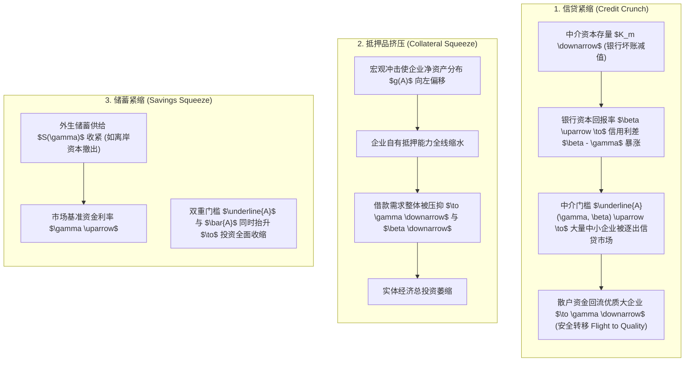

# Lec 3 信贷紧缩与银行中介资本（The Credit Crunch & Intermediary Capital）

> **授课教师**：Ricardo J. Caballero（MIT 经济学系讲席教授）  
> **本地官方课件**：[Lec 3 课件幻灯片 PDF](./sources/mit14_454_s26_lec3.pdf)  
> **核心参考文献**：
> - Holmstrom, B., & J. Tirole (1997), [*"Financial Intermediation, Loanable Funds, and the Real Sector"*](https://www.jstor.org/stable/2951252), *Quarterly Journal of Economics*, 112(3): 663–691.
> - Kashyap, A., & J. Stein (1994), [*"Monetary Policy and Bank Lending"* (PDF)](./sources/papers/c8334.pdf), in *Monetary Policy*, (Ed.) N. G. Mankiw, NBER, 221–262.
> - Bernanke, B., & A. Blinder (1988), [*"Credit, Money, and Aggregate Demand"*](https://www.jstor.org/stable/1818164), *American Economic Review*, 78(2): 435–439.

## TL;DR

- 基于 Holmstrom-Tirole (1997) 双重道德风险理论，金融中介（银行）存在的根本价值不在于单纯的资金通道，而在于通过投入高成本的“知情资本”（Informed Capital）监督借款人并向市场提供信用背书。
- 借款人资本结构内生分层：高资产企业进入无中介的直接融资市场；中等资产企业依赖银行注资与监督进行间接融资；低资产企业遭遇绝对信贷配给。
- 银行必须在贷款中持有真实的“风险共担”（Skin in the game），导致信贷扩张受制于银行自有资本充足率。
- 严格区分三种宏观冲击机制：银行资本损耗引发的“信贷紧缩”（Credit Crunch）、企业资产缩水引发的“抵押品挤压”（Collateral Squeeze）与全社会储蓄萎缩引发的“储蓄紧缩”（Savings Squeeze）。在信贷紧缩中，中介利差急剧走阔并触发资金流向高评级企业的“安全转移”（Flight to Quality）。

## 银行中介存在的微观经济学基础

在 Modigliani-Miller 定理主导的古典金融学与宏观经济学世界中，企业的资本结构（负债与权益比例）与其投资决策完全解耦。企业无论是向公众发行公开债券、配售股权，还是向商业银行申请抵押贷款，资金成本与经济效应毫无差异。在这种无摩擦基准下，金融中介仅仅扮演着无成本的记账漏斗，既不改变借款人的违约风险，也不创造真实的流动性增量。

然而，现实商业世界的信贷配置呈现出高度的结构分层与摩擦壁垒。绝大多数实体中小企业由于缺乏标准化的公开财务审计、业务具有高度专用性、且缺乏公开交易的股权与信用评级，存在严重的逆向选择与道德风险。非知情公众投资者由于缺乏专业鉴别能力，且面临严重的“搭便车”（Free-riding）困境，既不可能、也没有动机深入企业现场去逐一核实经营状态或约束借款人的机会主义侵占。

Bengt Holmstrom 与 Jean Tirole（1997）在其里程碑式的研究中指出：**金融中介（商业银行与专业放贷机构）存在的根本经济学价值，在于其扮演着“专业委托监督者”（Delegated Monitor）与“信贷认证中心”的双重角色**。但监督行为本身是私密的、不可直接被外部公众观察的行动。如果银行仅仅作为一个空手套白狼的资金通道，一旦企业借款出现坏账，银行本身缺乏履职激励，便会产生严重的道德风险。

因此，现代宏观金融理论确立了核心原则：**银行若要向市场出具有效的信用认证，自身就必须投入真金白银的自有股本（知情资本 Informed Capital），在资产负债表内持有实质性的第一损失劣后级敞口（Skin in the game）**。银行资本的充裕程度，由此直接决定了其作为可信监督者的承载上限，进而内生决定了全社会的宏观信贷规模与投资分布：


## Holmstrom-Tirole (1997) 规范模型推导

### 1. 经济环境与生产技术

- **时间与主体**：单期连续统经济。存在三类风险中性主体：
  - **企业（Firms）**：测度为 1，拥有生产项目但内部资金分布不同，资产 $A \sim G(A)$；
  - **金融中介/银行（Intermediaries/Banks）**：拥有专用监督技术与知情资本总量 $K_m$；
  - **非知情散户投资者（Uninformed Investors）**：资本充裕，储蓄供给曲线为 $S(\gamma)$。
- **项目特征**：开工所需固定要素投资规模为 $I$。若企业内部资金 $A < I$，则必须从外部融入 $I - A$。
- **产出分布与企业道德风险**：
  - 项目在好状态下产生收益 $R$，坏状态下产生收益 0；
  - 企业家在项目运行中可选择**尽责（Diligent）**或**偷懒（Shirking）**：
    - 若尽责：好状态发生概率为 $p_H$，企业家无私有收益；
    - 若偷懒：好状态发生概率下降为 $p_L < p_H$（令 $\Delta p \equiv p_H - p_L > 0$），但企业家可攫取私有收益 $B > 0$。
- **经济可行性假设**：只有尽责的项目才具有社会经济价值（正 NPV）：
  $$p_H R - \gamma I > 0 > p_L R - \gamma I + B$$
- **银行监督技术**：
  - 银行若耗费监督成本 $c > 0$，可对企业进行现场审计与约束，将企业的偷懒私有收益从 $B$ 压缩至 $b < B$；
  - **技术假定（TA）**：$\frac{p_H}{\Delta p} (B - b) > c > B - b$。保证监督具有正社会剩余，且银行无法在无自有资金时仅凭空口承诺进行监督。
- **资金回报率要求**：非知情公众投资者的市场必要回报率为 $\gamma$；银行知情资本的回报率为 $\beta$。因监督具有稀缺性与成本，均衡中必有 $\beta > \gamma$。

### 2. 直接融资（Direct Finance）及其门槛

考虑企业不经过银行，直接向非知情公众投资者借款 $I - A$。
好状态下的产出 $R$ 在企业与投资者之间分割：$R_f + R_u = R$。
为了激励企业尽职工作，企业的回报必须满足**激励相容约束（Incentive Compatibility, IC）**：

$$p_H R_f \ge p_L R_f + B \implies R_f \ge \frac{B}{\Delta p}$$

企业为了保持努力，自身必须至少留存 $\frac{B}{\Delta p}$ 的收益份额。因此，企业能够向外部投资者承诺的最大期望回报（**可质押期望收入，Pledgeable Expected Income**）为：

$$p_H \left( R - \frac{B}{\Delta p} \right)$$

非知情投资者的参与约束（Participation Constraint, PC）要求：

$$\gamma [I - A] \le p_H \left( R - \frac{B}{\Delta p} \right)$$

由此反解出**直接融资的企业净资产最低门槛** $\bar{A}(\gamma)$：

$$\bar{A}(\gamma) = I - \frac{p_H}{\gamma} \left( R - \frac{B}{\Delta p} \right)$$

::: theorem 直接融资边界定理
只有内部资金满足 $A \ge \bar{A}(\gamma)$ 的高净资产企业，才能仅凭自身资产负债表的抵押价值克服道德风险，直接在公开债券市场或股票市场融资。资产门槛 $\bar{A}(\gamma)$ 随无风险利率 $\gamma$ 的上升而单调提高。
:::

### 3. 间接融资（Bank Intermediation）与银行注资约束

当企业资产不足（$A < \bar{A}(\gamma)$）时，必须引入银行监督。
在监督下，企业私有收益降至 $b$。好状态产出三方切分：$R_f + R_u + R_m = R$。
此时系统面临**双重道德风险（Double Moral Hazard）**：不仅企业可能偷懒，银行也可能收取了报酬却不履行监督职责！

两项激励相容约束必须同时成立：
1. **企业尽职约束**：$R_f \ge \frac{b}{\Delta p}$；
2. **银行监督约束**：银行若监督，期望净收益为 $p_H R_m - c$；若不监督，好状态概率降至 $p_L$ 且收益为 $p_L R_m$。因此银行必须满足：
   $$p_H R_m - c \ge p_L R_m \implies R_m \ge \frac{c}{\Delta p}$$

此时，可向非知情外部投资者质押的最高收益提升为：

$$p_H \left( R - \frac{b + c}{\Delta p} \right)$$

设银行贷款注资额为 $I_m$，非知情散户提供剩余资金 $I_u = I - A - I_m$。
银行资本的预期内部收益率为：

$$\beta = \frac{p_H R_m}{I_m} > \gamma$$

由于银行资本比散户资金昂贵（$\beta > \gamma$），理性企业会尽可能压缩银行贷款比例，仅要求银行投入刚好满足激励约束的最低借款额度（**Skin in the game**）：

$$I_m(\beta) = \frac{p_H}{\beta} \frac{c}{\Delta p}$$

非知情散户投资者的参与约束为：

$$\gamma [I - A - I_m(\beta)] \le p_H \left( R - \frac{b + c}{\Delta p} \right)$$

代入 $I_m(\beta)$，反解出**能够获取银行贷款的最低资产门槛** $\underline{A}(\gamma, \beta)$：

$$\underline{A}(\gamma, \beta) = I - I_m(\beta) - \frac{p_H}{\gamma} \left( R - \frac{b + c}{\Delta p} \right)$$

由技术假定（TA），显见 $\underline{A}(\gamma, \beta) < \bar{A}(\gamma)$。由此确立了全社会资本市场的三级分层格局：

```text
[0] --------------------- [A(γ, β)] ----------------------- [A(γ)] -------------------- [I]
      信贷配给区                  间接融资区 (银行贷款)                直接融资区 (债券/股票)
   (完全无法获得资金)          (依赖银行知情资本与散户跟投)            (非知情投资者全额提供)
```

## 一般均衡出清与三大冲击机制

全社会金融市场出清要求两个市场同时达到均衡：

1. **银行知情资本市场出清**：间接融资企业对银行资本的总需求等于银行体系资本存量 $K_m$：
   $$K_m = \left[ G(\bar{A}(\gamma)) - G(\underline{A}(\gamma, \beta)) \right] I_m(\beta)$$
2. **非知情散户储蓄市场出清**：
   $$S(\gamma) = \int_{\underline{A}(\gamma, \beta)}^{\bar{A}(\gamma)} [I - I_m(\beta) - A] g(A) dA + \int_{\bar{A}(\gamma)}^I [I - A] g(A) dA$$

基于此一般均衡体系，Caballero 教授严格剖析了宏观经济学中经常混淆的三大信贷冲击：



### 深入对比：信贷紧缩与安全转移（Flight to Quality）

在**信贷紧缩（Credit Crunch）**场景下：
- 当银行业遭遇坏账冲击导致自有资本 $K_m$ 损耗时，能够提供的知情资本大幅短缺，推动银行资本要价 $\beta$ 暴涨；
- 银行贷款门槛 $\underline{A}(\gamma, \beta)$ 显著抬高，原本能够依靠银行贷款存活的中小企业被直接推入信贷配给区；
- 此时产生反直觉的宏观现象：由于中小企业项目无法开工，大量无法参与复杂中介投资的非知情散户储蓄转而疯狂追逐极少数最优质的大型蓝筹企业，导致非知情无风险利率 $\gamma$ 反而下降，直接融资门槛 $\bar{A}(\gamma)$ 降低！
- **这一理论推导完美解释了金融危机期间典型的“安全转移”（Flight to Quality）特征**：蓝筹企业与国债收益率创历史新低，而依赖银行信贷的中小微企业却面临融资断流与利率暴涨的绝境。

::: theorem 银行资本放大定理（Holmstrom & Tirole 1997）
全社会的真实投资乘数取决于银行知情资本规模：每 1 单位银行资本 $K_m$ 的注入，能够撬动 $\frac{I - A}{I_m(\beta)}$ 倍的社会总投资。一旦银行资本受到侵蚀，实体经济投资将呈现出按银行杠杆比例倍数放大的剧烈崩溃。
:::

::: example
- **历史镜像：1998 年长期资本管理公司（LTCM）与俄罗斯违约**：
  俄罗斯国债违约本身并不足以直接重创美国实体企业，但其击溃了华尔街核心专业套利对冲基金（LTCM）的资本基础。知情资本的瞬间归零使得全市场流动性溢价狂飙，甚至迫使美联储紧急召集 14 家华尔街大行注资接管，以防知情资本灭顶引发全市场信贷紧缩。
- **现实镜像：2023 年 SVB 破产外溢**：
  SVB 的倒闭不仅是单一储户损失，更直接冻结了其作为专业风投贷款人（Venture Debt Specialist）的知情资本，导致全美高科技初创企业与非上市公司面临长达数个季度的融资寒冬。
:::

::: insight
传统教科书式的货币政策传导假定“央行降息 $\implies$ 贷款利率下降 $\implies$ 投资增加”。但 Holmstrom-Tirole 模型揭示了**金融中介资本渠道（Bank Capital Channel）对货币政策传导的阻断效应**：
当商业银行遭受资本重创（$K_m$ 匮乏）时，即便央行将基础政策利率 $\gamma$ 降至零，知情资本溢价 $\beta - \gamma$ 的走阔也会彻底抵消降息效果。在此情境下，常规降息只能补贴无需帮助的公开市场大企业，唯有直接注资银行股权（如 2008 年不良资产救助计划 TARP）、或由央行直接承担信用风险扮演“最后贷款人”，方能从根本上化解信贷紧缩。
:::

::: pitfall
**常见误解：认为金融危机期间是全社会的总资金池（Money/Savings）消失了**。
数据表明，危机期间全社会的存款和流动性总额往往并未实质性减少。危机的本质并非“资金总量匮乏”，而是**承担监督与认证职责的“专业知情资本”（Informed Specialists' Equity）遭到了毁灭**。散户资金空前泛滥却不敢借出，资金滞留在国债逆回购中狂欢，而实体生产部门却因缺乏专业银行的中间背书而活活渴死。
:::
