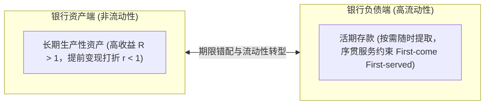
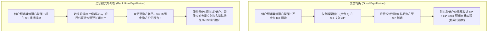
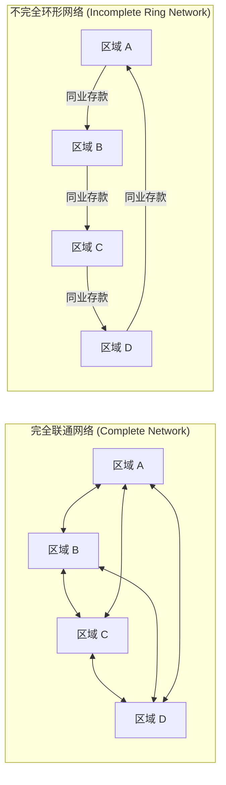
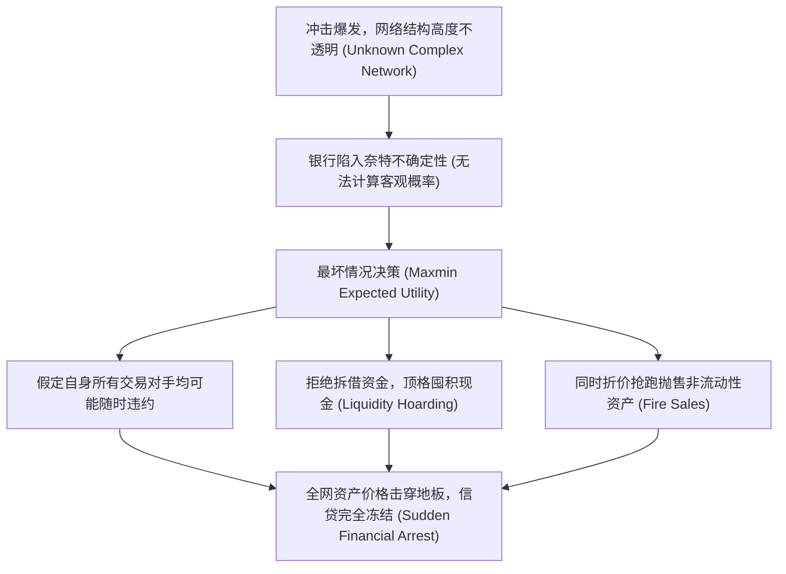

# Lec 4 流动性转型、挤兑与网络传染（Runs, Panics, and Contagion）

> **授课教师**：Ricardo J. Caballero（MIT 经济学系讲席教授）  
> **本地官方课件**：[Lec 4 课件幻灯片 PDF](./sources/mit14_454_s26_lec4.pdf)  
> **核心参考文献**：
> - Diamond, D. W., & P. H. Dybvig (1983), [*"Bank Runs, Deposit Insurance, and Liquidity"* (PDF)](./sources/papers/DD83jpe.pdf), *Journal of Political Economy*, 91(3): 401–419.
> - Allen, F., & D. Gale (2000), [*"Financial Contagion"*](https://www.jstor.org/stable/10.1086/262109), *Journal of Political Economy*, 108(1): 1–33.
> - Caballero, R. J., & A. Simsek (2013), [*"Fire Sales in a Model of Complexity"* (PDF)](./sources/papers/Fire%20Sales%20in%20a%20Model%20of%20Complexity.pdf), *Journal of Finance*, 68(6): 2549–2587.

## TL;DR

- 银行作为“流动性资金池”通过大数定律开展期限错配（用流动性负债对接非流动性资产），但在序贯服务约束下天然内生出协调失灵的多重纳什均衡。
- Diamond-Dybvig (1983) 证明帕累托最优流动性保险必须提供高于储存回报的早期清偿（$c_1^* > 1$），但若储户预期他人会挤兑，耐心储户的理性选择也是加入挤兑，迫使银行过早折价清算长期资产。
- Allen-Gale (2000) 揭示了清算网络架构对金融传染的非对称影响：全联通的完全网络能分散局部冲击；而环形等不完全网络会将微小的未预期流动性冲击放大为沿清算链条逐级崩塌的系统性雪崩。
- Caballero-Simsek (2013) 进一步证明，当复杂的金融网络结构不可被微观个体完全观测时，奈特不确定性将促使所有金融机构按“最坏情形”防御性囤积流动性，触发毁灭性的全网火灾抛售与金融休克。

## 期限错配与流动性保险：Diamond-Dybvig (1983) 模型

银行最核心的宏观功能是**期限转换（Maturity Transformation）**：实体经济需要长周期的固定资产投资（如厂房、基建），而家庭部门面临未知的特质流动性需求（如生病、突发消费）。银行汇聚海量储户资金，利用大数定律（LLN）平滑非同步的提款需求。

### 1. 经济环境设定

- **时间跨度**：三个时期 $t = 0, 1, 2$。单一消费品。
- **参与主体**：测度为 1 的同质消费者，在 $t=0$ 均拥有 1 单位初始禀赋。
- **技术结构**：
  - **短期存储技术**：从 $t$ 期存到 $t+1$ 期，每 1 单位投入产出 1 单位产出（毛回报为 1）；
  - **长期生产项目**：在 $t=0$ 投入 1 单位，若持有至 $t=2$ 期到期，产生高收益 $R > 1$；若在 $t=1$ 期中途被迫清算，残值仅为 $r \le 1$（存在非流动性折价）。
- **流动性偏好冲击**：在 $t=1$ 期，每位消费者私下获知自己的真实类型：
  - **急躁型（不耐心，Type 1）**：概率为 $\lambda \in (0, 1)$，仅在 $t=1$ 消费，效用为 $u(c_1)$；
  - **耐心型（Type 2）**：概率为 $1 - \lambda$，在 $t=2$ 消费，效用为 $u(c_2)$。
- **风险厌恶假定**：相对风险厌恶系数大于 1：$-\frac{c u''(c)}{u'(c)} > 1$。

### 2. 三种资源配置基准的对比

#### （1）自给自足（Autarky / 孤立无市场）
个体在 $t=0$ 必须在短期存储（投入 $1 - I$）与长期项目（投入 $I$）之间做权衡。
若成为急躁型，只能清算长期资产：$c_1 = (1 - I) + r I \le 1$；若成为耐心型：$c_2 = (1 - I) + R I$。
个体面临巨大的特质流动性风险，导致长期高收益投资严重不足。

#### （2）事后金融市场（Ex-post Financial Market）
假设允许在 $t=1$ 交易债券。急躁型向耐心型出售长期资产份额。
市场清算价格为 $p$。均衡时由于类型不可观测且缺乏事前保险，最终消费为：

$$c_1 = 1, \quad c_2 = R$$

市场未能提供任何跨期消费平滑：急躁型消费极低，耐心型消费极高（$c_2 \gg c_1$）。

#### （3）社会规划者最优流动性保险（First-Best Planner's Allocation）
中央规划者在总资源约束下求解全社会福利最大化：

$$\max_{c_1, c_2, I} \lambda u(c_1) + (1 - \lambda) u(c_2)$$

$$\text{s.t.} \quad \lambda c_1 \le 1 - I, \quad (1 - \lambda) c_2 \le R I$$

消去 $I$，总资源约束为 $\lambda c_1 + \frac{(1 - \lambda) c_2}{R} \le 1$。最优一阶条件（FOC）为：

$$u'(c_1^*) = R u'(c_2^*)$$

::: theorem 最优流动性保险定理（Diamond & Dybvig 1983）
在相对风险厌恶大于 1 的条件下，帕累托最优配置必然满足：
$$c_1^* > 1 \quad \text{且} \quad c_2^* < R$$
规划者通过在大数法则下汇集流动性，为不幸成为急躁型的家庭提供了跨状态保险（消费高于其本金 1），而由耐心型家庭让渡部分潜在高收益（消费低于极限收益 $R$）。
:::

### 3. 活期存款契约与自实现挤兑（Self-fulfilling Runs）

商业银行通过发行**活期存款契约（Demand Deposit Contract）**可以在分散经济中完全去中心化实现最优配置 $(c_1^*, c_2^*)$：
- 储户在 $t=0$ 存入 1 单位；
- 储户若在 $t=1$ 要求取款，银行按承诺无条件给付 $c_1^*$，直至银行资产耗尽；
- 储户若在 $t=2$ 取款，按剩余资产平分 $c_2^*$。
- **序贯服务约束（Sequential Service Constraint）**：银行面对排队提款的储户，只能遵循“先到先得”原则支付现金，无法事后核实提款者到底是真急躁还是假急躁。

该契约必然存在**多重纳什均衡（Multiple Nash Equilibria）**：

### 4. 挤兑防范机制与政策评价

1. **暂停兑付（Suspension of Convertibility）**：
   - 规则：银行声明在 $t=1$ 仅向前 $\lambda$ 比例的提款人兑付，随后强行关门。
   - 局限：在现实中，全社会的提款需求比例 $\lambda$ 并非恒定常数，而是随机波动的。一旦 $\lambda$ 存在不确定性，硬性设定关门线将误伤真实急躁储户。
2. **政府全额存款保险（Deposit Insurance / FDIC）**：
   - 机制：政府以税收能力担保所有储户在 $t=2$ 必然能拿到承诺的收益 $c_2^*$。
   - 效果：彻底消除了耐心储户因为害怕他人提款而被迫提款的恐惧，从微观博弈支付矩阵上**直接消除了坏均衡**。在理性预期下，政府甚至无需在均衡中支付任何真实保险金，仅凭担保即可维持系统稳定。
3. **最后贷款人（Lender of Last Resort, LLR）**：
   - 央行根据白芝浩原则（Bagehot's Rule），以合格抵押品和惩罚性利率向面临挤兑的银行提供无限流动性贴现，遏制资产负债表贱卖。

## 金融清算网络与危机传染：Allen-Gale (2000) 模型

当危机不再局限于单家银行，而是沿着金融机构间的同业拆借与交叉持股网络扩散时，系统性风险呈现出何种网络传导规律？

### 1. 区域模型设定与网络拓扑

考虑包含 4 个地理区域 $A, B, C, D$ 的经济体：
- 每个区域均包含大量 Diamond-Dybvig 类型的商业银行与储户；
- 区域间的流动性需求呈现**负相关对冲特征**：
  - 奇数区域（$A, C$）：在 $t=1$ 期，其中一个区域遭遇高流动性需求（急躁比例 $\omega_H$），另一个区域遭遇低流动性需求（急躁比例 $\omega_L$）；
  - 偶数区域（$B, D$）同样如此。
  - 全社会总急躁比例恒定：$\gamma = \frac{\omega_H + \omega_L}{2}$。

银行为了对冲本地流动性波动，在区域间建立跨区同业存款。Allen & Gale 对比了两种极端网络架构：

### 2. 网络脆弱性与传染机制对比

::: theorem 网络结构与传染鲁棒性定理（Allen & Gale 2000）
1. **完全网络（Complete Network）具备绝对鲁棒性**：当每个区域均匀持有所有其他区域的资产时，任何局部的流动性压力被全网 $N$ 个节点均摊吸收，系统能够平滑实现全社会第一最佳配置。
2. **不完全网络（Incomplete Network）具备极度脆弱性**：在单向环形清算网络中，局部节点的流动性缺口只能由其单一上游或下游吸收。一旦遭遇微小未预期冲击，网络将产生逐级违约的“多米诺骨牌式”系统性雪崩。
:::

#### 环形网络雪崩的推导：
假设发生了一个事前概率为 0 的微小总流动性冲击 $\epsilon > 0$，导致区域 $A$ 的急躁储户比例变为 $\omega_H + \epsilon$：
1. 区域 $A$ 产生大小为 $\epsilon c_1$ 的流动性缺口，在耗尽内部缓冲后，被迫提前折价清算长期资产；
2. 若清算价值依然无法满足提款，区域 $A$ 的银行宣告破产倒闭，对其对区域 $D$ 的同业存款债务发生全额或大额违约；
3. 区域 $D$ 原本指望提取存放在 $A$ 的资金来满足本区储户，随着资产负债表资产端被穿透，区域 $D$ 瞬间沦为资不抵债，被迫破产并对区域 $C$ 违约；
4. 违约脉冲沿着环形网络 $A \to D \to C \to B$ 顺时针横扫整个经济体，原本只需局部清算的微小扰动最终导致全网银行相继关门。

## 复杂网络、奈特不确定性与火灾抛售：Caballero-Simsek (2013)

Caballero 与 Simsek（2013）在金融网络中引入了**奈特不确定性（Knightian Uncertainty）与网络拓扑复杂性（Complexity）**：

在真实危机中，金融网络错综复杂（交叉持股、CDS 衍生品担保、多层再质押）。微观银行无法看清全网数千家机构的资产负债表拓扑关系。

::: theorem 复杂性放大定理（Caballero & Simsek 2013）
在已知网络中，即使发生流动性冲击，健康金融机构能够准确识别具有偿付能力的对手方，充当私营部门“白衣骑士”低价吸筹，阻止火灾抛售扩散。
而在不透明的复杂网络中，**不确定性的突然飙升导致信息生产机制瘫痪，微观极度审慎的自保行为（囤积流动性与提前平仓）直接在宏观上窒息了整个金融市场**。
:::

::: example
- **2008 年回购市场挤兑（Repo Run - Gorton & Metrick）**：
  在 2008 年次贷危机前，高质量资产证券化产品（AAA 评级 ABS）的隔夜回购扣减率（Haircut）接近 0%。当次贷亏损暴露后，由于没人知道哪只 ABS 背后含有毒资产，全市场质押率瞬间提高至 50% 以上。影子银行体系在一夜之间遭遇了数万亿美元规模的无声挤兑。
:::

::: insight
传统观点认为“金融一体化与网络互联总是能分散风险”。但 Allen-Gale 与 Caballero-Simsek 深刻揭示了**金融网络的双刃剑特质**：
当外部冲击处于“正常吸收阈值”之内时，互联网络确实能起到分散吸收冲击的减震器作用；但一旦冲击跨越临界值且网络透明度不足，网络互联便会立刻从“风险分散器”突变为“系统性风险的超导体”。
:::

::: pitfall
**常见误区：将银行挤兑单纯理解为储户到实体网点排队取钞票**。
在现代金融市场中，以 SVB 为代表的手机网银即时提款，以及以投行和对冲基金为代表的隔夜回购到期不续约、主经纪商（Prime Broker）保证金抽逃、甚至在衍生品市场上拒绝接受非现金质押品，都是具有毁灭性速度的现代挤兑形态。现代危机中的挤兑往往在数小时内就能以电子信号形式完成清算瘫痪。
:::
