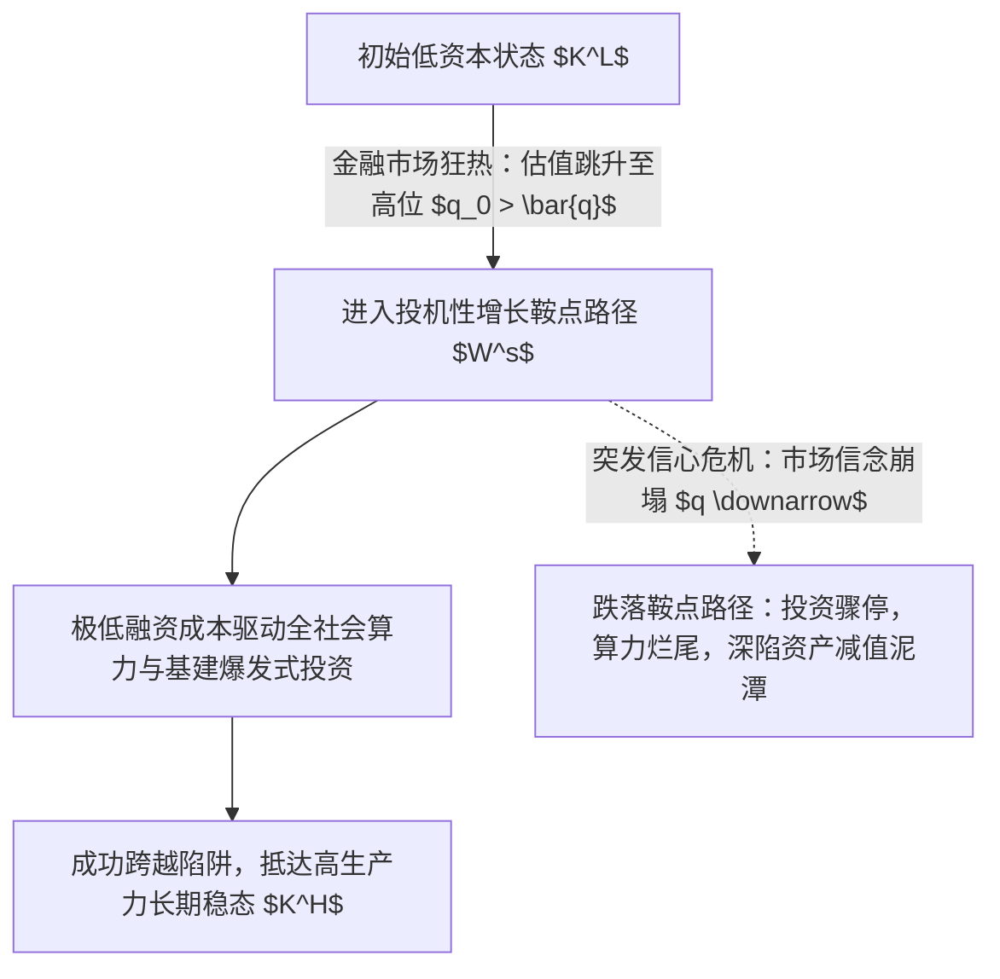

# Lec 5 资产泡沫、投机机制与投机性增长（Bubbles, Speculation, and Speculative Growth）

> **授课教师**：Ricardo J. Caballero（MIT 经济学系讲席教授）  
> **本地官方课件**：[Lec 5 课件幻灯片 PDF](./sources/mit14_454_s26_lec5.pdf)  
> **核心参考文献**：
> - Tirole, J. (1985), *"Asset Bubbles and Overaccumulation of Capital"*, *Econometrica*, 53(6): 1499–1528.
> - Allen, F., & D. Gale (2000), [*"Bubbles and Crises"*](https://academic.oup.com/mnras/article-lookup/doi/10.1111/1468-0262.00105), *Economic Journal*, 110(460): 236–255.
> - Abreu, D., & M. K. Brunnermeier (2003), [*"Bubbles and Crashes"*](https://scholar.princeton.edu/markus/publications/bubbles-and-crashes), *Econometrica*, 71(1): 173–204.
> - Harrison, J. M., & D. M. Kreps (1978), *"Speculative Investor Behavior in a Stock Market with Heterogeneous Expectations"*, *Quarterly Journal of Economics*, 92(2): 323–336.
> - Caballero, R. J., E. Farhi, & M. L. Hammour (2006), [*"Speculative Growth: Hints from the US Economy"* (PDF)](./sources/papers/w12939.pdf), *American Economic Review*, 96(4): 1159–1192.

## TL;DR

- 资产泡沫并非仅是市场参与者的非理性狂热，而是可以在严格的微观博弈与宏观一般均衡中内生产生的均衡现象。
- 资产短缺与理性泡沫（Samuelson-Tirole）：在动态无效率（$r < g$）经济中，缺乏安全储蓄工具导致资本过度积累，纯粹由信心支撑的无内在价值泡沫可作为价值储藏手段，挤出低效资本并达成帕累托改善。
- 风险转移泡沫（Allen-Gale）与转售期权溢价（Harrison-Kreps）：有限责任下的债务杠杆鼓励“拿别人的钱冒险”，推高资产溢价；而在卖空限制与信念分歧下，投机者即便明知资产高估，也会为了未来以更高价格倒手给更乐观者的“转售期权”而理性买入。
- Caballero 投机性增长（Speculative Growth）理论：在生成式 AI 与颠覆性技术革命中，劳动替代型资本带来“扁平 MPK 区域”，资产高估值通过降低外部融资成本自发开辟出通向高资本稳态的鞍点路径；但这种繁荣极具信念脆弱性，预期动摇将引发毁灭性的估值崩塌。

## 资产泡沫分析的四大经典微观范式

纵观荷兰郁金香狂热、南海泡沫、1929 年美股大崩溃、2000 年互联网泡沫直至现代加密资产与 AI 浪潮，经济学界形成了四套解释资产价格系统性脱离现金流贴现基本面的严密理论模型：

---

### 范式一：资产短缺与理性泡沫（Rational Bubbles in OLG）

考虑 Samuelson (1958) 与 Tirole (1985) 的两期世代交叠（OLG）经济：
- **家庭禀赋与储蓄需求**：家庭在年轻时拥有劳动禀赋 $w_t$，年老时不劳动作业。为了跨期平滑消费，必须在年轻时将部分收入储蓄。
- **动态无效率困境（Dynamic Inefficiency）**：
  若经济中自然界提供的实物资本或存储技术的边际回报率过低（$R < 1+n$，其中 $n$ 为人口或经济增长率，静态无增长下即 $r < 1$），全社会在年轻时为防老而被迫储蓄过多资本，导致资本边际产出低于折旧与维护成本，陷入“黄金律水准（Golden Rule）之外的动态无效率”。
- **泡沫资产的引入**：
  设市场上存在一种完全没有生产力、不产生任何内在股息的纯纸面资产（如法定纸币或不可兑换代币），总量固定，以价格 $B_t > 0$ 进行交易。
  年轻一代购买泡沫资产作为养老储蓄：$c_t^y = w - B_t$；年老时将该资产卖给下一代：$c_{t+1}^o = B_{t+1}$。
  在平稳均衡中，泡沫资产的收益率为经济增长率 $R_{bubble} = 1 > r$。

::: theorem 泡沫的帕累托改善定理（Tirole 1985）
令 $x \equiv B/w \in (0, 1)$ 为社会储蓄中泡沫资产的份额。全社会稳态终生效用为：
$$U(x) = u(w(1-x)) + u(wx)$$
在 $r < 1$ 时，引入泡沫资产能够挤出（Crowd-out）那些在边际上回报过低的实物资本投资，将资源直接转移给老年人消费，**自发使市场经济恢复至资本积累的黄金律边界，实现代际帕累托改善**。
:::

---

### 范式二：信贷代理摩擦与风险转移（Risk Shifting）

Allen & Gale (2000) 证明，无需假设代际交叠或无限期界，**仅凭信贷市场中的有限责任与债务合约**即可催生巨大泡沫：
1. **借贷结构**：投机者没有自有资金，从商业银行借入短期债务资金 $B$，以价格 $P$ 在市场上竞价购买某种风险资产；
2. **不对称博弈**：资产在期末产生随机回报率 $R \sim h(R)$。借款人向银行支付约定本息 $r P$：
   - 若 $R > r P$：借款人攫取全部剩余净利润 $R - r P$；
   - 若 $R \le r P$：借款人触发有限责任违约破产，收益截断为 0，亏损全部由放贷银行承担！
3. **泡沫溢价**：由于只享受上行红利而不承担下行尾部风险，借款人具有极强的冒险动机。借款人的竞价一阶条件为：
   $$\int_{r P}^\infty (R - r P) h(R) dR \implies P > P_{\text{fundamental}}$$
   不仅如此，若资产回报分布经历一次**均值保持展开（Mean-Preserving Spread, MPS，即风险波动率上升）**，由于有限责任的看涨期权凸性（Convexity），借款人愿意支付的泡沫资产价格 $P$ 反而进一步暴涨！

---

### 范式三：同步风险与推迟套利（Synchronization Risk & Riding the Bubble）

传统有效市场假说认为：只要存在理性套利者，任何资产泡沫会被瞬间做空抹平。Abreu & Brunnermeier (2003) 彻底颠覆了这一假说：
- **信息结构的异质感知时间**：
  资产价格由于非理性散户的追捧持续膨胀。理性套利者在不同随机时点 $t_i$ 独立意识到该资产估值已经脱离基本面。
- **缺乏公共知识（Lack of Common Knowledge）**：
  “我知道资产有泡沫”并不意味着“我知道你知道资产有泡沫”，更不意味着“我知道你知道我知道……”。
- **做空约束与协调困境**：
  单个套利者受制于资本限制无法独自打爆泡沫。只有当全网至少达到临界比例 $\kappa$ 的套利者同时协同做空时，泡沫才会崩溃。
- **最优投机策略：骑乘泡沫（Riding the Bubble）**：
  在达到协调临界点之前，过早做空不仅无法平抑泡沫，反而会承担巨大的融券做空利息并面临踩踏爆仓。因此，**完全理性的套利者的最优纳什均衡策略是“将计就计，火中取栗”——与散户一同买入推高泡沫以获取暴利资本利得，直至最后一刻精准出逃**。理性套利因此非但没有消除泡沫，反而延长了泡沫的存在时间。

---

### 范式四：信念分歧与转售期权（Resale Option Valuation）

Harrison & Kreps (1978) 提出了转售期权定价模型：
- 市场上存在不同主观信念的主体（如根据不同贝叶斯先验更新信息的乐观者与悲观者），且市场上**存在卖空限制（Short-sales Constraints）**；
- 悲观者无法融券做空，因此现货价格完全由最乐观的边际买方决定（Miller 1977 偏差）；
- **动态转售期权**：更深刻的是，在动态交易中，资产价格不仅反映当期持有人的股息期望，还内生包含了**转售期权价值（Resale Option Value）**：
  $$P_t = E_t^{\text{agent}}\left[\sum_{s=1}^\infty R^{-s} D_{t+s}\right] + \text{Option Value of Reselling to a Future More Optimistic Trader}$$
  即使当前买方明知当前的资产价格已经高于其自身算出的长线持有贴现价值，只要他预期未来市场存在信念分歧的洗牌，他就可以在未来某个状态将资产倒手卖给比他更狂热的下一个接盘侠！

---

## 卡瓦列罗前沿：投机性增长与 AI 繁荣的脆弱性

在当前由大语言模型与生成式人工智能引发的全球科技投资浪潮中，学术界与政策层最激烈的辩论在于：**这是一场必将幻灭的纯金融泡沫，还是代表真实生产率飞跃的产业革命？**

Caballero, Farhi & Hammour (2006) 以及 Caballero（2026 最新框架）提出了兼顾两者统一的分析范式——**投机性增长（Speculative Growth）**。

### 1. 核心技术特征：劳动替代型 AI 与“扁平 MPK 区域”

传统资本品的边际收益递减规律十分陡峭（$F_{KK} \ll 0$）。
然而，具有强大人类劳动替代能力的通用人工智能（Labor-like AI Capital）改变了这一生产函数：
- 在传统资本存量区间，资本与劳动力互补；
- 当资本存量进入中等规模后，AI 开始全面接替白领与认知劳动。在极宽的资本存量区间内，**资本边际产出（MPK）呈现近乎水平的“扁平区域”（Flat MPK Region）**：
  $$r_K \approx \bar{R} \quad \text{for } K \in [K^L, K^H]$$
- 这种扁平的 MPK 区域导致系统具备了产生**多重稳态（Multiple Steady States）**的物理基础：低技术低资本稳态 $K^L$、不稳定过渡中继 $K^M$、以及高技术高繁荣稳态 $K^H$。

### 2. 托宾 Q 跨期传导与投机性增长鞍点

引入托宾 $q$ 投资理论与资本调整成本 $\psi(I/K)$。投资动态学方程为：

$$\dot{K}_t = I_t - \delta K_t = \left[ \phi(q_t) - \delta \right] K_t$$

$$\dot{q}_t = (r_t + \delta) q_t - r_K(K_t)$$

- **繁荣期的资本深化机制**：
  若金融市场因对 AI 的乐观叙事形成极高的资产估值（$q_t \gg 1$），这种在传统分析师眼中看似“充满泡沫与投机”的高估值，在微观上极大地摊薄了前沿科技企业的资本成本，使得数百亿美元的先进芯片制造、数据中心、核电供应等巨额固定资产投入能够被迅速融通。
- **跨期鞍点稳定流形（Stable Manifold $W^s$）**：
  高估值驱动全社会资本跨越 $K^L$ 的引力陷阱，沿着投机性增长轨迹向高资本稳态 $K^H$ 高速巡航！

::: theorem 投机性增长的双重性定理（Caballero et al. 2006, 2026）
投机性增长既不是无中生有的纯纸面骗局，也不是没有风险的自然演进：
1. **真实生产性（Productivity-backing）**：高估值直接转化为不可逆的高生产性实物资产积累，最终稳态的实体福利确实远高于初始状态；
2. **极度信念脆弱性（Belief-driven Fragility）**：该路径的维系完全依赖于未来市场参与者对高估值的持续信念协调。如果资本在尚未抵达高位稳态 $K^H$ 之前市场信心发生动摇，托宾 $q$ 断崖暴跌，系统将瞬间跌出稳定鞍点流形，演化为严重的资本闲置与资产负债表型衰退。
:::

::: example
- **历史映射：1990 年代互联网浪潮与光纤泡沫**：
  1990 年代末美股对网络科技股的狂热估值虽然在 2000 年暴跌 80%，但正是这场投机繁荣留下了铺满全美的高速海底光缆、IP 清算网络与服务器基础设施，直接构筑了随后二十年全球移动互联网繁荣的物理底座。
:::

::: insight
传统央行“逆风抗浪”（Leaning Against the Wind）的教条主张在资产出现估值溢价时立刻暴力加息戳破泡沫。但投机性增长理论敲响了警钟：
对于具有强大正向技术外溢性的前沿领域，**粗暴加息不仅戳破了金融资产溢价，更会扼杀通往高技术稳态所必需的昂贵资本深化进程**。最优宏观政策绝非一味打压估值，而是在维持融资环境活力的同时，通过宏观审慎工具严禁高杠杆负债介入投机，将投机风险严格限制在具有股权吸收损失能力的风险资本圈层之内。
:::

::: pitfall
**常见误解：认为只要某项技术在未来能够真正改变世界，当前的股票估值就绝不可能存在泡沫**。
即便 AI 的技术前景 100% 真实，根据 Abreu-Brunnermeier 与 Harrison-Kreps 模型，二级市场的资产价格仍然会被风险转移、转售期权与投机倒把推升至不可持续的狂热高位。技术的长期物理真实性与短期金融资产价格的泡沫化非但不矛盾，反而是投机繁荣中一体两面的必然孪生现象。
:::
