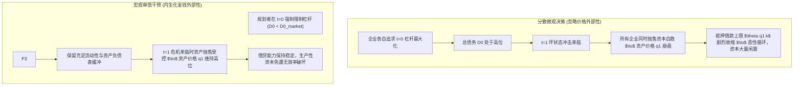
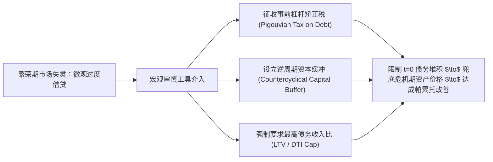

# Lec 6 信贷繁荣、金钱外部性与过度借贷（Credit Booms and Pecuniary Externalities）

> **授课教师**：Ricardo J. Caballero（MIT 经济学系讲席教授）  
> **本地官方课件**：[Lec 6 课件幻灯片 PDF](./sources/mit14_454_s26_lec6.pdf)  
> **核心参考文献**：
> - Lorenzoni, G. (2008), *"Inefficient Credit Booms"*, *Review of Economic Studies*, 75(3): 809–833.
> - Martin, A., & J. Ventura (2012), *"Economic Growth with Bubbles"*, *American Economic Review*, 102(6): 3033–3058.
> - Martin, A., & J. Ventura (2016), [*"Managing Credit Bubbles"* (PDF)](./sources/papers/macrebu_pub-1.pdf), *Journal of the European Economic Association*, 14(3): 753–789.
> - Farhi, E., & I. Werning (2016), [*"A Theory of Macroprudential Policies in the Presence of Nominal Rigidities"* (PDF)](./sources/papers/w19313.rev1.pdf), *Econometrica*, 84(5): 1645–1704.

## TL;DR

- 跨国历史实证表明，“由信贷驱动的资产繁荣”（Leveraged Booms）是预警系统性金融危机最具解释力的单一指标，其崩溃后引发的经济衰退深度远超单纯的无杠杆估值调整。
- Martin-Ventura 信贷泡沫模型证明：在抵押品极度匮乏的非完全市场中，信贷泡沫不仅是投机，还能通过将低效率散户储蓄导入高生产率企业实现生产性投资的“挤入效应”（Crowding-in）；然而该信贷链条天然具有断裂反噬的高脆弱性。
- Lorenzoni (2008) 经典模型确立了现代宏观审慎监管的理论基石：在有限承诺与流动性短缺下，微观主体在繁荣期制定借贷决策时将危机期的资产抛售价格视作外生常数，忽略了自身杠杆对市场出清价格的边际打压，构成了系统性的“金钱外部性”（Pecuniary Externality）。
- 分散竞争均衡必然内生出“过度借贷”（Overborrowing）与“过度投资”；社会规划者通过在事前征收杠杆税或实行借贷额度上限管制，能够实现严格的帕累托改善。

## 杠杆繁荣与危机的经验事实

近代经济史上充斥着“繁荣—萧条”周期。Mendoza & Terrones (2008) 以及 Schularick & Taylor (2012 AER, *"Credit Booms Gone Bust"*) 通过覆盖 140 年间数十个主要工业化国家的宏观历史数据库确立了强健的经验事实：

1. **金融危机的信贷前兆**：几乎所有严重的现代系统性银行业危机之前，都伴随着长达数年的实体经济信贷/GDP 比例超趋势扩张；
2. **杠杆资产泡沫的破坏力非对称性**：
   - **纯权益型泡沫破裂（如 2000 年美股互联网泡沫）**：居民与机构主要通过自身股权承担损失，银行资产负债表相对完好，危机后经济仅经历浅度衰退并迅速复苏；
   - **信贷杠杆型泡沫破裂（如 1929 年大萧条与 2008 年次贷危机）**：资产下跌直接击穿银行与家庭资产负债表，引发违约海啸与信贷冷冻，带来不可逆的长期产出损失。

## Martin-Ventura 框架：信贷泡沫与资本积累的“挤入效应”

在传统的 Samuelson-Tirole 泡沫模型中，资产泡沫仅仅是挤出低回报实物投资的纯消费工具。Alberto Martin 与 Jaume Ventura（2012, 2016）将金融约束与借贷中介引入 OLG 模型，提出了**信贷泡沫（Bubbly Credit）理论**：

### 1. 抵押品匮乏经济体（Collateral-Scarce Economies）
在存在严重信贷市场摩擦的发展中国家或转型经济体中，高生产率的企业家往往缺乏足够的合格质押品向低生产率的普通家庭借款。这导致大量社会储蓄只能滞留在低效部门，形成广泛的资本配置错配。

### 2. 泡沫作为“人造抵押品”的挤入机制
- **信用凭证的自发形成**：当市场上出现某种泡沫资产（如土地投机溢价或无担保金融凭证）时，企业家可以通过购买或发行这种未来具有升值预期的凭证作为抵押品，向普通储户借入更多现金；
- **投资挤入（Crowding-in）**：与新古典模型相反，在金融摩擦下，**信贷泡沫非但没有挤出实体生产，反而扩大了高生产率企业家的外部借款容量，将社会闲置储蓄成功导向了高效生产性投资**！
- **双刃剑的反噬**：一旦未来预期的折现值发生破灭，作为抵押品底座的“人造资产”瞬间蒸发，导致整个信贷中介网络彻底休克。

## Lorenzoni (2008) 规范模型：金钱外部性与过度借贷

Guido Lorenzoni（2008）建立了宏观审慎监管领域最经典的三期一般均衡模型，从福利经济学严格证明了**为什么不受管制的自由市场必然会导致过度借贷**。

### 1. 经济环境设定

- **时间跨度**：三个时期 $t = 0, 1, 2$。两种商品：即期消费品与资本品。
- **参与主体**：
  - **连续统测度为 1 的生产性企业（借款人）**：由风险中性企业家运营；
  - **连续统测度为 1 的无风险消费者（放贷人）**：拥有充裕的跨期消费品储蓄，折现率标准化为 1。
- **初始投资（$t=0$）**：
  企业家将消费品转化为资本品，投资生产技术成本函数为凸函数 $c(i)$，满足 $c' > 0, c'' > 0$。投入 $c(i)$ 单位消费品可构建 $i$ 单位专用资本。
  企业在 $t=0$ 的初始净资产为 $w_0$。若投资规模 $i$ 超过自有资金，企业发行债务 $d_0 = c(i) - w_0$。
- **状态不确定性与流动性冲击（$t=1$）**：
  在 $t=1$ 期，外生随机状态 $s \in S$ 揭晓，发生概率为 $\pi_s$。
  企业面临流动性再投资需求，或遭遇债务提前索偿。
- **最终生产（$t=2$）**：
  若企业在 $t=1$ 期结束时仍保留 $k$ 单位存量资本，其在 $t=2$ 期将生产 $A_s k$ 单位消费品。

### 2. 有限承诺与资本二级清算市场

- **抵押与承诺约束（Limited Commitment）**：
  在 $t=2$ 期，企业家可以随时违约。债权人最多只能追索企业产出的一个固定份额 $\theta \in (0, 1)$。因此企业在 $t=1$ 期能够向外部借入的最高新债务上限受制于可质押现金流：
  $$b_1 \le \theta A_s k$$
- **资产火灾抛售（Fire Sales）机制**：
  如果企业在 $t=1$ 期面临的债务偿还责任超过了新债务上限，企业唯一的生路是**在二级资产市场上变卖部分存量资本品 $\Delta k$**。
  变卖资本品由外部非受限主体（如其他未受冲击的行业或清算资金）吸收，其对资本的反需求函数为递减曲线：
  $$q_{1,s} = Q(k_{1,s}), \quad Q' < 0$$
  其中 $q_{1,s}$ 为 $t=1$ 期状态 $s$ 下的资本二级市场价格。全行业被迫抛售的资本越多，资产价格 $q_{1,s}$ 跌幅越惨烈。

### 3. 分散竞争均衡与社会规划者对比

#### （1）分散市场主体的微观最优化（Decentralized Agent）
每个单独的企业家在 $t=0$ 选择最优投资 $i$ 与初始借债规模 $d_0$。
**关键价格接受假设（Price-taking Assumption）**：由于每个企业家在全市场中微不足道，他在 $t=0$ 规划决策时，**将各个状态下的未来资产价格 $q_{1,s}$ 视作自己无法影响的外生给定参数**！
借款人的一阶条件权衡了 $t=0$ 的投资边际收益与 $t=1$ 坏状态下被迫抛售资本的期望损失。

#### （2）受约束社会规划者问题（Constrained Social Planner）
社会规划者无法废除微观的有限承诺约束（不能强行消灭 $\theta$ 摩擦），但规划者在求解全社会福利最大化时，**完全内生化了市场加总变量对资产清算价格的传导机制**：

$$q_{1,s} = Q\left( K_{1,s}(D_0) \right)$$

规划者的拉格朗日乘子中包含了一项关键的边际项：

$$\text{Planner's FOC} = \text{Private FOC} + \sum_{s} \pi_s \mu_s \cdot \underbrace{\frac{\partial q_{1,s}}{\partial D_0}}_{< 0} \cdot \text{Net Asset Position}$$

其中 $\mu_s > 0$ 为借贷约束在危机状态下的影子价格。

::: theorem 过度借贷与金钱外部性定理（Lorenzoni 2008）
在存在抵押借贷约束与资产清算折价的市场中，分散竞争均衡所内生的初始借债规模严格大于受约束社会最优水平：
$$D_0^{\text{decentralized}} > D_0^{\text{planner}}$$
**分散主体系统性地“过度借贷”（Overborrowing）和“过度投资”（Overinvestment）**。市场无法自发实现第一福利定理，竞争均衡是受约束低效的（Constrained Inefficient）。
:::

### 4. 机制解剖：为什么金钱外部性会导致真实无效率？

在标准完全竞争微观经济学中，价格变动带来的外部性（金钱外部性）仅仅是财富从卖方转移到买方，是纯粹的分配效应，不影响全社会帕累托效率。
但在宏观金融危机模型中，**金钱外部性直接污染了微观借贷约束方程中的状态变量**：

1. 资产价格 $q_{1,s}$ 不仅充当相对价格，而且直接决定了**借款人的抵押能力上限（Borrowing Capacity）**；
2. 当 $q_{1,s}$ 崩溃时，原本能够创造高边际产出的生产性企业被迫清算，而接盘方往往是生产效率低下的非专用主体；
3. 这种价格下跌导致了生产要素在不同主体之间的**严重错配与不可逆物理摧毁**，使得金钱外部性演变为了全社会真实总剩余的永久性净损失。

## 宏观审慎监管的福利经济学原理

Lorenzoni 模型的推导为现代中央银行与金融监管当局实施**宏观审慎政策（Macroprudential Policy）**提供了不可辩驳的公理化证明：

1. **事前干预优于事后救助**：
   若仅在危机爆发时（$t=1$）由央行放水救市，不仅面临纳税人资金损失，更会诱发严重的道德风险；最优监管必须在繁荣期（$t=0$）通过设立贷款价值比（LTV）上限或逆周期资本缓冲，遏制债务的过度累积。
2. **矫正税的福利增进机制**：
   在 $t=0$ 对企业借贷征税，虽然会在边际上轻微扭曲企业的平稳投资，但该扭曲属于二阶小量（Second-order Loss）；而在危机发生时阻止资产价格崩塌所带来的产出保全效应属于一阶显著量（First-order Gain）！**净福利必然严格为正**。

::: example
- **逆周期资本缓冲（CCyB）的实践**：
  在巴塞尔协议 III（Basel III）框架下，国际清算银行要求各成员国在信贷狂飙期强制银行提取最高 2.5% 的额外逆周期资本缓冲。这正是 Lorenzoni 理论在现代国际银行监管准则中的直接工程化落地。
:::

::: insight
传统自由放任主义常质疑：“如果借款人和银行都是完全理性的聪明人，为什么政府监管者能比他们更明智？”
Lorenzoni 模型给出了最强有力的反驳：**过度借贷的根源从来不是因为企业家‘愚蠢’或‘不理性’，而是因为分散个体的理性目标函数与全社会福利函数之间存在系统性的价格外部性裂痕**。每个人在微观上都做出了完全正确的自利决策，但这些决策的机械相加却把整个经济体推向了系统性自我毁灭的悬崖。
:::

::: pitfall
**常见误区：认为只要银行严格审查借款人的还款能力，信贷繁荣就不会演变为危机**。
在信贷繁荣的高峰期，每一笔贷款在当期看来都具有极其充沛的抵押品覆盖率（如在房价顶点发放的 70% LTV 房贷）。微观审贷流程可以做到天衣无缝，但微观风控无法预见全社会信贷集体见顶后，抵押品资产自身市值的断崖式下杀。宏观审慎监管的核心，恰恰是防范这种“个体看似无懈可击、总体必然崩溃”的系统性合成谬误。
:::
