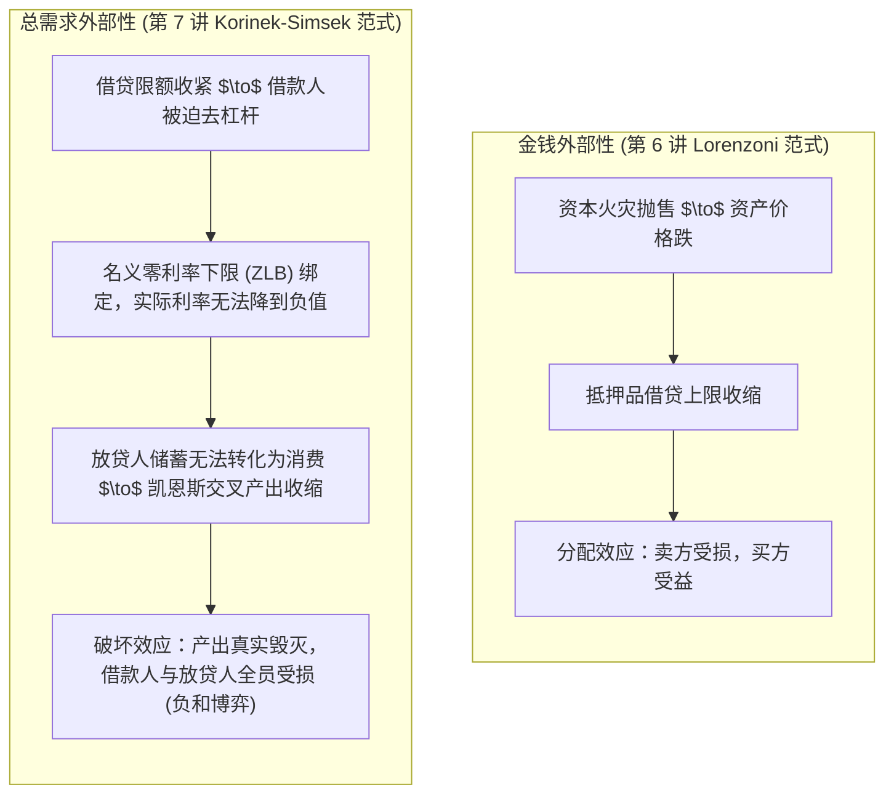
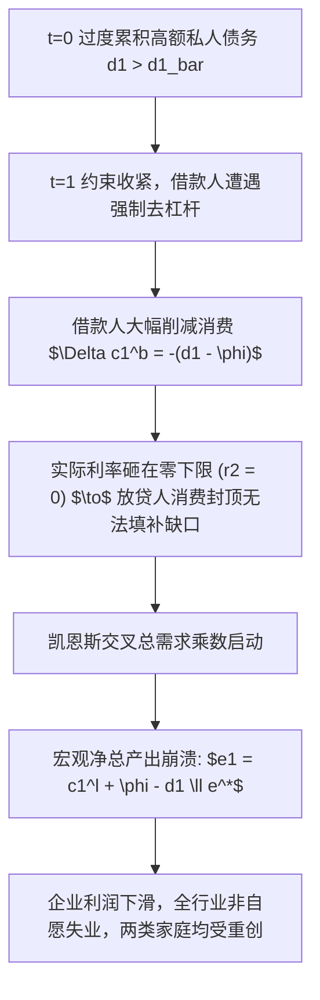
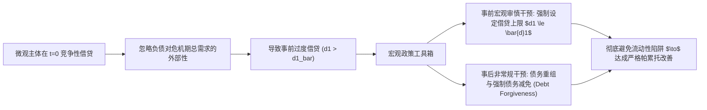

# Lec 7 流动性陷阱、去杠杆与总需求外部性（The Liquidity Trap and Leverage）

> **授课教师**：Ricardo J. Caballero（MIT 经济学系讲席教授）  
> **本地官方课件**：[Lec 7 课件幻灯片 PDF](./sources/mit14_454_s26_lec7.pdf)  
> **核心参考文献**：
> - Korinek, A., & A. Simsek (2016), [*"Liquidity Trap and Excessive Leverage"*](https://www.aeaweb.org/articles?id=10.1257/aer.20140289), *American Economic Review*, 106(3): 699–738.
> - Eggertsson, G. B., & P. Krugman (2012), [*"Debt, Deleveraging, and the Liquidity Trap: A Fisher-Minsky-Koo Approach"*](https://academic.oup.com/qje/article-abstract/127/3/1469/1924252), *Quarterly Journal of Economics*, 127(3): 1469–1513.
> - Guerrieri, V., & G. Lorenzoni (2017), [*"Credit Crises, Precautionary Savings, and the Liquidity Trap"* (PDF)](./sources/papers/w17583.pdf), *Quarterly Journal of Economics*, 132(3): 1427–1467.

## TL;DR

- 在名义利率零下限（ZLB）与名义刚性约束下，宏观经济的本质矛盾从资产价格折价（金钱外部性）转变为总需求不足（总需求外部性）。
- 债务去杠杆机制（Eggertsson-Krugman / Korinek-Simsek）：当借贷约束预期收紧时，高负债借款人因无法借新还旧被迫缩减消费以偿债；而放贷人受制于实际利率零下限，无法通过利率下调无限扩张即期消费予以对冲。
- 凯恩斯交叉与需求螺旋：由于借款人的边际消费倾向（MPC）为 1，微观个体的去杠杆努力转化为全社会总支出的断崖式暴跌，引发产出缺口与非自愿失业。
- 外部性性质的根本跃迁：金钱外部性是一方受损、一方受益的零和再分配；而总需求外部性直接摧毁实际总产出，对借贷双方均造成一阶福利净损失。分散经济存在系统性的“过度借贷”与“保险不足”，事前设定债务上限甚至事后债务减免能够实现严格的帕累托改善。

## 从金钱外部性到总需求外部性

在前两讲（Lec 5 与 Lec 6）中，我们分析了金融危机中的**金钱外部性（Pecuniary Externality）**：当借款人抛售资产时，市场出清价格下跌，导致所有同行的抵押品估值缩水。在金钱外部性中，价格调整本身并不直接凭空消灭商品，只是由于抵押品约束的扭曲带来了效率损失。

然而，2008 年金融危机与 1930 年代大萧条展现了更为致命的宏观现象：**当全社会家庭和企业同时试图削减债务、修复资产负债表时，经济直接跌入了名义利率零下限（Zero Lower Bound, ZLB）的流动性陷阱，导致全社会机器闲置、工人大规模失业、总产出跌破潜在产能**。

欧文·费雪（Irving Fisher, 1933）的“债务-通缩理论”（Debt-Deflation）、海曼·明斯基（Hyman Minsky）的“金融脆弱性假说”以及辜朝明（Richard Koo）的“资产负债表型衰退”（Balance Sheet Recession），在 Korinek & Simsek (2016) 的模型中得到了现代微观基础与规范福利经济学的严密统一。

## Korinek-Simsek (2016) 规范模型推导

### 1. 经济环境设定

- **时间与商品**：时间为离散期界 $t \in \{0, 1, 2, \dots\}$。单一消费品（美元）。
- **两类家庭主体**：经济由等测度（各占 1/2）的两类家庭构成：
  - **借款人（Borrowers, $h = b$）**：主观折现因子较低（不耐心，$\beta^b$）；
  - **放贷人（Lenders, $h = l$）**：主观折现因子较高（有耐心，$\beta^l \ge \beta^b$）。
- **期初债务**：在 $t=0$ 期初，借款人欠放贷人债务 $d_0 \equiv d_0^b = -d_0^l \ge 0$。
- **无约束的初始期（$t=0$）**：在 $t=0$，主体可以完全自由选择借入或借出的下期债务规模 $d_1$。
- **借贷约束的预期收紧（$t \ge 1$）**：
  在 $t \ge 1$ 各期，借贷市场环境发生结构性转变，所有主体面临外生给定的借款上限 $\phi$：
  $$d_{t+1}^h \le \phi \quad \text{for each } t \ge 1$$
  借款人在 $t=0$ 充分知晓未来借贷将被限额为 $\phi$（完全可预期的去杠杆收紧）。

### 2. 名义价格刚性与实际利率下界

- **生产与劳动供给**：1 单位劳动生产 1 单位消费品。引入 Greenwood-Hercowitz-Huffman (GHH) 偏好以消除劳动供给的收入效应：
  $$u(\tilde{c}_t^h - v(n_t^h)) \equiv u(c_t^h)$$
  其中 $c_t^h = \tilde{c}_t^h - v(n_t^h)$ 为**净消费（Net Consumption）**。潜在有效净产出为：
  $$e^* = \max_n [n - v(n)]$$
- **极端新凯恩斯主义价格粘性**：由于垄断竞争企业在短期内价格完全刚性且边际成本低于价格，产出在短期内**完全由总需求决定**。全社会净产出等于两类家庭的净消费之和：
  $$e_t = \frac{c_t^b + c_t^l}{2}$$
- **利率零下限（ZLB）**：
  名义政策利率受制于现金储蓄的零下限：$i_{t+1} \ge 0$。在完全粘性的通胀预期下，**实际利率存在硬性下界**：
  $$r_{t+1} \ge 0 \quad \text{for each } t \ge 1$$
  - 若需求旺盛，$r_{t+1} > 0$，货币政策能够稳定经济至潜在产能：$e_t = e^*$；
  - 若需求极度萎缩，利率触碰零下限 $r_{t+1} = 0$，市场无法通过进一步降息来出清商品，经济跌入**非自愿失业与萧条**：$e_t < e^*$！

### 3. 去杠杆期的微观消费行为（$t=1$）

考虑去杠杆正式发生的关键时期 $t=1$：
在 $t \ge 2$ 的未来稳态中，去杠杆已平稳完成，借贷约束不再动态收紧，经济恢复至充分就业 $e_t = e^*$，稳态无风险利率由耐心的放贷人决定：$1 + r_{ss} = 1/\beta^l > 1$。
家庭在 $t=2$ 的稳态消费分别为：

$$c_2^l = e^* + \phi(1 - \beta^l), \quad c_2^b = e^* - \phi(1 - \beta^l)$$

返回 $t=1$ 期，两类主体的预算约束为：

#### （1）受约束借款人（Borrowers）
借款人由于在 $t=1$ 必须将债务从 $d_1$ 压缩至 $\phi$，其新借款上限被锁定为 $\frac{\phi}{1+r_2}$。借款人的净消费为：

$$c_1^b = e_1 - d_1 + \frac{\phi}{1 + r_2} \overset{r_2=0}{=} e_1 - (d_1 - \phi)$$

::: theorem 借款人边际消费倾向定理
对于负债累累且借款受限的借款人，**其边际消费倾向（MPC）严格等于 1**。借款人在 $t=0$ 每多借 1 美元债务（即 $d_1$ 增加 1），在 $t=1$ 期的消费必须一比一、无保留地缩减 1 美元，将当期收入硬性用于偿还差额本金 $d_1 - \phi$。
:::

#### （2）未受约束放贷人（Lenders）
放贷人没有借款约束，其消费行为严格遵循欧拉方程（Euler Equation）：

$$u'(c_1^l) = \beta^l (1 + r_2) u'(c_2^l)$$

当利率因总需求低迷降至极限下界 $r_2 = 0$ 时，放贷人的即期消费触碰到了它的**生理与理性上限** $\bar{c}_1^l$：

$$u'(\bar{c}_1^l) \equiv \beta^l u'(c_2^l) \implies c_1^l \le \bar{c}_1^l$$

即使全社会借款人大量缩减开支，放贷人也绝不会无限超前消费，因为在 0 利率下将资金留存未来更为合算。

### 4. 流动性陷阱与凯恩斯交叉乘数

全社会在 $t=1$ 期的总收入取决于借款人的被迫去杠杆与放贷人消费上限的相互角力：

$$\text{杠杆去化差额: } (d_1 - \phi) \quad \text{vs} \quad \text{放贷人消费富余: } (\bar{c}_1^l - e^*)$$

由此导出**临界宏观债务阈值** $\bar{d}_1$：

$$\bar{d}_1 \equiv \phi + \bar{c}_1^l - e^*$$

- **良性去杠杆区间（$d_1 \le \bar{d}_1$）**：
  借款人的偿债收缩规模较小，放贷人能够通过实际利率的自然下浮（$r_2 > 0$）充分扩大消费，全社会维持充分就业 $e_1 = e^*$；
- **恶性流动性陷阱区间（$d_1 > \bar{d}_1$）**：
  借款人的去杠杆需求压垮了金融体系的吸收能力，实际利率触底 $r_2 = 0$。

在流动性陷阱中，将两类家庭的消费方程代入总需求出清条件：

$$e_1 = \frac{c_1^b + c_1^l}{2} = \frac{[e_1 - (d_1 - \phi)] + \bar{c}_1^l}{2}$$

移项整理，即可解出处于流动性陷阱中的**均衡宏观总产出**：

$$e_1 = \bar{c}_1^l + \phi - d_1 < e^*$$

::: theorem 总需求去杠杆乘数定理（Korinek & Simsek 2016）
在流动性陷阱中，宏观经济呈现出经典的凯恩斯乘数效应：
$$\frac{\partial e_1}{\partial d_1} = -1 < 0$$
**前期私人部门每多积累 1 单位债务 $d_1$，在危机去杠杆期将一比一导致全社会真实总收入 $e_1$ 永久性净蒸发 1 单位**！
:::

## 外部性对比：为什么总需求外部性具有毁灭性？

Korinek 与 Simsek 明确给出了福利导数的对比，奠定了危机政策的现代分析基石：

定义家庭在 $t=1$ 的期望福利为自身负债 $d_1$ 与社会总负债 $D_1$ 的函数 $V^h(d_1, D_1)$：

$$\frac{\partial V^h}{\partial D_1} = \frac{\partial e_1}{\partial D_1} \cdot u'(c_1^h) + \frac{\partial r_2}{\partial D_1} \cdot \text{Asset Position}$$

| 外部性类型 | 适用经济状态 | 外部性作用机制 | 福利分配效应 | 社会总效率影响 |
|:---|:---|:---|:---|:---|
| **金钱外部性 (Pecuniary)** | 利率未达下限 ($r_2 > 0$) 债务处于低位 ($D_1 \le \bar{d}_1$) | 通过改变利率/资产价格 $r_2, q_1$ 发生传导 | 零和转移：借款人受损，放贷人受益，边际上相互抵消 | 仅在扭曲借贷约束时存在二阶损失，完全市场下无效率损失为零 |
| **总需求外部性 (Aggregate Demand)** | 利率触碰零下限 ($r_2 = 0$) 债务过度积累 ($D_1 > \bar{d}_1$) | 通过改变未充分就业下的**真实总产出 $e_1$** 发生传导 | **全员受损（负和博弈）**： $\frac{\partial V^b}{\partial D_1} < 0$ 且 $\frac{\partial V^l}{\partial D_1} < 0$ | **一阶真实灾难**：资源白白闲置，机器生锈，社会福利呈现断崖式净毁损 |

::: theorem 普遍受损定理（Universal Loss in Liquidity Trap）
在流动性陷阱中，过度借贷不再是借款人与放贷人之间的财富争夺，而是演化为**全社会的共同自杀**：
$$\frac{\partial V^h}{\partial D_1} = -u'(c_1^h) < 0 \quad \forall h \in \{b, l\}$$
放贷人虽然在借贷合约上享有债权，但由于借款人消费崩溃摧毁了全社会总产出与就业，放贷人自身的收入与利润同样遭遇严重拖累，其遭受的宏观总需求损失超过了其在利息上的私人收益。
:::

## 宏观审慎管制与事后债务减免的帕累托改善

在总需求外部性的阴影下，自由放任的信贷市场无法自动达成帕累托最优：

1. **事前强制债务限额（Ex-ante Macroprudential Caps）**：
   社会规划者在 $t=0$ 强制要求借贷规模不得突破临界线 $d_1 \le \bar{d}_1$。虽然这限制了急躁借款人在平稳期的跨期消费，但该扭曲在无风险稳态处仅有**二阶微弱损失**；而彻底根除流动性陷阱萧条所带来的产出保全效益属于**一阶巨大增益**。
2. **事后非自愿债务减免（Ex-post Debt Forgiveness）**：
   更为震撼的是该模型的反直觉政策推论：在危机已经爆发且经济深陷流动性陷阱的 $t=1$ 期，**政府直接下令减免部分债务（将 $d_1$ 强行扣减至 $\bar{d}_1$）甚至能够带来帕累托改善**！
   - 对放贷人而言，虽然其账面债权遭到扣减，但债务减免瞬间解放了借款人的消费枷锁，使得全社会总需求爆发，放贷人企业端与就业端的利润暴增，**其宏观增益足以弥补账面减计的损失**！

::: example
- **历史政策反思：2008 年大衰退中的去杠杆泥潭**：
  在 2008 年美国次贷危机后，美国家庭部门经历了长达 6 年极其痛苦的“去杠杆”（家庭债务占 GDP 比例从近 100% 压缩到 80%）。正如 Mian & Sufi (2014) 在《债务之网》（*House of Debt*）中所证实，由于当时缺乏大规模的居民房贷直接减免救助，家庭部门疯狂削减零售与耐用品消费，迫使美联储在近零利率水平困守近十年，产出缺口损失高达数万亿美元。
:::

::: insight
传统古典经济学常将“债务契约的神圣不可侵犯”视为资本主义的基石，认为减免债务是对债权人产权的非法剥夺。但 Korinek-Simsek 模型给出了截然相反的宏观经济学严密证明：
在存在名义刚性与零利率下限的复杂现代经济中，**死板坚守债务全额刚性兑付不仅是对借款人的惩罚，更是债权人自身的宏观陪葬**。当系统性债务过重触发总需求外部性时，有组织的债务重组和定向减免不仅是人道主义援助，更是一种让债权人也能获益的帕累托自救。
:::

::: pitfall
**常见误区：认为只要中央银行将名义利率降至零，货币政策就已经做到了极致**。
流动性陷阱的核心症结在于名义零下限阻断了实际利率的进一步出清。当自然真实利率（Natural Rate of Interest）跌入深度负值时，将利率停在零依然相当于实施了“实质上的紧缩性货币政策”。在这一阶段，单纯依靠传统货币信贷工具已彻底失效，必须协同启动大规模财政转移支付、宏观审慎事前限额以及直接修复居民资产负债表的资产重组政策。
:::
