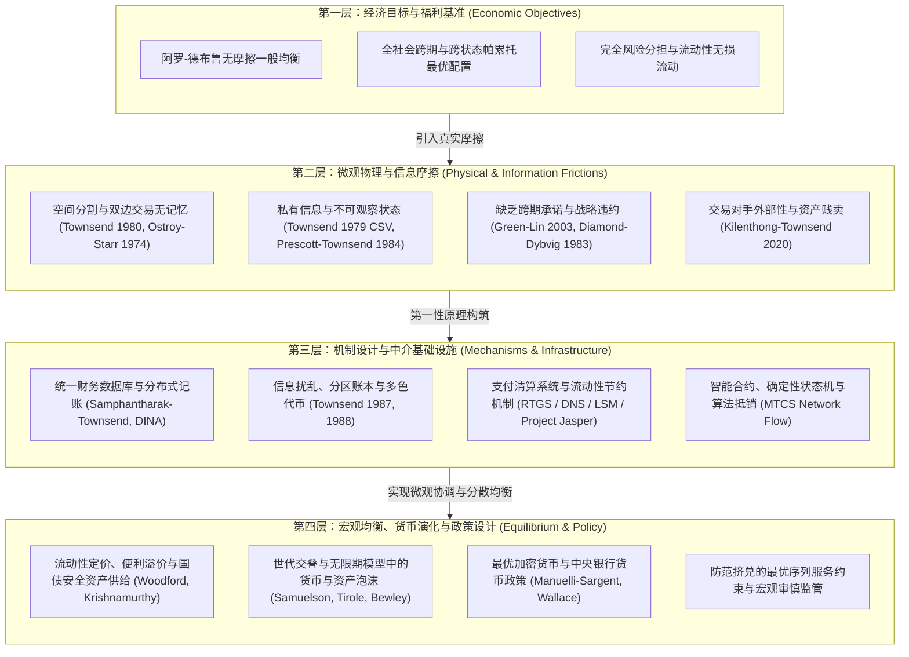

# MIT 14.462 高级宏观经济学 II（Advanced Macroeconomics II）

> **授课教授**：Robert M. Townsend（Elizabeth & James Killian Professor of Economics, MIT）  
> **学期与定位**：Spring 2020，MIT 经济学系博士生核心高级宏观专题课程（Macroeconomics Field Course）  
> **课程全称**：金融体系的度量、分析与设计——作为政策基石的第一性原理（Measurement, Analysis, and Design of Financial Systems: First Principles as the Foundation for Policy）  
> **官方资源**：[MIT Economics (14.462 Spring 2020 Lecture Slides)](https://economics.mit.edu/research/publications/14462-advanced-macroeconomics-ii-spring-2020-lecture-slides)

## TL;DR

- 课程以机制设计与一般均衡理论为第一性原理，系统解构现代宏观经济学中的流动性、支付系统、金融中介与货币演化。
- 确立“阿罗-德布鲁完全市场基准 $\to$ 空间/信息/承诺摩擦 $\to$ 去中心化账本/智能合约/代币化机制 $\to$ 宏观均衡与最优监管”的四层分析闭环。
- 融通微观财务数据（双式记账、国民收入分配账户 DINA）与宏观清算架构（RTGS、净额结算、回购违约、流动性节约机制 LSM）。
- 11 讲纵贯金融科技与影子银行、分布式账本与状态验证、新兴市场金融网络、资产贱卖与金钱外部性、货币与债务泡沫及最优代币货币政策。

## 课程定位与核心分析框架

不同于将货币与金融中介视为外生“摩擦”或单纯经验加总的传统宏观经济学，MIT 14.462 由微观经济机制设计泰斗 Robert M. Townsend 教授主讲，其核心主张是：**金融系统及其监管政策必须建立在第一性原理之上**。

现代宏观经济现实正经历前所未有的结构性重塑。在过去的宏观分析中，中央银行通常被假定为一个外生设定短期名义利率、并通过公开市场操作提供储备金的单一实体；商业银行则被简化为被动的存贷款转换漏斗。然而，当代金融系统的底层演进彻底击碎了这些过度简化的假设：
1. **金融技术创新与架构重构**：区块链、分布式账本（DLT）、智能合约与数字货币（CBDC 及加密资产）挑战了传统商业银行特许权与中央银行垄断清算职能。技术并非中性的效率工具，它改变了信息对称性、去除了中央清算对手方依赖，并重构了结算确定性（Settlement Finality）。
2. **金融中介链条的极度拉长**：影子银行、回购市场（Repo）、抵押品重质押（Rehypothecation）与各类双边及多边撮合平台，将传统流动性创造转变为高流速复杂的资产抵押网络。信贷流动不再仅仅依赖储蓄向投资的单向转化，而是依赖资产负债表扩张能力与日内支付清算的无缝衔接。
3. **宏观系统性脆弱性与外部性**：流动性短缺、资产贱卖（Fire Sales）、协调失灵挤兑与跨市场传染，揭示了微观理性与宏观金钱外部性（Pecuniary Externalities）之间的深层张力。单个金融机构在面临流动性冲击时按市价抛售资产是理性的自保策略，但集体抛售会导致资产价格断崖式下跌，恶化所有市场参与者的资产负债表与抵押能力。

为此，本课程建立了一套微观机制设计与宏观一般均衡高度融合的严谨理论分析范式。这一范式要求我们拒绝任何未经微观摩擦检验的直觉假设，从最基础的偏好、禀赋与技术约束出发，将制度与中介本身内生化为特定物理和信息摩擦下的最优解。

Townsend 教授提出了贯穿全课的四层宏观金融设计框架：

## 课程全景地图与讲义导航

全课系统分为四大逻辑模块共 11 讲：

| 模块 | 讲次 | 主题与核心理论 | 对应讲义 |
|---|---|---|---|
| **第一模块：技术演进、中介链条与微观数据基础** | 第 1 讲 | 支付系统与金融基础设施的设计、监管与政策（Fintech、影子银行与 CBDC） | [lec1.md](./lec1.md) |
| | 第 2 讲 | 账本与数据库管理、综合财务报表与分配/区域账户（Samphantharak-Townsend 与 DINA） | [lec2.md](./lec2.md) |
| **第二模块：流动性、网络中心度与契约机制** | 第 3 讲 | 电子货币、流动性短缺、网络中心度与最优流动性注入（M-PESA、Baumol-Tobin 与 Freeman 模型） | [lec3.md](./lec3.md) |
| | 第 4 讲 | 加密与验证协议 vs 智能合约与机制设计（电子邮件博弈、近似公共知识与状态机契约） | [lec4.md](./lec4.md) |
| | 第 5 讲 | 基于分布式账本技术的金融基础设施最优设计构想（信息扰乱、分区账本与防挤兑序列服务） | [lec5.md](./lec5.md) |
| **第三模块：市场分割、外部性与支付系统架构** | 第 6 讲 | 亟需的金融基础设施：新兴市场创新与最优市场设计理论指导（非完全市场、劳动力彩票与一般竞争均衡） | [lec6.md](./lec6.md) |
| | 第 7 讲 | 应对支付系统外部性与资产贱卖：加密货币最优竞争与金钱外部性消除（隔离市场与瓦尔拉斯平台） | [lec7.md](./lec7.md) |
| | 第 8 讲 | 支付系统：不同备选方案设计中的问题与挑战（RTGS、净额结算、结算违约与 LSM 算法） | [lec8.md](./lec8.md) |
| **第四模块：高流速债务、资产泡沫与最优货币政策** | 第 9 讲 | 去中心化货币交换的信息问题与高周转流通私人债务（Ostroy-Starr 定理、Townsend-Wallace 协调与重质押） | [lec9.md](./lec9.md) |
| | 第 10 讲 | 作为泡沫的货币、加密货币与公共债务（OLG 泡沫理论、动态无效率、公共债务流动性与国债溢价） | [lec10.md](./lec10.md) |
| | 第 11 讲 | 最优加密货币政策与最优货币政策（收费公路模型、空间分割货币、现金先行与回购微观摩擦） | [lec11.md](./lec11.md) |

## 前置知识与研究方法建议

本课程面向博士水平的宏观经济学与微观契约理论研究者，假定具备以下数理与理论基础：

1. **高级微观经济理论与机制设计**：
   - 熟悉阿罗-德布鲁一般均衡模型、第一/第二福利经济学定理；
   - 掌握信息经济学经典模型：昂贵状态验证（CSV）、逆向选择与信号传递（Rothschild-Stiglitz、Spence）、道德风险与动态合同（Holmström、Prescott-Townsend）；
   - 理解启示原理（Revelation Principle）及其在多智能体与限制通信环境下的推广与边界。
2. **现代宏观经济动力学与货币理论**：
   - 熟练运用动态规划（Bellman Equation）、世代交叠模型（Samuelson-Diamond-Tirole OLG）、现金先行模型（Lucas-Stokey）；
   - 深刻理解流动性约束、资产定价中的便利收益（Convenience Yield）以及宏观审慎监管的理论动机。
3. **网络流与信息科学原语**：
   - 理解双式记账的矩阵代数表达、网络拓扑图与图流（Graph Flow）最大流/最小费用算法；
   - 理解密码学基础原语（公私钥签名、单向哈希函数、零知识证明）在契约状态机中的经济学含义。
4. **推荐研读路线**：
   - **概念锚定**：先通读每讲的 `## TL;DR`，明确该讲要解决的具体市场失灵与微观摩擦；
   - **数理严谨**：推导正文中的规划者优化问题、一阶条件与激励相容约束；
   - **制度批判**：研读每讲的 `::: insight` 与 `::: pitfall`，把握理论抽象与现实央行/金融市场基础设施落地之间的断层与权衡。

## 课程参考书目与经典文献（Syllabus Readings）

各讲必读与经典文献在相应讲义中均有详尽推导与引用，核心书目与专著包括：

- **专著教材**：
  - Townsend, Robert M. (forthcoming). *Design and Regulation of Financial Infrastructure and Payments Systems*. MIT Press.
  - Samphantharak, Krislert, & Robert M. Townsend (2010). *Households as Corporate Firms: An Analysis of Household Finance Using Integrated Household Surveys and Corporate Financial Accounting*. Cambridge University Press.
  - Narayanan, A., J. Bonneau, E. Felten, A. Miller, & S. Goldfeder (2016). *Bitcoin and Cryptocurrency Technologies: A Comprehensive Introduction*. Princeton University Press.
  - Rogoff, Kenneth S. (2016). *The Curse of Cash*. Princeton University Press.
- **奠基性理论文献**：
  - Ostroy, J. M., & R. M. Starr (1974). "Money and the Decentralization of Exchange", *Econometrica*.
  - Townsend, R. M. (1979). "Optimal Contracts and Competitive Markets with Costly State Verification", *Journal of Economic Theory*.
  - Townsend, R. M. (1980). "Models of Money with Spatially Separated Agents", in *Models of Monetary Economies*.
  - Diamond, D. W., & P. H. Dybvig (1983). "Bank Runs, Deposit Insurance, and Liquidity", *Journal of Political Economy*.
  - Prescott, E. C., & R. M. Townsend (1984). "General Competitive Analysis in an Economy with Private Information", *International Economic Review*.
  - Tirole, J. (1985). "Asset Bubbles and Overlapping Generations", *Econometrica*.
  - Townsend, R. M., & N. Wallace (1987). "Circulating Private Debt: An Example with a Coordination Problem", in *Contractual Arrangements for Intertemporal Trade*.
  - Woodford, M. (1990). "Public Debt as Private Liquidity", *American Economic Review*.
  - Freeman, S. (1996). "The Payments System, Liquidity, and Rediscounting", *American Economic Review*.
