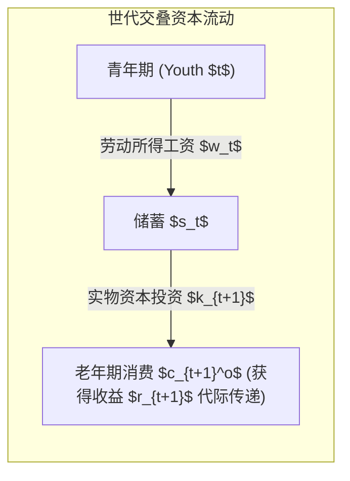
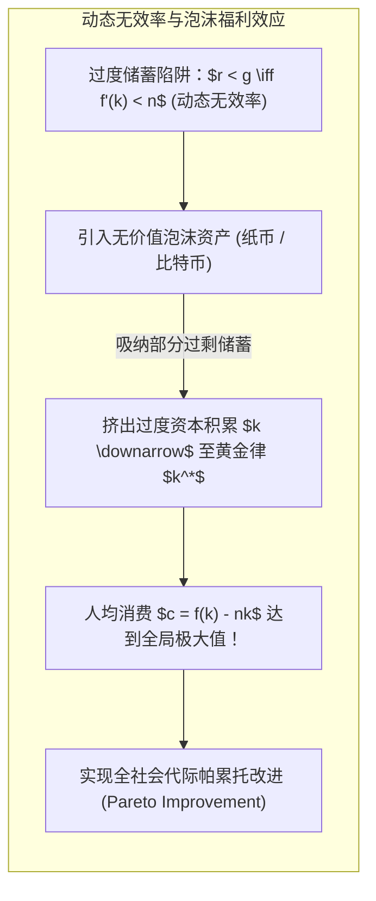
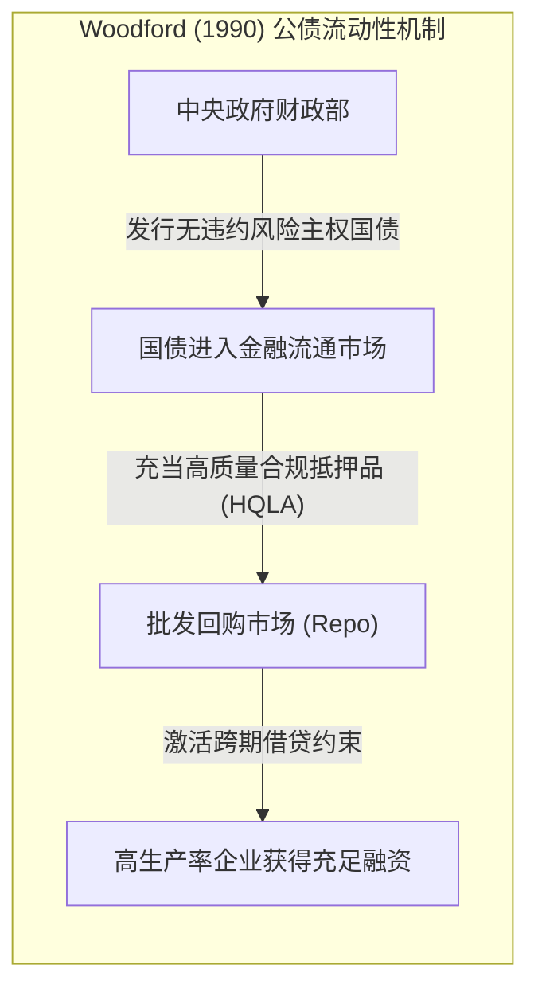

# Lec 10 作为泡沫的货币、加密货币与公共债务（Money, Cryptocurrency, and Public Debt as Bubbles: Indeterminacy, Fiscal Policy, and Liquidity Pricing）

> **授课教师**：Robert M. Townsend（MIT 经济学系 Killian 讲席教授）  
> **核心文献**：Jean Tirole (1985), *"Asset Bubbles and Overlapping Generations"*; Truman Bewley (1980), *"The Optimum Quantity of Money"*; Michael Woodford (1990), *"Public Debt as Private Liquidity"*; Olivier Blanchard (2019), *"Public Debt and Low Interest Rates"*; Arvind Krishnamurthy & Annette Vissing-Jorgensen (2012), *"The Aggregate Demand for Treasury Debt"*.

## TL;DR

- 在世代交叠（OLG）经济中，当资本收益率低于人口与经济增长率（$r < g$）时，经济陷入动态无效率，法币与加密货币作为无内在价值的“纯泡沫”能够挤出过度资本并实现帕累托改进。
- 布利（Bewley）无限期模型证明，在非完全保险与流动性约束下，法币即使无利息也能凭借“预防性平滑消费”的流动性价值维持正均衡价格。
- 伍德福德（Woodford）与布兰查德（Blanchard）阐明，主权国债不仅是政府财政借款工具，更是为私营部门提供安全质押品的“私人流动性（Private Liquidity）”源泉。
- 比特币与纯投机代币本质上是不产生股息分红的纯资产泡沫，其均衡路径具有内在的连续无穷多重性（Indeterminacy），极易诱发宏观金融动荡。

## 世代交叠模型与理性资产泡沫：Tirole（1985）基准

任何不产生任何真实红利、无实物锚定且不可兑换的纸币或加密代币（如比特币），为什么能在竞争市场上长期维持大于零的正向价格？

让·梯若尔（Jean Tirole, 1985）在戴蒙德（Diamond, 1965）资本积累世代交叠模型的基础上，确立了理性资产泡沫的现代宏观分析框架。

### 模型环境与无泡沫均衡

考虑一个两期生存的离散世代交叠经济。人口按增长率 $n$ 扩张：$L_t = (1+n)^t$。
- 每一代人在青年期提供 1 单位劳动，获得竞争性工资 $w_t$；
- 老年期不工作，仅依靠青年期的储蓄利息消费；
- 生产技术采用规模报酬不变的柯布-道格拉斯函数：$Y_t = F(K_t, L_t) = L_t f(k_t)$，资本完全折旧，要素价格由边际产出决定：
  $$r_t = f'(k_t), \quad w_t = f(k_t) - k_t f'(k_t)$$

青年人在青年期储蓄 $s(w_t, r_{t+1})$。在没有泡沫资产的纯实物资本经济中，资产市场出清条件为：
$$
(1+n) k_{t+1} = s(w(k_t), r(k_{t+1}))
$$

### 引入无内在价值的泡沫资产

现在引入总量固定为 $M$ 的不可兑换纸片（无论是法定纸币还是无抵押加密货币）。设其在时期 $t$ 的单价为 $p_t$。定义人均泡沫价值为 $b_t \equiv \frac{p_t M}{L_t}$。
由于资本与泡沫均可作为储蓄载体，**无套利条件（No-Arbitrage Condition）**要求两者的预期总收益率严格相等：
$$
1 + r_{t+1} = 1 + f'(k_{t+1}) = \frac{p_{t+1}}{p_t}
$$

此时，资产市场出清方程变为资本与泡沫共同吸纳青年储蓄：
$$
(1+n) k_{t+1} + (1+n) b_{t+1} = s(w(k_t), r(k_{t+1}))
$$
写成稳态人均形式：
$$
b = s(k, k) - (1+n)k
$$
同时，泡沫人均价值的动力学演化为：
$$
b_{t+1} = b_t \left( \frac{1 + f'(k_{t+1})}{1 + n} \right)
$$

### 动态无效率与泡沫的帕累托改进

如果经济体稳态时存在正泡沫 $b > 0$，由上式可知，稳态资本存量必须满足：
$$
f'(k^*) = n \implies r = g
$$
这正是著名的**黄金律资本水平（Golden Rule Level of Capital）**。

::: theorem Tirole 资产泡沫存在性定理（Tirole, 1985）
1. **动态有效经济（$r > g$）**：若无泡沫经济的稳态利率高于经济增长率，具有正价值的确定性泡沫在理论上**绝不可能存在**。因为泡沫收益率无法长期跑赢资本，其现值在无穷远处必然发散崩溃；
2. **动态无效率经济（$r < g$）**：若经济体由于储蓄过度导致资本边际产出极低（$r < g$），**理性资产泡沫不仅能够稳定存在，而且起到有益的社会功能**：它将青年人多余的储蓄吸收到“无磨损的虚拟代币”中，挤出了过度资本积累，提高了每一个世代一生的稳态消费水平。
:::

## 无限期界与不完全市场：Bewley（1980）预防性储蓄模型

Tirole 模型依赖两期寿命的 OLG 结构。如果经济体由无限寿命（Infinite-Horizon）的代表性主体构成，由于横截性条件（Transversality Condition, TVC）：
$$
\lim_{T \to \infty} \beta^T u'(c_T) p_T = 0
$$
在具有完全保险市场的代表性主体模型中，纯泡沫绝不可能拥有正价格。

杜鲁门·布利（Truman Bewley, 1980）打破了这一定理，构建了**异质性不完全市场模型（Bewley Model）**：

### 为什么在无限期界下法定货币依然有价值？

设经济中存在大量风险厌恶的无限寿命主体，每期遭遇不可投保的独立特异性收入冲击 $y_t \in \{y_L, y_H\}$。主体面临**无抵押借贷禁令（No-Borrowing Constraint）**，无法透支借款。
- 主体在遭遇高收入 $y_H$ 时，无法购买阿罗-德布鲁状态相依证券来对冲未来；
- 主体唯一能够自保的手段，是将多余产出兑换为无息法定货币 $M_t$ 储存起来；
- 当主体未来遭遇负向极低收入冲击 $y_L$ 时，卖出手中的法定货币换取面包维持生存。

::: definition 预防性储蓄流动性溢价（Precautionary Liquidity Premium）
在 Bewley 经济中，货币并不是为了赚取资本利息，而是充当了在非完全市场中抵御极端饥荒风险的**自保险缓冲垫（Self-Insurance Buffer）**。即使货币的名义实际收益率为零甚至为负（由于温和通胀），微观主体对跨期平滑消费的强烈渴望，依然使得全市场对货币存量产生持续、刚性的正向需求。
:::

## 公共债务作为私人流动性：Woodford 与 Blanchard 的综合

在宏观财政与货币交互层面，主权国债与央行货币在本质上是连续光谱上的同质产物。

### Woodford（1990）：公债创造私人流动性

迈克尔·伍德福德（Michael Woodford, 1990）建立了企业借贷约束下的公债模型。
- 实体经济中的企业家不定期涌现高生产率投资机会，但由于道德风险，外部银行要求其必须提供安全抵押品；
- 如果金融市场上缺乏高质量抵押品，企业家的投资能力将严重受阻；
- **政府发行公债（Public Debt），实际上是向私营部门凭空注入了一种绝对安全的无风险抵押品资产**。私营部门利用国债在回购市场上互相拆借，极大地拓宽了实体经济的投资边界。

### Blanchard（2019）与国债便利收益（Convenience Yield）

前 IMF 首席经济学家奥利维尔·布兰查德（Olivier Blanchard, 2019）在美经学会会长致辞中系统论证了低利率下的公债可持续性：

在过去数十年中，美国及主要 OECD 国家的 10 年期国债实际收益率 $r$ 长期显著低于实际 GDP 增长率 $g$（$r < g$）。
Krishnamurthy 与 Vissing-Jorgensen（2012）实证揭示了这一现象的深层原因：**国债具有极高的“便利收益（Convenience Yield）”**。

$$
r_{\text{Treasury}} = r_{\text{Capital}} - \text{Convenience Yield}
$$
由于金融机构在巴塞尔协议监管指标（LCR/NSFR）中必须强制持有高质量流动性资产（HQLA），且回购交易商极度偏好以美债作为抵押，市场参与者自愿接受远低于实体资本回报率的低利息持有国债。这证明：**现代主权公债在微观功能上已经高度等同于一种附带微小利息的“超级法定货币”**。

## 加密货币的宏观资产定价困境与不确定性（Indeterminacy）

将上述经典宏观理论投射到比特币与现代加密资产上，Townsend 教授指出了其内在的定价缺陷：

| 资产类型 | 实体资本品（Capital） | 主权法定货币 / 国债 | 纯加密货币（如 Bitcoin） |
|---|---|---|---|
| **基本面分红流 $d_t$** | 真实的边际生产产出 $f'(k) > 0$ | 国家主权税收与法定义务强制支付 | **严格为零**（$d_t \equiv 0$） |
| **流动性服务溢价** | 极低（流动性差，变现摩擦大） | 极高（法偿货币、终局结算抵押品） | 中等偏低（交易吞吐低、滑点与 Gas 费高） |
| **价值支撑机制** | 贴现现金流与重置成本 | 主权财政偿债承诺与央行最后贷款人 | **纯粹的自实现信念博弈（Pure Bubble）** |
| **均衡路径确定性** | 鞍点稳定（Saddle-Path Stable） | 央行通胀目标与泰勒规则锚定 | **内生无限多重均衡（Indeterminacy）** |

::: insight 深入见解：加密资产的宏观不稳定性根源
根据 Tirole 泡沫模型与动态相位图，当一种资产不具备任何真实的生产力分红与主权税收背书时，**它的稳态价格路径是极度脆弱的**。  
全网存在着连续无穷多条能够满足欧拉无套利条件的均衡路径，其中任何一条微小的随机噪音冲击（Sunspot Shock）都会导致信念在“繁荣膨胀”与“价值归零”之间剧烈跳跃。加密货币倡导者所宣扬的“无主权干预”，恰恰剥离了现代中央银行通过最后贷款人制度为法币价值提供的刚性锚定，使加密市场注定沦为高波动率投机者的游乐场，而难以承担现代宏观经济结算基石的重任。
:::
