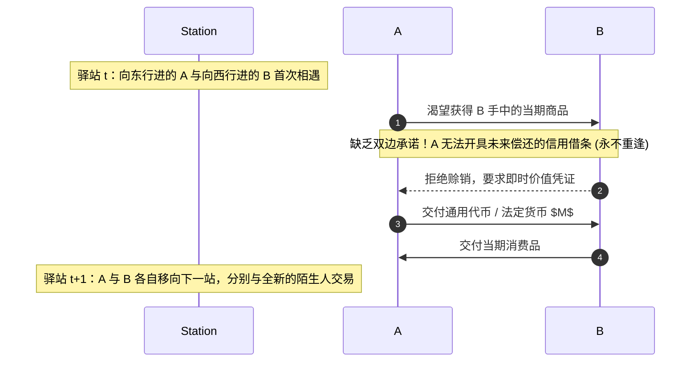
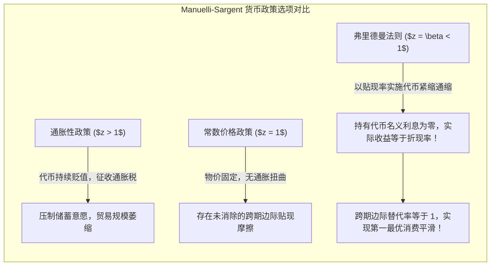
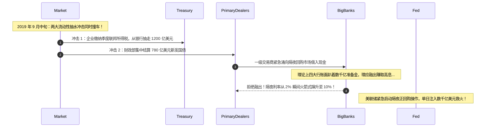

# Lec 11 最优加密货币政策与最优货币政策（Optimal Cryptocurrency and Monetary Policy: Transaction Patterns, Heterogeneity, and Micro-Market Frictions）

> **授课教师**：Robert M. Townsend（MIT 经济学系 Killian 讲席教授）  
> **核心文献**：Robert M. Townsend (1980), *"Models of Money with Spatially Separated Agents"*; Rodolfo Manuelli & Thomas J. Sargent (2010), *"Alternative Monetary Policies in a Turnpike Economy"*; Ricardo Lagos & Shengxing Zhang (2019), *"Turnover Liquidity and the Transmission of Monetary Policy"*; Gara Afonso et al. (2020), *"The Market Events of Mid-September 2019"*.

## TL;DR

- 汤森德收费公路（Turnpike）模型确立了空间物理分割与永不重复相遇环境下，代币/法币作为不可替代交易媒介的微观理论基准。
- 马努埃利-萨金特（Manuelli-Sargent）模型证明，弗里德曼法则在代币经济中依然是效率基准，但异质性主体的流动性约束绑定会引发复杂的财富分配效应。
- 2019 年 9 月美国隔夜回购市场利率飙升（Repo Turmoil）的现实案例表明，宏观准备金总量充裕并不等同于微观管道畅通，巴塞尔协议流动性指标制造了隐性管涌阻塞。
- 固定硬顶发行（如比特币 2100 万枚）的算法代币政策完全丧失了对流动性冲击的弹性缓冲，最优加密代币体系必须内生构建基于信贷需求的弹性供给机制。

## 空间分割与货币起源：Townsend（1980）收费公路模型

货币为什么存在？为什么微观主体自愿接受无内在使用价值的绿纸片或数字代币？

Robert M. Townsend（1980）发表在《货币经济学模型》上的开创性论文，构建了著名的**收费公路空间分割模型（Turnpike Model with Spatially Separated Agents）**，奠定了纯货币交换理论的微观物理基石。

### 模型拓扑与信息隔离

设经济体空间是一条双向无限延伸的高速公路（Turnpike）。主体分为两类：
- **A 类主体（向东行进）**：在偶数时点拥有商品禀赋，奇数时点需求消费；
- **B 类主体（向西行进）**：在奇数时点拥有商品禀赋，偶数时点需求消费；
- **关键物理约束**：公路上的主体以固定速率向相反方向移动，在每个服务区驿站（Station），一对 A 类与 B 类主体仅相遇一次，随后擦肩而过、**终生永不重逢**。

::: theorem Townsend 货币存在的微观必要条件定理（Townsend, 1980）
在满足以下三个物理与信息假定时，任何私人双边信用契约均彻底失效，**外部不可伪造的代币/货币（Fiat Money / Token）是实现跨期贸易的唯一可行机制**：
1. **空间分割与不可逆移动（Spatial Separation）**：交易双方在未来永不重逢，消除了重复博弈中的惩罚威胁；
2. **缺乏全网记忆（Absence of Record-Keeping）**：驿站缺乏全局连通的中央数据库，下游交易方无法核验上游主体的信用履约历史；
3. **缺乏强制执行力（Lack of Commitment）**：不存在能够跨越所有地理区域追索债务的超主权司法实体。
:::

## 替代货币政策与弗里德曼法则：Manuelli-Sargent 扩展

马努埃利与萨金特（Manuelli & Sargent, 2010）在 Townsend 收费公路经济中进一步探讨了：**中央银行（或智能合约算法协议）应该执行何种代币发行政策？**

### 模型的数学规划与欧拉方程

设主体的贴现因子为 $\beta \in (0, 1)$，效用函数为严格单调递增的严格凹函数 $u(c)$。代币总供给量按总增长率 $z$ 扩张：$M_{t+1} = z M_t$。代币单价为 $p_t$。
主体在相遇时的效用最大化问题受制于现金先行（Cash-in-Advance）或货币跨期约束：
$$
p_t c_{t} \le m_{t-1} + \tau_t
$$
其中 $\tau_t$ 为货币注入转移支付。跨期无套利欧拉条件为：
$$
u'(c_t) \ge \beta \left( \frac{p_t}{p_{t+1}} \right) u'(c_{t+1})
$$

::: theorem 空间代币经济中的弗里德曼法则（Manuelli & Sargent, 2010）
1. **弗里德曼法则的最优性**：最优货币政策要求名义利率降至零。在代币系统中，这要求代币存量以贴现速率 $\beta$ 持续收缩，引发温和通缩，使得持有代币的实际购买力增值率精确补偿主体的跨期耐心成本；
2. **异质性与流动性约束管涌**：当主体在不同周期的禀赋分布不均（如奇数期拥有 $a > 0$、偶数期拥有 $0$）时，流动性非负约束 $m_t \ge 0$ 会在不同世代交替绑定，货币紧缩会引发显著的财富再分配效应。
:::

## 宏观管涌堵塞的微观实证：2019 年 9 月美国回购危机（Repo Turmoil）

即使中央银行明晓最优货币理论，在复杂的现代金融市场“管道工程（Plumbing）”面前，货币政策传导依然会发生灾难性的微观肠梗阻。

2019 年 9 月 16 日至 17 日，美国金融核心中枢——担保隔夜融资利率（SOFR，隔夜国债回购利率）发生惊人异动：**通常锚定在 2.0% 左右的隔夜回购利率，在盘中瞬间失控暴涨至 10.0%！**

### 为什么大行坐拥数千亿准备金却见死不救？

Afonso 等（2020）与 Zoltan Pozsar（2019）系统解构了这一宏观金融中介管道的微观堵塞机制：
1. **流动性分布的极度不均衡**：全美前四大商业银行（JPMorgan、BofA、Citi、Wells Fargo）持有了全系统近 **50% 的准备金**，其余数千家中小银行与对冲基金早已面临储备紧缩；
2. **巴塞尔协议 III 监管指标的刚性硬约束**：
   - **流动性覆盖率（LCR）**：大行必须持有足额的现金以应对 30 天极端流动性流出情景；
   - **日内流动性压力测试与清算恢复计划（Resolution Planning）**：大行必须随时预备数百亿美元随时应对自身的秒级清算违约；
3. **市场分割摩擦**：账面上的“超额准备金”在微观风控模型中变成了“受困准备金（Trapped Liquidity）”。即使隔夜利差飙升至 10%，大行内部财务官因担心触碰合规红线而严禁对外融出资金。

::: insight 深入见解：宏观总量充裕与微观分配断层的两重天
2019 年美债回购危机给宏观经济学与金融科技敲响了警钟：  
**宏观层面的“流动性总量充裕”是一个巨大的伪命题**。金融体系的真实流动性取决于**网络中最脆弱节点的微观连通性与摩擦阻力**。如果微观管道被资本合规指标、清算时延或排他性壁垒截断，局部的流动性管涌会迅速在毫秒内反噬整个宏观金融系统的稳定性。
:::

## 对最优加密货币与算法稳定币政策的终极启示

将 Townsend 收费公路理论与 2019 回购危机相结合，Townsend 教授对区块链领域的代币经济学（Tokenomics）给出了深刻的理论裁决：

| 货币发行范式 | 代表机制 | 核心缺陷与理论批判 |
|---|---|---|
| **机械硬顶通缩型** | 比特币（2100 万枚硬顶） | **完全缺乏供给弹性**。当实体经济或日内交易量剧烈波动时，固定供给使得所有调整完全由代币剧烈价格波动承受，引发深层信贷通缩 |
| **外生双向再平衡型** | 算法稳定币（如 Terra/Luna 铸币税模型） | **缺乏主权最后贷款人支撑**。双币算法套利在面临持续单边净流出时，会瞬间触发内生死亡螺旋（Death Spiral） |
| **最优微观弹性型** | **Townsend 状态相依信贷代币** | **根据网络内部结算流速与交易需求内生吞吐流动性**。结合排他性抵押品约束与准备金缓冲，在实现最优跨期利率的同时，杜绝微观管涌挤兑 |

::: insight 深入见解：重构货币政策的第一性原理
真正的“最优加密货币政策”绝不等于“写死一套机械的硬顶代码并放任自流”。  
正如古典经济学中的“真实票据原则（Real Bills Doctrine）”所揭示的，货币与信贷的供给量应当随着真实商品交易与结算需求的扩张而内生弹性伸缩，并在贸易完成后自动销毁。现代智能合约技术如果能够摆脱原始的投机代币思维，转向结合图流对冲与动态状态相依弹性的清算网络设计，才能真正实现萨缪尔森、弗里德曼与汤森德所追求的无摩擦最优货币之境。
:::
