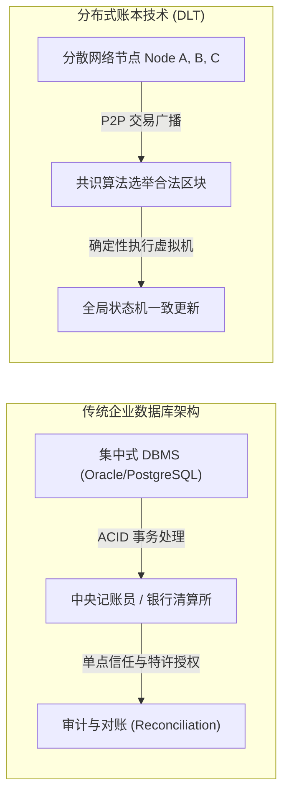
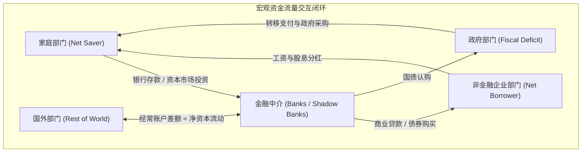

# Lec 2 账本与数据库管理、综合财务报表与分配/区域账户（Ledgers and Database Management, Integrated Financial Statements, and Distributional/Regional Accounts）

> **授课教师**：Robert M. Townsend（MIT 经济学系 Killian 讲席教授）  
> **核心文献**：Krislert Samphantharak & Robert M. Townsend (2010), *Households as Corporate Firms*; Archawa Paweenawat & Robert M. Townsend (2020), *"The Impact of Isolationist Policy: Disentangling Real and Financial Factors Through the Lens of Integrated Regional Financial Accounts"*; Thomas Piketty, Emmanuel Saez, & Gabriel Zucman (2018), *"Distributional National Accounts"*; Michael Batty et al. (2019), *"Introducing the Distributional Financial Accounts of the United States"*.

## TL;DR

- 分布式账本在计算机科学中体现为容错状态机，在经济学中本质上是记录多主体资产负债表与交易流向的统一分布式数据库。
- 综合财务核算体系将微观主体的收支、投资与融资活动严格映射为资产负债表、损益表与现金流量表的代数闭环。
- 资金流量（Flow of Funds）矩阵展现了跨部门、跨区域的零和结算约束，任何真实的商品流动必然对应等额反向的金融债权变动。
- 区域综合金融账户模型能够解构经济孤立政策（如贸易关税与信贷脱钩），精准剥离实体贸易摩擦与金融资本配置摩擦对区域福利的异质冲击。

## 账本即数据库：双式记账与状态机复制

在深入现代加密货币与分布式系统之前，Townsend 教授首先回归会计学与信息科学的本源：**账本（Ledger）在本质上就是带有特定约束条件的交易数据库**。

自 1494 年卢卡·帕乔利（Luca Pacioli）系统总结威尼斯复式记账法（Double-Entry Bookkeeping）以来，会计账本就确立了现代数据库的核心范式：
1. **借贷必相等（Algebraic Conservation Law）**：每一笔交易必须同时记录借方（Debit）与贷方（Credit），并在任何时点满足会计恒等式：
   $$\text{Assets}_t \equiv \text{Liabilities}_t + \text{Equity}_t$$
2. **状态转移可审计性（State-Transition Immutability）**：当前资产负债表存量状态 $S_t$ 是初始状态 $S_0$ 与历史所有交易事务（Transactions）顺序执行后的确定性累加：
   $$S_t = S_0 + \sum_{\tau=1}^t \Delta S_\tau$$

在传统集中式数据库管理系统（DBMS）中，数据一致性通过中心服务器加锁机制满足 ACID（原子性、一致性、隔离性、持久性）属性；而在分布式账本（DLT）中，多个地理分散且互不信任的节点必须通过共识算法（PBFT、Raft 或 PoW）解决分布式计算中的状态机复制（State Machine Replication, SMR）问题。

::: definition 分布式账本（Distributed Ledger）
分布式账本是一种去中心化的共享数据库系统，其中各节点遵循预设的密码学规则与共识协议，共同维护一个按时间顺序链式追加、不可篡改且全局可验证的交易与状态记录。
:::

## 综合微观金融账户体系：Samphantharak-Townsend 框架

宏观经济学的核心困境之一在于“微观数据与宏观加总脱节”。为了弥合这一鸿沟，Samphantharak 与 Townsend（2010）在泰国家庭长期微观跟踪调查（Townsend Thai Project）中开创了**将家庭视为企业（Households as Corporate Firms）**的综合财务核算体系。

### 三大财务报表的微观闭环

无论微观主体是跨国公司还是农村自耕农，其经济行为均可统一表达为三大标准报表：

1. **资产负债表（Balance Sheet）**：度量存量价值。
   $$\text{Cash}_t + \text{Inventories}_t + \text{Fixed Assets}_t = \text{Short-Term Debt}_t + \text{Long-Term Debt}_t + \text{Net Worth}_t$$
2. **损益表（Income Statement）**：度量生产与经营增量。
   $$\text{Net Income}_t = \text{Gross Revenue}_t - \text{Operating Costs}_t - \text{Depreciation}_t - \text{Interest Expense}_t$$
3. **现金流量表（Statement of Cash Flows）**：度量实际流动性流向。
   $$\Delta \text{Cash}_t = \text{OCF}_t + \text{ICF}_t + \text{FCF}_t$$
   其中：
   - $\text{OCF}_t$：经营性净现金流（Net Operating Cash Flow）；
   - $\text{ICF}_t$：投资性净现金流（Net Investment Cash Flow，购买或处置资本品）；
   - $\text{FCF}_t$：融资性净现金流（Net Financing Cash Flow，新增借款、偿还本息、股利分红）。

::: example 泰国家庭农户的复式记账实例
假设农户 A 出售了价值 5,000 泰铢的稻谷，其中 3,000 泰铢获得现金，2,000 泰铢为买方赊欠的应收账款（Trade Credit）；随后农户 A 偿还了村级基金 1,000 泰铢的化肥贷款。  
其资产负债表与现金流记账如下：
- **交易 1**：贷记“销售收入” 5,000；借记“现金资产” +3,000，借记“应收账款” +2,000；
- **交易 2**：借记“短期借款负债” -1,000；贷记“现金资产” -1,000；
- **现金流量净变动**：$\Delta \text{Cash} = +3,000 - 1,000 = +2,000$ 泰铢。  
此时，未被即时结清的 2,000 泰铢应收账款直接构成了微观网络内的私人贸易信用。
:::

## 资金流量矩阵与国民收入分配账户（DINA）

当我们将所有微观主体的报表横向加总时，便构成了全社会资金流量表（Flow of Funds Matrix）。

### 全社会资金流量矩阵的守恒律

设全社会划分为 $N$ 个部门（家庭、非金融企业、商业银行、央行、政府、国外部门）。在任意时间段内，各部门之间的转移支付与资产交易构成一个 $N \times N$ 矩阵 $[T_{ij}]$，其中 $T_{ij}$ 表示部门 $i$ 向部门 $j$ 的净资金转移。

$$
\sum_{j=1}^N T_{ij} = \Delta \text{Financial Assets}_i - \Delta \text{Liabilities}_i
$$

由于每笔交易都是双边的，全社会总资金转移满足零和约束：
$$
\sum_{i=1}^N \sum_{j=1}^N T_{ij} \equiv 0
$$

这一会计恒等式构成了宏观一般均衡分析的刚性边界：**任何部门的净财务盈余（储蓄大于投资），必然在数学上精确对应其他部门的净财务赤字**。

### 分配国民账户（DINA）：Piketty-Saez-Zucman 创新

传统的国民经济核算体系（如 BEA 发布的 GDP 与 NIPA 表）仅提供总体宏观总量，无法回答“经济增长成果由谁分享”的结构性问题。

Piketty, Saez & Zucman（2018）以及美联储推出的分配金融账户（Distributional Financial Accounts, DFA），通过将微观税收申报数据（IRS micro-files）、消费者金融调查（SCF）与宏观 NIPA 账户进行微观一致性桥接，测算出美国不同分位数人群的财富与资本收益分配：
- 前 1% 人群占有全社会超过 40% 的非金融资产与近 70% 的金融股权；
- 底部 50% 人群净资产接近于零，其资产负债表主要由高负债比率（按揭房贷与消费信贷）主导。

::: insight 深入见解：数据基础设施对宏观政策的制约
若一国中央银行仅盯住未经分配解构的加总 GDP 或物价指数，其货币政策注水往往会诱发严重的财富极化。因为扩张性货币政策推升资产价格主要膨胀了前 1% 人群的资产负债表净值，而低收入家庭因缺乏金融资产参与权，仅承受通胀导致的实际购买力贬值。完备的分布式微观账户是实现精准宏观调控的前置基础设施。
:::

## 区域综合金融账户：Paweenawat-Townsend 孤立政策分析

Paweenawat 与 Townsend（2020）将综合金融账户模型推广至空间地理维度，建立了**区域综合宏观金融模型**，用于量化评估区域经济隔离与信贷封锁政策。

### 模型的空间结构与真实/金融摩擦分解

设经济体由两类区域构成：核心都市圈（如曼谷，资本充裕、生产率高）与外围农村省份（如 Chachoengsao，资本匮乏、受天气冲击）：

两地之间的国际收支平衡表（Balance of Payments）恒等式为：
$$
\text{Current Account}_{CP} + \text{Financial Account}_{CP} \equiv 0 \implies (X_{CP} - M_{CP}) + F_{CP} \equiv 0
$$

当中央政府实施“孤立主义/贸易限制政策”（如设置省际关税、限制农产品跨区运输）或“金融隔离政策”（如限制跨区银行拆借与信贷配额）时，模型能够精准分离两者的异质影响：

::: theorem 真实贸易冲击 vs 金融脱钩冲击的福利效应（Paweenawat & Townsend, 2020）
1. **纯贸易摩擦（Real Trade Friction）**：阻断商品流动导致外围地区专业化优势丧失，本地相对物价扭曲，两地商品价格出现不合理的价差（Law of One Price 失效）；
2. **纯金融摩擦（Financial Friction）**：即使实体物流通畅，金融流动的阻断使得外围地区的储蓄无法以最优回报率进入核心金融市场，而外围地区的优质高收益项目因缺乏外部借贷资金而严重投资不足；
3. **实证结果**：在泰国区域数据中，**金融维度的市场分割（缺乏一体化清算与银行信贷中介）对总体产出与社会福利的破坏程度，是关税等单纯实体贸易壁垒的 2.5 至 3 倍**。
:::

::: pitfall 政策启示：警惕“自给自足”式区域发展陷阱
许多地方政策制定者倾向于倡导“本地储蓄留存本地投资”，试图切断资金外流。综合区域金融账户证明，这种金融自闭政策严重违背了边际资本产出均等化定理，反而剥夺了欠发达地区通过跨区金融合同平滑自然灾害冲击的能力。
:::
