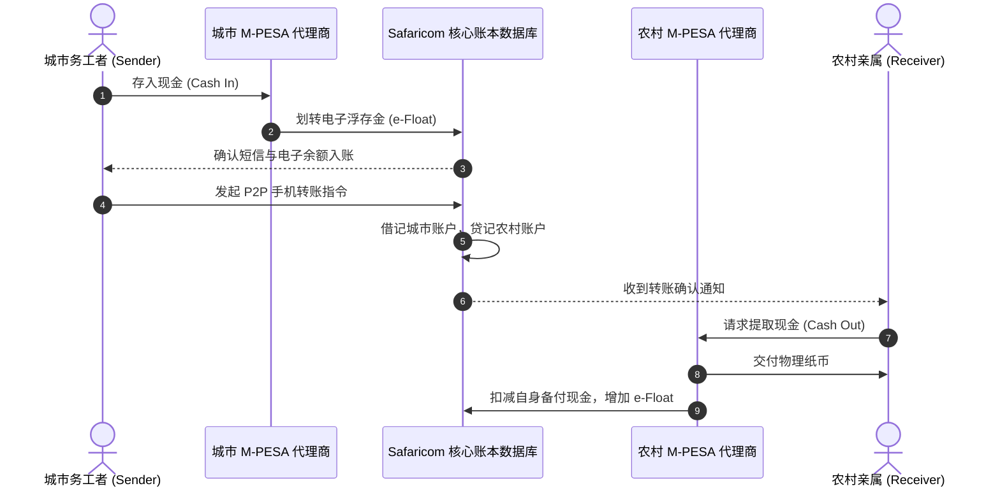
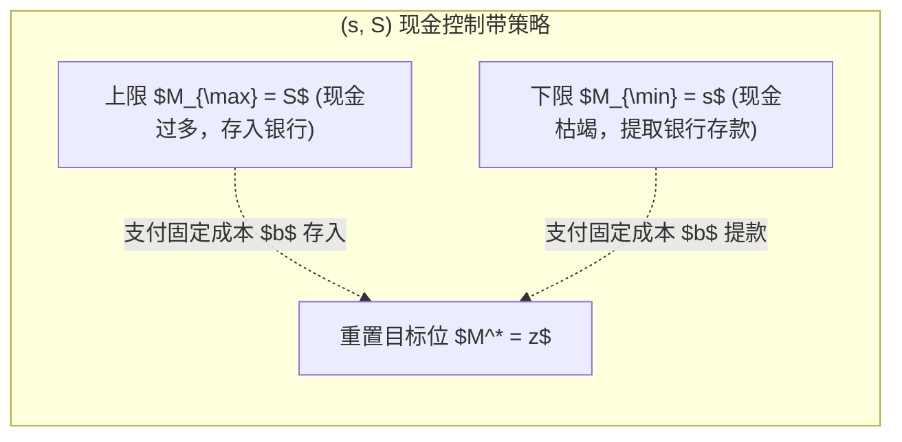
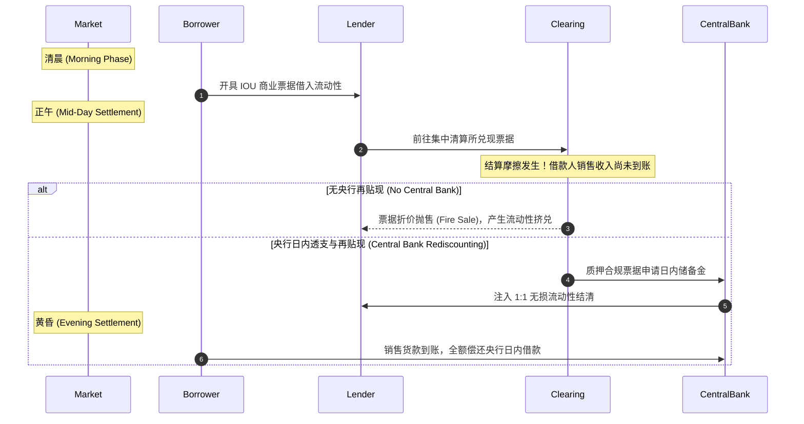

# Lec 3 电子货币、流动性短缺、网络中心度与最优流动性注入（e-Money, Infrastructure and Liquidity Shortages, Network Centrality, and Optimal Liquidity Injection）

> **授课教师**：Robert M. Townsend（MIT 经济学系 Killian 讲席教授）  
> **核心文献**：William Jack, Tavneet Suri, & Robert M. Townsend (2010), *"Monetary Theory and Electronic Money: Reflections on the Kenyan Experience"*; Fernando Alvarez, Anan Pawasutipaisit, & Robert M. Townsend (2018), *"Cash Management in Village Thailand: Positive and Normative Implications"*; Arun Chandrasekhar, Robert M. Townsend, & Juan Xandri (2019), *"Financial Centrality and Liquidity Provision"*; Scott Freeman (1996), *"The Payments System, Liquidity, and Rediscounting"*.

## TL;DR

- 移动电子货币（如肯尼亚 M-PESA 与瑞典 Swish）极大拓宽了跨期与跨空间风险分担边界，但高度依赖代理商网络的物理流动性备付。
- 鲍莫尔-托宾（Baumol-Tobin）与米勒-奥尔（Miller-Orr）微观现金管理模型证明，固定交易手续费使得低收入群体被迫持有过多现金并承受通胀侵蚀。
- 银行间与村庄微观金融网络具有显著的拓扑异质性，流动性分配效率高度依赖关键节点的中介传导能力。
- 金融中心度（Financial Centrality）度量了边际流动性注入对全网社会福利的乘数效应，为央行与平台提供了超越“普惠均匀注资”的最优靶向注水理论准则。

## 从物理现金到电子货币：M-PESA 与 Swish 的启示

随着移动通信与智能终端普及，电子货币（e-Money）深刻改变了低收入国家与发达经济体的微观支付生态。

### 肯尼亚 M-PESA 的微观福利机制

Jack, Suri & Townsend（2010）针对肯尼亚电信巨头 Safaricom 运营的移动支付系统 M-PESA 展开了长期追踪。在传统撒哈拉以南非洲地区，家庭跨区域汇款高度依赖长途客车司机携带现金，存在严重的被盗、欺诈与物流延迟风险。

M-PESA 构建了一个“虚拟账户 + 线下代理商（Agent）”的双层结算架构：

::: theorem 移动支付对微观风险分担的因果效应（Jack & Suri, 2014）
当家庭遭遇负向收入冲击（如干旱、重病）时：
1. **未接入 M-PESA 的家庭**：消费水平出现平均 **7%~10%** 的断崖式下跌，且被迫缩减教育支出与变卖牲畜资产；
2. **接入 M-PESA 的家庭**：消费支出完全平滑，未发生显著波动。其核心因果机制是**汇款接收概率提高，且来自异地更广阔社交网络的汇款资金流动速度提高了近 80%**。
:::

### 电子货币系统的阿喀琉斯之踵：代理商流动性断裂

尽管账本记账完全电子化，但只要物理现金与数字余额之间仍需双向兑换，系统就受制于**代理商流动性短缺（Agent Liquidity Shortages）**：
- 城市代理商通常面临“现金过多、电子浮存金（e-Float）枯竭”的单向压力；
- 农村提现代理商则频繁面临“物理钞票被提空、电子余额堆积”的流动性枯竭。
调查显示，超 40% 的代理商在早高峰因无法提供流动性而被迫拒绝客户交易。

## 微观现金管理理论模型：Alvarez-Pawasutipaisit-Townsend 检验

为了从第一性原理刻画个体在物理现金与生息金融资产之间的最优组合，Alvarez, Pawasutipaisit & Townsend（2018）基于泰国家庭月度流水数据，推广了经典 Baumol-Tobin 与 Miller-Orr 模型。

### 扩展的连续时间现金库存模型

设代表性主体在时间 $t$ 面临连续的外生净支出流。主体可持有两种资产：
1. **流动性现金 $M_t$**：名义收益率为 $0$；
2. **生息储蓄资产 $A_t$**：产生名义净利息率 $R > 0$。

现金账户余额演化遵循漂移布朗运动：
$$
dM_t = -\mu dt + \sigma dW_t
$$
其中 $\mu$ 为预期净消费支出流，$\sigma$ 为未预期收支波动的波动率，$W_t$ 为标准维纳过程。

主体每一次往返银行或 ATM 存取现金，必须支付一次性非凸固定交易成本 $b > 0$（包含交通时间、手续费与排队摩擦）。

决策者的最优化问题转化为一个 Hamilton-Jacobi-Bellman（HJB）方程决定的脉冲最优控制问题：
$$
\min_{\{s, z, S\}} \mathbb{E} \int_0^\infty e^{-\rho t} \left[ R M_t dt + b \sum_{k=1}^\infty \mathbf{1}_{\{t = \tau_k\}} \right]
$$

其解析解确立了最优 $(s, z, S)$ 策略带：
$$
z \approx \left( \frac{3 b \sigma^2}{4 R} \right)^{1/3}, \quad S - s \approx 3 z
$$

::: insight 深入见解：现金持有作为对穷人的隐性重税
在微观实证中，穷人与富人面对的固定交通与时间成本 $b$ 是相似的，甚至穷人因居住偏远面临更高的 $b$。  
由立方根公式可知，随着交易规模与收入下降，现金持有量占总收入的比例急剧上升。低收入家庭被迫将巨额比例的财富以零利息的物理现金形式沉淀在床垫下，不仅无法享受金融资产的资本增值，而且承受通货膨胀对其实际购买力的持续侵蚀。普及零固定费用的数字支付是一项具有强再分配意义的公共基础设施。
:::

## 支付清算中的流动性与再贴现机制：Freeman 模型

在宏观支付清算层面，流动性短缺不仅发生在个人层面，更是跨期结算的内在属性。Scott Freeman（1996）构建了经典的支付清算重叠代际（OLG）模型：

设经济体由两组空间隔离的岛屿构成，代理人分为借款人（Borrowers）与贷款人（Lenders）。借款人在清晨向贷款人开具商业承兑本票（Promissory Notes）以采购早市商品；然而，借款人自身的商品销售回款发生在黄昏。

::: theorem 结算体系中中央银行再贴现的最优性（Freeman, 1996）
当市场存在交易时间错配（Arrival Mismatch）时，私营清算所无法在没有外部流动性支持的情况下按面额完成实时清算，导致借款人必须以惩罚性折价抛售未到期票据。  
中央银行作为“最终清算人”（Settler of Last Resort），通过提供**零利息日内透支额度（Intraday Overdrafts）或以商业票据为抵押品进行无惩罚再贴现**，能够无成本消除流动性摩擦，实现帕累托最优配置。
:::

## 金融网络拓扑与最优流动性注入：Chandrasekhar-Townsend-Xandri 框架

在现实宏观金融中，流动性并非均匀分布在连续统上，而是流淌在复杂的银行间拆借或民间借贷网络拓扑结构中。Chandrasekhar, Townsend & Xandri（2019）提出了**金融中心度（Financial Centrality）**理论。

### 网络模型设定与社会规划者目标

设经济体由 $N$ 个风险厌恶主体构成，网络由邻接矩阵 $G = [g_{ij}]$ 刻画，其中 $g_{ij} = 1$ 表示主体 $i$ 与主体 $j$ 之间存在经双边信任认证的借贷/转账管道。

各主体在时期 1 面临均值为 0、方差为 $\sigma_i^2$ 的随机财富冲击 $\epsilon_i$。在无摩擦基准下，全社会总福利最大化要求完全平滑消费：
$$
c_i^* = \frac{1}{N} \sum_{j=1}^N \epsilon_j
$$

然而在网络约束下，资金流动必须沿着图上的边 $g_{ij}$ 进行，且每笔跨节点转移承受冰山运输成本或额度上限。

### 金融中心度的解析定义

社会规划者拥有一笔有限的外生公共流动性资源 $L$，需要决定将其注水给哪一个特定节点 $i$。

::: definition 金融中心度（Financial Centrality）
节点 $i$ 的金融中心度 $C_F(i)$ 定义为：向该节点外生注入一单位边际流动性 $\Delta L_i$ 所带来的全网总消费方差降低量（即全社会确定性等价福利的边际增加值）：
$$
C_F(i) \equiv \frac{\partial \mathcal{W}_{\text{Social}}}{\partial L_i} = \sum_{j=1}^N \lambda_j \frac{\partial \mathbb{E}[u_j(c_j)]}{\partial L_i}
$$
:::

Chandrasekhar 等人证明，金融中心度的排序取决于网络所处的制度环境：

| 制度环境类型 | 网络调整机制 | 最优注水节点特征 | 政策启示 |
|---|---|---|---|
| **惯性环境（Inert Environment）** | 网络连边 $G$ 固化，中介仅沿历史已有关系被动转手资金 | **特征向量中心度（Eigenvector Centrality）与中介中心度高**的超级中介银行 | 流动性能迅速通过中枢节点向全网辐射，降低全网交易跳数 |
| **响应型环境（Responsive Environment）** | 注入流动性会诱发借贷双方建立新连边（Endogenous Edge Formation） | **边缘次级节点（Peripheral Clustered Nodes）** | 向资本严重饥渴的孤立子群注水，能以最小成本激励其接入主网络，消除局部死锁 |

::: insight 深入见解：对危机时期央行量化宽松（QE）与纾困的批判
在 2008 年危机与 2020 年疫情救助中，各国央行往往机械地向摩根大通、高盛等一级交易商（Primary Dealers）注入数万亿美元储备金。  
金融中心度理论表明：**一级交易商并不必然是社会福利边际提升最大的节点**。当超级金融机构面临自身资产负债表约束时，其吸收的流动性仅在顶层银行间回购市场内部空转，无法穿透至实体经济底层的小微企业与脆弱家庭。真正的最优货币政策必须根据网络微观传导弹性，实施基于金融中心度的定向精准穿透注水。
:::
