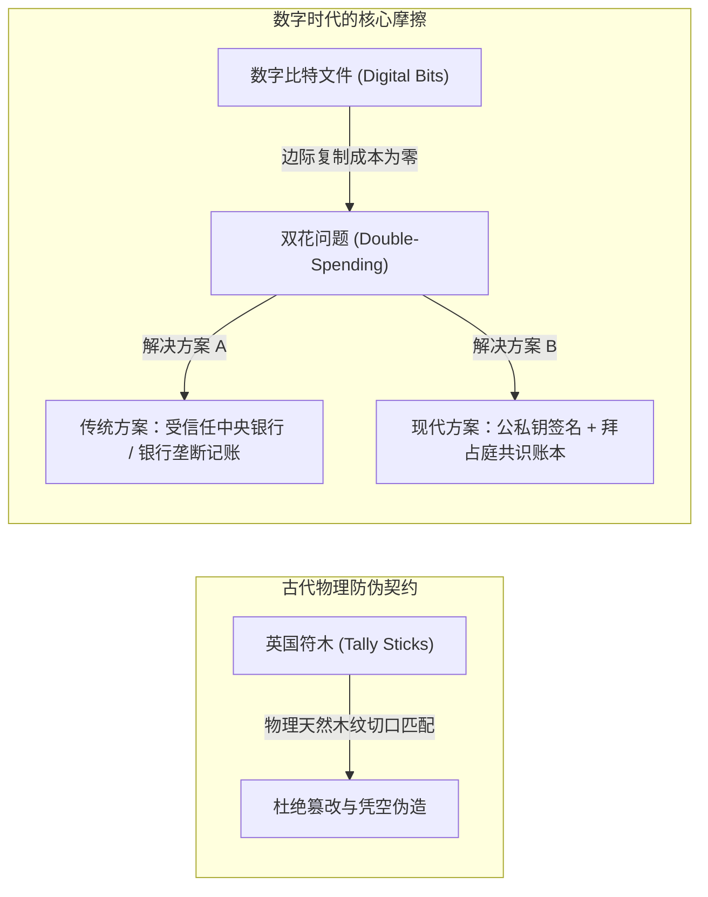
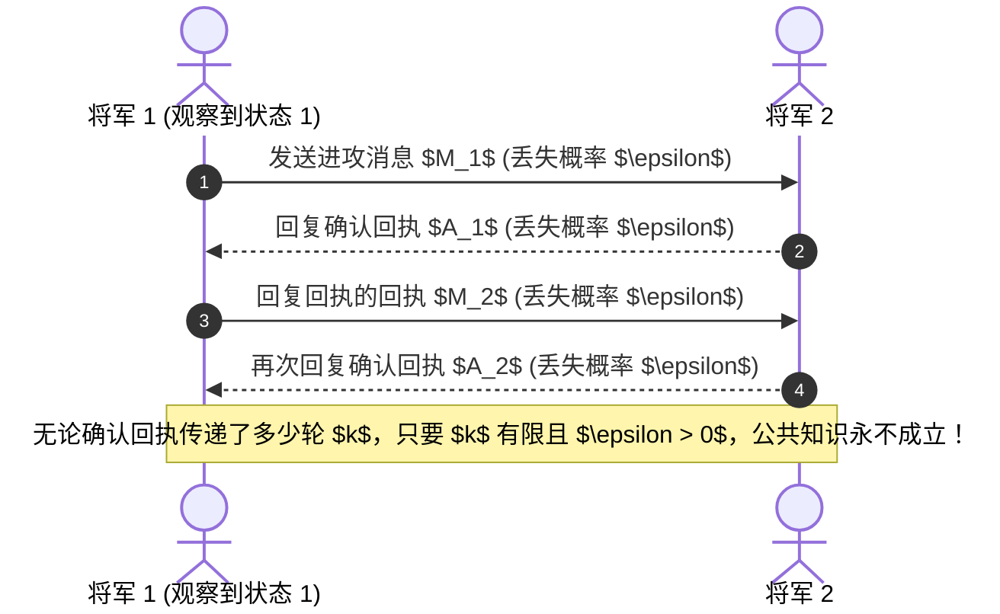
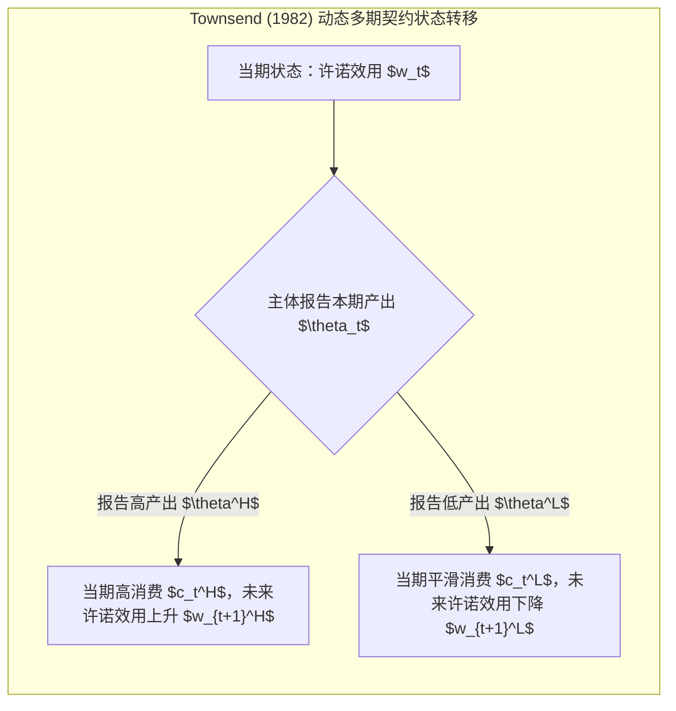

# Lec 4 加密与验证协议 vs 智能合约与机制设计（Encryption and Validation Protocols vs. Smart Contracts and Mechanism Design）

> **授课教师**：Robert M. Townsend（MIT 经济学系 Killian 讲席教授）  
> **核心文献**：Stephen Morris & Hyun Song Shin (1997), *"Approximate Common Knowledge and Co-ordination: Recent Lessons from Game Theory"*; Milton Harris & Robert M. Townsend (1981), *"Resource Allocation Under Asymmetric Information"*; Robert M. Townsend (1982), *"Optimal Multiperiod Contracts and the Gain from Enduring Relationships Under Private Information"*; Robert M. Townsend (1979), *"Optimal Contracts and Competitive Markets with Costly State Verification"*.

## TL;DR

- 记账与防伪技术贯穿文明史，从两河流域黏土陶筹、中世纪英国符木（Tally Sticks）到现代公私钥签名，其核心都是解决价值凭证的防伪与“双花问题”。
- 鲁宾斯坦电子邮件博弈（Electronic Mail Game）与莫里斯-申（Morris-Shin）近似公共知识定理证明，不可靠通信信道无法达成严格的博弈论公共知识。
- 经济学机制设计立足于信息不对称与激励相容（IC），通过启示原理刻画帕累托最优的间接信息沟通与跨期声誉奖惩。
- 智能合约的本质是确定性图灵完备状态机，它排除了违约与自由裁量，但受制于链下信息不可验证的“预言机困境”与状态刚性陷阱。

## 物理契约到数字加密的演进：防伪与双花难题

在计算机科学发明区块链之前，人类社会在数千年前就已经通过巧妙的物理机制实现密码承诺与分布式记账：

1. **美索不达米亚黏土陶筹与泥球（Clay Tokens & Bullae）**：公元前 3500 年苏美尔人将代表不同牲畜与谷物数量的陶筹封装于泥球内部，并在泥球表面加盖契约双方的滚筒印章。打破泥球是唯一的核实手段，实现了不可篡改的物理防篡改信封；
2. **中世纪英国符木（Medieval Tally Sticks）**：12 世纪英国财政部采用刻有不同凹槽的榛木符木记录税收与债务。符木沿纵向劈裂为两半：较长的一半（Stock，代表原始债权，即现代 Stock/Shareholder 的语源）留存债权人，较短的一半（Stub）留存债务人。两半木条的天然木纹与切口具有唯一的物理匹配性，彻底杜绝了事后篡改或伪造。

在数字世界中，任意电子报文均可被无成本无限复制。解决“双重支付（Double-Spending）”的传统方法是依赖单一中心化受信任记账员（如银行）；而分布式加密系统则依赖**公私钥非对称加密 + 拜占庭容错共识协议**的复合架构。

## 通信协议与博弈论共识：Morris-Shin 近似公共知识定理

区块链工程师通常假定网络通过 Gossip 广播与确认即可达成“共识”。然而，从博弈论第一性原理出发，**信息送达（Mutual Knowledge）并不等同于公共知识（Common Knowledge）**。

### 鲁宾斯坦（1989）电子邮件博弈与协同攻击困境

考虑著名的双将协同攻击博弈：将军 1 与将军 2 唯有同时发起进攻才能获胜，单独进攻将导致灾难性惨败。
- 自然状态 $\theta \in \{0, 1\}$，仅当 $\theta = 1$ 时进攻是互利的；
- 仅将军 1 观察到 $\theta = 1$，并通过信鸽向将军 2 发送消息；信鸽在飞行途中迷失的概率为 $\epsilon \in (0, 1)$；
- 收到消息的一方必须向对方回复确认回执（ACK），回执同样以概率 $\epsilon$ 迷失。

::: theorem 电子邮件博弈中的协调崩溃（Rubinstein 1989; Morris & Shin 1997）
无论系统经历了多少轮确认回执（即使双方计算机已互相发送了 10,000 条确认报文），在唯一的贝叶斯纳什均衡中：**双方在任何信息状态下都绝不进攻**。  
数学证明的核心在于数学归纳法：当信道存在哪怕极微小的丢包率 $\epsilon > 0$ 时，收到最后一条确认消息的节点永远无法确认对方是否收到了其回执。缺乏高阶相互信任（“我知道你知道我知道……”）会导致向后归纳的彻底崩溃。
:::

::: insight 深入见解：区块链共识机制的经济学本质
莫里斯-申定理在理论上终结了“单纯通过通信协议达成绝对理性共识”的幻想。  
中本聪的真正突破并非计算机科学，而是**引入了经济博弈激励来剪断无限向后归纳的链条**：在工作量证明（PoW）中，节点无需等待不可靠的无限阶确认，只要后续追加了 6 个确认区块，恶意颠覆账本的物理算力沉没成本便呈指数级攀升。系统是用“金钱惩罚（经济利益）”替代了理论上无法达成的“绝对公共知识”。
:::

## 机制设计基准：启示原理与动态多期契约

在微观经济学中，机制设计理论致力于在参与者拥有私有信息且追求自利最大化的前提下，寻找最优的资源配置协议。

### 启示原理（Revelation Principle）与静态基准

设参与者拥有不可观察的私有状态 $\theta \in \Theta$。机制设计者无需枚举复杂的非结构化博弈，根据哈里斯与汤森德（Harris & Townsend, 1981）以及迈尔森（Myerson, 1979）的启示原理，任何纳什或贝叶斯均衡都可以由一个**直接如实报告机制（Direct Truthful Mechanism）**等价实现：

$$
\max_{\{x(\cdot)\}} \int_{\Theta} u(x(\theta), \theta) dF(\theta)
$$
受制于：
1. **激励相容约束（Incentive Compatibility, IC）**：
   $$u(x(\theta), \theta) \ge u(x(\hat{\theta}), \theta), \quad \forall \theta, \hat{\theta} \in \Theta$$
2. **参与约束（Individual Rationality, IR）**：
   $$u(x(\theta), \theta) \ge \bar{u}, \quad \forall \theta \in \Theta$$

### Townsend（1982）多期动态契约：关系型中介的价值

Townsend（1982）进一步探究了跨期动态契约。当微观主体的生产率或收入在各期受到独立同分布的私有冲击时：
- 在单期孤立博弈中，为防止主体谎报低产出，规划者必须对其施加严苛的惩罚（如削减当期消费）；
- 在**长期承诺契约（Multiperiod Enduring Relationship）**中，规划者利用**跨期许诺效用（Promised Utility）作为状态变量**：当主体本期报告低产出时，当期依然给予其必要消费救济，但降低其未来各期的许诺效用折现值。

跨期动态契约证明：**长期的信息记忆与关系型金融中介，能够以远比单期硬性抵押更低的福利成本化解信息不对称**。

## 智能合约 vs 机制设计：两套范式的深层冲突

尼克·萨博（Nick Szabo, 1994）将智能合约定义为“一套以数字形式定义的承诺，包括合约参与方可以在上面执行这些承诺的协议”。在以太坊虚拟机（EVM）等现代公链上，智能合约体现为一段确定性部署的图灵完备字节码：一旦满足特定密码学输入，代码无条件强制执行（Code is Law）。

然而，Townsend 教授指出，智能合约与现代机制设计理论之间存在着根本性的理念冲突：

| 比较维度 | 计算机智能合约（Smart Contract） | 经济学机制设计（Mechanism Design） |
|---|---|---|
| **核心信条** | 算法确定性、无自由裁量权（Zero Discretion） | 状态相依性、激励相容性（Incentive Compatibility） |
| **执行机制** | 链上密码学签名匹配即无条件扣划资产 | 根据信息报告调整未来报酬，允许事后重协商（Renegotiation） |
| **状态可观察性** | 仅能观察链上闭环变量（代币余额、区块高度） | 面临私有信息与隐蔽行动，依赖代理人自愿报告与统计检验 |
| **应对外部冲击** | 代码刚性，无法处理未预见意外事件（Incomplete Contracts） | 保留自由裁量缓冲，防范流动性枯竭与恶性踩踏 |
| **外部信息输入** | 极度脆弱，受制于链下预言机（Oracle Problem）单点腐败 | 将信息搜集成本内生化（如昂贵状态验证 CSV 理论） |

::: definition 预言机困境（The Oracle Problem）
智能合约只能保证链上执行过程的确定性，却无法保证输入智能合约的链下真实世界数据（如大宗商品价格、天气状况、抵押物物理状态）的真实性与不可伪造性。任何试图将现实世界事件绑定至智能合约的尝试，都重新引入了对可信中心化数据中介的依赖。
:::

::: insight 深入见解：为什么“不可撤销的代码”往往是低效的
在不完全契约理论（Hart, 1995）与 Townsend 机制设计框架中，现实世界存在无法穷尽的意外偶发状态（Unforeseen Contingencies）。  
智能合约所标榜的“绝对不可更改与不可撤销”，在宏观危机时期往往是一剂致命毒药。例如，当黑天鹅冲击发生时，自动清算协议会机械触发连环强平，引发无流动性环境下的断崖式资产贱卖。相反，传统金融体系保留了破产保护重组（Chapter 11）、中央银行最后贷款人窗口与债务延期谈判等自由裁量缓冲，这些制度安排绝非落后低效的官僚冗余，而是应对不可抗力冲击的最优机制设计。
:::
