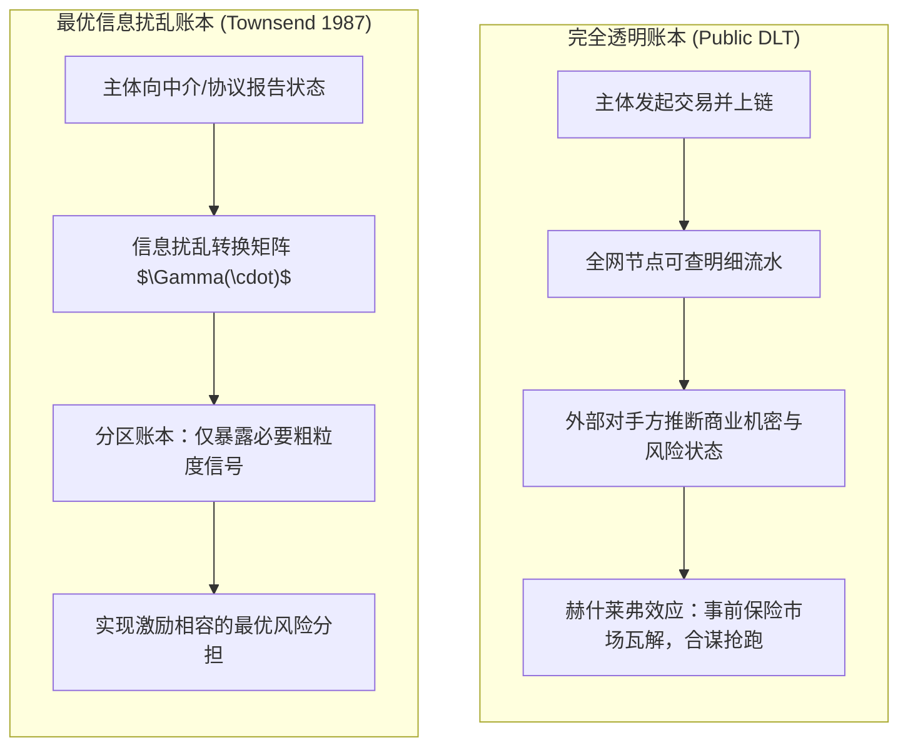
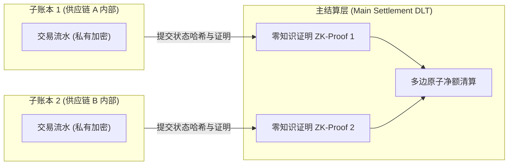
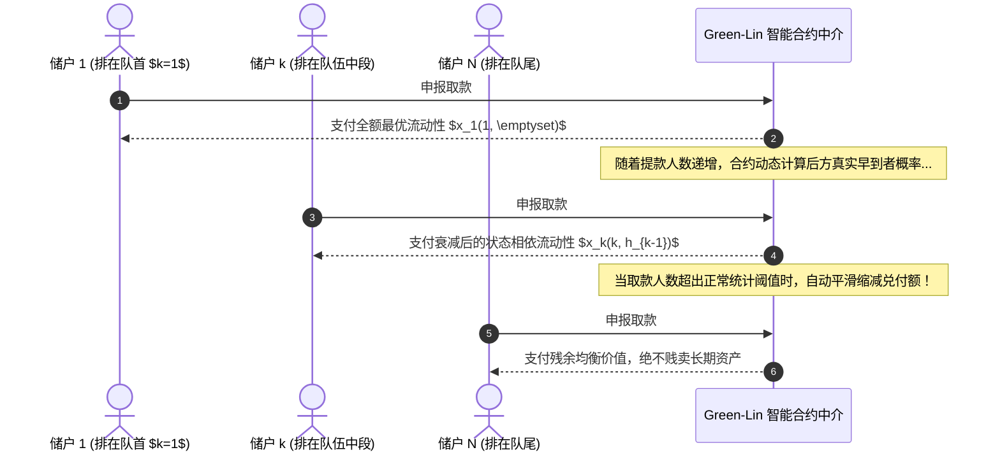

# Lec 5 基于分布式账本技术的金融基础设施最优设计构想（Vision for Optimized Design of Financial Infrastructure using Distributed Ledger Technology）

> **授课教师**：Robert M. Townsend（MIT 经济学系 Killian 讲席教授）  
> **核心文献**：Robert M. Townsend (1987), *"Economic Organization with Limited Communication"*; Robert M. Townsend (1988), *"Information Constrained Insurance: The Revelation Principle Extended"*; Edward J. Green & Ping Lin (2003), *"Implementing Efficient Allocations in a Model of Financial Intermediation"*; Douglas W. Diamond & Philip H. Dybvig (1983), *"Bank Runs, Deposit Insurance, and Liquidity"*.

## TL;DR

- 完全公开透明的共享账本会产生“信息外部性”，泄露交易隐私并引发赫什莱弗效应（Hirshleifer Effect），破坏最优风险分担。
- 最优机制设计要求信息扰乱（Scrambling）与分区账本（Partitioned Ledgers），多色代币（Colored Tokens）在去中心化网络中扮演了隔离信息集与访问权限的物理载体。
- 限制外部未授权借贷与侧向交易（Side Trading），是将代理人约束在最优动态契约中的必要前提。
- 格林-林（Green-Lin）模型证明，当智能合约能够严格承诺按提款队列位置与历史申报执行状态相依的序列服务规则时，能够彻底消除自实现银行挤兑。

## 透明度悖论与信息扰乱（Scrambling）：Townsend 理论基准

主流加密货币与以太坊等公链将“全网公开透明、所有历史交易对全节点可查”视为核心优势。然而，Townsend（1987, 1988）从信息经济学第一性原理出发，深刻揭示了**完全信息透明对社会帕累托最优配置的破坏性**。

### 赫什莱弗效应与信息泄露外部性

假设经济体中存在两位处于互补生产链条上的企业 A 和 B。企业 A 遭遇了技术生产冲击 $\theta_A$，这一冲击直接决定了其未来的还款能力与边际生产成本。

在传统的单边市场中，信息不对称通常被视作交易的阻碍。然而，在具有互助保险性质的金融体系中，适度的无知往往是合作的前提。如果所有交易记在完全公开的公共账本上，全网所有节点都具备完全的数据透视能力：
- 企业 B 能够通过 A 的原材料采购量、链上代币转移频次与资金流水，实时反向推断出 $\theta_A$ 的精确取值；
- 一旦私有信息被外部市场提前获知，资产估值便会立即实现，原先在事前（Ex-Ante）可以通过相互保险契约进行风险分散的技术冲击，在事后（Ex-Post）便沦为不可改变的既定事实。

这便是经济学中著名的**赫什莱弗效应（Hirshleifer Effect）**：**过度透明的信息披露消灭了风险分担市场**。当参与者预期到自己的交易记录会被对手方解析并用作价格歧视或信贷掠夺的依据时，理性主体会选择隐藏交易、退出网络，从而导致整个公共账本系统的崩塌。

信息透明与隐私保护因此并非单纯的人权伦理诉求，而是金融市场能够维持流动性供给的数学必要条件。在设计底层金融基础设施时，架构师必须精心权衡“全网可验证性”与“状态保密性”之间的帕累托前沿。

### 最优信息扰乱的数学形式化

设参与者报告其私有状态 $s \in S$。机制设计者并不直接向社会广播 $s$，而是通过一个受控的随机化扰乱核（Scrambling Kernel）$\pi(m \mid s)$ 生成中间消息 $m \in M$：

$$
\pi(m \mid s) = \Pr(M = m \mid S = s)
$$

此时，资源转移规则 $x(m)$ 仅依赖于扰乱后的聚合消息 $m$。

::: theorem 最优信息扰乱定理（Townsend, 1987）
在存在道德风险与逆向选择的受限通信经济中，直接如实公开披露的机制通常是严格次优的。  
最优资源配置必然要求**信息扰乱（Optimal Scrambling）**：机制故意混淆或粗粒度化特定私人状态，使得竞争对手无法剥夺信息租金，从而在满足全域激励相容约束的同时，最大化全社会的互助保险效用。
:::

## 分区账本与多色代币（Colored Tokens）的机制架构

基于信息扰乱理论，Townsend 教授提出了现代金融基础设施的最优设计架构：**分区账本（Partitioned Ledgers）与多色代币系统**。

### 为什么需要分区账本？

与其构建一个承载全社会所有微观业务的庞大单一单体账本（Monolithic Ledger），机制设计理论推导出的更优拓扑是构建相互逻辑隔离的子账本集合。在单体账本中，所有参与者竞争同一块全局状态树，导致了通信带宽的极度浪费与严重的信息过度暴露。

通过引入分区架构（Partitioned Architecture），系统能够在局部保留高密度的私有数据交互，同时对外部仅暴露受限的接口：
- **微观企业子账本**：仅记录企业内部生产要素流转、工人工资与商业机密，其明细对同行与上游供应商严格隔离；
- **银企清算子账本**：记录信贷发放与本息偿还，支持局部多边借贷轧差，对公开市场完全加密；
- **宏观多边清算主链**：不直接存储任何底层交易原文，仅接收各子账本提交的零知识证明（ZKP）与净额轧差哈希状态根，完成跨区总额原子清算。

这种分区设计不仅在密码学上保证了“最小特权暴露”原则，而且在宏观金融学上建立了防火墙。当某一特定子供应链账本内部发生流动性违约冲击时，分区账本的逻辑屏障能够阻止恐慌沿全网无差别蔓延。

### 多色代币（Colored Tokens）作为去中心化访问控制

在区块链早期，比特币通过在特定聪（Satoshi）上添加元数据标记，创造了“染色币（Colored Coins）”。Townsend 将其升华为一种通用的机制设计工具：

::: definition 多色代币系统（Multi-Colored Token System）
多色代币系统是指在底层结算层发行带有不同逻辑属性或智能合约权限标签的代币集合 $\{T_{\text{red}}, T_{\text{blue}}, T_{\text{green}}\}$。不同颜色的代币被赋予差异化的可流通范围、赎回期限与兑换对手方限制，用于在去中心化环境中自动强制执行契约隔离。
:::

::: example 多色代币在小微农贷中的应用
某政府开发性金融机构向贫困农户发放贴息贷款。若发放通用法币，农户可能将其挪用于赌博或购买消费品（道德风险）。  
采用双色代币设计：
- 发放**绿色代币（$T_{\text{green}}$）**：智能合约编程规定该代币仅能在经认证的农资商店（购买化肥、良种、农机）刷卡核销；
- 农资店收到绿色代币后，可向央行 1:1 兑换为通用基础货币；
- 任何试图将绿色代币在场外二级市场折价套现的行为，都会因智能合约白名单校验失败而被底层协议直接拒绝。
:::

## 外部借贷限制与侧向交易（Side Trading）隔离

在动态契约（如 Townsend 1982）中，委托人之所以能激励代理人如实报告低产出并努力工作，核心在于**未来许诺效用的动态调整**。

然而，如果代理人拥有不受监管的“外部秘密借贷通道”（Hidden Storage or Outside Credit Market）：
- 当代理人当期获得高产出时，他会选择向委托人谎报低产出，并将隐瞒的剩余资金悄悄存入外部未授权影子银行；
- 外部侧向交易（Side Trading）的存在，彻底摧毁了主契约的跨期激励相容边界，导致社会契约退化为低效的单期无记忆状态。

::: pitfall 机制设计陷阱：去中心化金融（DeFi）的可组合性风险
DeFi 社区推崇所谓的“货币乐高（Money Legos）”与无许可可组合性。但机制设计理论指出：**当不同金融合约可以无约束自由嵌套与二次抵押时，系统实际上摧毁了所有契约的排他性边界（Contractual Exclusivity）**。代理人可以利用外部借贷平台做空自身抵押品，诱发严重的违约外部性。最优金融系统必须对外部接入实施严格的合约授权委托。
:::

## 承诺消除挤兑：Green-Lin 最优序列服务模型

在银行与金融中介文献中，挤兑（Run）被普遍视为流动性转换的原生缺陷。戴蒙德与迪布维格（Diamond & Dybvig, 1983，简称 D-D 模型）奠定了经典范式：

在 D-D 模型中，储户在时期 1 面临早消费（第 1 类）或晚消费（第 2 类）的流动性冲击。由于银行面临**序列服务约束（Sequential Service Constraint, SSC）**——即储户按到达队伍的先后顺序排队取款，银行必须当场兑付预先承诺的固定面额 $r_1 > 1$——从而催生了双重均衡：
1. **帕累托最优均衡**：仅早到者排队取款，晚到者等待时期 2 获得更高回报 $R > r_1$；
2. **自我实现挤兑均衡**：晚到者预期其他晚到者也会去排队，导致银行长期资产被清仓贱卖，形成人人恐慌取款的恶性踩踏。

### Green-Lin（2003）的理论突破

格林与林（Green & Lin, 2003）提出了一个革命性的疑问：**为什么银行必须向队伍中的所有人支付固定的 $r_1$？**

如果银行向第 $k$ 位排队储户支付的金额 $x_k$，可以依赖于该储户在队伍中的具体位置 $k$，以及该储户之前所有储户的历史提款申报记录 $h_{k-1}$，即：
$$
x_k = x_k(k, h_{k-1})
$$

::: theorem Green-Lin 挤兑消除定理（Green & Lin, 2003）
当金融中介能够对序列服务执行严格的状态相依支付函数 $x_k(k, h_{k-1})$，且储户具有严格递减的边际效用时：  
**原 D-D 模型中的自实现挤兑均衡被完全消除，如实申报自身真实消费偏好是全网储户的唯一严格占优贝叶斯纳什均衡！**
:::

### 智能合约作为 Green-Lin 机制的终极物理承诺

为什么在 1983 年或现实传统银行中难以实施 Green-Lin 方案？因为传统商业银行柜台缺乏**对储户事前承诺的物理不可逆性**。储户会怀疑行长在危机时篡改兑付公式或优先照顾大客户。

::: insight 深入见解：智能合约代码与状态机承诺的真正价值
智能合约技术恰恰为 Green-Lin 机制提供了前所未有的工程基石：  
通过将状态相依的序列提款公式 $x_k(k, h_{k-1})$ 固化在只读字节码中，智能合约实现了**对排队位置与历史状态的密码学级承诺（Cryptographic Commitment）**。储户通过区块链透明验证排队顺序，并预先知晓即便发生恐慌，后续提款额度也会自动平滑衰减，从而使得“提前排队挤兑”在经济利益上彻底无利可图。这一理论将区块链从一种低效的代币转账工具，升华为了消除宏观银行挤兑的制度机制工具。
:::
