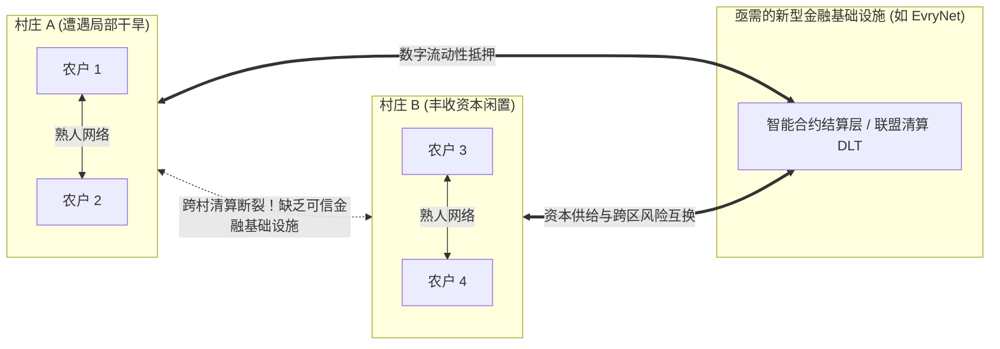
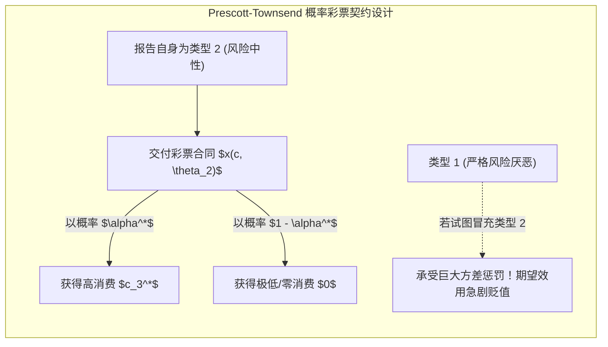
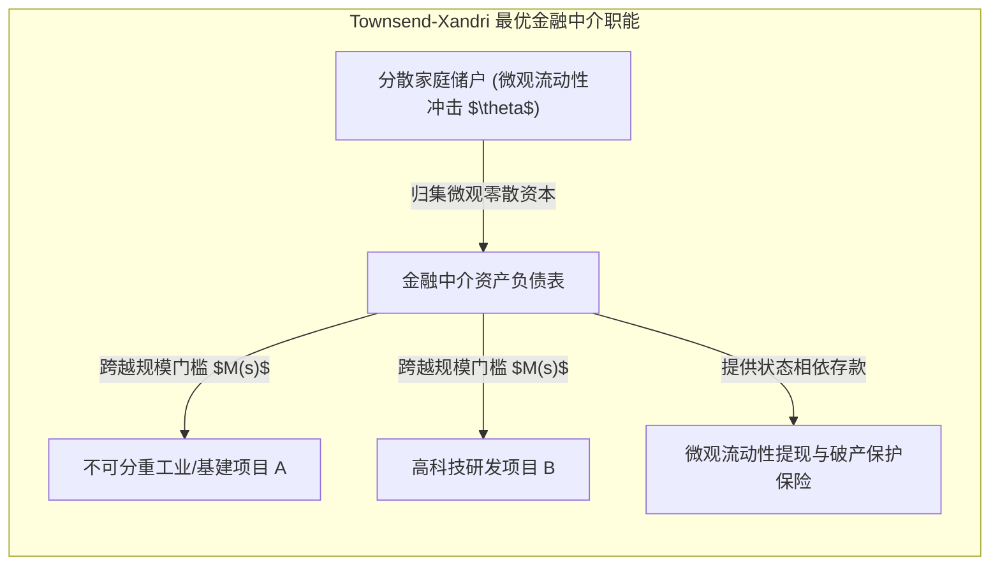

# Lec 6 亟需的金融基础设施：新兴市场创新与最优市场设计理论指导（Needed Financial Infrastructure: Innovations in Emerging Markets and Theory of Optimal Market Design）

> **授课教师**：Robert M. Townsend（MIT 经济学系 Killian 讲席教授）  
> **核心文献**：Edward C. Prescott & Robert M. Townsend (1984), *"General Competitive Analysis in an Economy with Private Information"*, *IER*; Robert M. Townsend & Juan Xandri (2019), *"Regulation and the Optimal Design of Financial Markets"*; Daron Acemoglu & Fabrizio Zilibotti (1997), *"Was Prometheus Unbound by Chance? Risk, Diversification, and Growth"*.

## TL;DR

- 新兴市场与底层乡村经济中，非正式信用网络局限于近邻熟人信任，缺乏跨区域、跨周期的规范化金融清算基础设施。
- 普雷斯科特-汤森德（Prescott-Townsend）一般竞争均衡理论证明，引入“概率彩票契约（Lotteries）”能够凸化非凸激励约束，在私有信息环境下恢复第一福利经济学定理。
- 结合戴蒙德-迪布维格（Diamond-Dybvig）流动性需求与阿西莫格鲁-齐利博蒂（Acemoglu-Zilibotti）不可分大项目约束，最优金融中介内生承担了资产池打包与存款保险双重职能。
- 现代去中心化金融协议（如 EvryNet）应以一般均衡机制设计为指导，而非盲目照搬缺乏激励兼容性保证的简单去中介模式。

## 现实缺口：新兴市场金融基础设施与去中心化实验

在对东南亚及非洲数十个农村社区长达二十余年的微观追踪中，Townsend 教授观察到一个普遍的制度悖论：
- 在村庄内部，亲友借贷、互助会与轮转储蓄借贷协会（ROSCA）异常活跃，能够在熟人社交监督下有效化解部分小额特异性风险；
- 然而，一旦遭遇全村干旱、洪水或系统性农产品价格暴跌等**聚合冲击（Aggregate Shocks）**，村级非正式信任网络便会全线冻结；由于缺乏与外部现代商业银行或资本市场的规范对接渠道，跨村金融中介严重缺失。

为了弥合这一裂痕，以 EvryNet 为代表的新型去中心化金融基础设施尝试在东南亚落地：利用分布式账本的低部署门槛与智能合约自动执行特性，建立去中心化的跨区域商业信用与流动性清算网络。但技术工具的落地必须接受严谨的经济学机制设计理论检验。

## 私有信息下的一般竞争分析：Prescott-Townsend（1984）模型

在传统的阿罗-德布鲁（Arrow-Debreu）完全竞争范式中，所有商品均拥有公开市场价格，第一福利经济学定理保证了竞争均衡的帕累托最优性。但当存在**逆向选择（Adverse Selection）与道德风险（Moral Hazard）**等私有信息时，阿罗-德布鲁定理通常失效。

普雷斯科特与汤森德（Prescott & Townsend, 1984）打破了这一传统定论，证明**通过重新定义商品空间并引入“彩票（Lotteries）”，完全竞争机制可以在私有信息经济中完全恢复**。

### 动机算例：非凸激励约束引发的市场失灵

设经济体在时期 $T=0$ 时所有代理人无差异，拥有确定性禀赋 $e$。在时期 $T=1$，份额为 $\lambda(\theta_1)$ 的主体遭遇私人冲击成为**类型 1（高度风险厌恶）**，效用函数为严格凹的 $U(c, \theta_1)$；份额为 $\lambda(\theta_2)$ 的主体成为**类型 2（风险中性）**，效用函数为线性函数 $U(c, \theta_2) = \theta_2 c$。

若类型 $\theta$ 是公开信息，第一最优（First-Best）资源配置满足边际替代率均等：
$$
U'(c_1^*, \theta_1) = \theta_2, \quad \lambda(\theta_1)c_1^* + \lambda(\theta_2)c_2^* = e
$$
此时，由于边际递减效应，$c_1^* < c_2^*$，风险中性的类型 2 为类型 1 提供了确定性保险。

然而，当类型 $\theta$ 是私有信息时，类型 2 会产生强烈的动机去**伪装成类型 1（Mimic Type 1）**：
$$
\theta_2 c_1^* > \theta_2 c_2^* \quad (\text{因 } c_1^* \text{ 为平滑消费，当 } c_2^* \text{ 承担残差时可能引发套利})
$$
若仅允许确定性消费合同，由于激励相容约束（Incentive Compatibility Constraint）：
$$
\theta_2 c_2 \ge \theta_2 c_1 \implies c_2 \ge c_1
$$
这一不等式与第一最优资源配置 $c_1^* > c_2^*$ 发生直接冲突。确定性可行合同集是非凸的，分散的瓦尔拉斯市场竞争往往无解或退化。

### 引入概率彩票（Lotteries）与可行集的凸化

Prescott 与 Townsend 提出了革命性的解决方案：**将合同标的从确定性消费向量 $c$，扩展为消费水平上的概率测度 $x(c, \theta)$**。

由于类型 2 是风险中性的，她在以下两种方案之间效用完全无差异：
1. 获得确定性的平滑消费 $c_2^*$；
2. 参与一个概率彩票：以概率 $\alpha^* = c_2^* / c_3^*$ 获得极高消费 $c_3^*$，以概率 $1 - \alpha^*$ 获得 $0$ 消费。

$$
\mathbb{E}[U(\text{Lottery}, \theta_2)] = \alpha^* \cdot (\theta_2 c_3^*) + (1 - \alpha^*) \cdot 0 = \theta_2 c_2^*
$$

::: theorem Prescott-Townsend 福利定理（Prescott & Townsend, 1984）
1. **激励相容性的自然内生**：虽然风险中性的类型 2 对彩票与确定性消费无差异，但严格风险厌恶的类型 1 极度厌恶方差，因此**类型 1 绝不会选择冒充类型 2 去抽取彩票**；
2. **第一与第二福利定理的成立**：通过引入概率测度，非凸的商品空间被彻底凸化（Convexification）。一个允许彩票交易的扩展瓦尔拉斯市场竞争均衡，在私有信息约束下严格实现了**受约束的帕累托最优（Constrained Pareto Optimum）**。
:::

## 规模门槛、内生不完全市场与金融中介：Townsend-Xandri 框架

在微观风险分担之外，宏观金融体系必须承担实体资产投资的期限转换与规模打包职能。Townsend 与 Xandri（2019）将 Diamond-Dybvig（1983）的流动性冲击模型与 Acemoglu-Zilibotti（1997）的内生非完全市场理论融为一体。

### 模型环境与最低规模门槛约束

考虑一个生活 3 期（$t = 0, 1, 2$）的经济体，包含度量为 1 的连续统家庭：
1. **时期 0**：家庭拥有禀赋 $\omega > 0$；
2. **时期 1**：家庭面临私有流动性冲击 $\theta \in \Theta$（决定其为早消费还是晚消费类型），同时宏观状态 $s \in [0, 1]$（决定实体生产率）公开实现；
3. **技术选项**：
   - **短期安全储蓄（Storage）**：投入 1 单位，在下一期无风险支付 1 单位；
   - **长期不可分生产性项目（Long Technologies）**：存在连续统的风险资产 $A_s$，每一项资产具有**最小规模门槛约束（Minimum Scale Requirement）** $M(s)$：
     $$r_s(s) = R > 1 \iff y(s) \ge M(s)$$
     由于全社会总资本禀赋不足以支持所有项目达到最小门槛（$\int_0^1 M(s) ds > \omega$），**真实宏观市场内生是不完全的（Endogenously Incomplete Markets）**。

### 社会规划者问题（The Planner's Problem）

社会规划者同时求解两大嵌套规划：
1. **资产组合选择规划**：决定向短期储蓄投入 $x \ge 0$，以及在哪些长期高门槛项目上集中资本 $y(s) \ge M(s)$，以跨状态分散宏观风险；
2. **流动性契约分配规划**：给定跨期可用产出 $Y(s) = x + R y(s)$，设计满足激励相容与跨期资源平衡的消费规则 $c_1(\theta, s), c_2(\theta, s)$。

$$
\max_{\{c_1, c_2, x, y\}} \int_0^1 ds \int_{\Theta} U(c_1(\theta, s), c_2(\theta, s)) dF(\theta)
$$
受制于：
$$
\int_{\Theta} [c_1(\theta, s) + c_2(\theta, s)] dF(\theta) \le x + R y(s), \quad \forall s \in [0, 1]
$$
以及对于所有 $\theta, \hat{\theta} \in \Theta$ 的如实报告激励约束。

::: insight 深入见解：对简单“去中介化（Disintermediation）”的技术反思
区块链社区往往将消除所有中介机构（Middlemen）视为终极道德正确。然而，Townsend-Xandri 框架用严密的数学证明：**金融中介绝非简单的寻租者，其存在是克服实体经济物理非凸性（不可分投资规模门槛）与信息非凸性（微观流动性保险）的内生最优制度发明**。  
如果去中心化金融（DeFi）仅仅将交易流程上链，却无法实现跨期大额资产池汇聚与精准的微观激励兼容彩票设计，其配置效率将远逊于受到规范监管的现代金融中介。
:::
