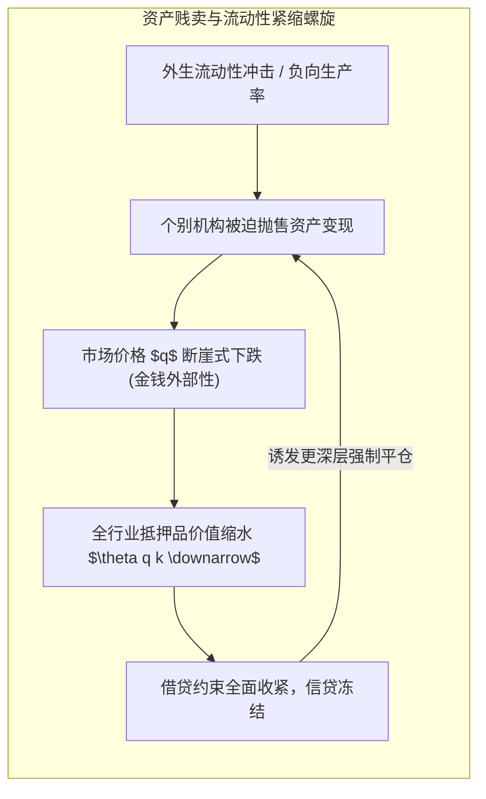
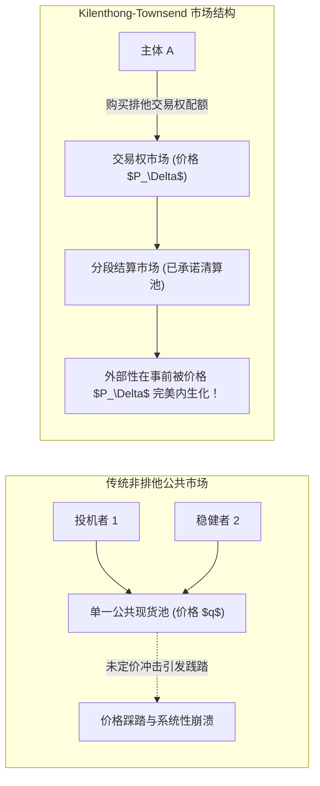
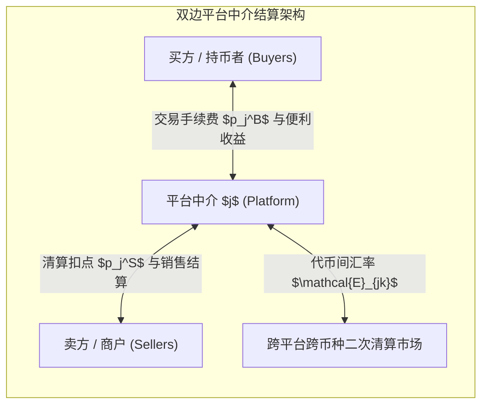

# Lec 7 应对支付系统外部性与资产贱卖：加密货币最优竞争与市场结构（Dealing with Externalities of Payments Systems and Fire Sales: Optimized Competition and Market Structure）

> **授课教师**：Robert M. Townsend（MIT 经济学系 Killian 讲席教授）  
> **核心文献**：Anup Jain & Robert M. Townsend (2018), *"The Economics of Platforms in a Walrasian Framework"*; Weerachart T. Kilenthong & Robert M. Townsend (2020), *"A Market Based Solution for Fire Sales and Other Pecuniary Externalities"*; Alberto Bisin & Piero Gottardi (2006), *"Efficient Competitive Equilibria with Adverse Selection"*.

## TL;DR

- 在不完全金融市场中，担保品约束与内生资产价格交织，个体追求微观自利抛售资产会引发严重的“金钱外部性（Pecuniary Externalities）”与系统性资产贱卖（Fire Sales）。
- 传统宏观审慎政策依赖外生行政性资本税或杠杆率管制，往往造成严重的跨期配置扭曲。
- 奇伦通-汤森德（Kilenthong-Townsend）提出了开创性的市场化解法：通过创立“排他性交易权（Rights to Trade）”与分段隔离市场，将价格反馈外部性在事前内部化。
- 瓦尔拉斯平台竞争框架证明，双边平台与加密代币发行可以通过结构化合约费率实现完全竞争定价，消解大科技（Big Tech）平台的垄断租金。

## 金钱外部性与宏观资产贱卖（Fire Sales）的微观机理

在初等微观经济学中，第一福利经济学定理成立的核心条件之一是“不存在技术外部性”。价格体系的变动（即所谓的金钱外部性，Pecuniary Externalities）仅代表财富在主体间的零和再分配，不会损害帕累托最优性。

然而，在宏观金融学与不完全市场文献中（如 Lorenzoni 2008, Bianchi 2011），**当市场参与者面临依赖资产市场价格的抵押品借贷约束时，金钱外部性会直接演化为破坏性的实际效率损失**。

### 抵押品约束下的恶性反馈螺旋

设经济体在时期 1 面临借贷抵押约束。借款人的最大对外负债 $b_1$ 不能超过其抵押资产存量 $k_1$ 的市场估值 $q_1$：
$$
b_1 \le \theta q_1 k_1, \quad \theta \in (0, 1)
$$
当宏观负向生产率冲击或流动性短缺发生时：
1. 单个借款人抵押品价值缩水，触发借贷约束收紧；
2. 为履行偿债承诺，借款人理性地在公开现货市场上被迫打折抛售实物资本或金融资产 $k_1$；
3. **由于所有借款人同时抛售，市场上总供给剧烈激增，导致均衡资产价格 $q_1$ 断崖式暴跌**；
4. 价格暴跌反过来进一步削减所有市场主体的抵押借贷能力，引发连环违约。

::: pitfall 微观理性与宏观灾难的割裂
在资产贱卖过程中，没有任何一个微观主体的行为是“非理性的”：每一家金融机构都在遵守风险控制模型并积极止损。  
然而，由于个体是价格接受者（Price Takers），他们在时期 0 进行杠杆投资时，**完全不会考虑自身未来在危机时期抛售资产对全市场价格 $q_1$ 造成的压制效应**。这种未被个体内部化的社会边际成本，导致自由竞争市场在繁荣期过度负债、在萧条期过度贱卖。
:::

## Kilenthong-Townsend 市场化解法：交易权与排他性合约

面对资产贱卖与金钱外部性，传统宏观审慎政策（Macroprudential Policy）的标准药方是**行政性干预**：征收皮古税（Pigouvian Tax）、强制限制杠杆率或实施资本项目管制。但这类管制不仅伴随巨大的行政寻租与监管套利成本，还经常误伤正常生产性融资。

Kilenthong 与 Townsend（2020）提出了具有里程碑意义的**市场化解决方案（Market-Based Solution）**：**无需官僚自由裁量干预，通过重构产权结构与市场制度，让分散市场自发实现约束帕累托最优**。

### 排他性合约与分段市场（Contractual Exclusivity & Segregated Markets）

造成金钱外部性的制度根源在于：所有主体都在同一个“无排他性、无记忆的公共现货大池子”中竞争同一价格 $q$。

Kilenthong 与 Townsend 证明，如果金融基础设施支持**分段市场（Segregated Markets）与排他性交易权（Rights to Trade）**：
1. **交易权定价**：在时期 0，市场不仅交易资产本身，还交易“在危机状态 $s$ 下以特定价格抛售或采购资产的排他性交易权配额” $\Delta h$；
2. **交易权市场价格**：持有交易权的权利在事前拥有一个内生价格 $P_\Delta$；
3. **外部性的完全内部化**：

::: theorem 资产贱卖的市场化中性定理（Kilenthong & Townsend, 2020）
通过为资产交易权设立显式的前瞻性排他市场，主体在时期 0 决定自身杠杆头寸时，必须按照市场价格 $P_\Delta$ 购买其未来可能对市场造成冲击的流动性额度。  
这一制度设计将未来的价格压制成本精确反弹至决策主体自身的预算约束上，**在完全去中心化的瓦尔拉斯多边竞争框架下，精准消除了金钱外部性，达到了社会规划者的受约束第一最优配置**。
:::

## 瓦尔拉斯框架下的平台与代币竞争：Jain-Townsend 模型

随着数字经济与去中心化金融发展，支付中介与资产撮合日益由大型数字平台（Platforms）与加密货币流动性池（如 Uniswap、各类清算链）主导。产业组织（IO）文献通常将平台刻画为具有市场势力的古诺或贝特兰德寡头垄断者。

Jain 与 Townsend（2018）构建了开创性的**瓦尔拉斯平台一般均衡模型（Platforms in a Walrasian Framework）**，证明平台中介同样能够被纳入竞争性定价体系。

### 双边市场的瓦尔拉斯微观结构

设经济体中存在买方（消费者）、卖方（商户）以及提供交易清算撮合服务的平台集合 $j \in \mathcal{J}$。在传统分析中，双边市场往往被视作天然具有强网络外部性与高转换成本的自然垄断行业，但通过精细刻画消费者的效用函数与合约结构，完全竞争分析依然能够成立：
- 买方使用平台 $j$ 获得流动性便利与网络效应效用 $v(n_j^S)$，其中 $n_j^S$ 为接入该平台的商户规模；买方为每笔交易向平台支付手续费 $p_j^B$；
- 商户接入平台 $j$ 必须承担固定接入费与向平台支付的清算抽成 $p_j^S$；
- 平台发行各自的平台代币或内部记账积分用于结算，并在跨平台二级市场上形成动态浮动汇率。

在均衡状态下，平台必须向双边市场公布一组非线性费率向量 $(p_j^B, p_j^S)$。由于买卖双方在不同平台之间均具备自由多宿主选择权，平台无法任意实施价格倾轧，其稳态定价受制于边缘竞争平台的自由进入威胁。

### 平台代币的完全竞争定价与社会效率

Jain 与 Townsend 证明，当允许自由进入（Free Entry）且智能合约能够解绑底层技术栈时：
1. **多宿主（Multi-homing）与准入门槛拆除**：如果用户能够同时持有并一键切换多个平台的代币，平台便丧失了锁定用户的垄断壁垒；
2. **零利润与最优价格结构**：在瓦尔拉斯平台均衡中，买方与卖方所支付的综合手续费精确等于平台维持分布式节点通信与抗攻击安全性的边际物理成本；
3. **代币间汇率的内在稳定性**：不同私营平台代币之间的相对汇率 $\mathcal{E}_{jk}$ 并非纯粹由投机情绪决定，而是反映了各平台底层清算效率与便利收益的边际替代率。

::: insight 深入见解：对大科技（Big Tech）金融围墙花园的规制哲学
现代科技巨头（如 Visa/Mastercard、微信支付、各类封闭式加密联盟链）之所以能够赚取超额垄断租金，根本原因在于其人为构建了“专有封闭账本”与高昂的跨平台结算壁垒。  
Townsend 的一般均衡理论给监管者指明了方向：治理平台垄断的最高效手段不是简单拆分企业规模，而是**强制推行底层支付清算协议的互操作性（Interoperability）与排他性交易权的确权**。一旦用户能够在不同平台与代币间实现零阻碍的即时原子跨链互换，瓦尔拉斯竞争规律便会自发压降平台手续费至社会最优水平。
:::
