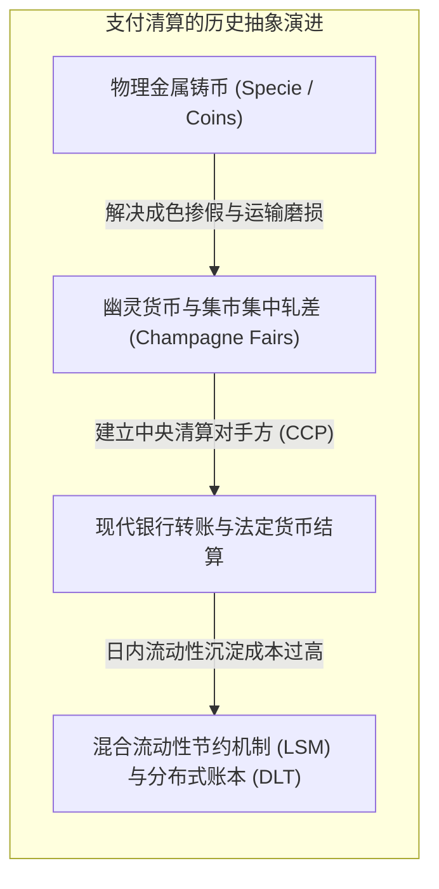
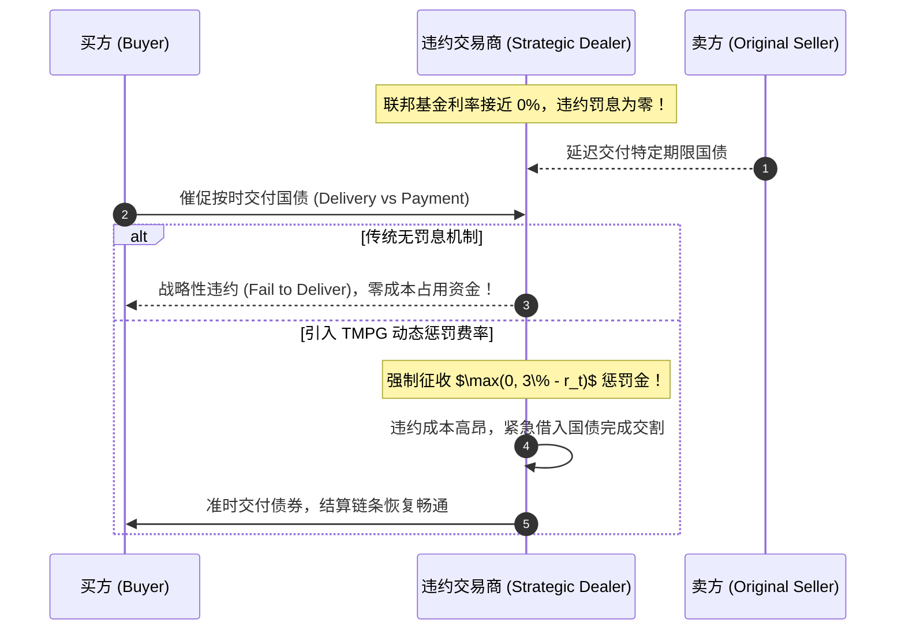
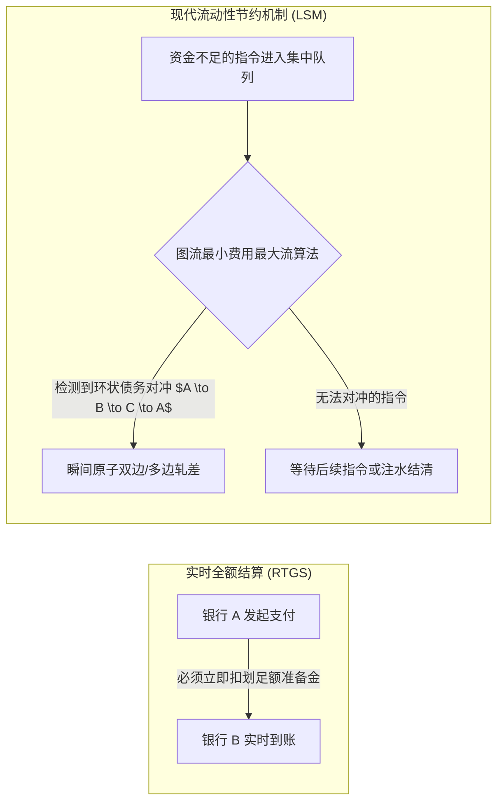
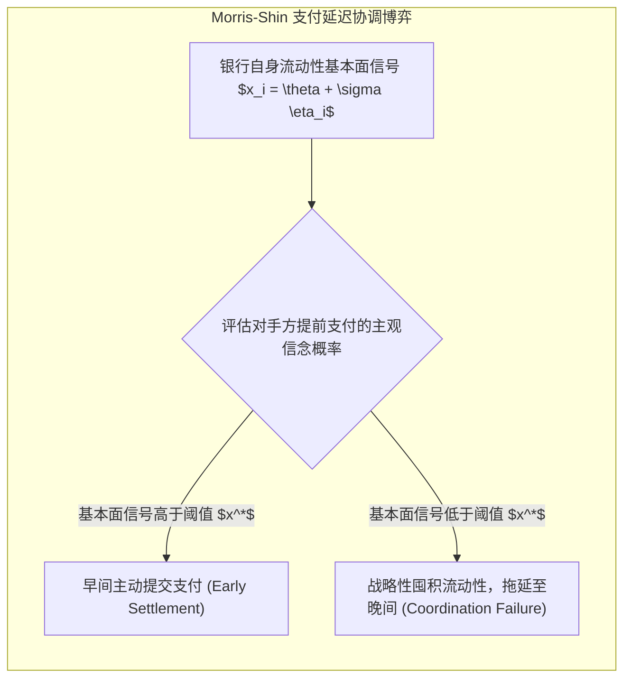

# Lec 8 支付系统：不同备选方案设计中的问题与挑战（Payment Systems: Problems and Issues to be Considered in Alternative Designs）

> **授课教师**：Robert M. Townsend（MIT 经济学系 Killian 讲席教授）  
> **核心文献**：Michael Fleming & Kenneth Garbade (2005), *"Explaining Settlement Fails"*; Morten L. Bech & Rodney Garratt (2003), *"The Intraday Liquidity Management Game"*; Pradeep Dubey (1982), *"Price-Quantity Strategic Market Games"*; Stephen Morris & Hyun Song Shin (2018), *"Distributed Ledger Technology and Large Value Payments: A Global Game Approach"*.

## TL;DR

- 支付结算在历史上常与物理货币脱钩，中世纪欧洲博览会与“幽灵货币（Ghost Currencies）”即已实现纯粹的账面信用清算。
- 现代金融市场中，实时全额结算（RTGS）虽消除了信用风险，但迫使银行沉淀巨额无息流动性；延时净额结算（DNS）极度节约流动性，却面临日内违约连锁传染。
- 国债与回购市场中的“结算失败（Settlement Fails）”具有内生博弈属性，零利率下限使得违约成本归零，迫使美联储引入 TMPG 惩罚性费率。
- 结合流动性节约机制（LSM）与双边对冲图算法的混合清算系统，以及 Project Jasper 等央行分布式账本实验，展现了下一代批发大额支付基础设施的演进路径。

## 支付系统的历史演进：从香槟集市到幽灵货币

在经济学理论中，阿罗-德布鲁无摩擦基准假定所有交易在单一核算单位（Unit of Account）下一瞬间完成出清，无需显式的“支付媒介”。然而在人类商业史中，支付始终是一个伴随严重摩擦与时间错配的独立工程。

1. **香槟集市布料博览会（Champagne Fairs）**：中世纪欧洲跨国商人聚集于法国香槟集市。集市前几周只进行商品看样与订单撮合，所有交易以“博览会账面信用（Fair Money）”记账；集市最后三天，所有商人进入集中清算所，通过多边账目勾对进行**集中差额轧差（Multilateral Netting）**，绝大部分交易无需动用真实金银币，仅极少数净差额用硬币结清（Townsend, 1990）；
2. **幽灵货币（Ghost Currencies）**：奇波拉（Cipolla, 1956）记录了 5 至 17 世纪地中海商人的记账惯例。由于当时欧洲君主频繁通过在硬币中掺铜进行法定货币贬值，商人阶层发明了只存在于账本上的虚拟记账单位（如卡罗琳镑 Pound of Tours）。这种“记账单位与流通硬币的彻底解耦”，为现代央行数字结算提供了最早的历史原型。

## 结算失败（Settlement Fails）与 TMPG 负惩罚利率机制

在现代宏观金融体系中，美国国债（US Treasuries）与三方回购（Tri-party Repo）是全球资本市场的流动性基石。然而，即使在这一最稳健的市场中，**结算失败（Settlement Fails）**依然屡见不鲜。

### 为什么会发生国债结算失败？

弗莱明与加巴德（Fleming & Garbade, 2005）系统分类了国债交易交割失败的成因：
1. **操作与通信故障（Operational Glitches）**：例如 1985 年纽约银行（BONY）计算机系统宕机、2001 年“9·11”恐怖袭击导致曼哈顿通信光缆物理中断；
2. **连锁交割延迟（Daisy Chains）**：交易商 A 承诺向 B 交付国债，前提是 A 必须先从 C 处收到国债。若链条上游的某一家对冲基金延迟交割，会导致下游数百笔交易连环违约；
3. **低利率环境下的战略性违约（Strategic Fails）**：在美联储将联邦基金利率降至接近 0%（Zero Lower Bound）的环境下，违约方延迟一天交割国债所承受的罚息几乎为零。借入国债的交易商宁可故意违约，将资金留在手中赚取隔夜利息，造成严重的流动性雪崩。

### TMPG 惩罚费率机制的设计

为了根治战略性违约，纽约联储下属的国债市场实践委员会（TMPG, 2010）引入了动态交割失败惩罚公式：

$$
\text{TMPG Fails Charge} = \max \left( 0, \, 300\text{ bps} - r_{\text{target}} \right)
$$
当目标利率 $r_{\text{target}}$ 降至 0% 时，违约方必须向对手方支付每年 300 个基点（3%）的硬性罚金。这一机制人为给交割失败设定了负收益底线，显著压降了美债市场的违约率。

::: theorem 美联储量化宽松（QE）对支付摩擦的附带红利
在 2008 年金融危机后，美联储实施了数轮大规模资产购买计划（QE），使其资产负债表规模急剧膨胀，准备金供给从危机前的 200 亿美元暴增至数万亿美元。  
微观支付数据证明：**泛滥的央行超额准备金极大地润滑了银行间清算管道，彻底消除了由于日内流动性捉襟见肘而诱发的交割失败**。但其宏观机会成本是全社会承担了巨大的流动性陷阱溢价。
:::

## 核心架构权衡：RTGS、DNS 与流动性节约机制（LSM）

中央银行在设计大额批发支付系统（如美联储 Fedwire、欧洲央行 TARGET2、中国大额实时支付系统 HVPS）时，面临经典的两难权衡：

| 结算机制模式 | 运行机制原理 | 核心优势 | 致命缺陷 |
|---|---|---|---|
| **实时全额结算（RTGS）** | 每笔支付指令独立、逐笔全额、实时终局结清 | **零交易对手信用风险**，无连锁违约传染 | **极度消耗流动性**，银行必须占用海量央行无息准备金 |
| **延时净额结算（DNS）** | 日间仅记录双边指令，营业日结束前统一差额轧差 | **流动性占用极低**（仅需结清净差额） | **蕴含系统性信用风险**，日间任何大行破产将摧毁清算池 |
| **流动性节约机制（LSM）** | 集中排队队列 + 智能算法多边周期性自动对冲 | 兼顾全额结算的终局性与净额结算的高资金效率 | 算法调度复杂度高，需要依赖中央队列撮合引擎 |

### Güntzer 等（1998）双边对冲算法与德国 EAF-2 实践

德国法兰克福清算系统 EAF-2 每天处理超过 50,000 笔大额银行间支付，总规模超过 6,000 亿马克。为了在无风险前提下节约流动性，Güntzer, Jungnickel & Leclerc（1998）将 LSM 形式化为一个**网络流循环负费用环（Negative Cycle）消除算法**：

设银行集合为有向图中的节点 $V$，排队支付需求为有向边集合 $E$，边上的权值 $w(u, v)$ 为转移金额。
- 算法每隔若干分钟对当前挂单队列运行一次图搜索；
- 一旦在有向图中检测到有向回路 $v_1 \to v_2 \to \dots \to v_k \to v_1$；
- 系统便可取回路上的最小金额 $w^* = \min \{w(v_i, v_{i+1})\}$，在无需占用任何外部准备金的情况下，**同时将所有相关账户直接扣划 $w^*$ 完成原子销账**。

## 央行分布式账本实验：Project Jasper 与全局博弈模型

为了探索下一代支付轨道，加拿大央行联合 R3 财团开展了著名的 **Project Jasper（加拿大实验）**，新加坡金融管理局开展了 **Project Ubin**。

### Project Jasper 的架构演化

在 Phase 1 中，Jasper 尝试使用公有链以太坊的私有部署版；但很快发现：
- 工作量证明（PoW）导致的概率性结算终局性（Probabilistic Finality）完全无法满足中央银行法律意义上的“即时绝对不可撤销”；
- Phase 2 切换至基于 Corda 的授权联盟链架构，由加拿大央行作为“公证人节点（Notary Node）”，将数字存托凭据（CAD-Coin）以央行准备金 1:1 备付发行，实现了亚秒级终局结算。

### Morris-Shin（2018）大额支付全球博弈模型

莫里斯与申（Morris & Shin, 2018）针对分布式大额支付系统构建了全局博弈（Global Game）模型：

设两家银行面临是否在清晨主动发起支付的决策。若双方均在早晨发起支付，双方均能通过双边对冲顺利出清，获得收益 $R$；若对方延迟支付而自身提前发起，自身将面临日内透支利息惩罚 $-C$；若双方均等待至黄昏，各自产生排队摩擦成本 $-D$。

::: theorem 分布式账本透明度对全局博弈的非单调影响（Morris & Shin, 2018）
1. **适度信息可见性改善协调**：若 DLT 能够让银行观测到全网排队队列的总深度（而隐藏单笔明细），各银行对系统出清能力的共同信念增强，促使均衡门槛 $x^*$ 降低，消除流动性囤积；
2. **过度透明度摧毁流动性**：若 DLT 将每一家参与银行的即时头寸完全公开，一旦某家大行遭遇临时流动性紧张，全网其他银行会瞬间形成“对方必然拖延支付”的共识，集体推迟打款，从而引发全系统的灾难性冻结。
:::

::: insight 深入见解：支付系统设计的制度精髓
支付系统绝非纯粹的软件网络工程，而是一场精密调谐的制度博弈。  
无论采用集中式中央服务器还是去中心化区块链节点，**“流动性与信用风险的互换律”永远存在**：消除信用风险就必须付出流动性锁定成本；追求极端资金效率就必须直面系统性连环违约。最优金融基础设施的艺术，在于利用数学图流对冲算法与精确受控的隐私分区，在保证结算绝对终局性的同时，将流动性消耗压降至物理极限。
:::
