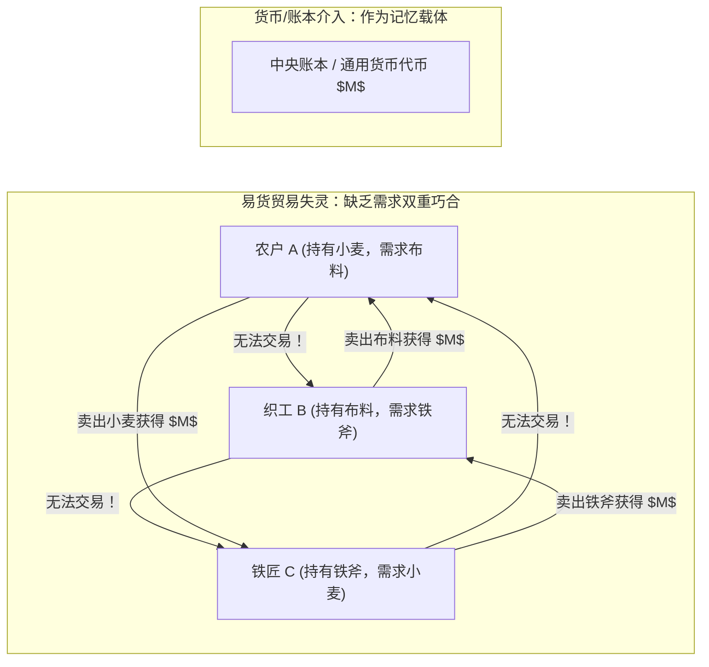
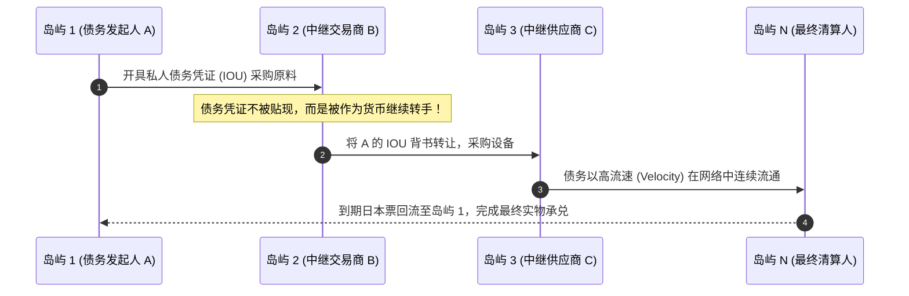
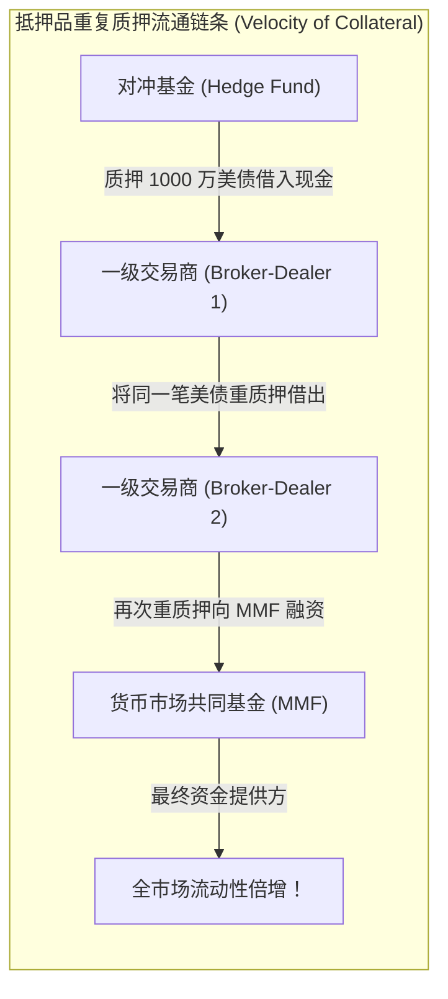

# Lec 9 去中心化货币交换的信息问题与高周转流通私人债务（The Information Problem of Decentralized Monetary Exchange and Circulating Private Debt: Regulation using DLT）

> **授课教师**：Robert M. Townsend（MIT 经济学系 Killian 讲席教授）  
> **核心文献**：Joseph M. Ostroy & Ross M. Starr (1974), *"Money and the Decentralization of Exchange"*; Robert M. Townsend & Neil Wallace (1987), *"Circulating Private Debt: An Example with a Coordination Problem"*; Sebastian Infante et al. (2018), *"The Ins and Outs of Collateral Re-use"*; Manmohan Singh (2011), *"Velocity of Pledged Collateral: Analysis and Implications"*.

## TL;DR

- 奥斯特罗伊-斯塔尔（Ostroy-Starr）不可能性定理证明，在缺乏全网全局交易历史记录的去中心化双边交易中，货币是维持贸易预算平衡的本质记忆载体。
- 汤森德-华莱士（Townsend-Wallace）模型表明，高流速流通的私人债务凭证（IOUs）能够替代外部法币支撑高效配置，但内生伴随多重协调崩溃均衡。
- 现代回购市场中，抵押品的“重复质押（Rehypothecation）”大幅放大了有效金融流动性，但抵押品流速骤降会引发系统性流动性挤兑。
- 分布式账本（DLT）通过穿透式记录抵押品权属流转图谱，为消除跨机构债务协调失灵与防范影子银行踩踏提供了可行的制度工具。

## 去中心化交换的信息困境：Ostroy-Starr（1974）定理

在标准微观瓦尔拉斯均衡中，拍卖官以统一相对价格结清所有商品。然而，真实的物理世界是由分散、双边且地理隔离的微观交易构成的。

奥斯特罗伊与斯塔尔（Ostroy & Starr, 1974）从机制设计角度提出了奠基性质问：**如果不存在集中拍卖官，微观主体如何在纯双边点对点（P2P）交互中达成瓦尔拉斯配置？**

### 双边平衡约束与需求双重巧合难题

设经济体中有 $N$ 个代理人与 $K$ 种商品。若两两主体在离散时间点相遇，每一场相遇构成一个双边交易对 $(i, j)$。
在没有信贷与通用货币的纯实物易货体系（Barter Economy）中，每一笔双边交易必须满足**实物价值双向平衡（Bilateral Balance）**：
$$
p \cdot z_{ij} = 0, \quad \forall (i, j)
$$
其中 $z_{ij}$ 为主体 $i$ 从主体 $j$ 处净获得的商品向量。

::: theorem Ostroy-Starr 去中心化交换不可能性定理（Ostroy & Starr, 1974）
在缺乏中央协调者的分散经济中，若信息结构满足**信息局部性（Informational Privacy）**——即交易对手方 $j$ 无法独立验证主体 $i$ 过去在其他所有市场的历史交易明细——那么实物易货贸易无法在有限步内收敛至瓦尔拉斯最优配置。  
**货币（Money）或公共账本（Ledger）的经济学第一性本质，不是商品本身的物理使用价值，而是作为一种跨时空的“公共记忆载体（Memory Device）”（Kocherlakota, 1998），用于证明该主体此前向社会交付了等价价值。**
:::

## 高周转流通私人债务与协调失灵：Townsend-Wallace 模型

既然货币的本质是可验证的账面记忆，那么这种记忆是否必须由中央银行垄断发行？民间商业信贷凭证（私人债务 IOU）能否自发充当交易媒介？

汤森德与华莱士（Townsend & Wallace, 1987）构建了一个具有空间分割与多期代际交叠的经典理论模型。

### 模型拓扑与私人票据流通

设经济体包含 $J$ 个沿环形排列的地理岛屿，时间在离散跨期演进。
- 居住在岛屿 1 的年轻一代农户需要从岛屿 2 采购生产原料，但其自身产出必须在未来成熟；
- 农户向岛屿 2 的卖家开具一张以自己未来产出为担保的**私人承兑本票（Private Debt IOU）**；
- 岛屿 2 的卖家收到该本票后，并不持有至到期，而是将其作为即时支付手段，转手支付给岛屿 3 的供应商；
- 该本票以高周转率（High Velocity）沿贸易链条在多个岛屿间流转，充当了事实上的“私人纸币”。

### 多重均衡与信念恐慌的脆弱性

Townsend 与 Wallace 证明，高流速流通私人债务的均衡高度依赖**高阶自实现信念（Self-Fulfilling Expectations）**：

::: theorem 私人债务货币的协调不稳定性（Townsend & Wallace, 1987）
该经济体必然存在多重均衡：
1. **高流动性有效均衡（High-Velocity Equilibrium）**：全网所有主体一致相信后续交易对手会足额接收该 IOU，私人债务以 100% 票面价值作为无摩擦货币流通，全社会实现第一最优帕累托产出；
2. **协调崩溃流动性枯竭均衡（Coordination Failure Run Equilibrium）**：只要下游某一个岛屿的主体对原始发行人 A 的兑付能力产生极微小的怀疑，信息恐慌将沿环形链条瞬间逆流而上；每一级接收者均要求巨额风险折价或彻底拒绝受让该 IOU，私人债务流速瞬间归零，经济陷入严重的信贷通缩。
:::

## 现代回购与抵押品重质押：Infante 与 Singh 的实证图谱

在 21 世纪的现代影子银行与批发资金市场中，Townsend-Wallace 的“私人债务流转”正在以惊人的规模上演——这便是**抵押品重复质押（Collateral Rehypothecation & Re-use）**。

### 抵押品流转乘数机制

曼莫汉·辛格（Manmohan Singh, 2011）与英凡特等（Infante, Press & Strauss, 2018）对全球大型交易商（Broker-Dealers，如高盛、摩根大通、巴克莱）的表外资产负债表进行了开创性解构：

定义**抵押品流速（Velocity of Pledged Collateral）**：
$$
\text{Velocity} = \frac{\text{全市场总借贷结算总额}}{\text{真实底层无重复抵押品总存量}}
$$
在 2007 年全球金融危机前夕，华尔街高质量抵押品（主要是美债与机构债）的流通速度高达 **3.0 左右**。这意味着每 1 万亿美元的基础抵押品，通过连续重质押支撑了近 3 万亿美元的市场化流动性。

### 危机中的去杠杆踩踏与流速崩塌

当雷曼兄弟（Lehman Brothers）倒闭时，全市场爆发流动性休克：
1. **抵押品折扣率（Haircut）暴增**：交易商拒绝接受除最核心国债以外的任何资产；
2. **拒绝再质押（Pledged Collateral Hoarding）**：各家机构要求收回抵押品物理保管权，导致抵押品流速从 3.0 断崖式暴跌至 1.8 甚至更低；
3. **流动性蒸发**：仅仅因为抵押品流速的下降，全球影子银行系统瞬间凭空蒸发了数万亿美元的信贷流动性，形成了经典的现代宏观流动性黑洞。

## 分布式账本技术（DLT）对金融债务流通的监管重构

面对 Townsend-Wallace 协调失灵与影子银行抵押品流速崩塌，传统的以机构报表为基础的监管范式（如巴塞尔协议季报披露）在秒级危机的传染面前彻底失效。

Townsend 教授指出，**分布式账本技术（DLT）为治理这一系统性风险提供了制度性的工程解法**：

| 维度 | 传统影子银行不透明网络 | 基于 DLT 的新型穿透式账本 |
|---|---|---|
| **权属链条追踪** | 抵押品流转散落在各家投行的私有封闭数据库，监管者仅能事后摸排 | 底层账本以不可篡改的 UTXO 或账户状态树，实时展现抵押品的完整流转图谱 |
| **重质押杠杆倍数** | 无法掌握同一张国债被重复抵押了多少次（隐性过度借贷） | 智能合约自动约束重质押最大跳数与折扣率，超额质押自动触发熔断 |
| **协调博弈信念** | 市场充斥谣言，对对手方偿付能力缺乏确定性，极易触发自实现挤兑 | 账本状态对全网参与者提供受控的零知识证明，锚定共同信念，消除协调崩溃 |
| **清算与违约处置** | 漫长的法院破产重组诉讼，抵押品长期被冻结无法变现 | 智能合约自动触发多边债务净额抵销，秒级释放被锁定的流动性 |

::: insight 深入见解：DLT 是系统性风险治理的显微镜
区块链技术最深刻的宏观经济学价值，不在于发行脱离现实的私营代币，而在于**为现代金融中介拉长的信贷链条提供了一张实时的、全景式的全局信息网络**。  
正如 Ostroy-Starr 定理所指出的，去中心化交换的本质瓶颈是信息私有性引发的信任割裂。当 DLT 将散落在各个影子银行表外的重质押网络转化为机器可读的共识状态机时，它实际上从根本上消除了信息摩擦，使高流速私人债务能够在不引发多重恐慌均衡的前提下，安全逼近第一最优配置。
:::
