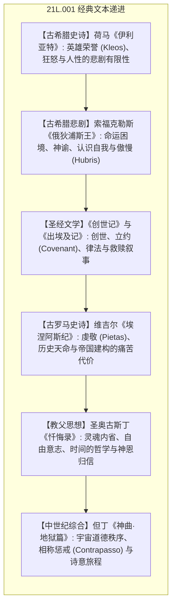

# 21L.001 西方文化基石：从荷马到但丁

MIT 21L.001（Fall 2008，主讲 Arthur Bahr 教授）是麻省理工学院文学系面向本科生的经典人文通识基石课程。课程精读奠定西方文学与精神传统的六部伟大经典：古希腊荷马史诗《伊利亚特》、索福克勒斯古希腊悲剧《俄狄浦斯王》、古罗马维吉尔史诗《埃涅阿斯纪》、圣经《创世记》与《出埃及记》、圣奥古斯丁《忏悔录》，以及但丁的中世纪巨著《神曲·地狱篇》。通过细读（Close Reading），探索英雄、荣耀、正义、神圣、罪责与救赎的原型母题。

## TL;DR

- 溯源英语世界文学与文化的原型母题：系统掌握西方文明两大支柱——希腊理性/悲剧（Hellenism）与希伯来信仰/正义（Hebraism）。
- 建立深度细读与批判性阐释能力：解析英雄史诗的口头传统、隐喻网络与古典叙事诗学。
- 贯通英语典故与深层语感网络：掌握渗透在西方思想、法律、政治与现代日常用语中的母本隐喻。

## 文本研读图景

本课程以细读（Close Reading）方法切入西方文明精神源头的经典文本序列。研读从古希腊荷马史诗《伊利亚特》所代表的英雄荣誉追求与必死悲剧性拉开序幕；继而剖析索福克勒斯《俄狄浦斯王》中命运与自我认知的严酷悖论；转入希伯来圣经《创世记》与《出埃及记》中的立约叙事与神圣律法传统；随后细读维吉尔《埃涅阿斯纪》中帝国天命与个人牺牲的张力；结合奥古斯丁《忏悔录》开创的基督教灵魂内省哲学；最终在中世纪集大成者但丁《神曲·地狱篇》的对称道德宇宙中完成古典向现代思想的过渡。

各模块之间并非割裂孤立的知识碎片，而是构成环环相扣的推导链条。学习者在研读各章节时，应重点追踪理论假说的提出背景、关键跨语言反例的证伪逻辑，以及形式化推导工具在具体语料中的落地验证过程。

## 核心经典研读模块

| 文本与作者 | 核心议题与文学机制 | 文化原型与现代映射 |
| :--- | :--- | :--- |
| **《伊利亚特》（荷马）** | 阿喀琉斯的愤怒、凡人的必死性、战争的残酷美学与悲悯 | 英雄荣誉观念、*Achilles' heel*、特洛伊木马典故 |
| **《俄狄浦斯王》（索福克勒斯）** | 盲目与洞察的悖论、知晓真相的代价、悲剧性傲慢（*Hubris*） | 弗洛伊德心理学原型、希腊戏剧结构三一律 |
| **《创世记》与《出埃及记》** | 亚伯拉罕献祭、出埃及神迹、十诫、上帝与被选之民的契约 | 西方契约精神起源、流散文学与自由解放叙事 |
| **《埃涅阿斯纪》（维吉尔）** | 责任高于个人情感（狄多之死）、罗马和平（*Pax Romana*）的天命 | 帝国意识形态修辞、现代西方爱国主义与义务冲突 |
| **《忏悔录》（奥古斯丁）** | 偷梨事件的无动机之恶、童年与记忆分析、柏拉图主义与基督教融合 | 近代西方自传体文学先河、内心独白与内省机制 |
| **《神曲·地狱篇》（但丁）** | 三韵句（*Terza Rima*）、地狱九层拓扑、罪与罚的对称报应律 | 托马斯阿奎那经院哲学形象化、意大利文艺复兴先声 |

## 前置知识与阅读建议

无特定学术门槛；建议预留充足的经典文本精读时间，配合课后讨论与细读随笔写作进行研读。

## 来源与参考资料

- MIT OpenCourseWare: [21L.001 Foundations of Western Culture: Homer to Dante (Fall 2008)](https://ocw.mit.edu/courses/21l-001-foundations-of-western-culture-homer-to-dante-fall-2008/)
- 主讲教师：Prof. Arthur Bahr（MIT Literature Section）
