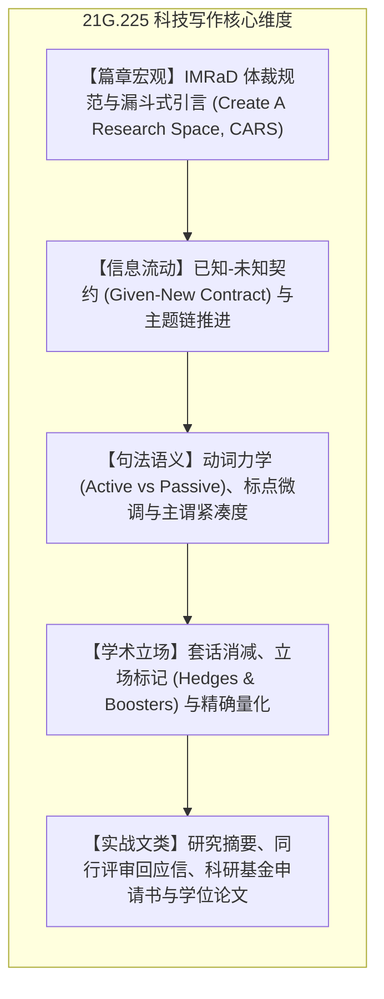

# 21G.225 科技与工程写作（Spring 16）

## TL;DR

- **课程定位**：如果你英语水平不错，但写作能力需要进一步提升，这是不二之选。
- **课程内容**：以最新的应用语言学和文体研究为基础，为您提供分析、练习并获得反馈的机会，帮助您撰写在工程或科学学习和职业生涯中将会用到的各种专业和学术文档。

## 课程介绍

### 先修课程

（无）

### 课程内容

如果您是麻省理工学院（MIT）科学或工程专业的本科三年级、四年级或研究生，并且您的英语水平较高，但写作能力需要进一步提升，那么21G.225/6课程正是您的理想之选。本工作坊以最新的应用语言学和文体研究为基础，为您提供分析、练习并获得反馈的机会，帮助您撰写在工程或科学学习和职业生涯中将会用到的各种专业和学术文档。如果您已经参与了某个研究项目，那么本工作坊将更加高效；您可以将与自身研究相关的文献和数据运用到课程作业中。

工作坊的内容循序渐进，每个模块和作业都以前一个模块和作业为基础。学员通常是所评述作品的作者，有时也需要负责主持小组讨论和进行简短的汇报。在整个学期中，按时出勤、按时完成作业以及积极参与课堂活动对于学习过程和工作坊的成功至关重要。

在 21G.225 / 6 课程中，您将通过写作过程中的起草、修改和分享，提高写作效率和流畅度。您将学习如何预判读者的需求并满足他们的期望。您将熟悉您所在学科的恰当文体规范。您将磨练编辑技巧，提高句子结构和用词的准确性，并培养作为一名具有国际视野的专业人士的自信心。

### 参考书

- Day, Robert A. 和 Barbara Gastel。*《如何撰写和发表科学论文》*。第 7 版。Greenwood，2011 年。ISBN：9780313391972。
- Hacker, Diana 和 Barbara Fister。*《电子时代的科研与文献》*。第 5 版。Bedford / St. Martin's，2010 年。ISBN：9780312566722。
- 霍顿·米夫林公司。*《美国传统词典》*。第5版。戴尔出版社，2012年。ISBN：9780553583229。
- 牛津大学出版社。*《新牛津美国词典》*。第3版。牛津大学出版社，2010年。ISBN：9780195392883。

## 课程核心维度与知识版图

本工坊专为跨语言学者量身定制，涵盖科研学术交流的全生命周期技能。在篇章宏观层面，系统解构现代科学论文通行的 IMRaD 结构与约翰·斯韦尔斯（John Swales）的 CARS 模型，指导如何撰写具有学术冲击力的引言与摘要；在段落与句子微观层面，严格推行“已知-未知信息契约（Given-New Contract）”，确保句间衔接咬合紧密；同时深入剖析学术语气的微妙分寸，精准调配立场标记（Hedges & Boosters），根除被动语态滥用与空洞套话，全面掌握学术期刊投稿与基金申请技能。

各模块之间并非割裂孤立的知识碎片，而是构成环环相扣的推导链条。学习者在研读各章节时，应重点追踪理论假说的提出背景、关键跨语言反例的证伪逻辑，以及形式化推导工具在具体语料中的落地验证过程。

## 16 讲完整讲义笔记导航

全课程 16 讲深度专题讲义笔记，系统覆盖 MIT 21G.225 全学期 26 次课程的核心理论模型、实战指南与中式英文诊断纠偏：

| 讲次 | 核心主题 | 核心写作机制与理论模型 | 讲义笔记 |
| :---: | :--- | :--- | :---: |
| **Lec 01** | 专业写作基石与“作者责任型”文化 | 作者责任型 vs. 读者责任型文化、专业级扫读（Scanning）、修辞情境三要素 | [讲义笔记](./lec1.md) |
| **Lec 02** | 篇章连贯、句子边界与标点修辞 | 已知-未知信息契约（Given-New）、从句组合、连读句（Run-on）与标点力学 | [讲义笔记](./lec2.md) |
| **Lec 03** | 面向公众的科普写作与同行评审 | 降维解释（Writing for the Public）、隐喻架桥、非专家读者同理心与同行评审规范 | [讲义笔记](./lec3.md) |
| **Lec 04** | 职场与学术信函：备忘录与邮件规范 | 4 层倒金字塔技术备忘录（Technical Memo）、专业 Email 礼仪与执行摘要 | [讲义笔记](./lec4.md) |
| **Lec 05** | 科技动词体系：时态沿革与语态分配 | IMRaD 四区时态演进律、主动语态 vs. 被动语态、动词化与名物化消解 | [讲义笔记](./lec5.md) |
| **Lec 06** | 学术求职信、履历（CV）与陈述信 | 学术与工业界 Cover Letter 12 句法、强力动作动词（Action Verbs）、个人陈述 | [讲义笔记](./lec6.md) |
| **Lec 07** | 论文架构规范、防范剽窃与语料检索 | IMRaD 宏观拓扑、学术诚信边界与改写（Paraphrasing）、语料库搭配检索 | [讲义笔记](./lec7.md) |
| **Lec 08** | 科技英语冠词系统精解 | 特指 vs. 泛指、可数 vs. 不可数名词、定冠词 *The* 与零冠词的数学化决策树 | [讲义笔记](./lec8.md) |
| **Lec 09** | 学术论文引言与斯韦尔斯 CARS 模型 | 斯韦尔斯三步走漏斗模型（Establish Territory, Establish Niche, Occupy Niche） | [讲义笔记](./lec9.md) |
| **Lec 10** | 科研项目提案撰写与说服修辞 | 基金提案四要素（问题、方案、可行性、影响）、图尔敏论证模型与预算防御 | [讲义笔记](./lec10.md) |
| **Lec 11** | 结果与讨论撰写：数据评论与学术立场 | 数据评论四部曲、软化词（Hedges）与强化词（Boosters）的高精度调配 | [讲义笔记](./lec11.md) |
| **Lec 12** | 定语从句、后置修饰与图表精确描述 | 限制性 vs. 非限制性定语从句、分词短语紧缩、图表说明文（Captions）叙事 | [讲义笔记](./lec12.md) |
| **Lec 13** | 期刊发表规范与同行评审答复信 | 审稿人回复信策略（Point-by-point Response）、防御性文献引证与礼貌原则 | [讲义笔记](./lec13.md) |
| **Lec 14** | 学术会议论文与科研海报设计 | 视觉信噪比（Signal-to-Noise Ratio）、3 秒吸引法则与海报空间流线设计 | [讲义笔记](./lec14.md) |
| **Lec 15** | 纳米学术演讲：2 分钟电梯微陈述 | 学术一分钟（Academic Minute）、3MT 答辩范式、为什么别人要在乎（Why Care?） | [讲义笔记](./lec15.md) |
| **Lec 16** | 学位论文摘要与总结章架构 | 论文摘要分类（描述型 vs. 资料型）、独立成篇总结章（Summary Chapter） | [讲义笔记](./lec16.md) |

## 前置知识与建议

适合需要撰写英文科研论文、毕业论文、技术报告的理工科与社科学者。建议结合正在写作的实际学术项目边学边练。

## 来源与参考资料

- MIT OpenCourseWare: [21G.225 Advanced Workshop in Writing for Science and Engineering (ELS) (Spring 2016)](https://ocw.mit.edu/courses/21g-225-advanced-workshop-in-writing-for-science-and-engineering-els-spring-2016/)
- 主讲教师：Jane Dunphy（MIT Global Studies and Languages / Comparative Media Studies/Writing）
- 权威参考书目：
  - Nigel A. Caplan: *Grammar Choices for Graduate and Professional Writers* (University of Michigan Press)
  - Robert A. Day & Barbara Gastel: *How to Write and Publish a Scientific Paper* (7th ed.)
  - John M. Swales & Christine B. Feak: *Academic Writing for Graduate Students* (3rd ed.)
