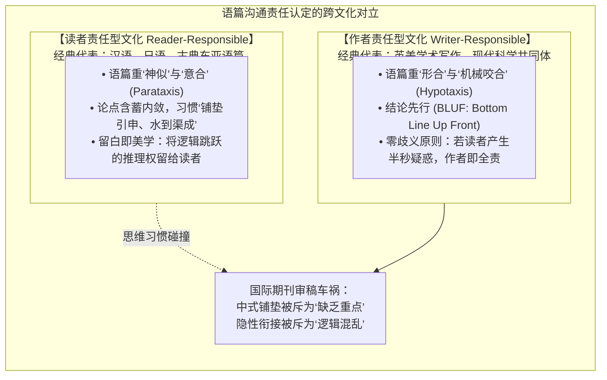
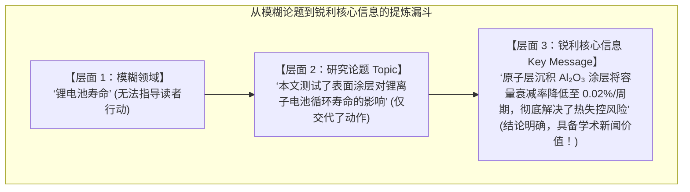
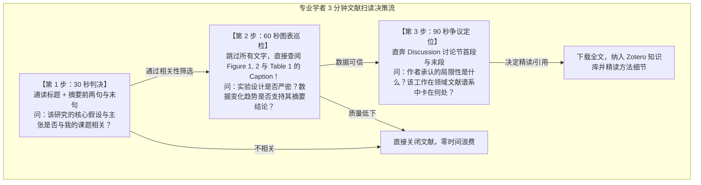

# Lec 1 专业写作基石与“作者责任型”文化

> MIT 21G.225 · 科技与工程高级写作工作坊 (ELS) · 主讲 Jane Dunphy

## TL;DR

- **作者责任型文化的范式转移**：英语学术写作将阐明逻辑的全部认知负担压在作者身上，与汉语高语境、重悟性推导的“读者责任型”传统形成根本性对立。
- **修辞情境三要素黄金三角**：专业沟通策略由作者信誉（Credibility）、目标受众认知缺口（Audience Needs）与终极行动目标（Objective）三元交集严格锁定。
- **论题与核心信息的关键剥离**：优秀论文绝非罗列“讨论了什么”（Topic），而是用一句话宣告“得出了何种全新不可逆的断言”（Key Message）。
- **专业级逆向工程研读（Scanning）**：成熟学者通过快速扫描标题、摘要四部曲与图表说明文提取学术新闻，并借助领域顶级“模型论文（Model Paper）”解码体裁规范。

## 1. 核心问题：为什么中文学者的学术英语常常被评为“不知所云”？

许多接受过多年英语教育、掌握上万词汇并在科研一线取得杰出实验数据的中国研究生和学者，在向《自然》（*Nature*）、《科学》（*Science*）或 IEEE 汇刊投稿时，常常收到审稿人令人沮丧的评价：
> *"The logic is jumpy."*（逻辑跳跃）  
> *"The main contribution is buried."*（核心贡献被深埋）  
> *"The writing lacks clear focus."*（行文缺乏清晰焦点）

中国作者常常对此感到委屈甚至困惑：“我的推导每一步都有数据支撑，结论就摆在图表里，审稿人自己稍微推导一下不就明白了吗？”

本讲作为 MIT 21G.225 工坊的开篇基石，直击这一认知冲突的最底层根源：这绝非单纯的词汇量匮乏或标点疏漏，而是**跨文化修辞模式（Contrastive Rhetoric）与篇章责任认定的深层代沟**。要写出具有国际竞争力的学术论文，必须首先完成从东亚“读者责任型”思维到英美“作者责任型”科学契约的范式飞跃。

## 2. 核心概念

| 概念 | 严密定义（用自己的话） | 容易混淆的邻居 | 典型实例 / 判据 |
|---|---|---|---|
| **作者责任型文化（Writer-Responsible Culture）** | 英美学术英语的核心契约：作者承担百分之百的信息清晰度责任；任何读者的困惑、误解或停顿，均被视为作者写作技术的严重失败。 | 读者责任型文化（读者责任型假定读者有义务调动常识与悟性自行脑补前后句之间的隐性因果关系）。 | 必须在段落开头显式放置主题句，并在句间通过已知-未知纽带咬合。 |
| **修辞情境三要素（Rhetorical Triad）** | 决定任何科学与技术文本成败的底层参数组合：作者身份信誉（Writer）、受众背景与预期（Audience），以及文档欲达成的具体行为目标（Purpose）。 | 文学辞藻堆砌（科技写作不追求辞藻华丽，一切遣词造句严格服从于修辞目标的达成效率）。 | 区分写给同行审稿人、跨学科评审委员会还是大众纳税人的文本形态。 |
| **论题 vs. 核心信息（Topic vs. Key Message）** | 论题仅指文档涉及的领域对象（如“燃料电池效率”）；核心信息则是作者希望读者读完后带走的唯一、具体的量化断言结论。 | 泛泛介绍（把“本文研究了A”误当成论文结论；合格的科技论文必须宣布“发现A通过机制B使效率提升了30%”）。 | 论文摘要与电梯演讲必须用 Key Message 开门见山。 |
| **专业级扫读（Scanning / Reading Like a Professional）** | 专业学者在海量文献中不逐字阅读、仅通过定位各节首末句、图表标题与标示词快速截获“学术新闻（The News）”的逆向阅读解码策略。 | 休闲阅读或精读（精读从第一个词读到末尾；扫读是基于学术体裁预期的战略性信息跳跃）。 | 30 秒内通过摘要三要素判断一篇论文是否值得下载精读。 |
| **模型论文法（The Model Paper Approach）** | 在撰写前从本领域顶级期刊中精选 1–2 篇结构公认优秀、具有完整 IMRaD 架构的范文，对其体裁动词、时态与段落推进进行逆向工程仿写的方法。 | 抄袭（模型论文法解构的是抽象的结构脚手架与句式模板，严禁复制任何具体思想与词句）。 | 分析范文引言中各句使用的动词时态与论据过渡词。 |

## 3. 证据链与形式推导：文化修辞学的认知对立

### 3.1 跨文化修辞学：作者责任 vs. 读者责任

对比语言学家约翰·海因兹（John Hinds, 1987）通过对全球主要文明书面语篇的实证调查，确立了语篇责任的经典二分法。这一理论深刻揭示了为什么母语极为优秀的非英语学者在撰写英文学术论文时会遭遇系统性的修辞挫败：

在语言学形态上，汉语属于典型的**意合语言（Paratactic Language）**，语篇中少用显性逻辑连接词，分句之间依靠语义关联与时间逻辑自然铺陈；而英语则是高度发达的**形合语言（Hypotactic Language）**，必须依赖严密的从属连词、介词短语与非谓语结构完成句法挂钩。

这种语言本体差异进一步固化为了深层的文化认知期待：
1. **读者责任型传统（Reader-Responsible）**：受古典儒道哲学与高语境（High Context）社会契约影响，传统中文语篇讲究“言有尽而意无穷”。作者常采用归纳式的“螺旋式推进”与“起承转合”，将核心结论保留至文章最后作为自然升华；读者被默认具备高水平的悟性与共情能力，有责任在脑海中主动补全段落间未明言的因果跃迁。
2. **作者责任型传统（Writer-Responsible）**：英美现代科学共同体是在培根经验主义与低语境（Low Context）商业法权环境中演化而来的。科学论文被视为具有法律效力的信息契约，读者（审稿人、全球科研同行）追求极端的高效与确定性。读者绝不承担任何替作者猜谜的义务；相反，作者必须对文本的易读性承担 $100\%$ 的法律级连带责任。

在作者责任型文化中，作者必须高频调度**元话语路标（Metadiscourse Signposts）**：在每一个大节开头显式提供“前瞻性概览（Advance Organizers）”，在每个自然段第一句话亮出核心主题句（Topic Sentence），并在句与句之间严密铺设逻辑转折器（*However, Consequently, In contrast*）。如果一个审稿人在阅读过程中不得不回溯重读前一句，或者不得不掩卷停顿超过两秒去琢磨“为什么作者在这里突然提到这个变量”，作者在专业修辞层面上就已经被宣判了失败。

### 3.2 论题（Topic）与核心信息（Key Message）的严格剥离

科技写作初学者最常犯的致命错误，是将“写作的范围（Topic）”误当作“写作的目的（Key Message）”：

::: definition 论题与核心信息的形式区分公式
- **论题（Topic = What you investigated）**：客观描述研究的对象与领域范畴，通常是一个名词短语或无倾向性的陈述句：
  $$\text{Topic} = \text{“Nanoparticle synthesis under high-temperature conditions.”}$$
- **核心信息（Key Message = The news / What the reader must believe）**：作者依据实验证据得出的、具有排他性与新颖性的核心科学主张，必须是一个包含动词强断言的完整命题：
  $$\text{Key Message} = \text{“Higher synthesis temperatures increase nanoparticle yield by 45\% without inducing crystal aggregation.”}$$
:::

在学术报告、技术备忘录或论文摘要中，如果在前三句话内未能让同行看到清晰的 Key Message，该论文在预审阶段就会被直接归入“平庸无力”的淘汰堆中。

## 4. 机制与形式推导：专业扫读与中式英语重构实战

### 4.1 专业级逆向工程研读（Scanning）

成熟的科研专家如何在每年几十万篇文献中快速提取信息？迈克尔·汉森（Michael J. Hanson, 2011）在 MIT 提出的文献高效扫读法则，以及加州大学格里斯沃尔德（William Griswold）的“三轮研读法（Three-Pass Approach）”表明，专业学术阅读绝非逐字逐句的线性滚动，而是具有高度战略目的性的非线性跳跃式侦察：

- **第一轮：鸟瞰筛查（Bird's-Eye Triage，耗时 1–3 分钟）**  
  阅读标题、摘要第一句与末句、主要章节标题以及结论首尾句。目标仅仅是回答一个二元问题：“这篇论文的核心假说是否直接处于我的研究脉络中？”
- **第二轮：图表与骨架审判（Grasp with Figures，耗时 5–10 分钟）**  
  完全跳过正文大段叙述，只审阅图表及其说明文（Captions）。专业研究者深知正文可能会有修辞美化，但原始实验数据、误差棒（Error Bars）与对照组图表是无法撒谎的物理证据。
- **第三轮：重构推演（Deep Dive & Virtual Re-implementation，耗时数小时）**  
  仅针对通过前两轮严格筛选的极少数核心顶刊文献，在草稿纸上复算其公式推导，审查其方法论隐藏的边界假设与极端条件限制。

这一阅读规律反向倒逼出作者的写作策略：**如果你的核心图表无法脱离正文独立理解，如果你的摘要第三句还在云山雾罩地讲历史背景，那么在专业读者的第一轮扫读筛选中，你的文章就已经被判处了“死刑”！**

同时，MIT 工坊在开学第一天向所有学员强制推行**模型论文解构法（Model Paper Reverse Engineering）**：
在动笔撰写任何正式学术文本前，学习者必须从目标顶刊（如 *Nature, IEEE TPAMI, JACS*）中锁定一篇公认的经典范文，用荧光笔对其进行“解剖式标注”：标出每一段的中心句位置、引言中三次语态时态切换的临界点、以及数据评论中采用的软化动词。通过逆向工程吸收顶级作者的句法骨架，是告别中式英文摸索的最快捷径。

### 4.2 典型中式英文病灶剖析与重构实操

中国学者在学术英语起步阶段，常因母语思维迁移呈现出几类系统性偏误。以下通过真实语料对比剖析其句法与修辞重塑方案：

::: pitfall 病灶一：“人类历史源远流长”式虚浮开篇
- **中式原句**：
  $$\text{*\“With the rapid development of human society and economy, energy shortage has become a hot topic in recent years.\”}$$
- **审稿人心理反应**：极度不耐烦！这是中小学应试作文的陈腐套话，浪费了论文黄金版面，完全缺乏专业针对性。
- **重构方案**：直切科学矛盾与量化痛点！
  $$\textbf{“Transitioning to grid-scale intermittent renewable energy is fundamentally bottlenecked by the low cycle efficiency (<65\%) of current zinc-air batteries.”}$$
:::

::: pitfall 病灶二：空洞虚词与主语隐身（Dummy Pronoun & Implicit Subject）
- **中式原句**：
  $$\text{*\“It is widely considered by us that through doing this experiment, the error can be minimized.\”}$$
- **句法分析**：汉语习惯无主句，导致直译成英语时堆砌虚词 *It is considered by us*，主语游离，动词被弱化为介词短语 *through doing*，主谓间距过大。
- **重构方案**：激活强力动作动词，明确操作施事！
  $$\textbf{“This recalibration protocol minimizes experimental systematic error to within \pm 0.5\%.”}$$
:::

::: pitfall 病灶三：论据倒装与因果前缀过载
- **中式原句**：
  $$\text{*\“Because the catalyst was poisoned and the pressure dropped rapidly, so the desired yield was not obtained.\”}$$
- **语法硬伤**：受汉语“因为……所以……”关联词影响，出现 *Because... so...* 双重连词违规；且将次要的背景原因堆在句首，核心结果推迟到最后。
- **重构方案**：英美作者责任型惯例——**结论先行，论据紧随其后**！
  $$\textbf{“The reaction failed to achieve the target yield due to rapid pressure loss induced by catalyst poisoning.”}$$
:::

## 5. 我的理解与批判性反思

::: insight 从语言代沟到认知赋能：重塑中国学者的学术声调
学完本讲，我们可以从理论高度对中国学者的学术写作困境进行彻底去魅：
1. **中式英文不是“劣质语言”，而是“错配语篇”**：汉语的意合（Parataxis）与读者责任型结构，在诗歌、文学与日常人际交流中拥有极高维度的审美丰富度。然而，现代实验科学论文是工业革命与启蒙运动催生出的一种极其特化的“信息工程蓝图”。用写山水写意画的方式去画航天飞机发动机草图，必然导致机械运转的灾难。
2. **作者责任型文化是一种心智利他主义**：英美科学写作所强调的“清晰、直接、结论先行”，在本质上是一种高度专业的认知利他主义（Cognitive Altruism）。读者的时间是极端宝贵的稀缺资源；作者多耗费一小时重构逻辑链条与句式，就能为全球成百上千位阅读该论文的学者节省数千小时的认知能耗。
3. **摆脱词汇崇拜，拥抱句法架构**：许多中国学者陷入“背诵 GRE/托福生僻大词”的误区，以为把 *use* 换成 *utilize*、把 *big* 换成 *tremendous* 就是“学术水平高”。国际顶级科技期刊恰恰极度排斥晦涩浮夸的词汇。真正的学术大师，是用初中级别的清晰词汇，搭建出如精密钟表般严丝合缝、逻辑推导势如破竹的句法咬合网络。掌握作者责任型契约，是我们从被动的跨语言应试者，蜕变为自信的全球科学对话者的第一步。
:::
