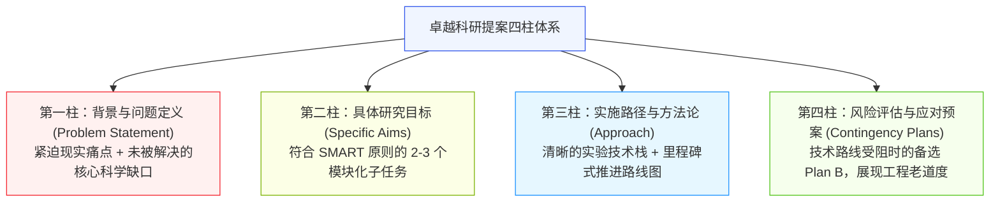
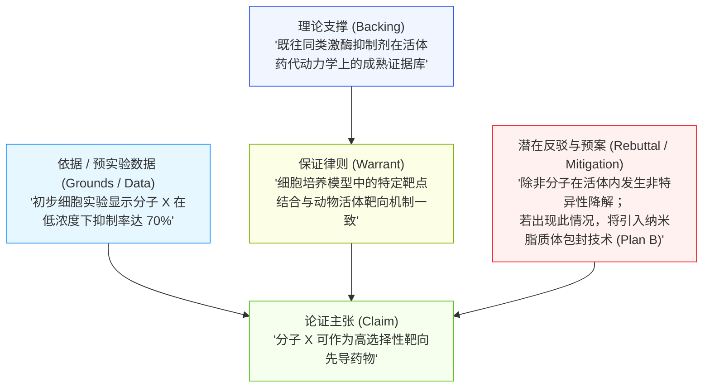
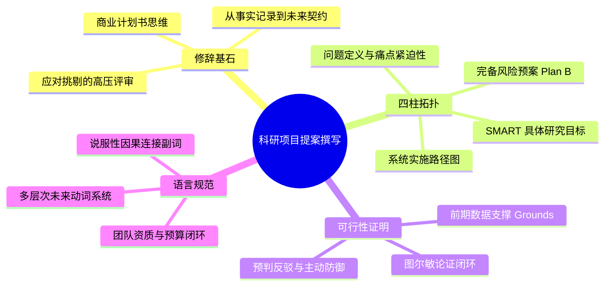

# Lec 10 科研项目提案撰写：问题陈述、方案设计与可行性说服

> MIT 21G.225 · 科技与工程高级写作工作坊 (ELS) · 主讲 Jane Dunphy

## TL;DR

- 科研提案（Research Proposal）不同于记录既有成果的期刊论文，它是一份向资助机构（如 NSF、NIH）论证“高学术回报”与“可控技术风险”的战略商业计划书。
- 遵循“四柱拓扑结构”，将愿景拆解为符合 SMART 原则的具体研究目标（Specific Aims），并强制配备备选风险预案（Contingency Plans）。
- 运用图尔敏论证模型（Toulmin Model）筑牢方案的可行性链条，借助未来动词时态与逻辑连接副词展现严密的工程实施管控力。

## 1. 提案的修辞本质：从“事实记录”到“未来契约”

许多学术界初学者在撰写项目申请书（Grant Proposal / Research Proposal）时，经常错误地套用期刊论文的写作习惯。根据 Robert Day 与 Barbara Gastel 在《How to Write and Publish a Scientific Paper》第 37 章中的论述，科技论文与科研提案属于两种完全不同的修辞文体：

```mermaid
flowchart LR
    subgraph 科技学术论文 (Paper)
        P1["汇报过去完成的实验<br/>(Past Simple 主导)"] --> P2["展示已确证的数据与事实"] --> P3["同行读者：关注结果真伪与复现性"]
    end
    subgraph 科研项目提案 (Proposal)
        R1["规划未来拟执行的方案<br/>(Future Forms 主导)"] --> R2["承诺高预期收益与风险可控性"] --> R3["评审委员：关注投资价值与团队胜任力"]
    end

    style P1 fill:#e6f7ff,stroke:#1890ff,stroke-width:1px
    style P2 fill:#f0f5ff,stroke:#2f54eb,stroke-width:1px
    style P3 fill:#fcffe6,stroke:#7cb305,stroke-width:1px
    style R1 fill:#fff1f0,stroke:#f5222d,stroke-width:1px
    style R2 fill:#fff7e6,stroke:#fa8c16,stroke-width:1px
    style R3 fill:#f6ffed,stroke:#52c41a,stroke-width:1px
```

期刊论文记录的是已经发生并确证的科学事实，审稿人的默认态度是“检验你的推导是否严密”；而科研提案则是向政府基金委或工业赞助商申请数万至数百万美元真实资金的**战略商业计划书**。

评审委员会委员（Reviewers）面对堆积如山的申请书，其阅读心理通常处于极其疲惫的高压状态。在资助率仅有 10% 到 20% 的残酷竞争中，评审人的工作目标实际上是**“寻找淘汰你的理由（Looking for reasons to say NO）”**。

::: definition [科研提案 (Research / Grant Proposal)]
科研提案是一份前瞻性的学术行动纲领，旨在向资助方证明某个重大科学瓶颈迫切需要被攻破、申请人提出了最科学合理的技术路线，且该团队具备在规定时限与预算内保质保量交付成果的绝对胜任力（Competence）。
:::

## 2. 卓越提案的核心四柱架构（The Four Pillars）

依据麻省理工学院《Checklist for Effective Proposals》，一份能够获得高分评审评价的项目提案，必须在以下四个核心支柱之间建立无可挑剔的平衡：



这四大支柱缺一不可。许多优秀的科学构想之所以在评审中折戟沉沙，往往不是因为第一柱的问题不够宏大，而是因为第四柱的风险预案完全缺失，导致评审委员认为该项目存在巨大的资助失败隐患。

### 2.1 具体目标（Specific Aims）的 SMART 原则

美国国家卫生研究院（NIH）与美国国家科学基金会（NSF）最看重的页面被称为 **Specific Aims Page**。一个标准项目通常设计 2 至 3 个子目标，每一个目标必须严格满足 SMART 原则：

- **Specific（具体明确）**：绝不写 *"Aim 1: Study the mechanism of cancer cell migration"*，必须写明具体靶点与技术探针（*"Aim 1: Quantify the binding affinity of peptide X to receptor Y using surface plasmon resonance"*）。
- **Measurable（可量化度量）**：定义明确的性能指标（如灵敏度提升 10 倍、延迟低于 5 ms）。
- **Achievable（切实可行）**：与申请团队的前期预实验数据（Preliminary Data）相互印证，证明并非痴人说梦。
- **Relevant（紧扣核心矛盾）**：子目标之间互为犄角，逻辑自洽，共同服务于攻克总问题。
- **Time-bound（有时限约束）**：每个目标必须能够精确映射到项目甘特图（Gantt Chart）的具体季度节点。

::: pitfall [相互依赖型目标陷阱 (Interdependent Aims Trap)]
提案设计中最致命的架构硬伤是**目标串联依赖**。例如：若 Aim 2 的开展完全取决于 Aim 1 必须成功合成出某种极其不稳定的新型分子，一旦 Aim 1 在头六个月失败，整个项目后续全部瘫痪。评审人会以“高风险且缺乏独立价值”为由直接否决。优秀的设计应保持各 Aim 之间的**半解耦性（Orthogonality）**，即使某个分子合成受阻，Aim 2 依然可以通过商业对照品推进表征。
:::

## 3. 图尔敏论证模型（Toulmin Model）在可行性说服中的应用

在面对极为挑剔的基金评审专家时，单纯罗列实验步骤是远远不够的。评审专家往往在阅读申请人方案时，随时都在心理寻找反例：“如果这步反应不发生怎么办？”“这个测量误差真的能支持你的结论吗？”为了在方案实施之前建立起无懈可击的说服力，当代高阶修辞学将哲学家斯蒂芬·图尔敏（Stephen Toulmin）的论证结构引入了科研提案设计。

图尔敏论证模型彻底打破了传统形式逻辑“三段论”的生硬框架，将说服过程解构为六个动态交互的认知要素：主张（Claim）、依据（Grounds/Data）、保证（Warrant）、支撑（Backing）、限制语（Qualifier）以及潜在反驳（Rebuttal）。在可行性论证中，作者绝不能默认评审人会无条件认可“数据能直接推导出主张”，必须显式给出保证律则与理论支撑。



通过显式展示图尔敏模型的五大核心要素，申请人主动填平了原始数据与科学主张之间的逻辑鸿沟（Warrant & Backing），并抢在挑剔的评审专家发难之前，主动指出潜在失效模式并给出具体的工程应对方案（Rebuttal）。这种自我审计式的论证闭环，不仅彻底消除了评审专家对技术暗礁的疑虑，更将方案的可靠性提升至工业级水准。

::: insight [防御性论证：把评审人的质疑转化为加分项]
初级学者最害怕在提案中提及方案的潜在局限，生怕给评审人留下“方案不成熟”的把柄。然而，顶尖基金申请高手深谙“防御性论证（Defensive Argumentation）”的精髓：与其让审稿人在评审意见中写下 *"The applicant overlooked potential thermal degradation during Step 3"*, 不如主动在正文中设立 *"Risk Mitigation & Anticipated Challenges"* 小节。当你主动写出 *"Although thermal degradation during Step 3 represents a theoretical risk, our preliminary tests demonstrate that adding a 2% volume fraction of antioxidant completely suppresses radical formation"* 时，评审人不仅无法挑刺，反而会对你的学术成熟度与工程严谨性击节赞赏。
:::

## 4. 提案语篇的语法驱动：未来动词与说服性副词

科研提案在语言学上具有鲜明的时态特征与词汇取向。根据 Jane Dunphy 的归纳，撰写提案必须掌握以下语言学调配技巧：

### 4.1 未来时态体系（Future Time Reference）的层次感

提案的核心方法论章节必须以**将来时态与情态动词**为主导，但单纯重复 *"We will do..."* 会使文体极其贫乏。熟练的学者会采用多层次的未来指称结构：

1. **确定性实施承诺（Definite Action）**：
   - *"We will fabricate the array using electron-beam lithography..."*（表达对标准工艺的完全掌控）
2. **制度化流程与安排（Scheduled Arrangements）**：
   - *"The testing phase is scheduled to commence in Month 6..."* / *"System integration is slated for Q3."*
3. **预期设计目的（Purposive Design）**：
   - *"The module is designed to withstand dynamic pressures exceeding 50 bar..."*
4. **条件性审慎推演（Conditional Caution）**：
   - *"Should unexpected phase separation occur, we will adjust the annealing temperature by 5°C increments."*

::: example [说服性副词与因果连词的精准植入]
在论述实施方案时，通过嵌入高精度说服性副词（Transitional and Subordinating Adverbs），能够显著强化逻辑推进的紧凑感：
> *"To **rigorously** evaluate the algorithmic efficiency, we will **systematically** benchmark the solver against three standard industrial datasets. **Consequently**, any deviation from theoretical convergence can be **promptly** isolated to boundary-condition discretization errors, thereby ensuring the numerical robustness of the proposed framework."*
:::

段落中的 *rigorously*, *systematically*, *consequently*, *promptly* 与 *thereby*，犹如精密机械中的咬合齿轮，让资助方深切感受到申请人思维的周密与执行力的老练。

## 5. 本讲总结与实操检视表



### 课后提案撰写自检清单

- [ ] 是否在引言第 1 页内明确提炼了本项目的“核心科学问题”与预期带来的重大现实影响？
- [ ] 拟定的 2-3 个 Specific Aims 是否符合 SMART 原则？彼此之间是否避免了致命的单点串联依赖？
- [ ] 是否展示了充分的前期预实验数据（Preliminary Results），用以支撑方案的可行性？
- [ ] 方法（Approach）章节是否为每一个关键技术节点配备了显式的“风险与备选方案（Potential Pitfalls and Alternative Strategies）”？
- [ ] 动词时态是否正确地从引言的现在/完成时，平稳过渡为方法章节的未来时态（*will*, *is designed to*）？
- [ ] 项目进度表（Gantt Chart）、人员分工（Personnel Roles）与经费预算（Budget Justification）是否与实施方案严密闭环，无虚构或遗漏？

## 6. 我的理解与批判性反思

撰写科研提案，是学者学术生涯中最重要的“资源获取能力”大考。它是科学、战略、心理学与修辞学的究极综合体。

1. **“科学家傲慢”与资助方的认知断层**：
   许多学者在提案中习惯于沉溺在自我设计的极其微观的技术细枝末节中，洋洋洒洒数十页，却从未说清这项研究到底能为国家科技实力、公共卫生健康或人类认知边界带来什么根本改变。资助机构的官员与终审委员会成员往往是跨学科的大同行（Generalists）。无法用三句话阐明项目的“宏观影响力（Broader Impacts）”，是顶尖学术硬骨头提案在评审中爆冷落选的最常见根源。
2. **风险防范不是“软弱”，而是“大师气象”**：
   中国很多青年学者由于担心被扣上“方案不成熟”的帽子，在写申请书时竭尽全力掩盖任何可能出现的风险，把技术路线描述得万无一失、一帆风顺。然而在身经百战的资深评审委员眼中，探索未知前沿的科研项目不可能没有意外和失败。敢于在提案中用大篇幅坦诚剖析潜在技术暗礁，并周密列出两套成熟的备选 Plan B，恰恰展现了一位实验室掌门人（PI）深思熟虑的工程沉淀与真正的科学大师风范。
3. **提案撰写是最好的科研顶层设计**：
   在真正动用资金、购买贵重试剂和指派博士生下地干活之前，通过提案写作强迫自己在纸面上把未来三年每一季度的输入、输出、假设前提、失败代价与因果链条严密演算一遍，是对科研生命周期极度负责的表现。一份逻辑严密的优秀提案，在获批资助的瞬间，实际上就已经完成了整项研究 50% 以上的智识探索。
