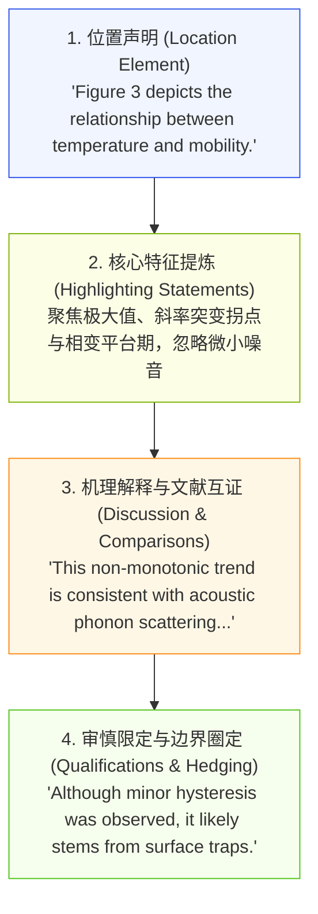
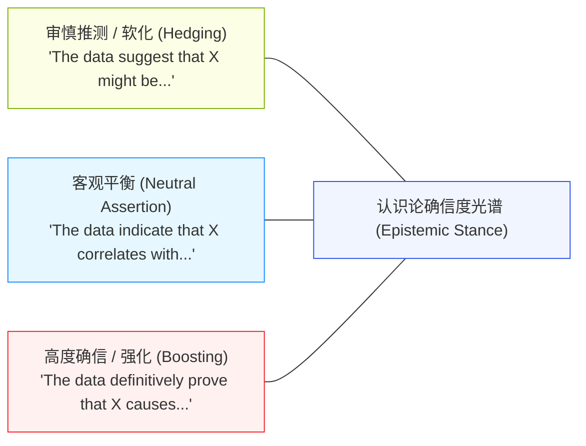
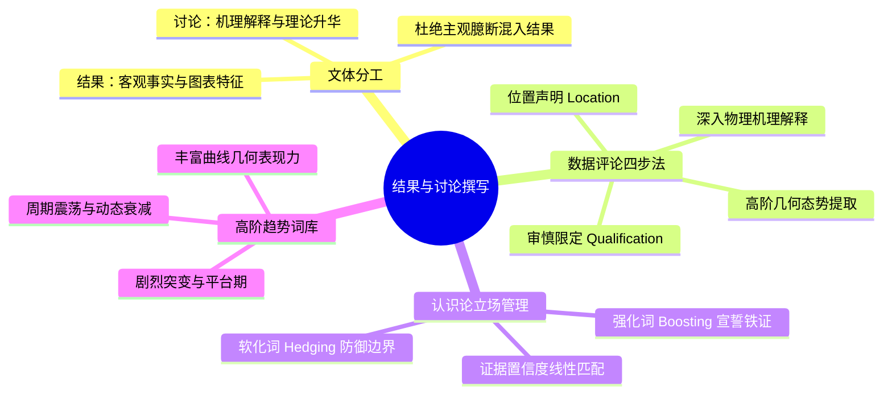

# Lec 11 结果与讨论撰写：数据评论、软化词与强化词的立场调配

> MIT 21G.225 · 科技与工程高级写作工作坊 (ELS) · 主讲 Jane Dunphy

## TL;DR

- 结果（Results）关注客观数据的忠实呈现，讨论（Discussion）聚焦科学机理的抽象升华与理论对齐，二者严禁混为一谈。
- 掌握斯韦尔斯数据评论四步法（定位声明、高阶态势、机理推导、审慎限定），杜绝将正文写成图表的口头报数流水账。
- 精准驾驭软化词（Hedging）与强化词（Boosting）的修辞光谱，根据数据置信区间动态调配认识论立场，做到大胆创新与防御性论证的有机平衡。

## 1. 结果与讨论章节的认识论解耦

在科技期刊的审稿实践中，许多初学者经常因未能厘清结果（Results）与讨论（Discussion）的文体职责，导致稿件被判定为“结构混乱、主观臆断与客观数据混杂”。根据 Robert Day 与 Barbara Gastel 在《How to Write and Publish a Scientific Paper》中的论述，这两个章节承担着截然不同的认识论使命：

```mermaid
flowchart LR
    subgraph 结果章节 (Results)
        R1["图表数据引导<br/>(Location Element)"] --> R2["关键趋势与极值提炼<br/>(What happened?)"]
        R2 --> R3["恪守客观测量事实<br/>严禁主观无根据推测"]
    end
    subgraph 讨论章节 (Discussion)
        D1["机理归因与物理图像<br/>(Why did it happen?)"] --> D2["与既有文献冲突/和解<br/>(Contextualization)"]
        D2 --> D3["局限性坦陈与推广边界<br/>(Hedging & Future Work)"]
    end

    style R1 fill:#e6f7ff,stroke:#1890ff,stroke-width:1px
    style R2 fill:#f0f5ff,stroke:#2f54eb,stroke-width:1px
    style R3 fill:#fcffe6,stroke:#7cb305,stroke-width:1px
    style D1 fill:#fff7e6,stroke:#fa8c16,stroke-width:1px
    style D2 fill:#fff1f0,stroke:#f5222d,stroke-width:1px
    style D3 fill:#f6ffed,stroke:#52c41a,stroke-width:1px
```

结果章节是科学法庭上的物证陈列台，只回答“测量到了什么（What did you observe?）”；而讨论章节则是辩护律师的结案陈词，负责解释“这些数据意味着什么（What does it mean?）”以及“它如何颠覆或巩固了当下的理论范式”。

::: definition [数据评论 (Data Commentary)]
数据评论指作者在正文中对图表（Figures & Tables）进行专业解构的修辞行为。它绝不是把图表坐标轴上的离散数值用自然语言机械念一遍，而是通过筛选显著特征、提炼整体态势、揭示异常拐点，将死板的数据转化为具有说服力的科学主张。
:::

## 2. 斯韦尔斯数据评论四步法（The 4-Part Data Commentary Recipe）

密歇根大学应用语言学团队（Swales & Feak）归纳的数据评论四步法，是自然科学与工程学术界最权威的句段推进模板：



### 2.1 逐步句法与词汇实战

1. **第 1 步：位置声明（Location Element）**：
   - 使用一般现在时，以图表为主语或采用括号引导：
   - *"Figure 4 shows..."* / *"As illustrated in Table 2, ..."* / *"The carrier lifetime decreased sharply (Figure 5b)."*
2. **第 2 步：核心特征提炼（Highlighting Statements）**：
   - 提取全局特征，严禁把读者当作盲人逐点读数（如 *"At 10K it is 2.1, at 20K it is 2.3, at 30K it is 2.5"* 是极其幼稚的写法）。
   - 聚焦高阶几何特征：斜率突变（inflection point）、峰值饱和（plateau）、跨越数量级的跳跃（order-of-magnitude surge）。
3. **第 3 步：机理解释与文献互证（Discussion）**：
   - 探寻背后的物理、化学或算法根源，并将自己的数据与本领域经典文献（Benchmarked against previous studies）进行对比。
4. **第 4 步：审慎限定（Qualifications）**：
   - 主动指出未完全吻合的边缘离群点（Outliers），用审慎词汇限定结论的适用区间。

::: example [优秀数据评论范式 vs 劣质机械报数]
- **糟糕的机械报数（无信息增量）**：
  > *"As shown in Figure 2, the sample heated to 100°C had a resistance of 12 $\Omega$. When heated to 200°C, the resistance became 24 $\Omega$. At 300°C, it was 48 $\Omega$."*
- **优秀的高阶数据评论（机理与态势穿透）**：
  > *"Figure 2 illustrates the thermal response of sample resistance across the 100–500°C range. Notably, the electrical resistance exhibits an exponential surge between 100°C and 300°C, doubling every 100°C, before plateauing at approximately 52 $\Omega$ beyond 350°C. This threshold saturation suggests that internal defect states undergo thermal recombination, which is in close agreement with the percolation model proposed by Miller et al. (2022)."*
:::

## 3. 认识论立场调配：软化词（Hedging）与强化词（Boosting）

在 Nigel A. Caplan 的《Grammar Choices for Graduate and Professional Writers》第六单元中，**认识论立场（Epistemic Stance）**被定义为作者对自己所陈述结论的“确信度把控”。一篇顶级论文绝不能处处都是百分之百的绝对铁律，也不能处处都是模棱两可的虚假推测。



优秀的科研写作者如同一位精密的声学工程师，通过在不同句子中调配软化与强化的音量推子，精准匹配实验证据的置信区间。

### 3.1 常用软化词（Hedges）工具箱

软化词并非逃避责任，而是学术严谨性的体现（防御性写作）：

- **情态助动词**：*may, might, could*（如 *"This discrepancy could arise from sample oxidation."*）
- **认识论动词**：*suggest, indicate, appear to, tend to, imply*（避免直接使用 *prove*）
- **概率副词与形容词**：*likely, presumably, potentially, plausible*
- **范围限制短语**：*under these specific conditions, to a first approximation, within experimental uncertainty*

### 3.2 强化词（Boosters）的审慎适用点

强化词用于宣告经过三重以上交叉验证的颠覆性结论或无可争辩的数理推导：

- **典型强化词**：*clearly, definitively, undoubtedly, establish, demonstrate conclusively*
- **适用场景**：
  - 核心理论假说被多组正交实验（Orthogonal Verification）彻底证实；
  - 彻底排除了领域内长期争论的某种假阳性机制；
  - 数学证明在特定边界条件下的绝对成立。

::: insight [学术写作中的“过度断言”与“过度自卑”]
青年研究者在立场调配中常走向两个极端：
- **过度断言（Overclaiming）**：刚刚做完 3 只小鼠的初步体外实验，就在讨论中写出 *"Our compound definitively cures neurodegenerative diseases."* 这类大话在审稿人眼中是学术不成熟的铁证，极易引发直接拒稿。
- **过度软化（Excessive Hedging）**：一句话中出现三个软化词（*"It could possibly suggest that the mechanism might perhaps be..."*），显得作者对自己做出的实验毫无信心。
**黄金原则**：结论的高度应当与误差棒（Error bars）和统计 p 值的置信度严格保持线性对应。
:::

## 4. 动态趋势描写的高阶词汇矩阵

为了避免整篇结果与讨论章节翻来覆去只出现 *increase* 和 *decrease* 这两个单调动词，写作者应当掌握物理演化与曲线几何的高阶描写词库：

| 动态趋势类型 | 常用普通词汇 | 具有工程穿透力的高阶学术词汇 |
| :--- | :--- | :--- |
| **快速剧烈上升** | *increase rapidly* | *surge, skyrocket, proliferate, escalate* |
| **平缓稳步上升** | *increase slowly* | *climb steadily, appreciate, follow an upward trajectory* |
| **急剧骤降** | *decrease fast* | *plunge, plummet, collapse, drop precipitously* |
| **达到峰值 / 平台** | *reach the top / stay flat* | *peak at, culminate in, plateau at, level off at* |
| **周期震荡 / 波动** | *go up and down* | *oscillate between X and Y, fluctuate within a 5% margin* |
| **微小衰减 / 渐弱** | *decrease a little* | *taper off, attenuate, diminish, subside* |

合理选用这些动词，能够将单调的数字曲线转化为充满物理张力的动态画面，使审稿人在脑海中清晰复现出材料相变、流场扰动或算力收敛的精妙过程。

## 5. 本讲总结与实操检视表



### 课后结果与讨论自检清单

- [ ] 检查结果（Results）章节：是否彻底清除了“未被本实验直接证明的主观推论”？
- [ ] 检查图表描述：是否在介绍 Figure 时，严格包含了“位置声明（如 *Figure 2 shows...*）”与“核心态势提炼”，而非逐点口头读数？
- [ ] 检查对离群点（Outliers）与异常值的处理：是否诚实指出并给出了合理解释（如 *This anomaly is attributable to...*）？
- [ ] 检索全文中的 *prove*：是否在没有绝对数学证明的情况下乱用了 *prove*？是否已大部分降维替换为 *demonstrate*, *indicate* 或 *suggest*？
- [ ] 检查整段文字的动词多样性：是否将重复多次的 *increase* 和 *decrease* 替换为了具有形态描述力的精准词汇（如 *plateau*, *plunge*, *oscillate*）？

## 6. 我的理解与批判性反思

科技论文的成败，往往在结果与讨论的转折处见真章。这一章节是研究者真正亮出科学思想锋芒的竞技场。

1. **从“绘图员”到“物理学家”的身份跃迁**：
   任何人只要经过几周培训，都能用 Python、MATLAB 或 Origin 绘制出漂亮的实验散点图与拟合曲线。但平庸学者与杰出科学家的分水岭在于：平庸学者只是图表的“口头播音员”，把图上的数字机械翻译成毫无灵魂的英文；而杰出科学家拥有透过噪点看透物理本质的洞察力。通过数据评论四步法，作者展现的是对支配这些曲线背后深层力学、热力学或算法规律的深刻顿悟。
2. **软化词是科学探索谦逊精神的最高表达**：
   有些工科学者误以为多用 *must*, *always*, *proves* 能显得自己的研究无比强大。事实恰恰相反，国际顶尖期刊的资深主编最警惕这种盲目自大。自然界的复杂性往往超出任何简化模型的捕捉能力。使用 *suggest*, *likely*, *under ambient conditions* 这类软化词，不是在示弱，而是向世界展示作者清醒地知晓自己模型的适用边界。真正的科学权威，永远建立在对未知的敬畏与对证据边界的绝对诚实之上。
3. **讨论是连接自身小课题与人类大知识库的脐带**：
   一个孤立的实验数据（例如某种纳米材料在某个特定波长下的吸光度）对人类社会而言毫无意义。讨论章节之所以至关重要，是因为它承担了“认知升维（Contextualization）”的功能。作者在此处必须将自己实验室烧瓶里的这几滴液体，链接到全球能源危机、量子计算极限或生命起源等宏大命题中。 Discussion 是整篇论文中让小研究变成里程碑作品的最关键催化剂。
