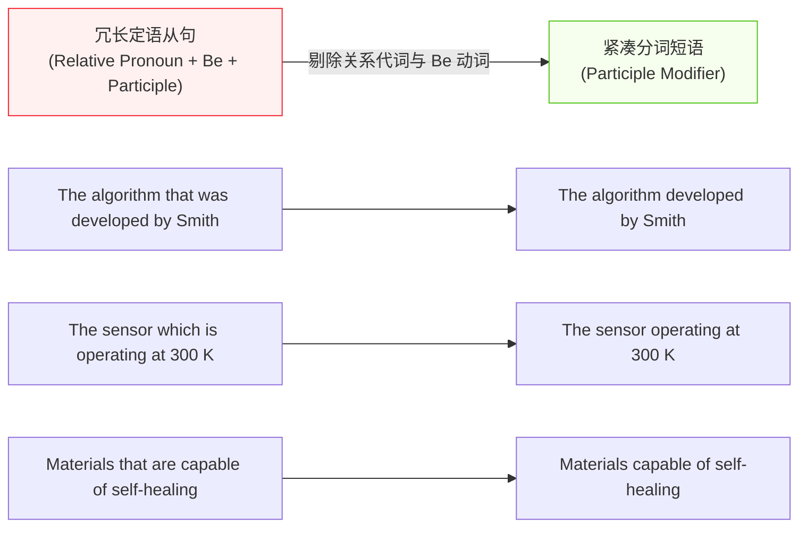
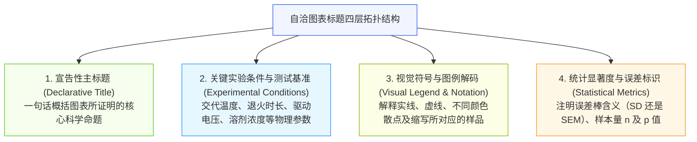
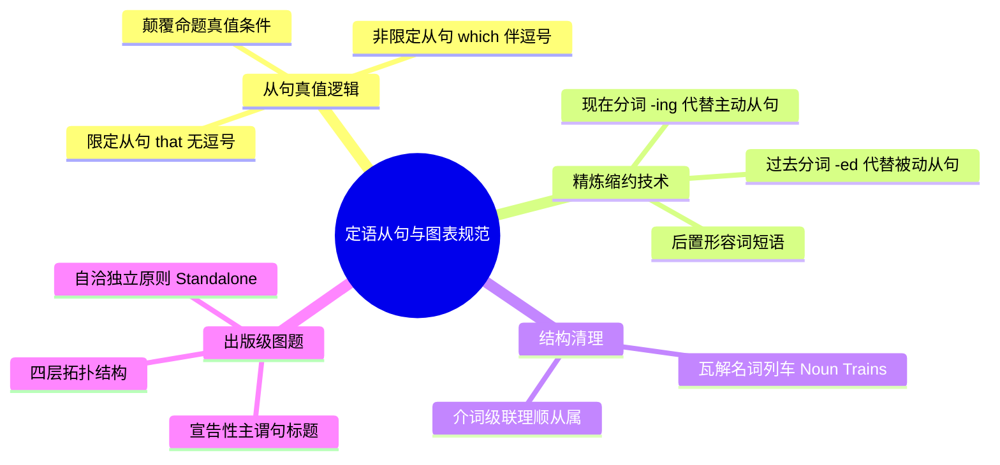

# Lec 12 定语从句、后置修饰与高精度数据图表评论

> MIT 21G.225 · 科技与工程高级写作工作坊 (ELS) · 主讲 Jane Dunphy

## TL;DR

- 限定性定语从句（*that* 无逗号）界定实体集合边界，非限定性定语从句（*, which* 伴随逗号）提供补充说明，标点差异直接改变科学命题的真值条件。
- 熟练运用分词短语缩约（Reduced Relative Clauses），将臃肿从句精炼为紧凑有力的后置修饰，拆解冗长的“名词列车（Noun Trains）”。
- 恪守图表标题（Figure Captions）的“独立自明原则（Standalone Principle）”，通过四层规范拓扑让审稿人在脱离正文时即可完全理解图表机理。

## 1. 定语从句的语义学边界：限定性 vs. 非限定性

在科技与工程学术语篇中，定语从句是构建复杂技术实体、界定实验边界不可或缺的语法工具。然而，根据 Nigel A. Caplan 在《Grammar Choices for Graduate and Professional Writers》第二与第三单元中的解析，非母语写作者最常见的致命伤是混淆**限定性定语从句（Restrictive Relative Clause）**与**非限定性定语从句（Non-restrictive Relative Clause）**。

在日常口语中，母语者可能偶尔模糊处理，但在严谨的科学论文中，一个逗号的存废能够彻底颠覆实验数据的科学事实！

```mermaid
flowchart TD
    subgraph 限定性定语从句 (Restrictive / That / 无逗号)
        R1["全集：100个芯片样品"] --> R2["限定从句条件：'that failed the thermal stress test'"]
        R2 --> R3["子集：仅有失效的 15 个芯片被丢弃<br/>(其余 85 个合格芯片保留)"]
    end
    subgraph 非限定性定语从句 (Non-restrictive / Which / 带逗号)
        N1["全集：100个芯片样品"] --> N2["插入补充信息：', which failed the thermal stress test,'"]
        N2 --> N3["全称判断：这 100 个芯片全部失效，全部被丢弃！"]
    end

    style R1 fill:#f0f5ff,stroke:#2f54eb,stroke-width:1px
    style R3 fill:#f6ffed,stroke:#52c41a,stroke-width:1px
    style N1 fill:#fff1f0,stroke:#f5222d,stroke-width:1px
    style N3 fill:#fff7e6,stroke:#fa8c16,stroke-width:1px
```

这一逻辑真值实验展示了标点与从句类型的巨大威力。如果写作者在描述昂贵晶圆或临床样本时错加或错漏了逗号，就会向审稿人传达完全相悖的实验结论。

::: definition [限定性 vs. 非限定性从句的真值契约]
- **限定性从句（Restrictive）**：从句所包含的信息是锁定主词身份不可或缺的定义性条件。去除该从句，读者将无法获知讨论的究竟是哪一个具体子集。**引导词必须使用 *that*（指物），前面绝对不得有逗号**。
- **非限定性从句（Non-restrictive）**：主词的身份在语境中已经完全明确唯一，从句仅仅是顺带提供的背景补充或次要评价。去除该从句，主句的科学事实依然完整成立。**引导词必须使用 *which*（指物），前后必须使用逗号隔开**。
:::

### 1.1 经典对比案例剖析

- **句型 A（限定性）**：
  > *"The catalysts that were synthesized via sol-gel exhibited superior activity."*
  > **科学含义**：实验室制备了多批催化剂，但**仅仅是**采用溶胶-凝胶法制备的那一部分催化剂表现出了优异活性；其他方法制备的催化剂活性不佳。
- **句型 B（非限定性）**：
  > *"The catalysts, which were synthesized via sol-gel, exhibited superior activity."*
  > **科学含义**：实验中涉及的**所有**催化剂都表现出了优异活性；括号里的从句只是顺便交代它们的合成方法都是溶胶-凝胶法。

## 2. 定语从句的缩约手术：分词短语与后置修饰

科技论文追求极高的信息密度与阅读节奏。如果一个段落中连续出现 3 个由 *that was...* 或 *which are...* 引导的定语从句，语篇会显得极为拖沓臃肿。现代科技英语普遍推崇**从句缩约技术（Clause Reduction）**。



通过这一外科手术式的简化，句子的语法主谓干道更加凸显，同时保留了全部修饰细节。

### 2.1 缩约规则矩阵

1. **被动语态从句 $\to$ 过去分词短语（-ed）**：
   - *原句*：*"The specimens that were fabricated in Step 1 were annealed."*
   - *缩约*：*"The specimens **fabricated in Step 1** were annealed."*
2. **主动进行时/状态从句 $\to$ 现在分词短语（-ing）**：
   - *原句*：*"Pores which have a diameter smaller than 2 nm are classified as micropores."*
   - *缩约*：*"Pores **having a diameter smaller than 2 nm** are classified as micropores."*
3. **形容词短语从句 $\to$ 后置形容词短语**：
   - *原句*：*"A protocol that is compatible with current CMOS foundries..."*
   - *缩约*：*"A protocol **compatible with current CMOS foundries**..."*

::: pitfall [缩约分词的施事混乱与悬垂风险]
在进行从句缩约时，必须确保被修饰的名词确实是该分词动作的逻辑承受者或发出者。如果名词与分词之间逻辑失配（例如将 *"The reaction that occurred after we added the acid"* 错误缩约为 *"The reaction adding the acid"*），会造成滑稽的语义灾难（反应自己不会去加酸）。
:::

## 3. 规避“名词列车（Noun Trains）”交通拥堵

工科与计算机学者常常有一种不良写作偏好：为了节省介词，将 4 到 6 个名词像贪吃蛇一样串联在一起，形成令人窒息的“名词列车（Noun Trains / Nominal Stacks）”。

- **窒息病句**：
  > *"Underground coal mine dynamic methane gas explosion risk evaluation computer system architecture."*（连续 10 个名词堆叠！）
- **解构重组原则**：
  抓住核心名词，利用“前置关键定语 + 后置介词短语 / 定语从句”将列车切断为层次分明的挂钩：
  > *"Architecture of a computer system for evaluating the dynamic risk of methane explosions in underground coal mines."*

重组后的句子通过 *for* 和 *in* 两个介词，清晰理顺了“架构 $\to$ 用于评估风险 $\to$ 风险属于瓦斯爆炸 $\to$ 环境在地下煤矿”的物理从属逻辑，极大降低了读者的解析负担。

## 4. 出版级图表标题（Figure Captions）的自洽性规范

在顶级科技期刊中，图表（Figures）往往是同行审稿人翻开论文后**最先查阅的核心资产**。根据 Day & Gastel 的指南，优秀的图表标题必须遵循**“独立自明原则（Standalone Principle）”**——读者无需在数百页的正文翻找对应段落，仅凭图表本身及其标题说明（Caption），就能完整读懂实验的所有物理变量与结论。



这一四层拓扑结构保证了信息密度的极致完备，消除了任何歧义空间。

::: example [出版级 Figure Caption 典范解析]
> **Figure 3. Hydrophobic fluorinated passivation enhances ambient operational stability of perovskite solar cells.**  
> (a) Time-dependent power conversion efficiency (PCE) of unencapsulated control (black open circles) and diamine-treated devices (red filled squares) aged under continuous 1-sun illumination in 65% relative humidity at 25°C.  
> (b) X-ray diffraction spectra of corresponding thin films acquired after 500 h exposure, indicating suppression of the yellow non-perovskite phase (marked with asterisks).  
> All error bars represent the standard deviation (SD) calculated across $n = 12$ independent devices for each condition. Solid curves represent biexponential decay fits.
:::

该范例不仅具备强有力的主谓完整结论性标题（enhances ambient stability），且将两幅子图（a/b）的测量变量、颜色符号标记、老化环境温湿度以及统计学参数（$n=12$, SD）交代得一清二楚。

::: insight [宣告性图题（Declarative Title）的修辞红利]
传统图题往往是死板的名词短语（如 *"Figure 3: Efficiency curves under humidity"*），这在修辞上完全处于被动。现代顶刊极度提倡**宣告性主谓句标题（Declarative Headline）**（如 *"Figure 3: Surface passivation prevents moisture-induced degradation"*）。直接在图题中向读者宣告科学结论，能够将审稿人的注意力瞬间锚定在你要表达的因果主张上，建立强大的心理先入优势。
:::

## 5. 本讲总结与实操检视表



### 课后定语修辞与图题自检清单

- [ ] 检查全文所有 *which*：是否前面都带有逗号（*, which*）？是否存在原本想写限定性修饰却错误用了 *which* 的地方？
- [ ] 检查全文所有 *that*：是否前面彻底清除了逗号（严禁出现 *, that*）？
- [ ] 检查从句密度：是否有多处由 *that was...* 或 *which were...* 构成的冗余结构？是否已缩约为紧凑的分词后置修饰？
- [ ] 检查复合名词：是否存在 4 个以上名词串联的“名词列车”？是否已通过介词短语进行了合理拆分？
- [ ] 检查所有 Figure Captions：是否每一个图题都能脱离正文被完全独立理解？
- [ ] 检查误差与图例：图题中是否明确标注了不同线条颜色代表的样品、误差棒代表的统计学含义（SD 或 SEM）以及样本量 $n$？

## 6. 我的理解与批判性反思

语言不仅是表达思想的工具，更是逻辑严密度的显微镜。从定语从句的微观标点到图表题注的宏观设计，无一不在检验研究者心智模式的成熟度。

1. **标点即法度，逗号即逻辑**：
   在很多汉语初学者的潜意识中，逗号只是说话喘气歇脚的随意停顿。但现代西方法律与科学文明是将逗号作为“集合界定运算符（Set Delimiter）”来对待的。一个逗号的存在与否，直接决定了一个集合是子集还是全集。将每一个标点符号都上升到“数理逻辑算子”的高度来敬畏和运用，是科技写作者摆脱业余感的最关键一跃。
2. **图表是论文的“门面”，Caption 是图表的“灵魂”**：
   在当今科研节奏极快的时代，同行评阅人或学术大牛在读一篇预印本时，90% 的人都是先扫一眼 Abstract，接着直接跳到 Figure 1、Figure 2 和 Figure 3。如果你的图画得光鲜亮丽，但下面的 Caption 只有干瘪的五个单词（如 *"Figure 2: SEM image of sample"*），审稿人必须费力去正文寻找放大倍数、比例尺和加速电压，这种不良体验会迅速转化为对论文工程质量的负面评价。把每一个 Caption 当作微型独立论文来打磨，是最高性价比的学术投资。
3. **语法紧凑度与心智负荷的负相关律**：
   通过分词缩约消除冗长定语从句、通过介词拆解名词列车，其底层追求都是同一个目标——**降低读者的短时认知负荷（Working Memory Load）**。人类大脑在单次阅读中能同时保持的句法分支深度是极其有限的。精炼、优雅且富有节奏的后置修饰，能够像润滑油一样减少大脑在语法树解析上的卡顿，让审稿人的全部智力无阻碍地专注于感受研究成果本身的震撼与美感。
