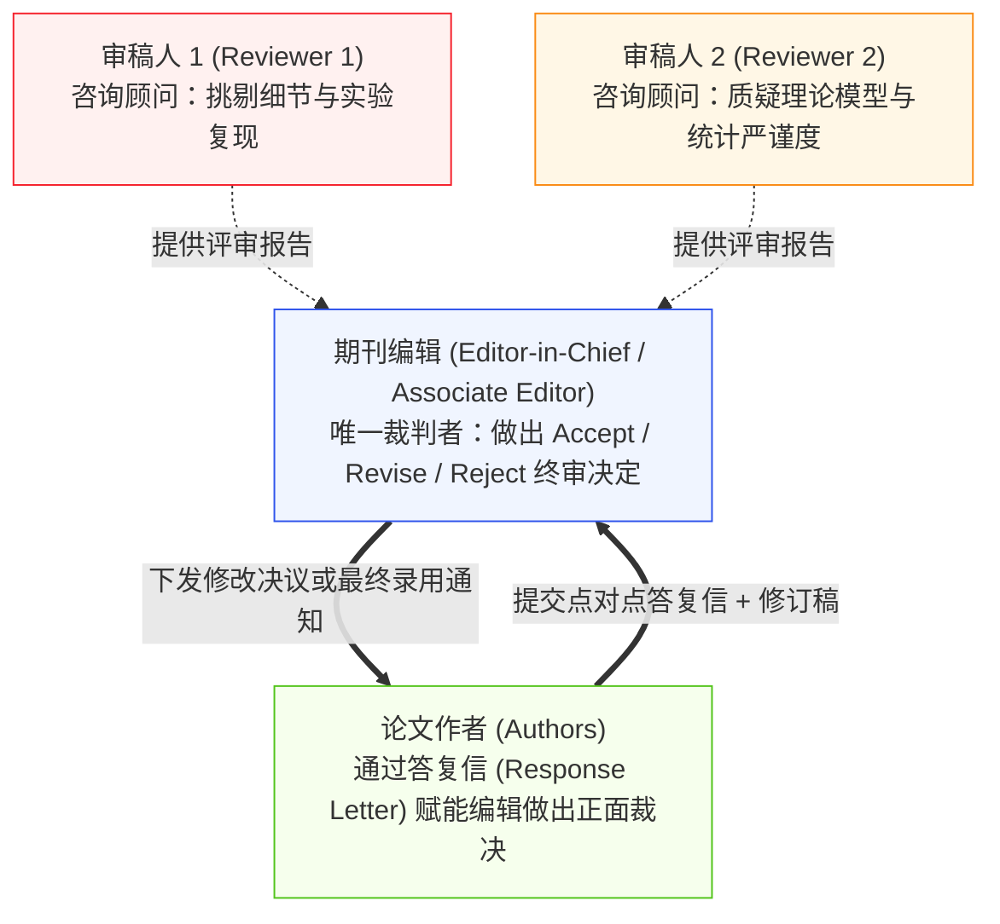
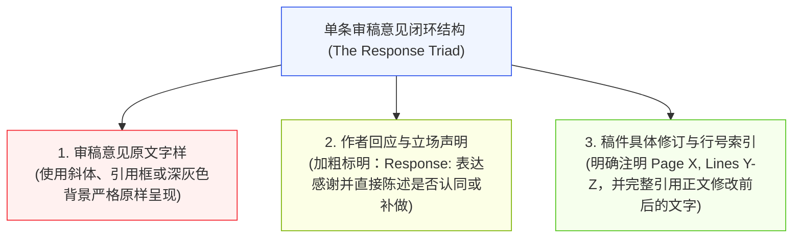
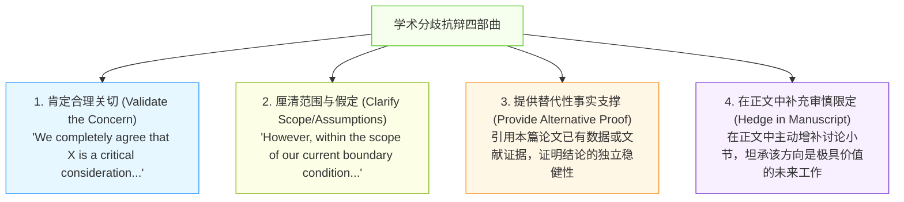
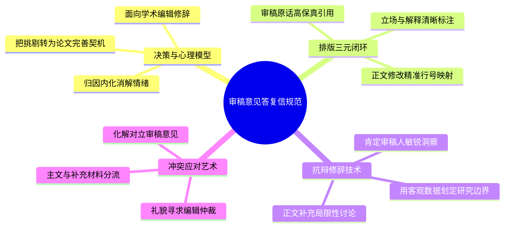

# Lec 13 学术期刊发表规范与同行评审答复信撰写

> MIT 21G.225 · 科技与工程高级写作工作坊 (ELS) · 主讲 Jane Dunphy

## TL;DR

- 收到严苛审稿意见后的首要修辞原则是“心理脱敏与归因内化”：审稿人的任何误解，本质上都是作者行文清晰度不足的体现。
- 答复信（Response to Reviewers）采用“逐条闭环三步法”（致谢共情 $\to$ 证据抗辩/补充解释 $\to$ 稿件修订引文与页码对应），杜绝遗漏任何敏感质疑。
- 掌握“防御性学术礼貌（Defensive Politeness）”，在坚持核心科学真理的同时，通过详尽的数据补做与优雅的修辞缓冲化解审稿冲突。

## 1. 国际期刊审稿生态与主编决策心理学

在自然科学与工程领域，论文投稿后的第一轮同行评议（Peer Review）几乎注定伴随着大量挑剔、苛刻甚至看似有失偏颇的审稿意见（Referee Reports）。根据 Robert Day 与 Barbara Gastel 在《How to Write and Publish a Scientific Paper》第 21 与 22 章中的论述，科研人员必须首先理顺期刊出版链条中的权力与决策结构：

许多年轻学者最容易犯的心理错误，是把审稿人当成“你死我活的辩论对手”。必须清醒地认识到：**审稿人不是法官，他们只是编辑的学术顾问；你的答复信表面上是在回答审稿人，但其真正的核心目标受众是学术编辑（Editor）**。你的任务是给编辑提供充分、体面且坚实的论据，使编辑能够理直气壮地推翻苛刻审稿人的负面意见，从而按下“录用（Accept）”键。

::: definition [答复信的“归因内化原则” (Attribution Internalization)]
犹他大学计算机科学家 Matt Might 在《Responding to Peer Review》中提出的黄金准则：如果审稿人没有读懂你的推导或彻底误解了你的实验设计，绝不要在回信中讽刺审稿人“没仔细看论文”；相反，作者必须推定**“这必定是因为我在正文中的表述不够清晰、排版不够直观，从而误导了日理万机的审稿人”**。这一态度能够从根本上化解抵触情绪。
:::

## 2. 答复信的黄金架构：点对点逐条闭环（Point-by-Point Protocol）

根据麻省理工学院科技写作规范，一份极具专业说服力的答复信（Response to Reviewers / Rebuttal Letter）必须具备无可挑剔的排版规制与视觉对比度。

通过这一三元闭环结构，编辑和审稿人完全无需将答复信与数百页的新老稿件来回翻页对照。所有证据在答复信内部即可实现“单点完全验证”，极大降低了审稿人的二次审校认知成本。

### 2.1 答复信开篇信函（Cover Letter to the Editor）的撰写要义

在正文逐条答复之前，答复信的第一页必须是一封致主编的正式信函，包含以下四项核心内容：
1. **稿件元数据与修改声明**：列出论文标题、稿件编号（Manuscript ID）以及通信作者信息，明确感谢编辑与两位审稿人付出的宝贵时间。
2. **修改战略概要（Executive Summary of Revisions）**：用 3 至 4 个项目符号（Bullet points），高度概括本次大修（Major Revision）所补做的最硬核实验（例如新增了 3 组对照测试、补充了活体毒理学表征、重构了定理 2 的数学证明）。
3. **关键数据增量声明**：明确指出稿件新增了几个主图、几页补充材料（Supporting Information），展现作者团队诚恳、严肃的修改决心。
4. **终结性请求**：表达对稿件达到期刊发表标准的坚定信心，礼貌恳请编辑重新审阅。

## 3. 抗辩修辞学：优雅地表达学术分歧（Disagreeing Respectfully）

当审稿人的意见确实存在事实错误，或者审稿人要求做一些严重超出本文研究范围（Out of Scope）、耗时数年且不切实际的追加实验时，作者绝不能无原则妥协，但更不能出言不逊。此时必须启动**“防御性学术礼貌（Defensive Academic Politeness）”**。

这一策略的精妙之处在于“给足审稿人面子，在科学事实上坚守底线”。你既肯定了审稿人看问题的敏锐度，又通过补充正文讨论，让审稿人感受到自己的意见切实推动了论文的完善。

::: example [优秀抗辩实战范例对比]
- **糟糕的攻击性抗辩（极易导致审稿人愤怒拒稿）**：
  > *"The reviewer obviously missed Equation 3. We already explained that our model does not apply to turbulent flow, so asking us to test Reynolds numbers over 10,000 makes no sense."*
- **优雅的防御性学术抗辩（化干戈为玉帛）**：
  > *"We thank the reviewer for raising this insightful question regarding high-Reynolds-number behavior. We completely agree that turbulent transport represents a fascinating and challenging regime. However, the primary focus of this work is to isolate the laminar-to-transitional instability under creeping flow conditions, where inertial effects are negligible (as formalized in Eq. 3).  
  > Extending the present spectral code to fully turbulent regimes would require incorporating an explicit subgrid-scale turbulence model, which is beyond the scope of this initial study. To make this physical boundary explicitly clear to all readers, we have revised the Introduction (Page 3, Lines 42–46) and added a dedicated paragraph in the Discussion (Page 14, Lines 210–218) discussing how future studies might couple our framework with large-eddy simulations."*
:::

在优秀范例中，作者不仅毫无火气，甚至把审稿人的质疑转化为了提升论文讨论章节深度（added a dedicated paragraph discussing future studies）的宝贵契机。

::: insight [处理相互冲突的审稿意见 (Conflicting Reviews)]
学术界经常出现令人啼笑皆非的僵局：审稿人 1 要求大幅精简引言并删除方法细节，而审稿人 2 却要求大幅扩充背景文献并详细展开实验步骤。面对这种冲突，作者绝不能私自选边站，最佳修辞策略是**在答复信中将决策权礼貌上交编辑**：
> *"We note that Reviewer 1 suggested condensing Section 2 for brevity, whereas Reviewer 2 requested additional methodological elaboration. To balance both constructive suggestions, we have retained a streamlined overview in the main text while transferring the detailed step-by-step protocols into Supplementary Note 2. We trust this compromise aligns with the editorial standards of the journal."*
:::

## 4. 本讲总结与实操检视表

### 课后答复信修改自检清单

- [ ] 答复信开篇是否包含了一封正式呈交给主编的 Cover Letter，并用项目符号高度概括了本次大修的核心增量？
- [ ] 是否逐字排查了审稿人的每一份报告？是否存在被“选择性遗漏”、未予回答的尖锐问题？
- [ ] 审稿意见与作者回复之间是否具备清晰的视觉反差（如审稿意见斜体/灰底，作者回复正体加粗）？
- [ ] 每一处修改是否都明确标注了新稿件的具体页码与行号（*Page X, Line Y*），并原汁原味摘录了修订前后的文字对比？
- [ ] 检查所有与审稿人意见不一致的抗辩：语气是否保持了“防御性礼貌”？是否彻底清除了任何讽刺、抱怨或防御性反问句？
- [ ] 对于因范围超限而未补做的实验：是否在正文的讨论章节中增补了相应的说明，将其作为极具价值的“未来研究方向”予以展望？

## 5. 我的理解与批判性反思

同行评议是现代学术共同体维系科学质量的核心免疫系统。学会撰写答复信，是青年学者真正融入国际学术共同体的成年礼。

1. **学术发表是一场旷日持久的“情绪管理修行”**：
   当研究者历经数月艰苦实验、耗尽心血写出一篇论文，却收到几位匿名审稿人冷酷无情的批判时，最初的本能反应必然是愤怒、委屈与挫败。然而，顶尖科学家的成熟标志，正是能够迅速从情绪风暴中抽离。在收到审稿意见后，强制自己设立“48 小时冷却期（Cool-down Period）”，不写一行答复，待理性回归后再以冰冷、精确、客观的工程师思维逐条拆解。战胜情绪，方能战胜评审。
2. **审稿人是免费为你找漏洞的“顶级红蓝军”**：
   在商业世界中，雇佣顶尖专家为你的产品进行全方位代码审计或红蓝对抗测试，需要支付数万美元的咨询费。而在学术界，两位与你素昧平生的顶级同行，自愿在深夜花费数小时阅读你的手稿，帮你找出逻辑漏洞、数学推导缺陷与实验盲区。即便他们的语气有时不够温和，其付出的智力劳动本身就具备无可估量的价值。怀着感恩与求真的心态看待挑刺，论文才能真正被淬炼为经得起历史检验的经典文献。
3. **答复信是展现学者专业风骨的修辞舞台**：
   一份高质量的答复信，其篇幅常常超过论文正文本身（例如 20 页的论文配发 30 页的详尽答复）。在这份文档中，作者展现的不仅是实验补做的勤奋度，更是渊博的文献底蕴、清晰的逻辑边界感以及优雅不卑不亢的学术尊严。当主编看到一份排版如艺术品般严整、数据详实且措辞极具绅士风度的答复信时，对该学者学术品格的信任便已不可动摇。
