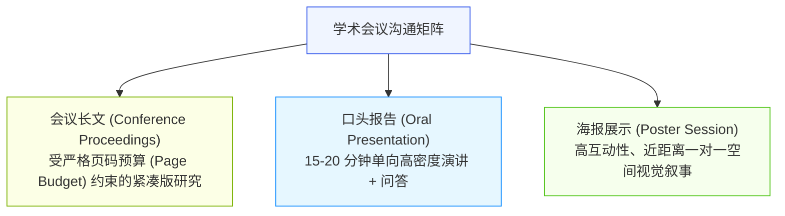
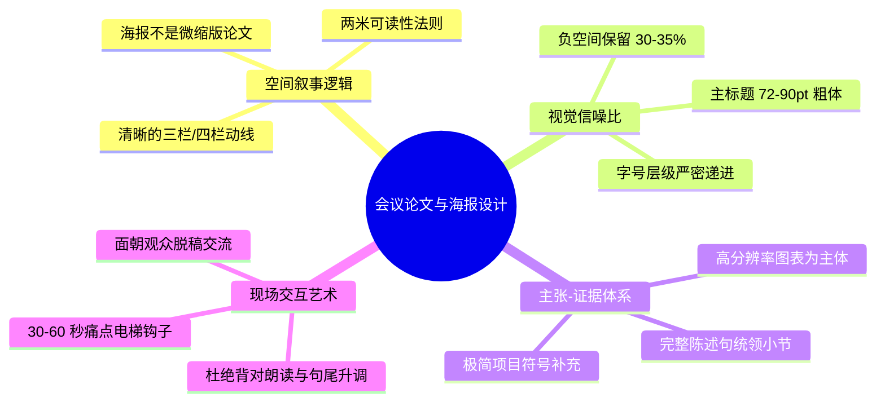

# Lec 14 学术会议论文与科研海报设计：视觉信噪比与空间叙事

> MIT 21G.225 · 科技与工程高级写作工作坊 (ELS) · 主讲 Jane Dunphy

## TL;DR

- 科研海报（Academic Poster）绝非打印在展板上的缩小版论文，而是一张以“视觉信噪比（Data-Ink Ratio）”与“两米可读性”为准绳的空间修辞广告。
- 全面推行迈克尔·艾利“主张-证据结构（Assertion-Evidence Structure）”，以结论性主谓句统领各栏目，取代“背景/方法/结果”等空洞标签。
- 掌握海报展区 30-60 秒现场交互钩子（The Pitch），面向读者脱稿阐明核心现实价值，严禁背对观众机械朗读展板文字。

## 1. 会议论文与科研海报的生态位演变

在现代自然科学与工程技术界，学术会议是前沿思想碰撞、建立学术声誉与同行社交网络的最核心枢纽。许多计算机科学（IEEE/ACM, NeurIPS, CVPR）与材料工程领域的顶级会议，其影响力和审稿难度甚至超过传统主流期刊。



在会议论文中，最严苛的挑战是**“页码预算（Page Budget）”**。例如，顶级会议通常规定论文严格限制在 6 页或 8 页以内，超出一行即被系统直接拒收。这要求作者在保留 CARS 引言、核心算法推导与关键基线对比的前提下，必须将次要推导和超参数调优迁移到附录，展现极致的文字压缩能力。

而在海报展示环节，沟通模式则彻底转变为**双向交互的空间叙事**。面对海报大厅里走动穿梭、精力分散的同行专家，一张优秀的海报必须在 5 秒内抓住过客眼球，并在 60 秒内传递核心科学价值。

::: definition [空间叙事 (Spatial Narrative)]
空间叙事指利用展板的二维物理几何平面，通过栏目编排、留白比例、字号梯度与视觉视觉引导线，引导参观者的视线按照预定的逻辑流线自发移动的视觉修辞技术。
:::

## 2. 海报设计的物理学：视觉信噪比与负空间

根据信息可视化先驱爱德华·塔夫特（Edward Tufte）与宾夕法尼亚州立大学 Michael Alley 教授的理论，一张劣质海报最常见的毛病被称为“文字暴政（Wall of Text）”——作者直接把 PDF 论文原封不动地贴在海报上，充斥着密密麻麻的 10pt 小字和无休止的从句。

```mermaid
flowchart LR
    subgraph 劣质海报：低信噪比 (Low Signal-to-Noise)
        B1["文字占比 > 70%<br/>从头到尾长篇段落"]
        B2["满版塞满无留白<br/>视觉窒息感极强"]
        B3["死板标签：Introduction / Results"]
    end
    subgraph 顶级海报：高信噪比 (High Signal-to-Noise)
        A1["图表与视觉中心 > 50%<br/>文字精简为项目符号"]
        A2["负空间 (留白) 保持 30-40%<br/>呼吸感与视觉引导明确"]
        A3["主张-证据体系：结论性主谓句统领"]
    end

    style B1 fill:#fff1f0,stroke:#f5222d,stroke-width:1px
    style B2 fill:#fff1f0,stroke:#f5222d,stroke-width:1px
    style B3 fill:#fff1f0,stroke:#f5222d,stroke-width:1px
    style A1 fill:#f6ffed,stroke:#52c41a,stroke-width:1px
    style A2 fill:#f6ffed,stroke:#52c41a,stroke-width:1px
    style A3 fill:#f6ffed,stroke:#52c41a,stroke-width:1px
```

海报必须严格遵循**“两米法则（The 2-Meter Rule）”**：站在两米之外的过客，无需凑近展板，就能清晰看懂主标题、核心图表和最关键的结论要点。

### 2.1 海报空间排版的四项硬性几何指标

1. **三栏或四栏垂直流线（Column Flow）**：
   - 欧美学术界的阅读习惯是“从左向右，自上而下”。海报应当划分为 3 栏（纵向排版）或 4 栏（横向排版），严禁设计强迫读者“S 型折返”或“反常识跳跃”的混乱动线。
2. **文字、图表与留白的黄金配比**：
   - **视觉图表（Figures & Diagrams）**：占据约 45%–50% 的核心版面；
   - **文字与项目符号（Text & Bullets）**：占据约 20%–25%（字数严格控制在 300–500 词内）；
   - **负空间（Negative Space / Margins）**：必须保留 30%–35% 的纯白或浅色背景留白，给视网膜留出认知呼吸空间。
3. **字号阶梯准则（Font Size Hierarchy）**：
   - **主标题（Title）**：72–90 pt（粗体，无衬线字体，如 Arial 或 Helvetica）；
   - **小标题（Section Headers）**：36–48 pt；
   - **图表题注与要点文字（Body Text）**：24–32 pt（绝对不得低于 20 pt）；
   - **致谢与极小文献（Footnotes）**：14–16 pt。

## 3. 迈克尔·艾利“主张-证据模型”（Assertion-Evidence Structure）

在学术海报和演示文稿设计中，Michael Alley 提出的“主张-证据结构（Assertion-Evidence Model）”彻底颠覆了传统的死板排版范式。

```mermaid
flowchart TD
    AE["主张-证据设计哲学"] --> H["主张小标题 (Sentence Assertion)<br/>用一整句完整的陈述句直接宣告核心结论（24-36pt）"]
    H --> E["视觉证据主体 (Visual Evidence)<br/>高分辨率实验图表、结构示意图或对比矩阵"]
    E --> C["极简说明 (Minimal Clarification)<br/>1-2 行项目符号解释关键实验参数，严禁成段文字"]

    style AE fill:#f0f5ff,stroke:#2f54eb,stroke-width:1px
    H fill:#f6ffed,stroke:#52c41a,stroke-width:1px
    E fill:#e6f7ff,stroke:#1890ff,stroke-width:1px
    C fill:#fcffe6,stroke:#7cb305,stroke-width:1px
```

### 3.1 传统模式 vs. 主张-证据模式对比

- **传统死板模式**：
  - 栏目标题写着大字：*"RESULTS"*
  - 栏目中间放了一张复杂的折线图。
  - 栏目下方写了三段密密麻麻的小字分析。
  - **后果**：走过的学者看一眼感到头晕，完全不知道这张图想证明什么，直接走开。
- **主张-证据模式（推荐）**：
  - 栏目标题直接宣告科学主张：*"Hydrophobic Coating Prevents 95% of Moisture Degradation"*
  - 下方大幅清晰图表直观对比：左侧是对照组（变黄失效），右侧是涂层组（完好如初）。
  - 下方仅保留两行要点：交代温度与湿度测试环境。
  - **后果**：学者在两米外扫一眼标题就抓住了结论，图表立即给予视觉确证，瞬间停下脚步与你展开深入探讨。

## 4. 展区现场交互艺术：30-60 秒“电梯钩子”与身体语用学

根据 Jane Dunphy 在 MIT 21G.225《Tips for Presenting Posters》中的教学要义，海报只是沟通的道具，**海报前的“你”才是真正的主角**。

### 4.1 30-60 秒“电梯钩子”（The Hook）

当同行学者在你的海报前驻足扫视时，你必须在 5 秒内以温和自信的眼神示意，并在其表现出兴趣的瞬间抛出 30 至 60 秒的口头钩子：

::: example [Jane Dunphy 推荐的经典开场白句型]
- **痛点与使命开场**：
  > *"X is a crippling bottleneck in the solar cell industry, and our goal is to eliminate this degradation using a novel molecular cross-linker."*
- **反常识与方法创新开场**：
  > *"Usually, researchers attempt to solve this heat problem by increasing fan speed, but we took a completely opposite approach—exploiting micro-channel phase change cooling!"*
- **现实利益与量化成效开场**：
  > *"The key challenge in datacenter telemetry is latency; our lightweight algorithm reduces memory overhead by 40% while maintaining 99.8% detection accuracy. Would you like a brief tour of how the pipeline works?"*
:::

### 4.2 空间交互礼仪与语域戒律

1. **绝对严禁背对观众**：
   - 许多羞涩的学者习惯于整个人面朝展板，用手指指着海报上的小字喃喃自语。**这是展区最严重的社交车祸**！作者必须侧身或完全面向观众，保持眼神接触，只有在需要指引具体图表时才将手臂伸向展板，且手指应停留三秒以上方便观众定位。
2. **绝对严禁朗读展板文字（Extemporaneous Delivery）**：
   - 展板上的文字是给读者看的，不是你的口读提示卡。你的口语应当是自然、生动、脱稿的对话体解释，使用高阶口语动词（*"Here we noticed something surprising..."*）。
3. **语域专业度与语调控制（Tone & Intonation）**：
   - 虽然海报交流偏向半正式（Semi-formal），但严禁滑向街头俚语。杜绝使用 *"you guys"*, *"gonna"*, *"wanna"* 等词汇。
   - 戒除句尾莫名升调（Uptalk / High Rising Terminal）——陈述句尾若像问句一样向上扬起，会向欧美同行传递出严重的不自信与犹豫感；陈述句结尾必须坚定地下沉收音。

::: insight [海报展区：青年学者的“学术社交外挂”]
许多青年学者只把海报看作是“没被选上口头报告（Oral）”的二等补偿。这是一种极其狭隘的误解。口头报告通常只有 15 分钟，台下坐着上百人，提问时间仅有 2-3 个问题，听众听完便作鸟兽散；而在 2 个小时的海报 Session 中，你有机会与领域内的大牛学者、顶刊主编以及潜在的博后导师进行长达 20 分钟的一对一深度私聊。把海报磨砺到极致，是青年学者建立高价值学术人脉的最强跳板。
:::

## 5. 本讲总结与实操检视表



### 课后海报与会议论文自检清单

- [ ] 会议论文篇幅：是否严格恪守了征稿通告（Call for Papers）的硬性页码上限，没有任何溢出？
- [ ] 海报视觉平衡：图表面积是否达到 40%–50%？留白是否达到 30% 以上？文字是否控制在 500 词内？
- [ ] 两米可读性校验：在标准电脑屏幕上缩放到 25% 比例时，主标题与主要图表结论是否依然清晰可辨？
- [ ] 栏目标题：是否清除了单调的 *"Introduction"*、*"Methods"*，换成了有主谓结论的“主张-证据句（Assertion-Evidence）”？
- [ ] 口头钩子演练：是否准备了 60 秒内的口头 Pitch？能否在不翻看讲稿的情况下脱稿说出“本研究解决的核心行业危机是什么”？
- [ ] 肢体动作自省：在模拟展示时，自己是否做到了始终面向提问者，并且用明确的手势指引展板核心区域？

## 6. 我的理解与批判性反思

学术海报与会议交流，是科学思想在物理现实世界中的“具象化着陆”。

1. **从“文字崇拜”到“空间修辞”的认知革命**：
   东方传统文人自古以来崇尚“微言大义”，习惯于用密密麻麻的文字填满每一寸竹简与宣纸。这种文字崇拜心理投射到现代科研中，就变成了害怕留白的“海报恐惧症”——总觉得展板上有空白就是没做够工作。然而，现代视觉认知心理学早已证明：**留白不是荒废，留白是最高级的修辞引力**。给视网膜足够的留白，核心图表才能发出振聋发聩的光芒。
2. **学术社交中“脆弱性（Vulnerability）”的价值**：
   在海报展区，最打动资深学者的往往不是那些把自己的成果吹嘘得完美无缺的人，而是敢于在展板右下角坦诚展示“我们当前尚未完全解决的反常异常点（Anomalies）”的青年学者。海报展示的本质是“未完成状态的切磋”。敢于露出学术探索中的毛刺与困惑，往往能够吸引真正的大师在你的展板前驻足，当场为你提供突破性的启发和建议。
3. **身体语言是隐形的学术简历**：
   在国际学术大厅中，除了文字与幻灯片，学者的眼神聚焦度、站姿挺拔度、手势从容度以及声音穿透力，都在持续向外界广播着一种隐形信号：你是否对自己的科学探索拥有由内而外的笃定与热爱。一个畏畏缩缩背对观众念字的学生，与一位双眼放光、自信引导同行穿梭于数据微观宇宙的学者，即使拿着完全相同的实验数据，所赢得的同行信任与学术声誉也天差地别。
