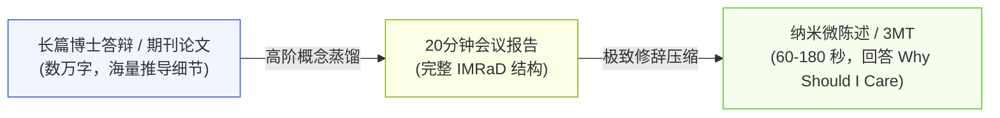
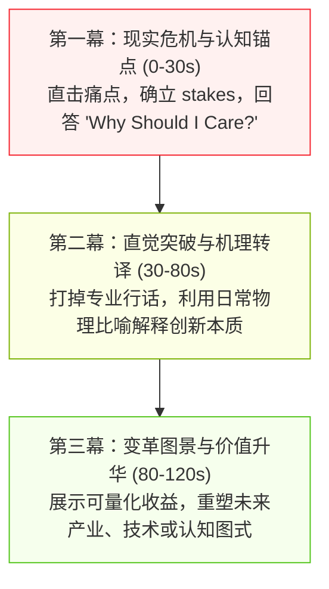
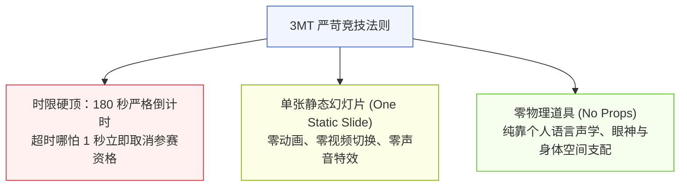
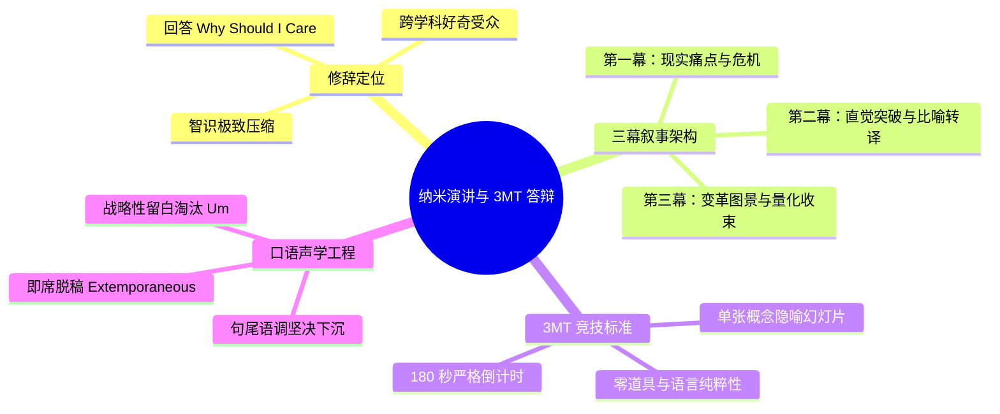

# Lec 15 纳米学术演讲：2 分钟电梯微陈述与 3MT 答辩艺术

> MIT 21G.225 · 科技与工程高级写作工作坊 (ELS) · 主讲 Jane Dunphy

## TL;DR

- 纳米演讲（Nano-Presentation / Academic Minute）是在 60 至 120 秒内向跨学科同行传递科研核心价值的高阶口语艺术，第一任务是回答“读者为何要在乎（Why should I care）”。
- 掌握微叙事“三幕剧架构”（现实危机 $\to$ 核心机理与比喻转译 $\to$ 变革性未来图景），彻底摆脱平铺直叙技术参数的流水账陷阱。
- 践行“即席脱稿（Extemporaneous Delivery）”，用战略性留白（Strategic Pauses）取代中式英语常伴的填充词（"um", "ah"），以语调坚决下沉建立学术笃定感。

## 1. 纳米演讲的场景定位与认知压缩比

在现代快节奏的科研与产业环境中，学者们常常在学术鸡尾酒会、电梯偶遇资助人、或是跨学科评审会议中被问及一个看似轻巧却极具杀伤力的问题：**“What do you do?（你是做什么研究的？）”**。

在 MIT 21G.225 的经典 Handout《From Conference Paper to Conference Talk: Nano-presentations》中，Jane Dunphy 与核工程系荣誉教授 Michael Driscoll 指出：



绝大多数听众在 60 至 90 秒内无法听到核心兴奋点，注意力就会不可逆地漂移涣散。做一场 45 分钟的技术报告可以依靠公式推导与图表堆叠来掩盖思维漏洞；而要在 120 秒内向非本领域的麻省理工社区同侪讲清楚自身科研的灵魂，需要极高的**智识压缩比（Intellectual Compression Ratio）**。

::: definition [纳米学术演讲 (Nano-Presentation / Academic Minute)]
纳米学术演讲指在 60 至 120 秒的极端严格时限内，面向非本专业、但具备高智识素养的跨学科听众，采用即席脱稿（Extemporaneous）的对话风格，清晰阐明课题背景痛点、创新突破机理及其深远现实影响的微型口语叙事文体。
:::

## 2. 纳米微陈述的“三幕剧架构”（The 3-Act Micro-Narrative）

为了在两分钟内形成完整的认知闭环，演讲内容必须放弃线性复述实验步骤的平庸做法，转而采用好莱坞式的精炼“三幕剧架构”：



### 2.1 三幕演进实战拆解

1. **第一幕：锚定危机与切身利益（The Hook: 0–30 秒）**：
   - 严禁从自己实验室的名字或繁复的化学分子式开篇。
   - 直接抛出一个震撼性事实或紧迫危机（如 *"Every year, battery fires cause billions in property damage and stall electric aviation..."*）。让听众瞬间意识到：如果不听你的演讲，世界将承受某种重大损失。
2. **第二幕：直觉突破与机理转译（The Mechanism: 30–80 秒）**：
   - 解释传统方案为何失败，而你的方案为何能够破局。
   - 必须使用一个生动的物理比喻（如将固态电解质界面比作给分子修建高速立交桥，而非单纯罗列锂离子跃迁势垒）。
3. **第三幕：变革图景与升华收束（The Vision: 80–120 秒）**：
   - 给出硬核量化数据（如 *"This simple chemical modification doubles energy density while making the battery completely unburnable at 200°C"*）。
   - 以一句富有哲理性或时代意义的展望强力收音，给听众留下持久的心智印记。

## 3. 全球 3MT（Three Minute Thesis）答辩艺术与单张幻灯片法则

源自澳大利亚昆士兰大学、风靡全球数百所顶尖高校的 **3MT（Three Minute Thesis，三分钟论文答辩）**竞赛，将纳米演讲的修辞标准推向了极致。



在 3MT 中，那张唯一的静态幻灯片被称为演讲者的“视觉伴奏（Visual Accompaniment）”。最愚蠢的做法是在这张幻灯片上塞入复杂的电路图、密密麻麻的微分方程或包含 10 个柱状图的图表矩阵；**最顶级的 3MT 幻灯片通常只展示一张强有力的概念隐喻摄影、一张高对比度的微观结构特写，或者一个简洁的几何因果模型**，它存在的唯一使命是强化听众对核心比喻的情感联结。

::: example [MIT 学生 Chris Moses 的纳米陈述开篇典范]
在麻省理工微陈述实训中，学生 Chris Moses 介绍其复杂的流体力学与微流控研究时，采用了极具穿透力的开场白：
> *"Have you ever wondered why stirring milk into hot coffee takes two seconds, but mixing two thick paints takes forever? At the microscopic scale inside a microchip, fluids don't swirl; they crawl like molasses. My research develops microscopic acoustic tweezers—essentially sound waves that act as invisible whisks—forcing micro-droplets to mix a thousand times faster for ultra-rapid disease diagnosis."*
:::

这一陈述完全绕开了 Navier-Stokes 方程与低雷诺数（Low Reynolds Number）蠕动流的数学公式，却通过咖啡搅拌与糖浆爬行的生活常识，精准传达了微尺度湍流缺乏的核心物理本质。

## 4. 声学工程：非母语学者的脱稿即席与声律控制

在 Jane Dunphy 的 ELS 教学体系中，中国学者在进行短时间演讲时最容易陷入的误区是“背诵剧本（Script Recitation）”。

### 4.1 彻底抛弃死记硬背（Why Recitation Fails）

许多非母语学生为了确保 2 分钟不犯语法错误，写好一份 300 词的逐字稿，将其逐字背得滚瓜烂熟。然而，死记硬背在现场会引发三大灾难：
1. **机械呆滞面孔（The Zombie Delivery）**：演讲者的眼球往往向上翻或眼神放空，大脑全速在神经海马体中检索文字，完全丧失了与现场观众的情感连接与眼神交流。
2. **灾难性单点崩溃（Single Point of Failure）**：一旦因为紧张忘掉某一个介词或连词，大脑会瞬间发生死锁（Deadlock），在台上陷入长达 10 秒的尴尬死寂。
3. **语调僵硬单调（Lack of Prosody）**：背诵的语言缺乏自然的停顿与重音起伏，听起来像合成语音。

**真正的专业规范是“即席脱稿（Extemporaneous Delivery）”**：牢牢记住三幕剧的**核心逻辑节点、关键比喻与量化数字**，但具体的连接词句在现场即时根据观众的反馈自然吐出。即使某个单词换了同义词，主线依然从容推进。

```mermaid
flowchart TD
    subgraph 糟糕范式：逐字机械背诵 (Script Recitation)
        B1["头脑死记 300 词文本"] --> B2["眼神涣散，缺少交流"] --> B3["一旦忘词，全盘死锁崩溃"]
    end
    subgraph 卓越范式：逻辑节点即席 (Extemporaneous Mastery)
        A1["心智锚定 3 个核心逻辑里程碑"] --> A2["眼神锁定听众，实时感知反馈"] --> A3["自然呼吸，遇阻从容绕行换词"]
    end

    style B1 fill:#fff1f0,stroke:#f5222d,stroke-width:1px
    style B3 fill:#fff1f0,stroke:#f5222d,stroke-width:1px
    style A1 fill:#f6ffed,stroke:#52c41a,stroke-width:1px
    style A3 fill:#f6ffed,stroke:#52c41a,stroke-width:1px
```

### 4.2 消除填充词与战略性留白（The Power of Strategic Pauses）

许多非母语学者由于害怕出现沉默，在思考下一个词时习惯性地发出 *"um...", "uh...", "like...", "you know..."* 等填充音（Fillers）。这在严肃学术场合会严重削弱演讲者的权威感。

::: insight [用留白替代“Um”的声学校准]
在英语声学修辞中，**两秒钟的完全静默不是尴尬，而是极具戏剧张力的“黄金留白（Strategic Pause）”**。当你讲完一个惊人数据（如 *"Our chip uses 90% less power"*）之后，立即闭紧双唇停顿整整两秒，让事实在听众大脑中充分发酵。当你想不出下一个词时，坦然保持微笑并沉默一秒，听众会认为你在深思熟虑，绝不会察觉你的短暂迟疑。
:::

此外，必须坚决抑制汉语母语者常见的“升调倾向（Uptalk）”。陈述句的结尾音高必须果断下沉（Falling Pitch），向听众宣誓学术主张的不可动摇。

## 5. 本讲总结与实操检视表



### 课后纳米演讲演练核对清单

- [ ] 计时测试：在手机秒表监控下，完整陈述是否严格落在 60 至 120 秒区间，绝无超时？
- [ ] 第一句冲击力：前两句话是否直接点明了课题解决的重大危机或科学难题，未陷入“自我报家门”的繁文缛节？
- [ ] 核心机理转译：是否用到了一个源自日常生活体验的精妙比喻，让无背景听众能在 5 秒内抓住本质？
- [ ] 幻灯片纯净度：如果配有一张幻灯片，是否剔除了所有小字与繁复图表，只保留了最具冲击力的视觉锚点？
- [ ] 填充词清零：录音自听并统计全过程中的 *"um"*, *"ah"*, *"like"* 次数，是否实现了零容忍？
- [ ] 即席检验：在连续尝试三次演讲时，是否能够做到“逻辑主线完全相同，但具体句式词汇自然微调”，真正达到脱稿即席境界？

## 6. 我的理解与批判性反思

纳米演讲是科学与公共世界对话的“第一微米接触面”。能够做好 2 分钟陈述的学者，才是真正掌握科学本质的大家。

1. **“深入浅出”背后的智识特权解构**：
   在很多工科学者中存在一种心智怠惰，即把“别人听不懂我的研究”当作一种智商优越感，认为大众听不懂是因为课题太深奥。然而，爱因斯坦曾深刻指出：“一切伟大的物理学定律都可以用极其简单的方式向酒吧招待解释清楚。”故意堆砌晦涩行话往往是因为研究者自身没有想透。纳米演讲强制剥夺了使用术语的特权，逼迫学者直面物理本质，这是对思维纯度最严酷的提炼。
2. **学术传播是一场“注意力争取战”**：
   在当今注意力极度碎裂的信息爆炸时代，没有任何人有义务耐着性子听你从绪论开始铺垫 20 分钟。无论是科技巨头的风投经理、基金委的项目官员，还是顶尖名校的系主任，他们每天被成千上万的信息轰炸。谁能在前两分钟唤醒他们的共情与兴奋感，谁就赢得了改变世界的技术资源。纳米演讲不是轻浮的表演，它是学者争取科研资源、推动技术落地的核心生存技能。
3. **即席表达对思维灵活性的终极淬炼**：
   从死记硬背走向即席脱稿，是学者自信心发生质变的分水岭。背诵体现的是对未知的恐惧与对自我的怀疑，而即席体现的是对自身科研领域的绝对掌控。当你对每一块数据的来龙去脉、每一个变量的物理意义烂熟于心时，语言不过是随心调用的工具。站在聚光灯下，眼神坦然地注视同伴，用最朴素、最炽热的语言传递科学之美，这正是学者最迷人的学术魅力时刻。
