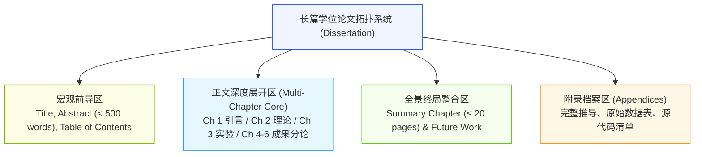
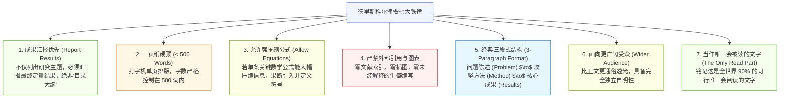
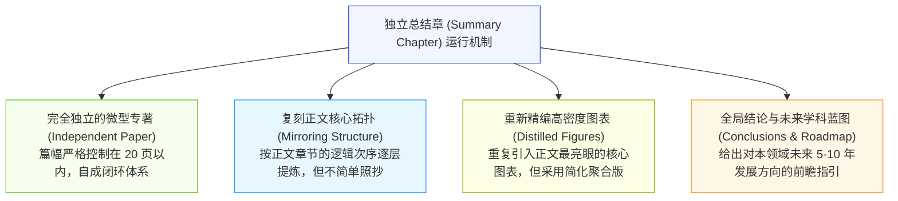
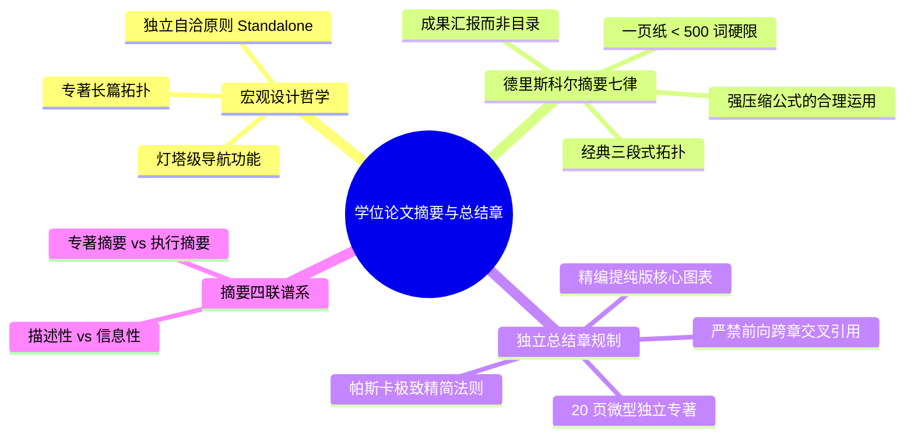

# Lec 16 学位论文摘要与总结章架构：长篇专著的全局整合

> MIT 21G.225 · 科技与工程高级写作工作坊 (ELS) · 主讲 Jane Dunphy

## TL;DR

- 学位论文（Thesis / Dissertation）的长篇专著属性要求作者建立“全景鸟瞰视角”，摘要与总结章是整本专著中唯二具备“完全独立自洽性（Standalone）”的核心枢纽。
- 践行麻省理工核工程系荣誉教授德里斯科尔（Michael Driscoll）的摘要七大准则，采用三段式拓扑（问题-方法-成果），杜绝写成空洞的“目录清单”。
- 总结章（Summary Chapter）是一篇不超过 20 页的独立精编微专著，遵循帕斯卡修辞法则，通过提炼简化图表与全局结论，完成学者由研究生向独立专家的学术蜕变。

## 1. 长篇学术专著的拓扑系统与宏观整合

完成硕士或博士学位论文（Master's Thesis / Doctoral Dissertation），是青年学者学术生涯中规模最庞大、结构最复杂的学术工程大考。与篇幅受限在 8 至 12 页的期刊论文不同，学位论文通常是一部介于 80 至 200 页的长篇学术专著（Monograph）。

在长达数百页的篇幅中，答辩委员会委员、同行评阅人以及未来的学术引用者，极少有人能够从第一页逐字读到最后一页。在这座庞大的知识迷宫中，**摘要（Thesis Abstract）与总结章（Summary Chapter）**构成了读者唯一能够纵览全貌的导航灯塔。

::: definition [独立自洽原则 (The Standalone Principle)]
独立自洽原则指学位论文的摘要与总结章必须作为完全独立的出版单元存在。读者在不翻阅任何后续正文章节、不查阅正文图表的情况下，仅凭阅读该章节即可完整理解本论文的科学动机、理论范式、核心定量发现与重大历史结论。
:::

## 2. 德里斯科尔学位论文摘要七大准则（Driscoll's Guidelines）

麻省理工学院核工程系荣誉教授 Michael Driscoll 总结的《Thesis Abstract Preparation Guidelines》，是 MIT 乃至全美工科博士生奉为圭臬的经典摘要圣经。

### 2.1 描述性摘要 vs. 信息性摘要的致命分野

Driscoll 强调的第一条准则，直击非母语写作者最常犯的顽疾——把摘要写成了干瘪的“描述性目录（Descriptive Table of Contents）”。

- **平庸失败的描述性摘要（仅报题目，无实质数据）**：
  > *"In this thesis, the thermal properties of silicon carbide are studied. The experimental methods are described in Chapter 2. The results of heat dissipation are presented and analyzed in Chapter 4, and conclusions are drawn in Chapter 5."*（这完全是一张废纸，读者读完依然对科学发现一无所知）。
- **顶尖卓越的信息性摘要（汇报定量成果与机理突破）**：
  > *"This thesis resolves the interfacial thermal bottleneck in silicon carbide power electronics by introducing a boron nitride monolayer. Using transient thermoreflectance, we demonstrate a 42% reduction in boundary thermal resistance at 300 K, increasing the safe operating power density from 120 W/cm$^2$ to 210 W/cm$^2$."*（数据确凿，机理明确，量化成果一目了然）。

### 2.2 经典三段式拓扑（The Three-Paragraph Architecture）

Driscoll 提倡的标准三段式是长篇论文摘要最高效的容器：
- **第一段：问题与研究目标（Problem & Motivation）**：指明现实工程痛点、理论盲区与本学位论文旨在攻克的核心科学问题（Move 1 & Move 2）。
- **第二段：攻坚手段与理论范式（Method of Attack）**：提炼所构建的独特数学模型、实验平台或算法流线，展现方法论创新。
- **第三段：量化突破与深远结论（Quantitative Results & Impact）**：端出核心数据，阐明对工业界或基础物理认知的深远推动。

## 3. 德里斯科尔独立总结章架构（The Thesis Summary Chapter）

在学位论文的主体章节（Chapters 1–5）之后，必须设置一个高阶的“总结章（Summary Chapter）”。许多学生误以为总结章就是简单写两页纸的“结语与未来工作”。根据 Driscoll 的《Guide to the Thesis Summary Chapter》，总结章的修辞规格远比一般人想象的要高得多：

### 3.1 杜绝跨章节引用（Banishing Cross-Chapter Allusions）

在撰写总结章时，最严厉的修辞禁令是：**严禁出现“详见第 4 章图 4.12”或“公式推导见第 3 章公式 3.8”这类强迫读者翻阅前文的粗暴表达**！

总结章既然被定位为一篇“能够被系主任或同行学者随身携带单独阅读的独立论文”，它就必须包含所有理解结论所需的自包含图表和关键公式。如果正文第 4 章有一张包含 12 条曲线的复杂测试图，总结章应当重新绘制一张**提纯版图表（Distilled Composite Figure）**，仅保留对照组与最佳优化组的两条核心曲线，直观呈现终极结论。

::: insight [帕斯卡名言的工程修辞隐喻]
Driscoll 在指导总结章撰写时，特别援引了 17 世纪法国哲学家布莱兹·帕斯卡（Blaise Pascal）写给朋友信中的传世名言：
> *"I have made this letter longer than usual because I lack the time to make it short."（我这封信写得比往常长，是因为我没有时间把它写得更短。）*
把长篇大论写长很容易，把数十万字的庞杂研究提炼为 20 页内珠玑璀璨、逻辑紧凑的独立总结章，需要付出数倍的智力沉淀。总结章的厚度，恰恰是衡量学者思维精纯度的标尺。
:::

## 4. 摘要四联谱系：类型与语境矩阵

在学术与工程实践中，根据受众与发布载体的不同，摘要演化出了四种鲜明的语篇形态（Rew, 1993）：

| 摘要类型 | 核心受众与载体 | 篇幅上限 | 核心修辞功能与内容侧重点 |
| :--- | :--- | :--- | :--- |
| **描述性摘要 (Descriptive)** | 图书馆索引、检索数据库、文献书目 | 50–100 词 | 仅指明论文讨论的论题范畴（What is covered），不给出具体实验数值或结论细节 |
| **信息性摘要 (Informative)** | 期刊论文前导、顶级学术会议论文 | 150–250 词 | 微型全景展示：背景、目标、方法、核心量化数据与最终结论全要素闭环 |
| **专著性摘要 (Thesis Abstract)** | 硕士/博士学位论文、博士后工作报告 | 300–500 词 | 遵循 Driscoll 三段式准则，兼顾高专业深度与跨学科透光性，容纳高压缩核心公式 |
| **执行摘要 (Executive Summary)** | 政府咨询报告、企业技术备忘录、商业计划 | 1–3 页 | 面向高层决策者（BLUF 原则）：核心建议、商业收益、工程成本与行动时间表 |

## 5. 本讲总结与实操检视表

### 学位论文终局自检清单

- [ ] 摘要篇幅检测：是否严格控制在一页以内，字数是否少于 500 词？
- [ ] 摘要内容审计：是否清除了类似“第 3 章讨论了……”的描述性目录废话？是否包含具体的最终定量测量数据？
- [ ] 摘要独立性：在脱离论文全本的情况下，外系学者能否完全读懂摘要中的问题与结论？是否存在未展开解释的生僻行话？
- [ ] 总结章跨章节引用清理：全文检索总结章，是否彻底清除了 *"See Chapter X"*、*"Refer to Table Y"* 等偷懒的交叉引用？
- [ ] 总结章图表自洽性：关键图表是否已作为独立插图重新插入总结章，并配备了自洽的 Figure Caption？
- [ ] 总结章篇幅控制：除去图表后，纯文本篇幅是否严密控制在 20 页以内，做到了高密度蒸馏？

## 6. 我的理解与批判性反思

撰写完学位论文的总结章，意味着长达数年的研究生学术训练终于走到了终点线。这一章节的完成，不仅是物理文本的交付，更是学者心智的终极加冕。

1. **从“拼图碎片”到“科学大厦”的认识论蜕变**：
   在攻读学位的数年漫长岁月里，学生的大多数时间都被具体实验的挫败、代码的调试、样品的污染所割裂。视野往往被局限在极度狭窄的微观切片上，一叶障目。只有当坐下来撰写全局总结章时，学者才被迫退后十步，将散落在各个章节中的零散发现重新编织为一座逻辑严密、巍峨耸立的科学大厦。这种全局建构能力，正是博士学位（Doctor of Philosophy）中“哲学（Philosophy）”二字的真正归宿。
2. **“独立自洽”背后的学术利他主义**：
   Driscoll 教授反复强调“摘要和总结章必须独立自洽、绝不强迫读者翻看正文”，其内核是一种极其崇高的“学术利他主义”。在这个信息超载的世界上，每一个同行的注意力都是极度宝贵的。花费数周心血把几百页的书稿压缩成 20 页清澈透亮的独立总结章，是作者对学术同行时间最大的敬畏与呵护。善待读者认知的学者，才能赢得学术界最真诚的共鸣与传颂。
3. **帕斯卡法则对工科一生的终生烙印**：
   “因为缺乏时间，所以写得冗长”这一讽刺性洞见，将伴随每一位优秀学者的一生。在未来的工业研发、国家级基金申请或技术创业中，任何人都可以轻易写出一份泥沙俱下的百页报告，但唯有真正掌握核心机制的顶尖领袖，才能够用两页纸的执行摘要击穿一切信息迷雾。在 MIT 21G.225 获得的严苛写作训练，最终淬炼出的不仅是优美的英文句法，更是一颗洞察本质、高度自律、永远追求极致精纯的卓越工程灵魂。
