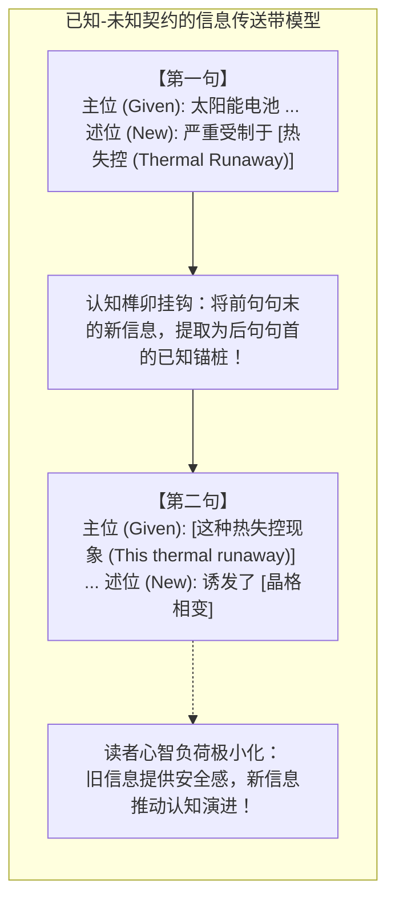
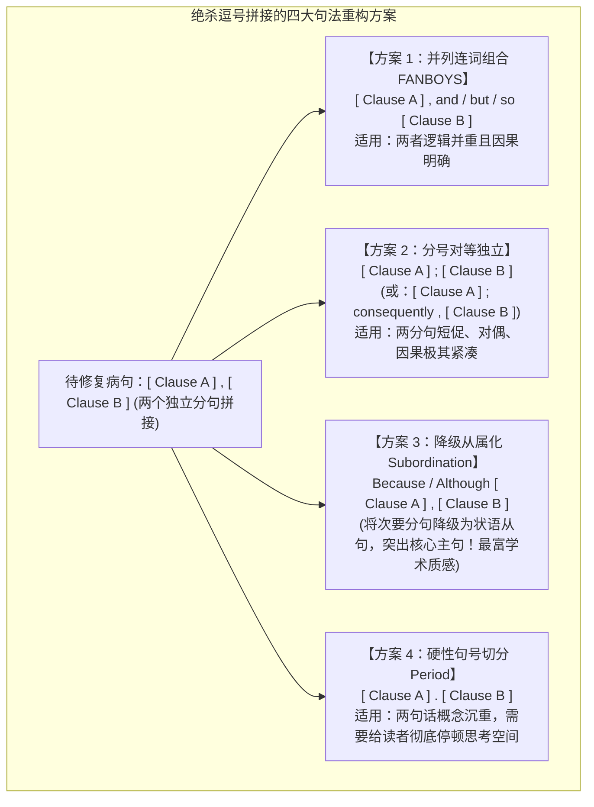

# Lec 2 篇章连贯、句子边界与标点修辞

> MIT 21G.225 · 科技与工程高级写作工作坊 (ELS) · 主讲 Jane Dunphy

## TL;DR

- **已知-未知信息契约（Given-New Contract）**：旧信息（读者已知概念）置于句首主语位充当心理认知锚桩，新信息（未见核心断言）置于句末焦点区，构筑无缝行进的逻辑输送带。
- **主位-述位拓扑推进（Theme-Rheme）**：通过线性链（上一句句尾转化为下一句句首）或恒定主位链推进，彻底根除前后句缺乏逻辑挂钩的“跳跃感”与认知断裂。
- **绝杀逗号拼接（Comma Splice）与连读句**：彻底破除汉语“一逗到底”的意合恶习，严格依据英语四大合法句法范式重构独立分句边界。
- **标点符号的高精度修辞力学**：分号（;）建立平衡对立，冒号（:）发布强承诺阐释，破折号（—）实施高张力插入，精密调控科技论文的阅读节奏。

## 1. 核心问题：为什么每个单词都认识，连在一起却读得极度痛苦？

在审阅中国研究生的英文论文初稿时，审稿人常抱怨一种普遍的“阅读晕车感”：
论文里没有出现语法单词拼写错误，每一个分句在语法书上似乎也都挑不出毛病，但整段文字读起来却如同在碎石堆上颠簸——
前后两句话之间缺乏看不见的引力牵引，读者的大脑刚在第一句建立了一个概念模型，第二句却突然杀出一个毫无铺垫的全新名词作为主语；接着，作者用一个逗号把几个互不统属的长从句随意串联在一起，一口气拖延了四五行，令读者在长距离修饰的迷宫中窒息。

本讲深入剖析篇章微观结构的两大核心引擎：**信息流动（Information Flow）的心理语言学定律**，以及**句子边界与标点符号的形式语法力学**。

## 2. 核心概念

| 概念 | 严密定义（用自己的话） | 容易混淆的邻居 | 典型实例 / 判据 |
|---|---|---|---|
| **已知-未知信息契约（Given-New Contract）** | 认知语篇心理学定律：作者有义务在每一个句子的开头放置读者在上下文已知的旧信息（Given），在句尾重音焦点区释放全新的核心信息（New）。 | 语序随意性（随意将刚发明的新概念塞进主语，会导致读者工作记忆检索失败）。 | $A \to B$；接下来必须由 $B \to C$，绝不能突兀插入 $X \to Y$。 |
| **主位与述位（Theme & Rheme）** | 系统功能语言学范畴：主位（Theme）是分句的出发点，通常占据句首；述位（Rheme）是围绕主位展开陈述、承载核心论证推进的实质内容。 | 语法主语与宾语（主语是句法槽位；主位是信息包装与篇章衔接的修辞起点）。 | 倒装句中，介词短语可提前充当主位以吻合 Given 信息。 |
| **逗号拼接（Comma Splice）** | 严重的英语句法违规：仅使用普通逗号将两个完整的独立主谓分句（Independent Clauses）连接在一起，缺乏并列连词或从属标记。 | 合法并列（汉语允许一逗到底；英语中无连词的逗号并列属于致命句法结构崩溃）。 | *\*The reaction was exothermic, the temperature rose.*（违规）。 |
| **连读句（Run-on Sentence / Fused Sentence）** | 没有任何标点符号或连词断开、将两个或多个独立分句机械黏合在一起的病态句子。 | 长难句（长难句只要从属连词层次清晰即合法；连读句是缺乏结构边界的黏连）。 | *\*We tested three samples they all showed identical traits.* |
| **高阶标点修辞（Semicolon & Colon Mechanics）** | 科技写作中界定逻辑亲疏的标点系统：分号连接语义紧密且结构对等的两个独立分句；冒号用于从总述向分述、阐释或清单展开的强指引。 | 随意替代（分号绝不能用于修饰从句；冒号前必须是语法结构完全闭合的独立分句）。 | 独立分句 A ; 独立分句 B；独立分句 A : 解释说明 B。 |

## 3. 证据链与理论模型：认知负荷与信息拓扑

### 3.1 已知-未知信息契约的认知心理学实证

心理语言学家哈维兰与克拉克（Haviland & Clark, 1974）通过自定步速阅读（Self-Paced Reading）实验证实：人类在阅读处理句子时，必须首先在工作记忆中为输入的声音或文字找到一个“先行锚点（Antecedent Anchor）”。

考察以下两组在逻辑上完全等价的句对处理时延：

::: example 认知加工阻力对比实验
- **句对组 1（违背 Given-New 契约，跳跃颠倒）**：
  - *Sentence 1*: Recent advances in deep learning have enabled human-level image recognition.
  - *Sentence 2*: **Massive annotated datasets** are required by these neural networks.
  - **眼动与时延记录**：受试者在读到第二句开头的 *Massive annotated datasets* 时，大脑神经元产生强烈的 N400 脑电电位突起，瞳孔微扩张，阅读时延显著延长 140 毫秒！因为大脑必须强制暂停，在内存中重新开辟新区域来安置这个突如其来的全新概念。
- **句对组 2（恪守 Given-New 契约，无缝咬合）**：
  - *Sentence 1*: Recent advances in deep learning have enabled human-level image recognition.
  - *Sentence 2*: **These neural networks**, however, require **massive annotated datasets**.
  - **眼动与时延记录**：受试者阅读极其流畅，残差时延降至基线水平！第二句句首的 *These neural networks* 作为上一句尾部已提及的已知信息（Given），像榫卯一样牢牢扣住读者心智，随后顺理成章地将焦点引向新信息 *massive annotated datasets*。
:::

### 3.2 主位推进（Theme-Rheme Progression）的三大经典几何拓扑

奈杰尔·卡普兰（Nigel A. Caplan, 2012）在《专业写作语法选择》中指出，高水平科技论文的段落连贯性，依赖于三种严整的主题链拓扑推进：

1. **线性连续推进链（Linear Progression / Zig-zag Pattern）**：
   - 每一句话的述位（句末新信息 $R_1$），直接转化为下一句话的主位（句首旧信息 $T_2 = R_1$）。
   - **效果**：因果链条极其紧密，适合描述分子反应机理、算法执行流水线或推导因果逻辑。
   - **几何公式**：$T_1 \to R_1 \Longrightarrow T_2(=R_1) \to R_2 \Longrightarrow T_3(=R_2) \to R_3$
2. **恒定主位推进链（Constant Theme Progression）**：
   - 连续多句话共享相同或同义的主位（$T_1 = T_2 = T_3$），不断赋予其不同的新特征述位（$R_1, R_2, R_3$）。
   - **效果**：高度聚焦于单一核心研究对象，适合介绍一种新型复合材料的多个物理特性或一个器件的各项性能指标。
3. **衍生超主位推进链（Derived / Hyper-Theme Progression）**：
   - 首句提出一个宏观超主位集合（如“该系统由三个子模块构成”），后续各句分别以子集分支作为主位依次展开。

## 4. 机制与形式推导：绝杀中式连读句与标点修辞

### 4.1 逗号拼接（Comma Splice）的语法致病机理与四大救赎方案

在汉语中，逗号充当了通用的“语流呼吸气口”，古人甚至无需标点，现代汉语作者常常一口气连写七八个逗号才打一个句号。但将这种习惯移植到英语中，会引发灾难性的**逗号拼接（Comma Splice）**语法崩溃。

::: pitfall 典型的中式逗号拼接事故
$$\text{*\“The catalyst degraded rapidly, the reaction yield dropped below 15\%.\”} \quad (\text{严重语法崩溃 ❌})$$
两个分句各自拥有完整的主语和限定谓语动词，但在句法拓扑上，一个裸露的弱逗号（`,`）在音系和句法中根本不具备断开独立时态短语（TP）的结构张力！
:::

要彻底根治这一顽疾，必须在四大合法句法范式中进行确定性选择：

| 修复范式 | 针对上述病句的真实重构实战 | 句法与修辞特征评价 |
|---|---|---|
| **方案 1：并列连词** | *The catalyst degraded rapidly, **and consequently** the reaction yield dropped below 15%.* | 逻辑平稳推进，因果显式化。 |
| **方案 2：分号修辞** | *The catalyst degraded rapidly**;** the reaction yield dropped below 15%.* | 结构严整短促，赋予两件事强烈的必然绑定感。 |
| **方案 3：从属化降级** | *As the catalyst degraded rapidly, the reaction yield dropped below 15%.* | **学术推荐度极高 ✅**：摆脱扁平并列，形成主从层级景深。 |
| **方案 4：独立句号** | *The catalyst degraded rapidly**.** This failure reduced the reaction yield below 15%.* | 稳健庄重，并在第二句首利用指示代词构筑 Given 锚桩。 |

### 4.2 科技英语高级标点修辞系统：分号、冒号与连字符谱系

标点符号不是排版装饰，而是调节读者认知处理速度与期待的**交通信号灯**：

1. **分号（Semicolon `;`）：对等独立分句的天平**  
   分号的停顿力度大于逗号、小于句号。它向读者宣告：“前后两个句子在句法上各自独立，但在思想实质上是不可分割的一体两面”。
   - 合法结构：`[完整独立主谓分句] ; [完整独立主谓分句]`
   - 严禁滥用：绝不能用分号连接从句或分词短语（如 *\*Although the system failed; we continued* 属于严重语法事故）。
2. **冒号（Colon `:`）：宣告解释的强聚光灯**  
   冒号向读者发布强烈的契约承诺：“后文将对冒号前的断言进行具体的阐释、拆解、例证或清单罗列”。
   - **黄金法则**：冒号前面的句子**必须是一个在语法上完全闭合的独立分句**！
   - 典型反例：*\*The advantages are: speed, low cost, and reliability.*（严重错误！*are* 是系动词，表语被冒号强行割裂）。
   - 正确修改：*The system exhibits three major advantages: speed, low cost, and reliability.*
3. **破折号谱系的微观力学（Hyphen vs. En-dash vs. Em-dash）**：
   - **连字符（Hyphen `-`）**：用于词内构词，制造复合词（如 *high-temperature superconductor*, *state-of-the-art*）。
   - **短破折号（En-dash `–`）**：长度等同于字母 N，专用于表示数值范围或对称对等关系（如 *pp. 45–52*, *voltage–current characteristics*）。
   - **长破折号（Em-dash `—`）**：长度等同于字母 M，用于在句中实施强有力的补充插入，制造比括号更引人瞩目、比逗号更突出的修辞强调。

## 5. 我的理解与批判性反思

::: insight 句法张力与学术建筑学
学完本讲，我们应当将科技英语写作视为一门精密的心智建筑工程学：
1. **已知-未知契约是读者的认知氧气管**：没有经过训练的作者，写文章完全凭自己的灵感倾泻，想到哪个词就把哪个词丢进主语位置，结果让读者如同在没有路标的荒野中不断迷路。将旧信息置于句首，不是刻板教条，而是在读者的神经突触间搭建平稳滑行的铁轨。每一个句子都应该是上一句的平稳延伸，又是下一句的坚实地基。
2. **标点符号是思维的节拍器**：中式写作习惯了散文化的“一逗到底”，这种惰性思维在国际期刊上是灾难性的。逗号、分号与冒号，代表着完全不同的逻辑承诺。分号是并行的天平，冒号是聚焦的箭靶，连词是通畅的高速匝道。精确掌握标点力学，就是在用乐谱级的精度掌控审稿人的心跳与呼吸。
3. **从属化是思维深度的试金石**：小学生才全篇使用 *and, but, so* 机械连接短句；成熟的科学家必须学会将次要的背景、条件与让步，大量打包降级为从属从句、分词短语与独立主格。正是这种主从分明的层级景深（Depth of Field），赋予了科技论文沉稳、严密且无可辩驳的权威力量。
:::
