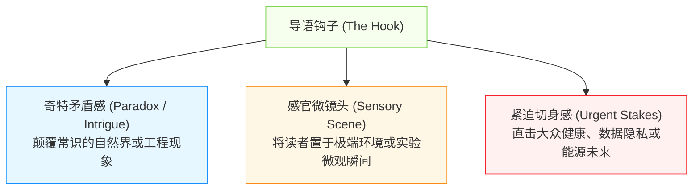
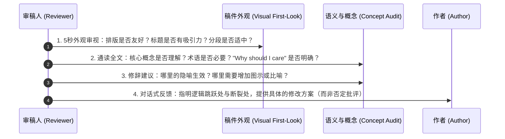
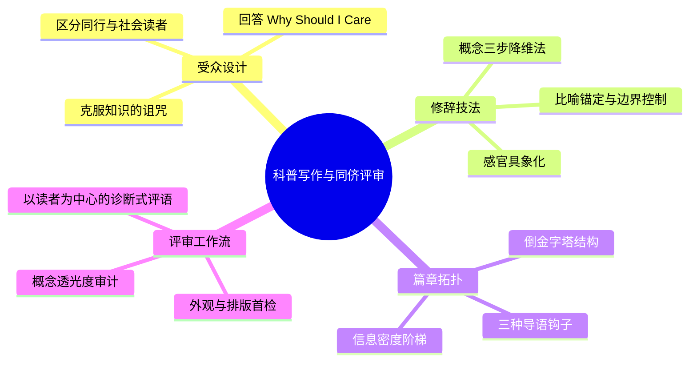

# Lec 3 面向公众的科普写作与同行评审机制

> MIT 21G.225 · 科技与工程高级写作工作坊 (ELS) · 主讲 Jane Dunphy

## TL;DR

- 面向非专业公众写作的核心是克服“知识的诅咒”，通过“概念降维”、“比喻转译”与“利益关联”回答“读者为何要在乎（Why should I care）”。
- 叙事结构采用新闻学倒金字塔与引人入胜的导语钩子（Hook），将传统论文中后置的影响力与核心发现前置到开篇。
- 同行评审（Peer Review）不是机械的文字纠错，而是基于读者视角的修辞审计，聚焦宏观结构、术语密度、逻辑连贯性与论据充分性。

## 1. 知识壁垒与受众意识模型

科技工作者在向跨学科同行或社会公众传播技术发现时，最常遭遇的认知障碍被称为“知识的诅咒（Curse of Knowledge）”。研究人员长期浸润在极高密度的专业语境中，容易默认受众具备同等的先验知识与推导耐心。面向公众写作的本质，是一场精确的“受众设计（Audience Design）”。


受众设计的认知梯度从领域核心向外逐层扩散。对领域同行而言，高密度缩略词与公式是提升信息密度的必要压缩包；但当目标受众转移为跨界学者或普通大众时，必须解构压缩包，将其还原为具体形象的感官体验与逻辑因果。

::: definition [受众设计 (Audience Design)]
受众设计指作者在构思与行文时，主动预判目标读者的先验知识水平、阅读目的与注意力极限，并相应调整词汇难度、信息呈现次序、句式复杂度与背景解释深度的修辞策略。
:::

### 1.1 “读者为何要在乎”（The "Why Should I Care?" Test）

学术期刊论文通常允许作者将结论与现实影响放置在最末尾的“讨论”章节。然而在公共写作与科普专栏（如 *New York Times* 科学版、*MIT News*）中，第一段若未能回答“Why should I care?”，读者就会立即放弃阅读。

::: example [学术陈述与公众视角的转换对比]
- **学术期刊原始表述**（*Journal of Thoracic and Cardiovascular Surgery*）：
  > "Endovascular stent grafting demonstrates non-inferiority compared with open surgical repair for descending thoracic aortic aneurysms in low-risk cohorts with respect to 30-day all-cause mortality."
- **公众科普转译表述**（*Proto* 医疗专刊转译）：
  > "Instead of opening up the chest cavity like a cracked engine block to stitch a weakened artery, surgeons can now thread a tiny mesh tube through a blood vessel in the groin—sparing elderly patients from weeks of grueling intensive care."
:::

转译后的表述将冰冷的术语（Endovascular stent grafting）具象化为操作场景（thread a tiny mesh tube），用生动的比喻（cracked engine block）唤起读者的机械常识，并直接点明现实收益（免去数周重症监护痛苦）。

## 2. 核心科普技法：概念降维与比喻架构

在 Robert Day 与 Barbara Gastel 的《How to Write and Publish a Scientific Paper》中，向公众解释复杂物理与工程机制被提炼为三大核心修辞支柱：比喻锚定、术语减负与视觉化语言。

### 2.1 概念转译的三步法

概念降维绝非粗暴地删除专业细节，而是通过日常物理实体搭建认知脚手架（Cognitive Scaffolding）：

```mermaid
flowchart TD
    Step1["步骤一：提炼核心机制的抽象数学/物理关系"] --> Step2["步骤二：检索日常生活中的共有实体或物理现象"]
    Step2 --> Step3["步骤三：建立映射并显式说明比喻的边界与失效点"]

    style Step1 fill:#f0f5ff,stroke:#2f54eb,stroke-width:1px
    Step2 fill:#fcffe6,stroke:#7cb305,stroke-width:1px
    Step3 fill:#fff0f6,stroke:#eb2f96,stroke-width:1px
```

在建立映射时，作者需要严密审视日常实体与微观科学现象之间的对应关系。若省略了比喻的边界界定，读者容易在过度延伸类比时产生严重的科学误解。

::: example [弗里曼·戴森评理查德·费曼的科普范式]
著名物理学家 Freeman Dyson 在 *The New York Review of Books* 中评述费曼的路径积分与费曼图时写道：
> "Feynman simply visualized electrons traveling not along a single smooth track, but exploring every possible convoluted path simultaneously, like water seeping through all crevices of a sponge. His diagrams were not mere mathematical symbols; they were a shorthand comic strip of atomic acrobatics."
:::

戴森并未引入泛函积分（Functional Integrals）的严格拓扑定义，而是用“水渗过海绵的所有裂隙”与“原子杂技的连环画”两个意象，精准传递了量子力学中“对所有历史路径求和”的核心物理直觉。

::: pitfall [比喻失控与错误简化]
- **错误简化**：将技术缩水为无实质信息量的儿童话语（如“电脑像个聪明的大脑”），完全丧失了工程解释力。
- **比喻失真**：忽略比喻的适用边界，导致读者得出荒谬推论（例如将重力场比作橡皮膜时，未解释为何橡皮膜下沉本身需要外部重力向下拖拽）。
- **专业术语暗度陈仓**：在第一段抛出未经解释的专有名词（如 *CRISPR-Cas9*、*Markov Chain*、*Epigenetics*），未提供即时的同位语或类比拆解。
:::

## 3. 公普文本的宏观结构：倒金字塔与引题艺术

科研论文采用经典的 IMRaD（引言-方法-结果-讨论）结构，本质上是“归纳式与长篇论证型”的时间轴展开；而面向公众的科普与新闻报道则采用“倒金字塔模型（Inverted Pyramid）”。

| 维度 | 传统科研论文 (IMRaD) | 公普写作 / 新闻专栏 (Public Science) |
| :--- | :--- | :--- |
| **开篇焦点** | 宽泛的领域历史、背景与文献综述 | 核心发现、突破性现实后果与新闻钩子（Hook） |
| **叙事走向** | 漏斗型：背景 $\to$ 缺口 $\to$ 方法 $\to$ 数据 $\to$ 结论 | 倒金字塔：最具冲击力成果 $\to$ 机制解释 $\to$ 实验背景 |
| **术语密度** | 极高，依赖前沿命名契约以达到严谨性 | 极低，仅保留必要专有名词并配合即时解构 |
| **句式风格** | 多从句嵌套、名物化与被动语态为主 | 短句、主动动词、感官具象动词与生活隐喻 |
| **阅读动力** | 同行学术研究刚需与方法复现 | 智识好奇心、健康/切身利益与社会伦理关联 |

### 3.1 导语钩子（The Hook）的构造策略

公共写作的成败取决于第一句或第一段能否牢牢锁住读者眼球。Jane Dunphy 归纳了科普写作中最强效的三种开篇策略：



这三种钩子对应不同领域的技术特质。基础科学与生物学善用奇特反差，微观材料与物理学善用感官特写，而医学与人工智能则适合直奔现实利益与伦理危机。

::: example [James Gorman 论捕蝇草的开篇钩子 (*New York Times*)]
> "The Venus flytrap is a plant with a secret: it can count. When an unsuspecting insect brushes against one of the sensitive hairs inside its snap trap, the plant sets a mental timer. If the insect triggers a second hair within twenty seconds, the trap snaps shut in a tenth of a second. Three more touches, and the plant begins producing digestive enzymes."
:::

该导语赋予植物以“心智计数”与“倒计时器”的拟人特征，避开电位差动作电位（action potentials）等生物电生理学术语，却精确勾勒出了该机制的阈值触发控制逻辑。

## 4. 麻省理工同侪评审工作坊机制（Peer Review Workshop）

在 MIT 21G.225 中，同行评审不仅是写作练习的批改环节，更是训练学术同理心与专业审校思维的核心机制。Jane Dunphy 确立了严格的“分层评审工作流（Layered Peer Review Protocol）”。



同行评审不是挑挑逗号与拼写错误的表面工作，而是自上而下的系统性审计。审稿人必须模拟一个善意但挑剔的非专业读者，向作者指出理解过程中产生阻滞的精确节点。

### 4.1 MIT 公普写作评审清单项（The Audit Checklist）

依据麻省理工教学规范，审稿人须依照以下四大维度为同侪提供建设性反馈：

1. **外观与排版亲和力（Visual & Layout Welcomeness）**：
   - 标题是否在 10 个词内兼具信息量与趣味性？
   - 段落长度是否控制在 3-5 句话，是否存在阻碍阅读的长篇文字块？
   - 是否有视觉路标（小标题、黑体引语、信息图示草图）？
2. **概念透光度（Conceptual Transparency）**：
   - 非专业读者在不查阅 Wikipedia 的情况下能否复述核心机制？
   - 专业缩略语（Acronyms）是否在首次出现时立即展开并解释其实际功能？
   - 每一个生僻术语的存在是否有其不可替代的修辞目的，抑或是懒惰的行话残留？
3. **因果与论证链条（Causal Logic Chain）**：
   - 实验数据是否提供了直观的现实参考物（例如：“该晶体管厚度仅为人类发丝直径的万分之一”，而非单纯写“0.8 纳米”）？
   - 论文事实与作者推测之间的界限是否清晰明了？
4. **语调与态度（Tone and Engagement）**：
   - 语气是居高临下的说教（Patronizing），还是平等且引人入胜的智识对话？
   - 句子长短是否有节奏感？是否有打破单调语调的疑问句或短句？

::: insight [建设性同行评审的语言范式]
审稿人在撰写评语时，应避免使用纯评判性辞令（如 *"This paragraph is confusing and poorly written"*），而应采用以读者反应为中心的诊断式语言：
- **诊断式反馈模板**：*"As a reader without a fluid dynamics background, I lost the thread between sentence 2 and 3 because the word 'vorticity' appeared without an anchor. If you compared it to water spinning down a drain, the rest of the mechanism would instantly fall into place."*
这种反馈不仅指出了病灶，还解释了读者的心理认知过程，并给出了立即可执行的处方。
:::

## 5. 本讲总结与自检清单



### 课后写作自检清单

- [ ] 标题是否能在 5 秒内唤起非专业人士的阅读欲望？
- [ ] 第一段是否直接回答了该技术对人类社会、日常生活或科学边界的重大影响？
- [ ] 是否清理了所有未经解释的实验室行话与缩略语？
- [ ] 核心抽象机制是否至少配备了一个来自物理世界的生动比喻？
- [ ] 每一个比喻是否都明确界定了其适用极限，避免过度简化或失真？
- [ ] 给同伴撰写的评审意见是否具体指出了“认知掉队”的位置，并提供了建设性的改写建议？

## 6. 我的理解与批判性反思

在科学全球化与跨学科协作加速的今天，科技工作者的影响力往往取决于其将深奥工作转化为多方共识的能力。深入剖析 MIT 21G.225 的科普与同行评审模块，可以获得三层深远的认知升华：

1. **科普写作是学术研究的最高级检验**：
   物理学家费曼曾指出，如果你不能向大学一年级新生或自己的祖母解释清楚一个概念，说明你并没有真正理解它。在学术界，繁复的数学符号与晦涩的专门术语有时会成为掩盖思考漏洞的“避风港”。面向公众写作强制剥离了这些形式主义外壳，迫使研究者直面最核心的物理图像与逻辑本质。
2. **中国工科学者的“说理惯性”解构**：
   国内工科培养往往高度推崇客观、严谨与内敛的学术风格，这使得许多留美学者在撰写科普、项目摘要或媒体推介时，常常陷入“平铺直叙技术参数”的误区。他们担心使用生动的比喻会“不严谨”或“不够严肃”。但事实证明，在国际顶级科学传播中，生动比喻与严谨态度绝不冲突；缺乏比喻的冰冷罗列不仅不能彰显深度，反倒体现出沟通能力的欠缺。
3. **同侪评审是未来学术自治的预演**：
   在研究生阶段系统性接受同侪评审训练，其终极价值不仅在于改进当前的一篇课程作业，更在于培育一个健康的学术生态责任感。学术发表体制的根基正是匿名的同行评审。学会以同理心、建设性、有证据支持的方式阅读同伴的文字，既是提升自身批判性思维的利器，也是未来成为负责任的国际期刊审稿人与项目评审专家的必经之路。
