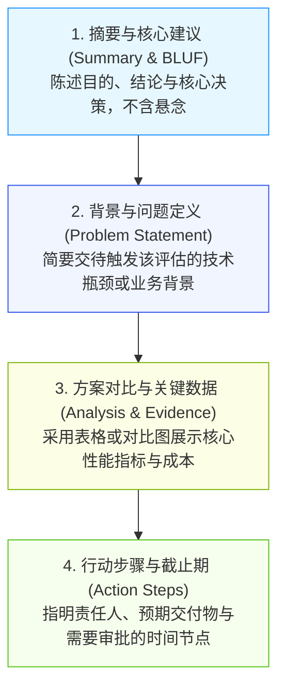
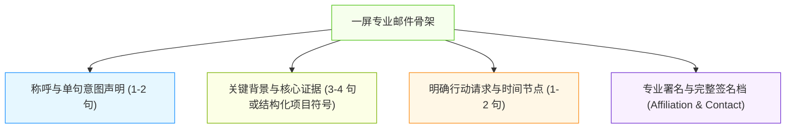
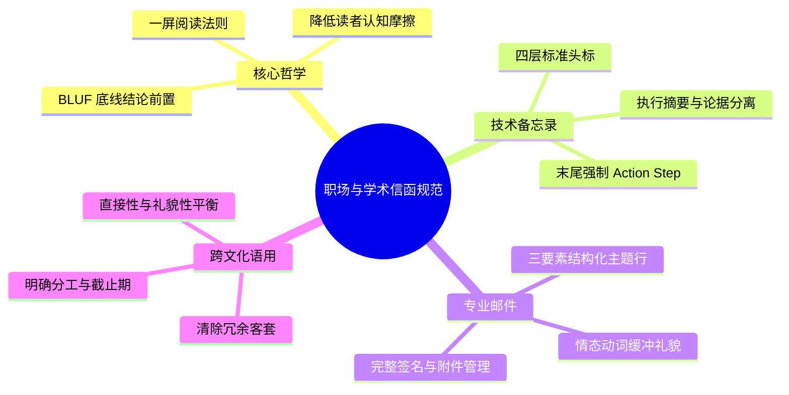

# Lec 4 职场与学术信函：技术备忘录、专业邮件与沟通规范

> MIT 21G.225 · 科技与工程高级写作工作坊 (ELS) · 主讲 Jane Dunphy

## TL;DR

- 技术备忘录（Technical Memo）与专业邮件的核心原则是“结论前置（BLUF）”，开篇 2-3 句内必须声明核心决议与行动要求。
- 采用四层标准头标（To, From, Date, Subject）与模块化视觉排版，通过清晰小标题、单倍行距与操作要点降低管理者的认知摩擦。
- 跨文化语用需克服东亚高语境的“客套绕圈”惯性，在直接性与礼貌性之间建立平衡，终篇必须明确责任归属与截止节点（Action Step）。

## 1. 组织内技术沟通的底层逻辑

在现代科研实验室、工业研发团队与高科技企业中，技术备忘录（Technical Memo）与工作电子邮件是发生频次最高的文体。与追求详尽论证与文献铺垫的学术论文不同，组织内沟通的首要法则是**降低决策者的认知摩擦（Cognitive Friction）**。

```mermaid
flowchart TD
    subgraph 传统学术思维
        A1["长篇背景与文献综述"] --> B1["实验过程与推演细节"] --> C1["末尾给出结论与建议"]
    end
    subgraph 组织工程沟通 (BLUF)
        A2["结论与行动诉求 (BLUF)"] --> B2["执行摘要与核心论据"] --> C2["详细工程参数与补充附录"]
    end

    style A1 fill:#fff1f0,stroke:#f5222d,stroke-width:1px
    style C1 fill:#f6ffed,stroke:#52c41a,stroke-width:1px
    style A2 fill:#f6ffed,stroke:#52c41a,stroke-width:1px
    style C2 fill:#f0f5ff,stroke:#2f54eb,stroke-width:1px
```

管理层和资深科学家每天处理数十份技术提案与数百封邮件。若采用传统的学术推导顺序，读者必须耐着性子读完数页工程细节才能明白作者到底需要批准什么预算或采纳哪套方案。组织沟通强制推行 **BLUF（Bottom Line Up Front，底线结论前置）**。

::: definition [BLUF 原则 (Bottom Line Up Front)]
BLUF 是起源于军事情报与工业管理的修辞标准，要求写作者在文档或邮件的第一段前三句话内，明确声明核心结论、重大发现或具体的行动请求（Action Requested），后续正文仅作为论据支撑与细节补充。
:::

## 2. 技术备忘录的标准架构与视觉设计

根据 Jane Dunphy 讲义中的《Technical Memo Checklist》，一份专业的技术备忘录必须在格式与视觉层面上实现“一眼即可导航”。

### 2.1 四层标准头标（Standard Memo Header）

技术备忘录必须以严格标准化的头标区（Header Block）开启，不可省略任何一项：

```text
TO:       [收件人姓名、职务与所属部门]
FROM:     [发件人姓名、职务与联系方式]
DATE:     [全写日期，如 October 28, 2026]
SUBJECT:  [行动导向的精准主题行，如 Recommendation for Migrating to Rust in Sensor Firmware]
```

主题行（Subject Line）必须具备高辨识度，严禁使用过于模糊的单字词（如 *Updates*、*Report*、*Testing*）。优质的主题行通常包含“行动类型 + 核心对象 + 关键界定”。

### 2.2 备忘录正文的四阶段拓扑

技术备忘录的正文一般限制在 1 至 2 页内，严格按照以下四个功能区块展开：



每一个区块都有严格的信息边界。背景陈述不宜超过半页，若有海量原始日志或推导脚本，必须归入文档末尾的附录（Appendix），绝不在主干文本中堆砌。

::: example [优秀技术备忘录开篇范例]
> **SUBJECT: Recommendation to Upgrade Cooling Subsystem for Cluster B**  
> **SUMMARY & RECOMMENDATION:**  
> This memorandum recommends an immediate transition from forced-air cooling to closed-loop liquid cooling in Cluster B prior to the Q4 scaling phase. Our thermal stress tests indicate that the current air cooling will fail under the projected 45% compute load increase, risking thermal throttling and hardware degradation. Implementing the liquid cooling solution will cost approximately $32,000 but prevent an estimated $180,000 in downtime. A detailed timeline and vendor quotation are outlined below for your approval by Friday, November 7.
:::

该范例在前三句内清晰交代了推荐动作（transition to closed-loop liquid cooling）、技术风险（thermal throttling）、财务权衡（$32k cost vs $180k loss）与明确的截止期限（Friday, November 7）。

::: pitfall [技术备忘录常见致命伤]
- **悬念式铺垫**：直到第二页才说出需要老板批准哪笔经费，浪费读者时间。
- **无层次长文本**：全文不加小标题，行距过密，缺乏项目符号（Bullet points），视觉阻力极大。
- **缺失行动步骤（Action Step）**：通篇分析了三个方案的优劣，但在结尾没有给出明确的作者推荐立场和下一步分工，迫使收件人追问：“So what? What do you want me to do?”。
:::

## 3. 专业电子邮件的语用学与修辞调配

根据 Swales 与 Feak 在《Academic Writing for Graduate Students》中的附录指南，科技人员在与导师、期刊主编、企业客户或跨国同侪沟通时，电子邮件是展现学术素养与职业水准的第一触点。

### 3.1 邮件主题行的“三要素公式”

高质量的学术与工程邮件主题行必须满足以下结构公式：

$$\text{Subject Line} = [\text{类别标签}] + \text{核心诉求 / 事件} + (\text{截止日期 / 标识符})$$

- **平庸主题**：`Meeting` / `Question` / `Paper draft` / `Hello`（极易被当成垃圾邮件或被无限期推迟回复）。
- **专业主题**：
  - `[Action Required] Review of 21G.225 Proposal Draft by Nov 12`
  - `Inquiry: Lab Access Protocol for Microfabrication Facility (Group 4)`
  - `Paper Submission 24-900: Extension Request for Assignment 2`

### 3.2 语域（Register）与礼貌策略的黄金区间

非英语母语学者在撰写邮件时，往往在“过度卑微客套”与“过于生硬命令”两个极端之间摆动：

| 语用维度 | 过度高语境（东亚客套惯性） | 理想的专业语域（Professional Register） | 粗暴失礼（Direct & Demanding） |
| :--- | :--- | :--- | :--- |
| **开篇** | "Dear Respected Prof. Smith, I am very sorry to trouble your busy schedule, hoping you are in good health..." | "Dear Professor Smith, I am writing to request a brief meeting regarding..." | "Professor, I need to see you tomorrow at 10 AM." |
| **核心诉求** | 隐晦提及问题，不敢直接提出需求，等待导师自行猜测 | 直接提出需求，并提供 2-3 个可选的时间槽或明确的材料附录 | "Send me the code you promised." |
| **行动推进** | "Whatever you decide is completely fine with me..." | "Please let me know if Thursday 2:00 PM or Friday 10:00 AM suits your calendar." | "Reply as soon as possible." |

::: insight [跨文化视角的礼貌标记系统]
在英语专业语境中，真正的礼貌不是通过自我贬低或过长寒暄体现的，而是通过**情态动词（Modals）与条件句（Conditionals）构建的缓冲空间（Hedge/Buffer）**体现的：
- 使用 *"Could we schedule..."* 或 *"Would it be possible to..."* 代替 *"I want to..."*。
- 使用 *"I would appreciate your feedback on..."* 代替 *"Give me your feedback."*。
- 给对方留下拒绝或调整的余地（*"Please let me know if another time works better for you."*）。
:::

### 3.3 “一屏法则”与认知负荷控制

根据认知负荷理论（Cognitive Load Theory）与眼动追踪研究，当代专业人士在移动设备或桌面端查阅邮件时，普遍遵循“F 型视觉扫描模式（F-Shaped Pattern）”。收件人通常只会在邮件顶部扫视前两行，随后沿左侧垂直边缘快速寻找项目符号与粗体路标。

因此，专业电子邮件的篇幅必须严格恪守“一屏法则（One-Screen Rule）”：在不进行二次滚轮滑动的前提下，收件人必须能够在 15 秒内掌握邮件的全局架构、核心诉求与预期截止日期。若邮件篇幅过长，未能在第一屏形成认知闭环，极易被标记为“稍后处理”并最终沦入未读黑洞。



在实际排版执行中，作者应注意将多项事务切分为清晰的项目符号（Bullets），且每一项保持在单行或两行以内。如果一封邮件不可避免地需要交代复杂的理论推导、详尽的测试日志或冗长的会议纪要，最佳工程实践是在正文中仅保留高阶执行摘要与行动项，将详细分析归入标准附件（PDF）或内部文档超链接中，确保邮件主干轻盈且极具行动导向。此外，签名档必须包含发件人的全名、当前职位、实验室或研发部门全称以及官方联系电话，避免收件人在跨部门协作时耗费精力检索组织架构。

## 4. 常见沟通误区与修改实训

以下通过真实工作场景中的对比案例，解析学术与工程沟通中的典型失误及纠偏方案。

::: example [案例分析：向资深教授或导师请求推荐信]
- **糟糕草稿（低效且产生心理负担）**：
  > "Hi Prof, I was in your class last term. I am applying to PhD programs now. Can you write me a recommendation letter? The first deadline is in two days. Thank you so much!"
- **专业修订稿（尊重他人认知负荷，材料完备）**：
  > "Dear Professor Johnson,  
  > I hope this note finds you well. I am writing to ask whether you would feel comfortable writing a strong letter of recommendation for my application to doctoral programs in materials science, focusing on nanomaterial synthesis.  
  > I thoroughly enjoyed your Advanced Solid-State Physics course (Fall 2025), where my semester project on silicon carbide heterostructures earned an A.  
  > My earliest application deadline is December 15 (Stanford University). To assist your review, I have attached my updated CV, statement of purpose, and an unofficial transcript, along with a bulleted summary of key research accomplishments from our lab discussions.  
  > Thank you very much for considering this request. Please let me know if you would like any additional materials.  
  > Sincerely,  
  > Li Wei  
  > M.S. Candidate, Department of Materials Science, MIT"
:::

修改稿做到了五项关键点：① 询问是否能提供“强推荐信（strong letter）”；② 明确具体学术方向；③ 精确唤起教授对该生过往成绩的具体记忆；④ 预留了充裕的时间（数周提前量，而非两天）；⑤ 打包附带了所需参考文件，极大减轻了教授起草信件的负担。

## 5. 本讲总结与实操检视表



### 课后信函起草核对清单

- [ ] 主题行是否包含清晰的类别标签与具体行动指令，而非笼统名词？
- [ ] 第一段是否在前 3 句话内给出了明确的结论、决定或核心诉求（BLUF）？
- [ ] 是否清理了无信息增量的“客套空话”（如“深知您非常忙碌抱歉打扰……”）？
- [ ] 备忘录中是否存在未指明责任人与交付日期的悬空结论？
- [ ] 正文篇幅是否适配“一屏阅读”，长篇数据是否已移至表格或附录？
- [ ] 请求是否运用了情态缓冲动词（*Could*, *Would*, *I would appreciate*），语气是否专业而不蛮横？

## 6. 我的理解与批判性反思

科技工作者常常容易落入一种“技术唯物主义”的狭隘认知中，认为只要算法最优、实验数据最硬，沟通与信函格式只是无关紧要的繁文缛节。然而在真实科研与工业界运行中，技术信息的传递效率直接决定了工程价值的变现速度。

1. **信函排版是个人工程严谨性的全息投射**：
   在技术管理层眼中，一个连邮件主题行都无法精确概括内容、在备忘录中排版混乱、甚至忘记写明行动截止日期的工程师，很难让人相信其在编写关键代码或操作复杂仪器时具备足够的工程自律。清晰的格式与严密的结构不仅服务于读者，更是作者专业声誉的无形资产。
2. **高语境文化与低语境工商业文明的对接**：
   在中文传统语境中，“直截了当说明利益或诉求”常常被视为不够含蓄甚至冒昧，人们习惯于在开头做大量情感铺垫。但在国际高科技研发语境下，这种拐弯抹角的沟通方式不仅不会增加人情味，反而会极大地消耗国际同侪宝贵的时间精力。学会“有礼貌地直接”（Direct yet Courteous），是东亚科研人员融入全球学术共同体的关键心理跃迁。
3. **技术备忘录是对抗“集体失忆”的防御性资产**：
   在工程团队中，技术备忘录不仅是即时决策的工具，更是不可逆的法律与历史凭据。当数月或数年后系统出现故障或审计回溯时，口头沟通早已无从考证，而一份拥有清晰日期、四层头标、数据对比与签名责任链的技术备忘录，将成为复盘技术责任与还原决策逻辑的唯一硬指标。
