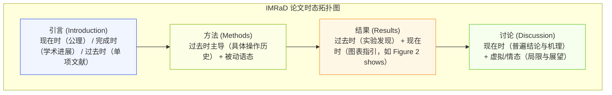
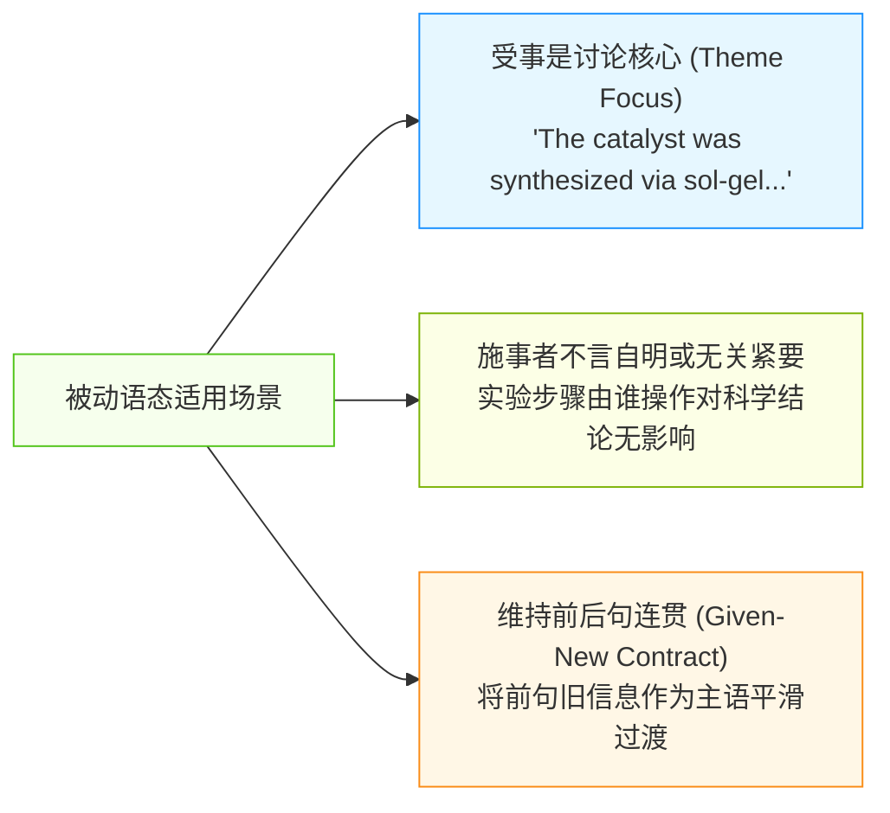
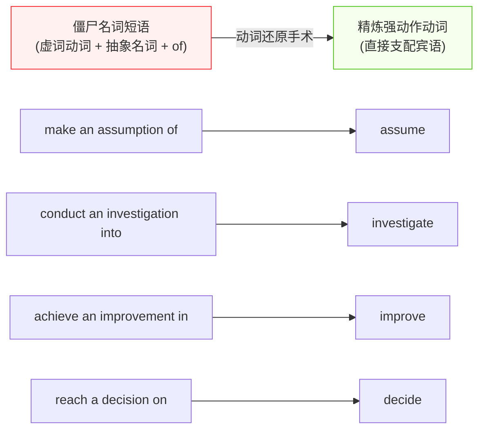
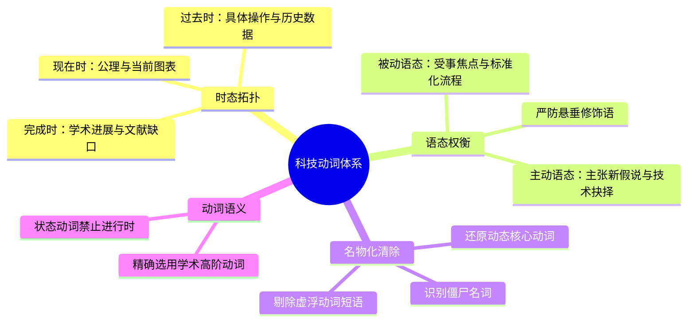

# Lec 5 科技动词体系：时态分布、被动语态与语态功能分配

> MIT 21G.225 · 科技与工程高级写作工作坊 (ELS) · 主讲 Jane Dunphy

## TL;DR

- 科技论文中的动词时态并非机械语法规则，而是表达“认识论距离”与“事实确定性”的修辞工具：一般现在时陈述普遍真理与当前图表，一般过去时记录具体实验步骤与观察数据，现在完成时搭建前人研究与当下研究的桥梁。
- 被动语态服务于“受事焦点”与流程客观性，主动语态表达作者学派主张与方法学裁决，两者的动态切换是现代顶级期刊的标准规范。
- 坚决清除“僵尸名词（Nominalization）”，将臃肿的动词短语还原为强动作动词，彻底根除中文母语者因缺少时态屈折而产生的“时态漂移（Tense Drift）”。

## 1. 动词时态的修辞功能与 IMRaD 分布拓扑

非英语母语科研人员常误以为时态仅仅是动作发生物理时间的记录。在 Nigel A. Caplan 的《Grammar Choices for Graduate and Professional Writers》中，科技语篇中的时态被界定为**认识论定位工具（Epistemological Positioning）**。通过切换时态，作者向读者暗示某项陈述究竟是“公认的恒常法则”、“特定实验的历史记录”，还是“仍在探讨中的学术悬案”。

在整篇科研论文中，时态的起伏勾勒出研究从宏观背景收窄至具体实验，再从具体数据升华回普遍理论的经典沙漏形状。掌握这套拓扑分布是避免语篇混乱的根本。

### 1.1 三大主导时态的语用契约

根据科技出版界（IEEE、ACS、Nature Portfolio）的通用规范，科技写作中的三大核心时态承载着严格的语义边界：

| 时态形式 | 核心修辞功能 | 典型学术应用场景 | 典范例句 |
| :--- | :--- | :--- | :--- |
| **一般现在时 (Present Simple)** | 表达普遍规律、公认理论、永久属性及当前文档内部的图表指引 | 定理、物理性质、常数规律、Figure/Table 指引 | *"Water freezes at 0°C."* / *"Figure 3 illustrates the relationship between strain and stress."* |
| **一般过去时 (Past Simple)** | 记录在特定时间、特定实验室条件下完成的单次历史操作与具体观测结果 | 方法章节的操作步骤、结果章节的具体量测值 | *"The mixture was heated to 120°C for 30 minutes."* / *"The tensile strength increased by 14%."* |
| **现在完成时 (Present Perfect)** | 连接过去的研究活动与当前的研究现状，强调过往工作对当下的累积效应或知识缺口 | 引言中的文献综述、研究空白的提出 | *"Several algorithms have been proposed to address this latency issue, but none has achieved real-time execution."* |

::: definition [认识论距离 (Epistemological Distance)]
认识论距离指写作者通过动词形式表达对命题确定性及普遍性的主观认同。使用一般现在时（*"Newton's law states that..."*）表示将该理论视为无需争辩的客观事实；使用一般过去时（*"Smith (2018) found that..."*）则将结论限定在该特定作者的特定实验范围内，与当前普遍真理保持审慎距离。
:::

## 2. 语态之争：被动语态的合理性与主动语态的回归

长期以来，科技写作界流传着“科学论文必须通篇使用被动语态以彰显绝对客观”的教条。这一教条导致大量学术文本充斥着僵化冗长的句子，甚至为了抹除人称而出现逻辑悬空。

### 2.1 被动语态的合法生态位

被动语态在现代学术写作中依然具有无可替代的修辞价值。许多写作指南过分强调主动语态，导致部分青年学者产生“只要用了被动语态就是坏英文”的虚妄恐慌。事实上，根据语料库实证语言学研究，顶级科技文献中被动语态的平均使用比例稳定在 25% 至 35% 之间。

被动语态的合理性建立在信息组织与焦点管理的基础之上。当研究对象、受试材料或反应产物是整个讨论的绝对核心时，强行引入“我们（We）”作为语法主语反而会分散读者的注意力，破坏客观中立的学术观察感。

当实验流程遵循标准化操作协议时，操作者的人格特征对实验结果并无因果干预，此时使用被动语态能够有效抑制无关冗余，让实验材料与物理状态成为句子的主干焦点。此外，正如在第二讲“已知-新信息契约”中所阐述的，为了使上文句尾刚刚引出的新实体能够在下文句首顺畅衔接，转换语态是被动语态最核心的篇章黏合功能。

::: insight [主动与被动的动态编织艺术]
一篇成熟的学术论文从不固执于单一语态，而是实现“宏观有担当，微观守客观”的动态编织：
- **引言与假说陈述**：采用主动语态（*"We demonstrate that..."*），明确树立学术领地与原创主权；
- **方法与仪器参数**：采用被动语态（*"The specimen was etched with hydrofluoric acid for 15 s"*），彰显实验操作的标准可重复性与实验员身份的无偏性；
- **讨论与机制洞察**：在作者的主动反思（*"We interpret this unexpected shift as evidence of phase separation"*）与客体数据表现（*"This behavior is governed by thermodynamic stability"*）之间游刃有余地切换。
:::

### 2.2 主动语态（We）的权威回归

在顶尖期刊（如 *Science*, *Nature*, *PNAS*）中，第一人称主动语态（*We / Our*）在以下关键节点是强烈推荐的：

1. **提出新假说或新模型**：当作者提出原创性观点时，必须由第一人称承担责任，而非模糊其词。
   - *劣质被动*：*"It is hypothesized that the algorithm might converge in sub-linear time."*（责任主体悬空）
   - *优质主动*：*"We hypothesize that the algorithm converges in sub-linear time."*（明确声称学术主权）
2. **方法学关键抉择与实验干预**：当存在多种技术路线且作者主动做出裁决时。
   - *例句*：*"To avoid numerical instability, we chose an implicit Euler scheme rather than the explicit Runge-Kutta method."*

::: pitfall [悬垂修饰语 (Dangling Modifiers)]
滥用被动语态最容易滋生的语法灾难是悬垂分词短语。分词短语的逻辑主语必须与主句语法主语严格一致：
- **错误病句**：*"After heating the solution for two hours, the precipitate was observed."*（溶液自己不会加热自己，分词主语是实验员，但主句主语变成了沉淀物）。
- **规范修订（主动）**：*"After heating the solution for two hours, we observed the precipitate."*
- **规范修订（纯被动去分词）**：*"After the solution was heated for two hours, the precipitate formed."*
:::

## 3. 驱逐“僵尸名词”：名物化（Nominalization）的解构与重构

名物化（Nominalization）指将本来充满生命力的动词或形容词转化为抽象名词的语法现象（例如将 *analyze* 变为 *perform an analysis of*）。海伦·斯沃德（Helen Sword）在《Stylish Academic Writing》中将其生动地称为“僵尸名词（Zombie Nouns）”——它们吸干了句子的活力，将鲜活的物理运动转化为死气沉沉的概念堆砌。

这种名词堆砌极大地浪费了读者的认知工作记忆。消除虚浮动词与介词碎片，不仅能够使句子长度缩减 30% 到 50%，更能显著提升论证的力量感与明确性。

::: example [名物化清除对比]
- **冗余泥泞版（名物化泛滥）**：
  > *"The implementation of the new scheduling policy resulted in the realization of a substantial reduction in CPU idle cycles and caused the stabilization of system throughput."*（25 个词，核心动作全部被关在 *implementation*, *realization*, *reduction*, *stabilization* 四个抽象名词笼子里）
- **精炼有力版（动作回归主干）**：
  > *"Implementing the new scheduling policy substantially reduced CPU idle cycles and stabilized system throughput."*（14 个词，动作清晰，因果直截了当）
:::

## 4. 状态动词（Stative Verbs）与动态动词的认知区隔

在学术写作中，动词在词汇语义层面被划分为状态动词（Stative Verbs）与动态动词（Dynamic Verbs）。许多 ELS 学者因母语中无进行体限制，常在此处犯下严重语法错误。

::: definition [状态动词 (Stative Verbs)]
状态动词指描述一种持续状态、关系、归属或心理认知的动词（如 *contain*, *consist of*, *belong to*, *resemble*, *possess*, *indicate*）。这类动词通常**禁止使用进行体（Progressive Aspect）**。
:::

- **典型错误**：*"The composite material is consisting of carbon fibers."*
- **标准修正**：*"The composite material consists of carbon fibers."*
- **典型错误**：*"These data are indicating that the reaction has reached equilibrium."*
- **标准修正**：*"These data indicate that the reaction has reached equilibrium."*

动态动词（如 *diffuse*, *vibrate*, *propagate*, *accelerate*）则可以自由采用进行体，用以强调某一物理过程在特定观察时间窗口内正在持续进行。

## 5. 本讲总结与实操检视表

### 课后动词修辞审计清单

- [ ] 检查方法（Methods）章节：是否通篇一致地使用了一般过去时记录实验，未出现跳回现在时的违规漂移？
- [ ] 检查图表引用：在指引读者查看 Figure 或 Table 时，动词是否严格使用了一般现在时（如 *Table 1 summarizes...*）？
- [ ] 检查分词状语从句：分词短语的逻辑施事是否与紧随其后的主语完全一致，是否存在悬垂修饰？
- [ ] 检查论文中的第一人称（*We*）：是否用在阐明自身核心贡献、假说或关键选择的关键句子中？
- [ ] 检索全文中的 *make*, *do*, *conduct*, *perform*：检查其后是否跟着虚假抽象名词，并尝试直接替换为核心动词？
- [ ] 检查 *consist*, *contain*, *indicate* 等状态动词：是否误用了进行体（*-ing*）？

## 6. 我的理解与批判性反思

动词是句子的引擎。在对科技论文进行深层修辞重构时，审视动词往往比堆砌高难度术语更能迅速提升整篇文章的学术档次。

1. **中文“无形态变化”对时态掌控的潜意识侵蚀**：
   汉语是通过虚词（如“了”、“过”、“着”）或时间副词（如“昨天”、“已经”）来标记时间关系的，动词本身不发生任何形态折屈。这种深层母语机制导致中国学者在写英文时，极易产生“时态失忆症”——在同一段描述实验现象的文字中，第一句用了过去时，第二句因脑海中构想的是普遍物理机制而顺手滑入了现在时，第三句又跳回过去时。必须建立起“时态是语篇级别的一致性协议”的自觉。
2. **被动语态与学术责任的隐匿**：
   在很多亚洲学术传统中，谦虚与隐匿自我被视为一种美德，这促成了被动语态的泛滥。学者们习惯于写 *"It is believed that..."* 或 *"It was decided to..."*，以此来规避承担学术责任的心理压力。然而在现代国际同行评审中，这种写法被普遍视为缺乏自信和回避担当。顶尖学者敢于用 *"We propose"* 和 *"We demonstrate"*，因为学术论文不仅是数据的记录，更是作者科学声誉的质押。
3. **动词驱动型思维与工程直觉**：
   “僵尸名词”不仅让语言变得晦涩，更在潜移默化中钝化了研究者的物理直觉。物理和工程的本质是物质、能量和信息在时空中的运动与转换。当研究者习惯于用 *differentiation*, *crystallization*, *propagation* 这些静止的名词思考时，概念被固化为冰冷的黑盒；而当强迫自己使用 *differentiate*, *crystallize*, *propagate* 动词构句时，头脑中复现的是动态的演变过程。卓越的科技写作，本质上是动态工程思维的外显。
