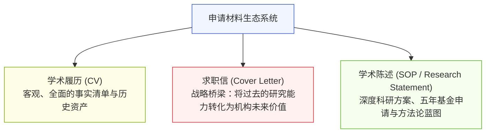
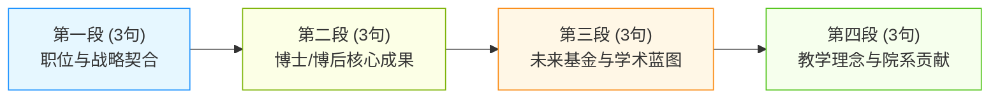
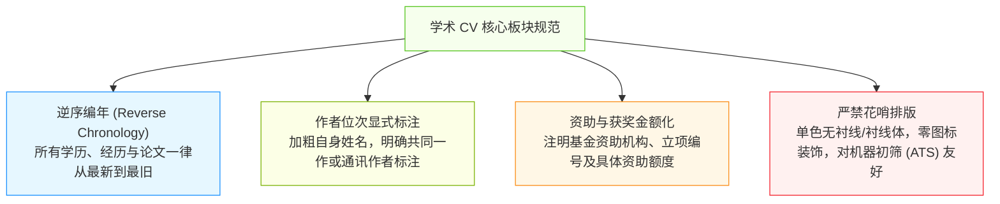
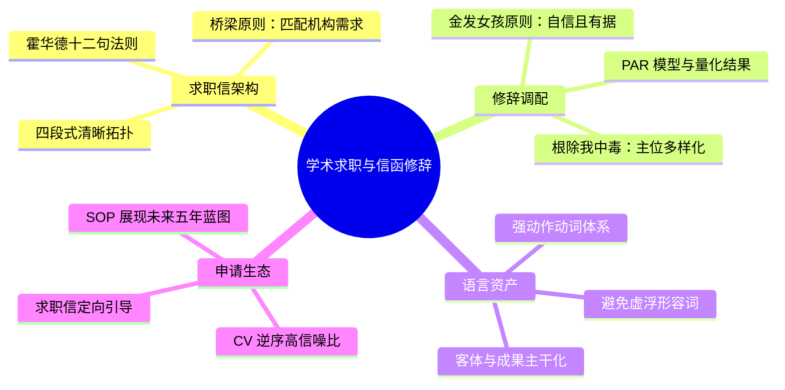

# Lec 6 学术求职信、履历（CV）与陈述信

> MIT 21G.225 · 科技与工程高级写作工作坊 (ELS) · 主讲 Jane Dunphy

## TL;DR

- 学术求职信（Cover Letter）绝非履历（CV）的散文版复述，而是以“霍华德十二句法则”为骨架、链接过往科研与招聘机构未来蓝图的战略契合声明。
- 遵循 PAR（问题-行动-结果）叙事模型与强动作动词库，彻底根除开篇必用“I”的“我中毒（I-Poisoning）”语篇顽疾。
- 践行“金发女孩修辞策略（Goldilocks Strategy）”，在东亚式的过度谦逊与美式的过度自负之间找到坚实、自信且经得起推敲的专业语调平衡。

## 1. 求职信的定位与选拔委员会心理学

在高校教职招聘、博士后遴选或顶尖研发实验室的招募中，招聘委员会（Search Committee）面对的是数百份来自全球顶尖机构的申请材料。评审委员用于初筛每份材料的平均时间通常不超过两分钟。



很多非英语母语学者最大的误区，在于把求职信写成了一篇冗长的散文体简历流水账（*"First I went to Tsinghua, then I joined MIT, and I published 5 papers..."*）。求职信的核心功能不是罗列事实，而是**建立相关性（Establish Relevance）**——回答为什么你的特定技能树能够解决该院系当前急需突破的科研课题与教学缺口。

::: definition [求职信的“桥梁原则” (The Bridge Principle)]
桥梁原则指求职信必须在“申请人已做过的成果（What I have achieved）”与“目标机构正在谋求的未来（What the institution needs）”之间搭建不可替代的逻辑连接，证明申请人的入职将带来显著的边际增益。
:::

## 2. 霍华德“十二句法则”（Philip Howard's "A Dozen Sentences"）

牛津大学互联网研究院教授 Philip N. Howard 在 *Inside Higher Ed* 提出的“十二句求职信模型（A Dozen Sentences）”，被麻省理工等世界顶尖学府广泛采纳为学术教职信函的标准骨架。一篇两页纸的学术求职信，其主干逻辑可精确提炼为四个功能段落与十二个核心命题：



这一高度结构化的拓扑确保了评审委员在快速扫读时，能够在预期的段落位置瞬间抓取关键决策信息。

### 2.1 逐段句式功能分解

1. **第一段：身份与定制契合（Sentences 1–3）**：
   - **S1（声明意图）**：明确说明申请的具体职位全称、招聘编号及信息来源。
   - **S2（当前学术身份）**：概括当前的学术阶位、导师、毕业院校与预期答辩时间。
   - **S3（宏观契合点）**：单句提炼为什么你的跨学科背景与目标院系的战略方向（如特定实验室或战略研究计划）是天作之合。
2. **第二段：核心学术突破（Sentences 4–6）**：
   - **S4（核心贡献）**：用一句话概括博士或博士后阶段解决的最核心科学/工程问题。
   - **S5（方法论创新）**：陈述所开发的独特理论、算法、仪器或实证范式。
   - **S6（发表与同行认可）**：点出代表作所发表的顶尖期刊（如 *Nature*、*IEEE Trans*）或所获重要奖项。
3. **第三段：未来基金与五年蓝图（Sentences 7–9）**：
   - **S7（独立科研主线）**：明确未来 3-5 年建立独立课题组（PI）后的核心研究纲领。
   - **S8（外部资助计划）**：具体点出拟申请的国家级基金类别（如 NSF CAREER Award、NIH R01）。
   - **S9（院内交叉合作）**：具体指出目标院系内 1-2 位潜在合作教授的姓名与交叉结合点。
4. **第四段：教学、服务与行动收束（Sentences 10–12）**：
   - **S10（教学胜任力）**：列出既能教授的核心基础课，又能为该系创设的特色前沿选修课。
   - **S11（教学哲学与多元包容）**：一句话阐释如何指导多元背景的本科生与研究生开展科研。
   - **S12（致谢与面试期待）**：指出全套申请材料已备齐，表达对校园面试（Campus Interview）的期待。

## 3. 麻省理工求职修辞法则与 ELS 语法根治

在 MIT 21G.225 的《Job Application Letter Checklist》中，Jane Dunphy 归纳了非母语学者必须严格恪守的三大修辞与语用准则。

### 3.1 戒除“我中毒”（Curing "I-Poisoning"）

东亚学者在撰写第一人称英文信函时，常出现一种顽固的语篇疾病——**“我中毒（I-Poisoning）”**。即几乎每一个自然段、甚至段内的每一个句子，都机械地以第一人称代词 *"I"* 作为句首主语（如 *"I am writing... I received my PhD... I investigated... I also developed... I believe..."*）。在系统功能语言学（Systemic Functional Linguistics）中，句首位置被称为“主位（Theme）”，它决定了读者的认知聚焦点。通篇充斥着 "I" 作为主位，在母语评审眼中会呈现出严重的认知单调与不成熟感，显得写作者缺乏驾驭复杂学术语篇的句法弹药库。

为了彻底治愈“我中毒”，作者必须主动实施句式主位多样化（Thematic Variation）。可以通过将时间短语、实验环境、核心研究成果或分词状语前置，将第一人称代词从句首主位隐蔽到句中或从属分句中，让学术事实与客观环境成为引导演示的主角。

```mermaid
flowchart TD
    subgraph 我中毒病灶 (I-Poisoning)
        B1["I received my PhD from..."]
        B2["I investigated the thermal properties..."]
        B3["I also developed a novel sensor..."]
    end
    subgraph 修辞脱敏处方 (Syntactic Variation)
        A1["介词/状语前置：'During my doctoral research at MIT, ...'"]
        A2["成果作主语：'My investigation into thermal properties revealed...'"]
        A3["分词短语引导：'Having synthesized the novel sensor, we observed...'"]
    end

    style B1 fill:#fff1f0,stroke:#f5222d,stroke-width:1px
    style B2 fill:#fff1f0,stroke:#f5222d,stroke-width:1px
    style B3 fill:#fff1f0,stroke:#f5222d,stroke-width:1px
    style A1 fill:#f6ffed,stroke:#52c41a,stroke-width:1px
    style A2 fill:#f6ffed,stroke:#52c41a,stroke-width:1px
    style A3 fill:#f6ffed,stroke:#52c41a,stroke-width:1px
```

在实际修订过程中，消除“我中毒”的实战铁律是：**全信中以代词“I”作为首词的段落绝对不得超过半数，且单个段落内严禁连续两句话以“I”开头**。通过将学术成果、仪器平台或研究过程重构为语法主语（例如使用 *"My dissertation examined..."* 替换 *"I studied..."*），不仅能够瞬间提升文风的学术质感，更将评审者的注意力自然导向了研究本身的客观价值，而非申请人的个人自我表扬。

### 3.2 金发女孩修辞策略（The Goldilocks Strategy）

来自英国童话《金发女孩与三只熊》的“金发女孩原则（Not too hot, not too cold, just right）”，是衡量求职信语气（Tone）的核心尺度：

| 语调光谱 | 过度自卑/谦逊（Too Cold / Humble） | 金发女孩最佳平衡（Just Right / Assertive） | 狂妄自大（Too Hot / Arrogant） |
| :--- | :--- | :--- | :--- |
| **自我评价** | "Although I am only a junior researcher, I hope I might learn something from your prestigious department." | "My research in neuromorphic hardware positions me to expand your department's initiatives in edge intelligence." | "I am the foremost expert in neuromorphic circuits and will revolutionize your department." |
| **科研贡献** | "I was fortunate enough to assist my advisor with the paper..." | "I co-authored the *Nature Materials* study, leading the physical characterization and finite-element modeling." | "I alone solved the degradation problem that all other labs failed to address." |
| **教学陈述** | "I would be willing to teach whatever basic courses nobody else wants to teach." | "I am fully prepared to teach core undergraduate Thermodynamics while developing an elective in Nano-scale Heat Transfer." | "My teaching methods will single-handedly modernize your outdated curriculum." |

::: insight [自信与证据的联立方程]
真正的学术自信不需要依靠修饰性形容词（如 *brilliant*, *world-class*, *groundbreaking*）来壮胆，而是完全建立在**硬核事实与动词动作**之上。当你使用 *"engineered a scalable wafer-level packaging protocol that reduced thermal resistance by 38%"* 时，无需自我吹嘘“这是突破性成就”，数字与强动作动词本身已经向评审委员会证明了一切。
:::

### 3.3 PAR 叙事架构与强动作动词库

在解释过往研究或工业界实习时，严禁使用虚弱动词（如 *worked on*, *participated in*, *helped with*）。必须采用 **PAR 架构（Problem - Action - Result）**，并驱动高阶动作动词：

::: definition [PAR 叙事模型]
- **Problem（问题/挑战）**：当时领域面临的卡脖子物理极限、算法瓶颈或工程成本危机；
- **Action（自主行动）**：你具体采取的设计路线、数学建构、实验干预（使用强动词）；
- **Result（可量化收益）**：带来的性能提升倍数、发表的顶会论文、获批的专利或工业界转化。
:::

- **系统设计与架构**：*Spearheaded, Architected, Engineered, Synthesized, Formulated, Overhauled*
- **实验与量测优化**：*Calibrated, Quantified, Benchmarked, Optimized, Disentangled, Streamlined*
- **领导与协作驱动**：*Mobilized, Negotiated, Mentored, Orchestrated, Liaised, Consolidated*

## 4. 学术履历（CV）与陈述信（SOP）的规范

在学术求职与高端科研岗位申请中，学术履历（Curriculum Vitae, CV）与学术陈述信（Statement of Purpose / Research Statement, SOP）构成了求职信的深度专业支撑。许多初入学术圈的研究者经常混淆工业界简历（Resume）与学术履历（CV）的根本差异。

工业界简历通常是精简的 1 至 2 页快照，强调直接相关的短期项目技能与商业结果；而学术 CV 则是一份穷尽性的、严肃的学术生涯终生档案（Living Scholarly Record），其篇幅不受 1-2 页的限制，全面记录学者的教育背景、同行评审期刊论文、学术专著、获批专利、受邀国际会议报告、科研基金资助以及学术共同体服务记录。两者的定位差异决定了其排版逻辑与信息密度的不同。

### 4.1 CV 的信噪比与逆序编年法则

学术 CV 的核心设计追求是极致的“高信噪比（Signal-to-Noise Ratio）”。评审委员会委员需要在几十秒内准确评估申请人的学术产出阶梯、期刊档次以及国际同行影响力。任何破坏视觉扫描流畅度的装饰性元素（如个人大头照、彩色技能进度条、繁复的图标装饰或多栏报刊式排版）在严肃学术评审中都会被视为极不专业的业余表现。

规范的学术 CV 必须建立严谨的视觉层级，确保每一项学术资产都具备可溯源的元数据，并在时间维度上形成无可挑剔的逻辑链条。



在排版与内容架构的具体执行中，学者须注意以下四项硬性标准：
1. **严格的逆序编年（Reverse Chronological Order）**：所有学术经历与成果必须一律从当前（最新年份）向过去倒序排列，让评审人首先看到申请人最近期、最具代表性的学术活跃度。
2. **论文清单的精准分类与作者标注**：严禁将正式同行评审期刊（Peer-reviewed Journal Articles）、顶级会议论文（Refereed Conference Proceedings）、受邀综述（Invited Reviews）以及预印本（Preprints）混杂成一锅粥。必须单列子标题清晰区分，并在所有条目中**将自身姓名加粗**，若存在共同第一作者或通讯作者，必须在条目末尾用星号明确注释说明。
3. **基金项目与学术荣誉的量化透明**：列出科研资助（Grants & Fellowships）时，必须注明资助机构全称、项目编号、个人承担角色（PI, Co-PI 或 Key Personnel）以及具体的资助总金额（如 *$450,000*），展现自身独立汲取科研资源的能力。
4. **机器筛选与排版兼容性**：当代科研机构与工业界初筛广泛采用申请人追踪系统（ATS），多栏排版与复杂嵌套表格极易导致解析错乱。采用标准的单栏无衬线（如 Arial, Helvetica）或经典衬线体（如 Times New Roman, Garamond），保持 1 英寸标准页边距，是对人类评审与算法系统最安全的双重保障。

## 5. 本讲总结与实操检视表



### 课后求职信修改自检清单

- [ ] 是否确认了招聘委员会主席的具体称谓（如 *"Dear Professor Miller and Members of the Search Committee:"*），而非机械泛称？
- [ ] 第一段是否在前两句内准确指明了所申请职位的全称与编号？
- [ ] 是否统计了全信以“I”作为首词的段落？是否严格少于 50%？
- [ ] 介绍过往科研时，是否遵循了 PAR 模型，给出了明确的问题边界、个人行动与可复算的量化收益？
- [ ] 是否全文清除了 *helped*, *worked on*, *participated in* 等虚弱动词，换用了具备工程穿透力的强动作动词？
- [ ] 在陈述未来计划时，是否具体提到了目标院校的 1-2 位潜在合作学者姓名或现有科研平台的名称？
- [ ] 语气是否处于“金发女孩平衡点”——既无东亚式“自谦贬损”，又无狂妄自大的空洞承诺？

## 6. 我的理解与批判性反思

学术求职信的撰写过程，本质上是一名青年学者从“学生思维”向“独立学者思维”蜕变的精神洗礼。

1. **从“索取者”到“合伙人”的心理转向**：
   学生在申请研究生或初级职位时，潜意识中往往将自己置于“向导师求学、请求给予培养机会”的被动位置。但在学术教职或高级工业研究员申请中，招聘机构寻找的是能够带来独立科研经费、能指导研究生、能支撑系所教学声誉的“初级合伙人（Junior Partner）”。如果求职信充斥着“希望在您系学到先进技术”的幼稚表述，几乎注定被淘汰。学者必须展现出“我能为该机构带来何种独特价值”的合伙人姿态。
2. **克服中式谦逊背后的“修辞赤字”**：
   在儒家文化熏陶下，“居功不傲”、“将功劳全部归于集体”被视为优良美德。然而，在以契约和个人明确贡献为根基的西方学术招聘中，如果申请人通篇写 *"We observed..."*、*"The lab discovered..."*，甚至在求职信中刻意隐去自己在论文中的核心主导作用，选拔委员会只能推定你只是一个执行具体操作的边缘技术员。学会准确界定并勇敢宣示自己的独创贡献，是保护自身学术产权与职业前途的必备技能。
3. **十二句法则背后的信息密度美学**：
   能够用十二句话把过去数年的学术精华与未来五年的战略规划交代得滴水不漏，考验的是极高的思维压缩比与语言提纯能力。学术界最顶级的智慧往往展现于对繁复事实的极致抽象。把一份数十页的学术履历蒸馏为一张严密、有力、充满张力的求职信，本身就是研究者工程建模与逻辑架构能力的最硬核展示。
