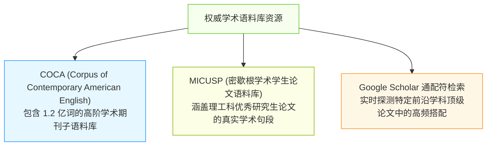
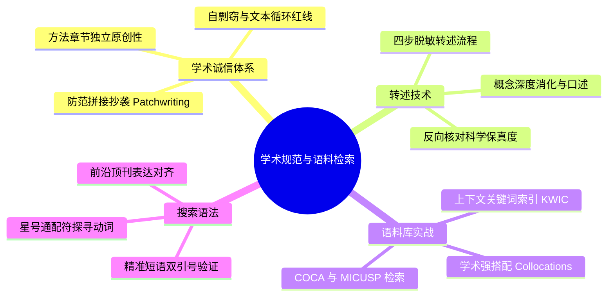

# Lec 7 论文架构规范、防范剽窃与语料库搭配检索

> MIT 21G.225 · 科技与工程高级写作工作坊 (ELS) · 主讲 Jane Dunphy

## TL;DR

- 学术抄袭不仅限于字对字抄录，还涵盖“拼接式改写（Patchwriting）”、隐性复用前人思想架构以及自剽窃（Self-Plagiarism）。
- 掌握合法转述（Paraphrasing）的“四步脱敏法”，彻底摆脱机械替换同义词的伪改写陷阱，实现对原文思想的消化与概念重构。
- 善用学术语料库（COCA、MICUSP）与精准检索语法，以索引行（KWIC）和高频学术搭配（Collocations）解决非母语写作者的用词生硬与介词搭配焦虑。

## 1. 学术规范、伦理防线与剽窃的光谱模型

在国际科技出版共同体中，学术诚信（Academic Integrity）是不可逾越的红线。许多非英语母语科研人员并非故意学术不端，而是由于对学术规范的边界认知模糊，导致论文在经过 Turnitin 或 Crossref 查重时遭遇严重学术危机。

```mermaid
flowchart LR
    subgraph 剽窃光谱模型 (The Plagiarism Spectrum)
        P1["直接逐字照抄<br/>(Verbatim Theft)"] --> P2["拼接式改写<br/>(Patchwriting)"]
        P2 --> P3["观点窃取与漏引<br/>(Idea Borrowing w/o Citation)"]
        P3 --> P4["自剽窃与重复发表<br/>(Self-Plagiarism)"]
    end

    style P1 fill:#fff1f0,stroke:#f5222d,stroke-width:1px
    style P2 fill:#fff7e6,stroke:#fa8c16,stroke-width:1px
    style P3 fill:#fcffe6,stroke:#7cb305,stroke-width:1px
    style P4 fill:#e6f7ff,stroke:#1890ff,stroke-width:1px
```

根据伊利诺伊大学 Michael C. Loui 教授在《Science and Engineering Ethics》中的经典分类以及 Miquel Roig 的 26 条学术规范指南，剽窃呈现为一个从粗暴到隐蔽的连续光谱。

::: definition [拼接式改写 (Patchwriting)]
语言学家 Rebecca Moore Howard 提出的概念，指写作者虽然对源文本进行了微调（如替换个别同义词、删减修饰成分或调整从句语序），但其句法主干、论证节奏与专业短语组合依然完全依赖源文本的修辞寄生现象。在国际出版界，未经直接引号引用的 Patchwriting 会被一律判定为抄袭。
:::

### 1.1 常见的学术不端误区

1. **同义词替换伪装**：仅仅使用 Word 或 ChatGPT 将句中的 2-3 个名词或动词换成同义词，句式完全不变。
2. **方法章节的“免死金牌”错觉**：误以为“实验步骤反正都是公认的，复制粘贴前人甚至自己过往论文的 Methods 章节不算抄袭”。现代出版伦理明确规定：除非引用标准协议（Standard Protocols）并明确出处，否则方法描述同样必须独立成文。
3. **自剽窃（Self-Plagiarism / Text Recycling）**：未经披露将自己此前已发表会议或期刊论文的整段文字复用到新论文中。一旦论文发表，作者通常已将版权转让给出版商，未经引注的自我文字复制不仅违背学术道德，还涉及版权法律侵权。

## 2. 合法转述的“四步脱敏法”（Legitimate Paraphrasing）

转述（Paraphrasing）是科研写作中最高频的文献引注技巧。优秀的转述不仅能够向读者证明你完全理解了参考文献的机理，更能将他人的研究顺畅无缝地编织进你自身的论证脉络中。

```mermaid
flowchart TD
    S1["第一步：深度研读与意图解构<br/>彻底读懂原作者的核心主张、实验依据与逻辑边界"] --> S2["第二步：盲写重构 (Look Away)<br/>合上原文，脱离视觉依赖，凭记忆向虚拟同行口述其逻辑"]
    S2 --> S3["第三步：句法与焦点重塑<br/>调整信息包装视角，将原文结论整合为支撑己方论述的证据"]
    S3 --> S4["第四步：溯源校对与权威引注<br/>重新对照原文核实有无概念扭曲，并严格附上标准引用标识"]

    style S1 fill:#f0f5ff,stroke:#2f54eb,stroke-width:1px
    S2 fill:#fcffe6,stroke:#7cb305,stroke-width:1px
    S3 fill:#fff7e6,stroke:#fa8c16,stroke-width:1px
    S4 fill:#f6ffed,stroke:#52c41a,stroke-width:1px
```

这套“脱敏机制”的核心在于切断视网膜对原句字词的短期记忆依赖。只有当研究人员强迫自己合上论文窗口、通过口述或笔记重新提炼信息时，大脑才会动用深层认知网络，生成真正属于自己的全新句法架构。

::: example [转述质量进阶三段式对比]
- **原始文献片段**（源自一篇关于材料抗拉强度的论文）：
  > *"The incorporation of graphene nanoplatelets into the epoxy matrix significantly enhances the fracture toughness by impeding crack propagation along the interface."*
- **不合格的拼接抄袭（Patchwriting）**：
  > *"The addition of graphene platelets into the epoxy resin remarkably improves the fracture resistance by hindering crack growth along the boundary."*（词汇机械替换，语法骨架 100% 吻合，构成查重学术违规）
- **合格的深度转述（Synthesized Paraphrase）**：
  > *"When graphene nanoplatelets are embedded within polymer systems, the composite demonstrates superior resistance to structural failure because the interfaces effectively arrest advancing micro-cracks (Zhang et al., 2024)."*（句型彻底重构为条件状语从句与因果解释，保留核心物理概念，逻辑清晰且合规引注）
:::

::: pitfall [转述过程中的“概念漂移”]
在努力改变句式时，写作者最容易犯的另一极端错误是“篡改了原作者的科学结论”。例如原作者指出 *"The drug inhibited tumor growth in 65% of murine models"*，转述者若粗心写成 *"The drug has been proven to cure cancer in animals"*，便严重背离了客观科学事实。改写后必须执行“保真度反向校验”。
:::

## 3. 语料库语言学（Corpus Linguistics）在科技写作中的实战

很多母语为中文的工程师在起草英文论文时，常常因不确定介词搭配、学术动词选型或学科惯用习语而陷入苦思。传统的双语词典往往提供脱离语境的死板翻译，而现代语言学为我们提供了极具威力的实证工具——**学术语料库（Academic Corpora）**。

在 Nigel A. Caplan 的《Grammar Choices for Graduate and Professional Writers》第七单元中，语料库检索被列为专业研究生的必备写作技能。



语料库的本质是数以亿计的真实母语出版物文本索引。写作者不再依赖个人的模糊语感，而是通过大数据统计概率，直接确认某一专业词汇在顶级学术同行中的地道搭配方式。

### 3.1 搭配（Collocation）与关键词索引（KWIC）

词汇从来不是孤立存在的，它们在长期的学术交往中形成了稳固的共现搭配伙伴（Collocates）。

::: definition [学术搭配 (Academic Collocation)]
指两个或多个词在学术语篇中以显著高于随机偶然的概率频繁共同出现的组合形式。例如在自然科学论文中，动词 *formulate*、*test*、*support* 与名词 *hypothesis* 构成强学术搭配；而使用 *"do a hypothesis"* 则是典型的中式 Chinglish 生造搭配。
:::

利用语料库进行 **KWIC（Key Word In Context，上下文关键词索引行）** 检索时，系统会将检索词置于屏幕中央，并在左右两侧罗列数十条来自真实文献的切片：

```text
... our findings strongly SUPPORT THE HYPOTHESIS that neural plasticity decreases ...
... subsequent experiments TESTED THE HYPOTHESIS by introducing a kinase inhibitor ...
... we propose a model to FORMULATE A HYPOTHESIS regarding thermodynamic flux ...
... the empirical evidence REFUTES THE HYPOTHESIS of instantaneous phonon transfer ...
```

通过审视这些索引切片，写作者能够瞬间掌握该动词支配的介词（*in*, *with*, *under*）、常伴随的副词修饰语（*strongly*, *partially*）以及后接从句的具体时态。

### 3.2 必备检索技巧与通配符语法

在缺乏专业语料库高级账号时，利用学术搜索引擎（如 Google Scholar）的双引号与通配符，同样可以达到极高精度的搭配验证效果：

1. **精确短语锁定（双引号 `""`）**：
   - 验证介词搭配：搜索 `"compatible with the model"` 与 `"compatible to the model"`。前者会返回数百万条顶刊结果，而后者极少，从而立即确立标准介词为 *with*。
2. **通配符补全（星号 `*`）**：
   - 寻找合适的学术动词：搜索 `"further research is * to understand"`，结果中会高频涌现 *warranted*, *needed*, *required*，直接为你提供典范的句型库存。
3. **学科动词探针**：
   - 当想表达“填补缺口”时：搜索 `"bridge the gap between * and *"` 或 `"address the discrepancy in"`，观察同行在你的特定子领域中最常采用哪种表达方式。

::: insight [语料库驱动的“学术语感外脑”]
许多非母语学者终其一生都在与“记不住英语固定搭配”搏斗。事实上，当代优秀的科研作者从不把大脑当作死记硬背的硬盘，而是把语料库与前沿文献检索当作自己的“外挂学术语感”。当你遇到介词犹豫、动词拿不准时，花 30 秒进行语料库索引，比拍脑袋盲目自信更具工程严谨性。
:::

## 4. 本讲总结与实操检视表



### 课后论文规范自检清单

- [ ] 检查文献引用：所有转述他人的论断，是否都附带了明确的作者与年份（如 *Smith et al., 2023*）？
- [ ] 检查改写段落：是否存在仅调换了 2-3 个同义词但句式架构与原文高度一致的“拼接式抄袭（Patchwriting）”？
- [ ] 检查自引文本：是否直接复制了自己已发表硕士论文或会议长文中的整段文字？若是，是否已进行了重新转述并注明出处？
- [ ] 检查专业动名词搭配：是否对模糊的短语动词（如 *bring about*, *come up with*）进行了语料库检索，并替换为了精准学术用词（如 *yield*, *elucidate*）？
- [ ] 检查介词搭配：是否通过通配符或语料库索引验证了所有学术动词与形容词所后接的特定介词？

## 5. 我的理解与批判性反思

学术诚信与语料库工具的结合，揭示了当代学术写作从“艺术创作”向“严密工程规范”演进的深刻本质。

1. **中国教育背景下的“记忆性引用”文化脱敏**：
   在中国传统人文教育中，熟读并背诵名家名篇被视为最高级的学养，在文章中化用古人原句往往是博学的体现。然而在以罗马法与现代知识产权为法理基础的现代西方科研体系中，这种潜意识中的“默写化用”构成了巨大的职业雷区。学术界对知识产权的界定细致到每一个具体的句法排列。学者必须在心理底层完成认知切换：**任何不是你自己大脑独立生成的句法结构，只要没有加引号并给出页码，就是对他人知识劳动的非法侵占**。
2. **“拼接式改写”是学术语言不自信的病态代偿**：
   绝大多数研究者之所以陷入 Patchwriting，根本原因不是品格败坏，而是“语言自卑”——他们担心一旦脱离了 Native Speaker 精妙的句式，自己写出的句子就会错误百出。语料库工具的出现彻底瓦解了这一困境。通过语料库，我们借鉴的不是某位具体学者的特定句子，而是整个科学共同体沉淀下来的“公共语块（Shared Lexical Bundles）”。掌握了公共语块，青年学者就能挺起胸膛，用合规、典雅且完全属于自己的语言从容阐述真知灼见。
3. **查重软件的局限与学者良知的底线**：
   现代科研管理过度依赖 Turnitin 或 iThenticate 的重复率百分比（如低于 15% 即可放行）。然而，算法只能识别人类可见文本的字符匹配，却无法检测深层的“思想偷窃（Idea Plagiarism）”。有些投机者利用 AI 工具重写规避了查重算法，但其核心构想与推导脉络完全是对他人的掠夺。工具只能兜底技术规范，真正的学术尊严永远维系在学者对探索未知的诚实与对同侪劳动的最高敬畏之中。
