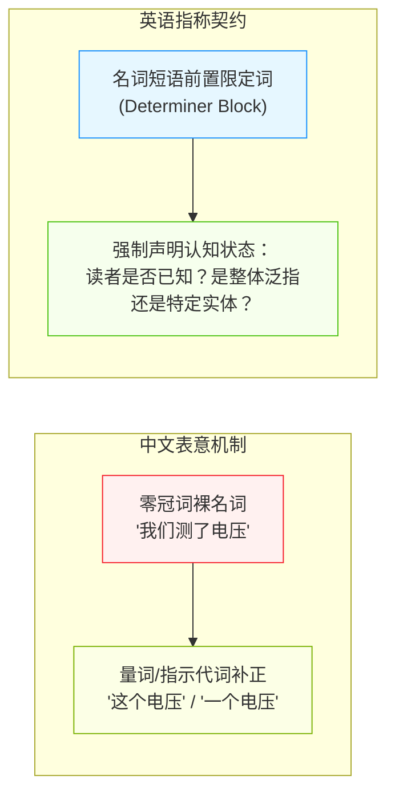
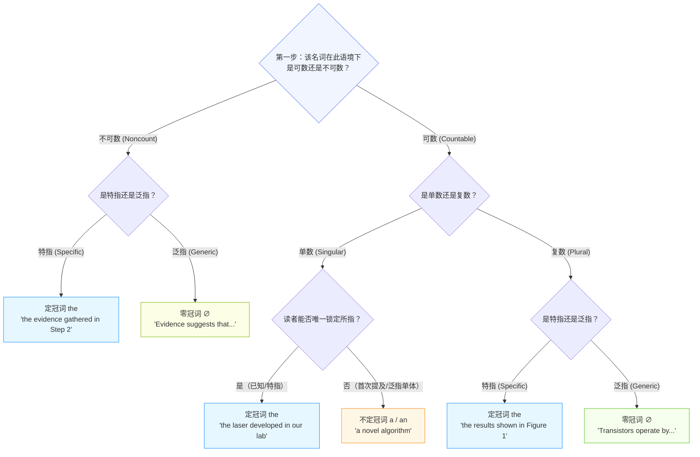
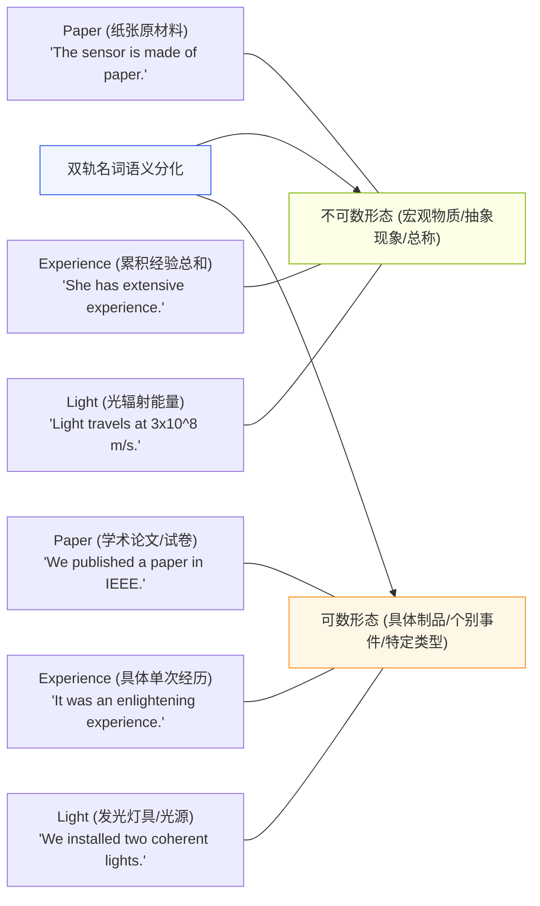
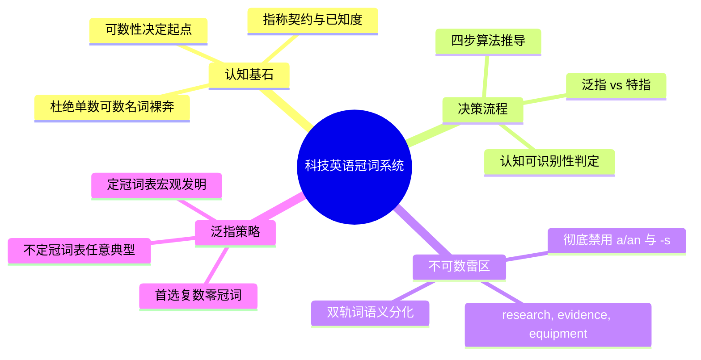

# Lec 8 科技英语冠词系统精解：定冠词、不定冠词与零冠词

> MIT 21G.225 · 科技与工程高级写作工作坊 (ELS) · 主讲 Jane Dunphy

## TL;DR

- 英语冠词（*a/an*, *the*, $\varnothing$）是标记名词“可数性”与“认知已知度（Identifiability）”的精密指称系统，中文母语者必须摆脱“无形态对应”的直觉盲区。
- 遵循“科技写作冠词四步决策树”，先判定概念的可数性与泛指/特指性，再根据单复数与语境共有知识做出严密推导。
- 严密辨识科技文献中的“不可数陷阱词”（如 *research*, *evidence*, *equipment*, *software*），并掌握复数零冠词在表征科学普遍规律时的首选地位。

## 1. 冠词认知模型与跨语言概念鸿沟

在母语为中文的科研人员提交的英文稿件中，冠词错误（多用、漏用、错用）在语法错误统计中常年占据 50% 以上的极高比例。正如 Nigel A. Caplan 在《Grammar Choices for Graduate and Professional Writers》第五单元中所指出的，冠词并非装饰性的虚词，而是英语句子中极其关键的**指称协议标记（Referential Agreement Markers）**。

中文缺乏形态化的冠词范畴，名词自身即可独立充当主语或宾语，其特指还是泛指完全依赖上下文语境或“这/那”等指示代词。而在现代英语中，单数可数名词在绝大多数情况下**绝不能裸奔（Bare Noun）**，必须显式配备限定词（*a/an*, *the*, *this*, *my* 等）。

::: definition [指称可识别性 (Identifiability / Givenness)]
指称可识别性指写作者向读者传递的关键信号：当前讨论的名词所代表的实体，在读者的认知工作记忆中是否能够被唯一锁定。若读者可以根据上文提及、现实唯一性、后置修饰限制或常识确定具体所指，必须使用定冠词 *the*；若只是某一类别的非特指成员，则使用不定冠词 *a/an* 或复数零冠词 $\varnothing$。
:::

## 2. 科技写作冠词四步决策树（The Article Decision Tree）

为了将复杂的语法直觉转化为工程师易于执行的确定性算法，麻省理工写作中心与 Caplan 归纳了科技文本中的“冠词推导决策树”。

这一算法的执行起点不是盲目猜测加不加 *the*，而是首先确立名词在当前专业语境下的“可数性”特征。只要理顺了这一拓扑分支，绝大多数冠词疑难便可迎刃而解。

### 2.1 决策四步法实战步骤

1. **第 1 步：查验名词可数性（Countability Test）**：
   - 尝试在词前加数字（*one, two, three*）或加复数后缀 *-s*。若不符合现代学术规范（如不可说 *two equipments* 或 *three researches*），则坚决划归不可数分支。
2. **第 2 步：审定指称范围（Generic vs. Specific）**：
   - 该词指的是“全世界所有该类事物”（泛指），还是“本次实验/本文所特指的那一部分”（特指）？
3. **第 3 步：检索认知记忆（The Mental Identification Test）**：
   - 读者在读到这个词时，头脑中能否立刻指认出“是哪一个”？如果能够唯一指认（例如有后置定语从句限制，或整个实验室只有一台该设备），立即加 *the*。
4. **第 4 步：单复数与语音核对（Phonological Check）**：
   - 选用 *a* 还是 *an* 完全取决于随后首个发音是否为元音音素（Vowel Sound），而非拼写字母（如 *a unique property*，因为 /j/ 是辅音；*an NMR spectrum*，因为字母 N 读音为 /en/，首音素是元音）。

## 3. 科技论文中的不可数“黑洞词”与双轨词

中国学者最容易失误的阵地，是将母语中被视为可数概念的词汇，套用到英语的不可数名词中。

### 3.1 绝对不可数名词黑名单

以下名词在标准科技学术英语中**一律不可数**，严禁使用不定冠词 *a/an*，严禁加复数后缀 *-s*：

| 不可数核心词 | 典型中国学者错误写法 | 国际科技学术标准修正方案 |
| :--- | :--- | :--- |
| **Research** | *conducted a research* / *many researches* | *conducted research* / *a study* / *several research projects* |
| **Evidence** | *an evidence* / *many evidences* | *a piece of evidence* / *substantial evidence* / *the evidence* |
| **Equipment** | *an equipment* / *new equipments* | *a piece of equipment* / *new apparatus* / *devices* |
| **Information** | *an information* / *many informations* | *information* / *data items* / *pieces of information* |
| **Software** | *a software* / *many softwares* | *software* / *a software package* / *software applications* |
| **Literature** | *read a literature* / *recent literatures* | *read the literature* / *a paper* / *recent publications* |

::: pitfall [“Data” 的单复数现代规范]
拉丁文词源中 *datum* 为单数，*data* 为复数。在当代理工科顶刊（如 *Nature*, *IEEE Transactions*）中，主流规范依然将 *data* 视作复数名词（*"These data show..."*），但在计算机科学与部分工程领域，*data* 作为不可数集体名词（*"The data is processed..."*）的接受度正逐渐上升。作为非母语学者，最稳健的做法是始终将其作为**复数**处理（*The data demonstrate...*），避免激怒传统保守派审稿人。
:::

### 3.2 词义双轨名词（Countable / Uncountable Shifts）

在科技语篇中，许多物理、工程与计算学科名词呈现出“可数与不可数双轨并行”的特征。写作者不能机械地将一个单词死记为“绝对可数”或“绝对不可数”，而必须根据其在具体句子中所指代的“抽象质量/物质流”还是“离散实体/特定个体”来进行灵活判定。

这种词义分化在英语认知语法中被称为“质料到个体的概念压制（Conceptual Coercion）”。当名词表征无明显外在边界的物理现象、能量流动、化学材料或经验总和时，该词以不可数形态出现，不加不定冠词；而一旦该概念被聚焦为某个具体的工程试样、单次独立事件、特定发光器件或具象学术成果时，名词便被“压制”为可数名词，必须遵循标准单复数限定词契约。

除了图示中的典型案例外，科技论文中还广泛存在其他学科双轨词：
- **Glass**：作为不可数物质名词表示“玻璃材料”（如 *"The lens is fabricated from optical glass."*）；作为可数名词表示“玻璃器皿或杯子”（如 *"Prepare three clean glasses for titration."*）。
- **Conductivity**：作为不可数宏观物理性质表示“导电率”（如 *"The material exhibits high electrical conductivity."*）；而在比较不同材料的具体导电类型或导电模式时，可转化为可数名词（如 *"The conductivities of the three alloy variants differ significantly."*）。
- **Noise**：在信号处理中作为不可数概念表示“系统白噪声或背景干扰”（如 *"The filter suppresses thermal noise."*）；而在指代特定声源发出的离散偶发杂音时，可作为可数名词使用（如 *"Spurious noises were detected during the startup cycle."*）。

准确识别这些双轨词的修辞意图，能够帮助研究人员在宏观理论阐释与微观实验测量之间实现语法维度的无缝切换。

## 4. 科学泛指（Generic Reference）的三种修辞形态

在陈述科学原理、定义与普遍规律时，学术英语允许使用三种不同的泛指形态，但它们在科技共同体中的语体色彩截然不同。

1. **复数零冠词（Plural with Zero Article）—— 科技写作首选王者**：
   - *例句*：*"Semiconductors exhibit variable electrical conductivity."*
   - *语用评价*：这是现代自然科学与工程论文中**最标准、最自然、最无歧义**的泛指方式。它直接指代该类别的全体成员，完全避免了单数冠词的纠缠。
2. **定冠词加单数（Definite Singular）—— 抽象发明与宏观门类**：
   - *例句*：*"The transistor revolutionized modern computing."*
   - *语用评价*：强调该技术或物种作为一个抽象历史发明或科学体系的整体，常用于科技史综述、宏观引言（如 *The microprocessor*, *The internal combustion engine*）。
3. **不定冠词加单数（Indefinite Singular）—— 任意典型个体代表**：
   - *例句*：*"A capacitor stores electrical energy in an electric field."*
   - *语用评价*：强调“只要是该类别的任意一个合格个体，都必定具备这一性质”。

::: insight [中国学者泛指写作的最优安全策略]
在撰写科技论文中的定理、背景与普遍结论时，**默认使用“复数名词 + 零冠词（Plural + $\varnothing$）”是成功率最高、出错率最低的黄金策略**。只要将概念写成复数形式（如 *Nanotubes are...*, *Algorithms require...*, *Catalysts speed up...*），你就无需再为选择 *a* 还是 *the* 耗费半秒脑力，同时完美契合当代主流期刊的文风预期。
:::

## 5. 本讲总结与实操检视表

### 课后冠词专项修改清单

- [ ] 检索全文中的 *research*, *evidence*, *equipment*, *software*, *literature*：是否存在误加 *a/an* 或误加 *-s* 的情况？
- [ ] 检查所有单数可数名词：是否存在既没有 *a/an*，也没有 *the*，也没有物主代词的“裸奔”病句？
- [ ] 检查普遍性科学命题：是否优先采用了“复数名词 + 零冠词”（如 *Neurons transmit signals...*）？
- [ ] 检查 *the* 的使用合理性：句子后部是否有 *of...* 介词短语或定语从句限制了该名词的范围（如 *the efficiency of the cell*），使其必须具备定冠词？
- [ ] 检查不定冠词音标：如 *a uniform distribution*（辅音音素 /j/ 用 *a*），*an ultrafast pulse*（元音音素 /ʌ/ 用 *an*），音素判定是否无误？

## 6. 我的理解与批判性反思

冠词虽小，却是窥探印欧语系与汉藏语系世界观差异的最深窗口。

1. **“实体独立性”与“边界确定性”的哲学透镜**：
   西方近代科学诞生于形式逻辑与还原主义土壤中，其语言体系要求每一个实体在出场的瞬间，必须交代其“边界”（可数还是不可数）与“在读者心智中的存在状态”（已知还是未知）。中文是一种重意合、轻形态的整体性语言，我们更关注事物之间的动态流转与宏观气象。因此，中国学者写英文冠词的困难，本质上不是词汇量问题，而是在下笔构句的每一微秒，大脑是否切换到了“离散化、定标化与边界明确化”的西方逻辑齿轮之中。
2. **“不可数名词”背后的学科隐喻**：
   为什么 *research* 和 *evidence* 在英语中是不可数的？因为在西方学术哲学中，*research* 被视为人类探索未知的一个持续流动、无边界的累积性“质料（Mass/Substance）”，而不是一块块可数的地砖；*evidence* 是支撑法庭或科学论证的证据流总和，必须用 *pieces of evidence* 来度量。理解了这一语言学隐喻，学者们便无需再死记硬背不可数规则，而是从认识论层面自然体会到用词的理据性。
3. **精准冠词是构建学术公信力的第一道防线**：
   在国际顶级审稿人眼中，高阶的方法论和精美的插图固然是论文的核心，但如果第一段的冠词错误多达三四处（如写出 *In this paper, we propose a novel method to solve the traffic problem, which is an important research...*），审稿人在潜意识中会立即给论文打上“粗糙、缺乏严格学术训练”的负面心理标签。彻底攻克冠词壁垒，是青年学者迈向国际学术自主、赢得同行专业尊重的最基础也是最坚固的铠甲。
