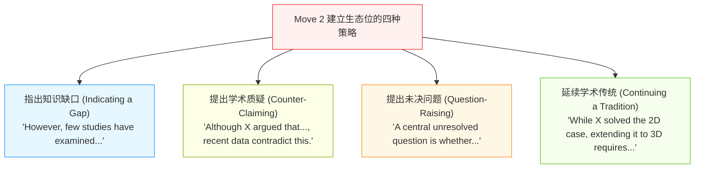
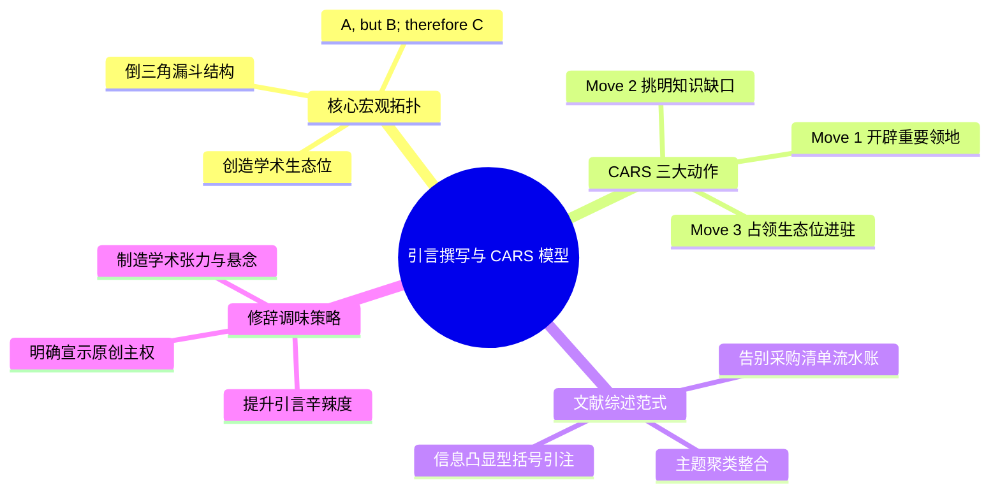

# Lec 9 学术论文引言与斯韦尔斯 CARS 漏斗模型

> MIT 21G.225 · 科技与工程高级写作工作坊 (ELS) · 主讲 Jane Dunphy

## TL;DR

- 学术论文引言（Introduction）的本质是“开辟学术领地（CARS 模型）”，遵循“A（既有领地），但 B（知识缺口）；因此 C（本研究工作）”的倒三角漏斗拓扑。
- 彻底摒弃清单式文献罗列（Shopping List），采用“主题聚类（Thematic Clustering）”与“信息凸显型引注”展现对学科前沿的批判性整合。
- 熟练运用轻度反驳、指出缺口与延伸传统的修辞话语，破除东亚学者因回避学术冒犯而不愿宣称原创领地的心理障碍。

## 1. 引言的修辞博弈与沙漏宏观模型

在科技论文写作中，引言（Introduction）通常被公认为最具智识挑战性的章节。与描述客观操作的方法（Methods）或汇报测量数值的结果（Results）不同，引言承载着强烈的**修辞说服任务（Rhetorical Persuasion）**：作者必须向挑剔的审稿人证明，当前领域存在一个不可忽视的重大科学缺口，而本论文所采取的方案具有独一无二的研究价值。

```mermaid
flowchart TD
    subgraph 经典 CARS 漏斗模型 (Create A Research Space)
        M1["Move 1: 开辟研究领地 (Establishing a Territory)<br/>申索研究重要性 + 梳理领域宏观进展"] --> M2["Move 2: 建立学术生态位 (Establishing a Niche)<br/>指出认知盲区 / 揭示理论矛盾 / 提出新挑战"]
        M2 --> M3["Move 3: 占领生态位 (Occupying the Niche)<br/>阐明本文研究目标 + 核心发现 + 论文章节指引"]
    end

    style M1 fill:#f0f5ff,stroke:#2f54eb,stroke-width:1px
    style M2 fill:#fff1f0,stroke:#f5222d,stroke-width:1px
    style M3 fill:#f6ffed,stroke:#52c41a,stroke-width:1px
```

密歇根大学语言学教授 John Swales 提出的 **CARS 模型（Create A Research Space，创造研究空间）**，揭示了全球顶尖学术期刊引言的通用语法。Jane Dunphy 将其高度概括为一个极为精妙的逻辑公式：**“A, but B; therefore C”**。

::: definition [CARS 模型 (Create A Research Space)]
CARS 模型是应用语言学界解释学术引言宏观修辞结构的标准范式。它将引言解构为三个逻辑层层递进的动作（Moves）：Move 1 通过文献勾勒公认的重要领地；Move 2 通过挑明知识缺口建立自身立足的生态位；Move 3 宣告本文的进入并全面占领该生态位。
:::

## 2. CARS 三步法（The Three Moves）实战拆解

为了在微观句法层面落地 CARS 模型，作者需要掌握每一个 Move 内部的典型语言标记与句式推进模式。

### 2.1 Move 1：开辟研究领地（Establishing a Territory）

Move 1 的核心目的是拉近与读者的认知距离，表明本课题属于当代科学界共同关注的热点命题。作者通常通过以下三步递进：
- **Step 1：强调中心性（Claiming Centrality）**：使用动词短语声明该课题的重要地位（如 *"Knowledge of... is fundamental to...", "...has attracted widespread interest in recent years."*）。
- **Step 2：领域概括（Topic Generalizations）**：用现在时阐述当前学界公认的物理规律、工艺趋势或常识性基线。
- **Step 3：综述先前研究（Reviewing Prior Literature）**：系统回顾前人做出的主要贡献，搭建知识背景。

### 2.2 Move 2：建立学术生态位（Establishing a Niche）

Move 2 是整篇引言的修辞转折枢纽（The Rhetorical Pivot）。在 Move 1 中，作者通过系统梳理既有文献，向同行展示了该领域的繁荣景象与巨大价值；然而，如果领域已经尽善尽美，本篇论文的发表就失去了合法性。因此，作者在此处必须打破 Move 1 所烘托的“和谐盛世”，通过引入审慎而坚决的批判性反思，制造显著的认知张力（Cognitive Tension）。

在应用语言学语料库分析中，Swales 归纳了科技作者在建立生态位时最常用的四种修辞武器。不同学科与不同创新层级的论文，可以根据自身技术路线的激进程度灵活选用：



在这四种策略中，“指出知识缺口（Indicating a Gap）”是工程与自然科学中使用频次最高（占比超 70%）的标准手段。写作者通常借助于强转折连词（*However*, *Nevertheless*, *Despite these advances*）打破上文叙事节奏，随后紧跟负面评价动词短语或限定词（如 *remain poorly understood*, *is computationally prohibitive*, *lacks in situ experimental validation*, *suffers from catastrophic forgetting*），在学术前沿看似坚固的堡垒上精准凿开一个属于自己的突破口。

而对于颠覆性创新或实验结果与前人理论正面冲突的论文，“提出学术质疑（Counter-Claiming）”则是最强有力的战术。作者在此处需要格外注重措辞的审慎性（Hedging），避免攻击前人人格，而是将矛头对准前人模型的假设前提或早期仪器精度的历史局限性（例如 *"While classical nucleation theory assumes isotropic surface energy, recent cryogenic TEM observations suggest..."*），从而在保持崇高学术礼貌的同时，不可辩驳地确立自身的领先优势。

### 2.3 Move 3：占领学术生态位（Occupying the Niche）

在凿开缺口后，作者必须以第一人称主动担当的姿态（*In this work, we...*）宣告进驻：
- **声明本文目标（Announcing Purpose / Work）**：明确说明本项工作旨在解决 Move 2 所揭示的哪项具体瓶颈。
- **预告主要发现（Announcing Principal Findings）**：简要概括最亮眼的实验突破或理论推演（选填，在部分期刊中可作为 Hook）。
- **点明创新价值（Stating Research Value）**：交代该成果对基础科学或工程实践带来的实质推动。
- **论文结构指路（Outlining Article Structure）**：特别是在长篇工程或计算机论文中，简述后文各章节的组织分布（如 *"The remainder of this paper is organized as follows..."*）。

::: example [“A, but B; therefore C” 经典引言架构剖析]
- **[Move 1 - A: 既有领地]** Perovskite solar cells have achieved certified power conversion efficiencies exceeding 25%, establishing them as promising contenders for next-generation photovoltaics.
- **[Move 2 - B: 知识缺口]** *However*, their long-term operational stability remains severely hindered by moisture-induced phase degradation at grain boundaries under ambient conditions.
- **[Move 3 - C: 占领生态位]** *Here, we demonstrate* a molecular cross-linking strategy using a hydrophobic fluorinated diamine that passivates surface defect states and prevents moisture penetration.
:::

## 3. 引言的调味艺术：“平淡型”与“辛辣型”引言

Jane Dunphy 在 MIT 21G.225 中提出了引人深思的修辞光谱隐喻——“平淡型引言（Plain Introduction）”与“辛辣型引言（Spicy Introduction）”。

| 维度 | 平淡型引言 (Plain Introduction) | 辛辣型引言 (Spicy Introduction) |
| :--- | :--- | :--- |
| **开篇基调** | 干燥、线性、纯功能性汇报；直奔陈述句 | 具有鲜明叙事张力与认知悬念（Intellectual Tension） |
| **学术冲突** | 缺口呈现为平缓的流水账补充（"X did this, so we do Y"） | 缺口呈现为深刻的科学佯谬、理论对立或工程物理极限 |
| **动词选型** | 使用中性弱动词（*study*, *examine*, *test*） | 驱动高辨识度辨析动词（*disentangle*, *reconcile*, *challenge*） |
| **审稿人心理反应** | “这是一篇合格、平稳、可发可不发的常规论文” | “这是一个激动人心、解决了领域长期困惑的重大突破” |

青年学者应当在掌握平淡型标准规范的基础上，有意识地提升引言的“辛辣度”，通过将技术难点包装为对立学派的争鸣或不可调和的工程权衡（Trade-off），极大唤起审稿人的学术好奇心。

## 4. 文献综述的范式跃迁：告别“采购清单”

在撰写 Move 1 的文献综述时，初学者最容易陷入“采购清单式文献罗列（Shopping List Literature Review）”。

```mermaid
flowchart TD
    subgraph 糟糕范式：采购清单式罗列 (Author-Heavy Shopping List)
        A1["Smith (2020) investigated A and found B."] --> A2["Johnson (2021) examined C using method D."]
        A2 --> A3["Furthermore, Zhang (2022) measured E and observed F."]
    end
    subgraph 卓越范式：主题聚类与批判综合 (Thematic Synthesis)
        B1["提出核心机理矛盾或技术路线分野 (Topic Theme)"]
        B2["整合归纳：'Several physical models attribute this instability to interfacial strain (Smith, 2020; Johnson, 2021)...'"]
        B3["指出深层共性盲区：'Yet, these models consistently overlook non-equilibrium phonon transport...'"]
        B1 --> B2 --> B3
    end

    style A1 fill:#fff1f0,stroke:#f5222d,stroke-width:1px
    style A2 fill:#fff1f0,stroke:#f5222d,stroke-width:1px
    style A3 fill:#fff1f0,stroke:#f5222d,stroke-width:1px
    style B1 fill:#f6ffed,stroke:#52c41a,stroke-width:1px
    style B2 fill:#f6ffed,stroke:#52c41a,stroke-width:1px
    style B3 fill:#f6ffed,stroke:#52c41a,stroke-width:1px
```

清单式罗列在修辞学上被称为“作者凸显型堆砌（Author-Prominent Clutter）”。审稿人阅读文献综述不是为了看一份历史人员名单，而是为了审视你是否提炼出了文献背后的**学术争鸣脉络与机理边界**。

::: insight [信息凸显型引注的修辞威力]
优秀的学术文献综述应当以“科学论题”而非“学者姓名”统领主语位置：
- **低级清单式**：*"Smith (2018) synthesized nanoparticles. Lee (2019) improved the yield. Davis (2021) coated the surface."*
- **高级综合型**：*"Although nanoparticle yield has been improved through precursor modulation (Smith, 2018; Lee, 2019), surface functionalization remains largely restricted by thermal instability at elevated temperatures (Davis, 2021)."*
在高级范式中，学者姓名退居句尾括号之中（Information-Prominent），而科学现象、因果逻辑与理论瓶颈跃居为主语核心，展现出成熟的学术鸟瞰视角。
:::

## 5. 本讲总结与实操检视表



### 课后引言修改自检清单

- [ ] 是否在前两段内清晰完成了 Move 1（阐明了课题的重要现实或理论意义，未突兀地一上来就写具体代码或公式）？
- [ ] 是否在引言中设置了清晰可见的“转折枢纽”（如 *However*, *Despite*），明确勾勒出当前学界尚未解决的“知识缺口（Move 2）”？
- [ ] 知识缺口是否与后文本文提出的核心贡献（Move 3）形成严丝合缝的闭环对应？
- [ ] 检查文献引用：是否存在连续 3 个句子都以人名（*X et al.*）作为句首主语的清单式写法？是否已改写为“主题概念统领 + 句末括号聚合引注”？
- [ ] 在宣示本研究工作时，是否果断采用了第一人称主动语态（*In this study, we propose...*），文风是否兼具自信与严谨？

## 6. 我的理解与批判性反思

学术论文的引言不仅是一个章节，它是整篇研究的“战略立项书”。深入体悟 Swales CARS 模型背后的社会语言学内核，能够对学术竞争的本质形成深刻洞见：

1. **学术研究是“领地争夺”而非“自娱自乐”**：
   Swales 之所以选用 *Territory*（领地）和 *Niche*（生态位）这两个充满生物学与地缘政治色彩的词汇，深刻揭示了国际科学共同体的真实运行法则。全球有数以万计的科学家在同一赛道奔跑，读者与期刊版面资源是极其稀缺的。如果作者不能在引言中清晰证明“我所占领的这块领地前人未曾涉足，且具有极其重大的生态位价值”，论文就无法在同行评议中生存。
2. **克服中式“面子心理”与学术批评恐惧**：
   在华人文化圈中，尊师重道、避免公开否定前辈成果是深入骨髓的处世哲学。这导致许多中国年轻学者在写引言 Move 2 时极其拧巴，不敢明确指出国际前沿文献的缺陷，甚至使用极度模糊的客套话敷衍带过。然而，在西方学术传统中，精准指出已有文献的局限并非对前人的“人身攻击（Ad Hominem）”，恰恰是对其学术劳动的最高敬意——因为只有真正深刻的研究才值得被当作后续突破的跳板。科学正是在不断的“友善质疑与证伪”中螺旋上升的。
3. **引言是抵御论文退稿的第一道盾牌**：
   资深审稿人和期刊编辑在决定是否送审或给出拒稿意见时，往往在读完引言前三页时就已经形成了 80% 的心理倾向。如果引言平淡无奇、缺口牵强附会、文献综述杂乱无章，审稿人会带着挑刺的心态去审视后文的数据；反之，若引言逻辑如行云流水，科学缺口凿得令人信服，整个论证体系就会散发出不可阻挡的说服力。
