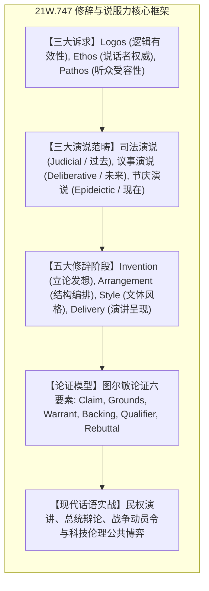

# 21W.747 古典修辞学与现代政治论辩

MIT 21W.747（Fall 2009，主讲 Andrea Walsh 讲师）是麻省理工学院写作与人文研究系开设的经典说服与论辩理论课程。课程将亚里士多德、柏拉图、西塞罗与昆体良的古典修辞学传统，与现代公共政治演讲、法律论辩、新闻传媒和社交网络话语分析紧密结合。课程系统训练如何解构文本中的说服机制、论证有效性、修辞格（Figures of Speech）与谬误，并掌握极具穿透力的演说与议论文写作。

## TL;DR

- 解构说服力的底层逻辑：系统学习亚里士多德修辞三要素——*Logos*（逻辑理据）、*Ethos*（人格信誉）与 *Pathos*（情感共鸣）。
- 掌握西方论辩的结构范式：从图尔敏论证模型（Toulmin Model）到古典五大修辞阶段（发想、布局、文体、记忆、演述）。
- 培养批判性话语分析能力：穿透政治辞令中的隐喻陷阱、假对立与无意识偏见，提升高阶思想输出的说服力。

## 课程修辞学大厦

本课程将两千余年西方修辞学思想脉络与当代现实政治语境紧密缝合，揭示公共话语中说服力、权力和受众心理的深层动力学。教学以亚里士多德的三大说服力诉求——逻辑理据（Logos）、讲者信誉（Ethos）与听众同理心（Pathos）为理论奠基；贯穿古典修辞发想、布局、文体、记忆与呈现五大演述阶段，剖析论题发掘与论据选择的心智过程；通过图尔敏（Toulmin）论证模型精确解构主张、理据与反驳边界；后半程聚焦 20 世纪以来的重大公共政治文本、民权演讲、反战动员令与科技伦理博弈，深度训练学习者识别隐性修辞陷阱与产出高说服力演讲文本的实践能力。

各模块之间并非割裂孤立的知识碎片，而是构成环环相扣的推导链条。学习者在研读各章节时，应重点追踪理论假说的提出背景、关键跨语言反例的证伪逻辑，以及形式化推导工具在具体语料中的落地验证过程。

## 计划涵盖主题

| 模块 | 核心修辞机制 | 经典案例与文本分析 |
| :--- | :--- | :--- |
| **古典修辞三大支柱** | 论辩逻辑、说话者品格塑造与情感同理心 | 柏拉图《高尔吉亚篇》、亚里士多德《修辞学》 |
| **修辞五阶段与篇章布局** | 开宗明义、事实叙述、立论证明、反驳反思与结语 | 西塞罗法庭辩词、林肯葛底斯堡演说 |
| **图尔敏论证模型** | 主张、证据、正当理由（Warrant）与反驳预案 | 现代法律辩护词、科研论文争鸣文章 |
| **修辞格与隐喻力学** | 提喻、借代、对仗（Antithesis）、隐喻框架 | 马丁·路德·金《我有一个梦想》、丘吉尔战时演讲 |
| **现代政治与公共话语** | 宣传修辞（Propaganda）、民粹修辞与危机公关 | 肯尼迪就职演说、战后公共议题辩论 |

## 前置知识与建议

适合希望提升公开演讲、政策论辩、批判性思维与高阶议论文写作能力的学习者。

## 来源与参考资料

- MIT OpenCourseWare: [21W.747 Classical Rhetoric and Modern Political Discourse (Fall 2009)](https://ocw.mit.edu/courses/21w-747-classical-rhetoric-and-modern-political-discourse-fall-2009/)
- 主讲教师：Dr. Andrea Walsh（MIT Comparative Media Studies / Writing）
