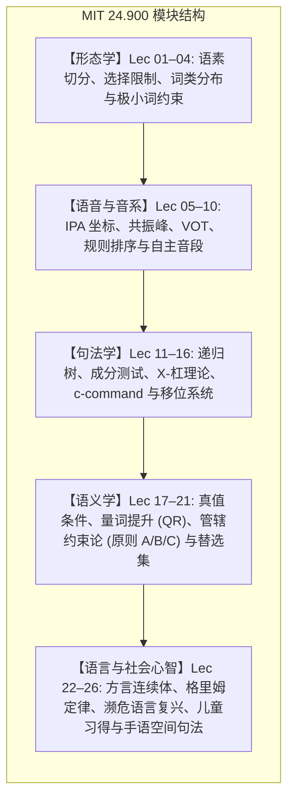

# 24.900 语言学导论

MIT 24.900（Spring 2022，主讲 Norvin W. Richards 教授）是麻省理工学院语言学与哲学系面向本科生的经典形式语言学核心入门课。课程以乔姆斯基普遍语法（Universal Grammar, UG）为理论基石，系统剖析人类心智中的语言计算机器。全课分为五大核心知识板块：形态学（Morphology）、语音学与音系学（Phonetics & Phonology）、句法学（Syntax）、语义学（Semantics & Pragmatics），以及跨语言与社会心智研究（方言学、历史语言学、濒危语言复兴、儿童语言习得与手语语言学）。

## TL;DR

- 确立语言机能的心智现实性：语言是人类生物学遗传的内在认知计算系统，而非外界刺激的被动模仿。
- 贯穿形式理论与经验实证：从跨语言语料（斯瓦希里语、拉尔迪尔语、他加禄语、德语等）提炼严密数学与树形模型。
- 全套 26 讲完备讲义笔记与逐字精翻档案，涵盖乔姆斯基二叉树、成分统领、量词提升与手语空间句法。

## 课程介绍

### 先修课程

（无）

### 课程内容

本课程将解答一些关于人类语言本质的基本问题。在整个课程中，我们将探讨人类语言如何成为一个复杂但又遵循规律的心理系统。课程的大部分时间将用于详细研究该系统的一些核心方面；我们还将利用个别课时讨论其他一些问题，包括语言是如何习得的、语言如何随时间演变、语言濒危状况等等。

### 教材

- O'Grady, William, John Archibald, Mark Aronoff 和 Janie Rees-Miller (2017)。*当代语言学：导论*。纽约：Bedford/St. Martin's。

  - 如果真要用教材的话，这大概就是我们的教材了……但它还不够好，不足以让你买。我们偶尔会和书里的内容相矛盾。一般来说，如果你发现我们和书里的内容有矛盾，那就是我们是对的，书里的内容是错的

## 课程结构与知识版图

本课程系统解构人类语言机能的内在生成规律。全学期教学沿着形式理论由浅入深推进：首先通过形态学确立语素切分与选择限制，继而通过语音学与音系学揭示离散心智表征与连续发音动作的对应法则。在句法学模块中，乔姆斯基二叉树与成分统领（c-command）构成了句子计算的骨架；随后进入形式语义学与语用学，探究真值条件与管辖约束论；最终将形式模型投射至现实世界中的方言变异、语言历史演化、濒危语言抢救复兴、儿童早期习得以及手语空间句法。

各模块之间并非割裂孤立的知识碎片，而是构成环环相扣的推导链条。学习者在研读各章节时，应重点追踪理论假说的提出背景、关键跨语言反例的证伪逻辑，以及形式化推导工具在具体语料中的落地验证过程。

## 讲义笔记与逐字稿导航

课程逐字稿仅作为本地整理资料保存，尚未发布；下表提供已发布的讲义笔记。

| 讲次 | 核心主题 | 核心机制与关键案例 | 讲义笔记 | 逐字稿精翻 |
| :---: | :--- | :--- | :---: | :---: |
| **Lec 01** | 导论：语言知识的本质 | 普遍语法 (UG)、刺激贫乏、成分测试前瞻 | [讲义笔记](./lec1.md) | 仅本地保存 |
| **Lec 02** | 形态学（一）：语素基础 | 行间标注、斯瓦希里语矩阵、他加禄语叠词 | [讲义笔记](./lec2.md) | 仅本地保存 |
| **Lec 03** | 形态学（二）：层级树与选择限制 | 词缀范畴选择限制、*unlockable* 结构歧义、波兰语去浊 | [讲义笔记](./lec3.md) | 仅本地保存 |
| **Lec 04** | 形态学（三）：类型学与底层式推导 | 孤立/胶着/屈折/多式综合、拉尔迪尔语极小词约束与截断 | [讲义笔记](./lec4.md) | 仅本地保存 |
| **Lec 05** | 语音学（一）：发音器官与 IPA | 声道解剖、10 大发音部位、6 种发音方法、辅音矩阵 | [讲义笔记](./lec5.md) | 仅本地保存 |
| **Lec 06** | 语音学（二）：元音与声学语图 | 元音四边形、搭嘴音、F1/F2 共振峰、麦格克效应 | [讲义笔记](./lec6.md) | 仅本地保存 |
| **Lec 07** | 语音到音系：VOT 与形式重写规则 | 范畴感知、印地语塞音对立、美语闪音与复数底层式 | [讲义笔记](./lec7.md) | 仅本地保存 |
| **Lec 08** | 音系学（一）：音系共谋与规则排序 | 英语复数规则排序、亚韦尔马尼语三辅音共谋、优选论前瞻 | [讲义笔记](./lec8.md) | 仅本地保存 |
| **Lec 09** | 音系学（二）：区别性特征与配列律 | 日语复合词重音、音位配列律、Wug 测试、二元特征矩阵 | [讲义笔记](./lec9.md) | 仅本地保存 |
| **Lec 10** | 音系学（三）：同化与自主音段 | 阿拉伯语冠词同化、芬兰语元音和谐律、自主音段扩散 | [讲义笔记](./lec10.md) | 仅本地保存 |
| **Lec 11** | 句法学（一）：离散无限性与成分测试 | 递归性、四大成分测试（移位/配合/片段/分裂）、短语结构 | [讲义笔记](./lec11.md) | 仅本地保存 |
| **Lec 12** | 句法学（二）：X-杠理论与 TP 骨架 | X-bar 通用几何、补足语 vs. 附加语结构间距、时态短语 | [讲义笔记](./lec12.md) | 仅本地保存 |
| **Lec 13** | 句法学（三）：合并次序与 c-command | T 先合并论证、成分统领严格定义、约束原则 C 验证 | [讲义笔记](./lec13.md) | 仅本地保存 |
| **Lec 14** | 句法学（四）：投射原则与移位系统 | 投射原则、深层/表层结构、语迹、跨语言 Wh-类型学 | [讲义笔记](./lec14.md) | 仅本地保存 |
| **Lec 15** | 句法学（五）：普遍语法未见类型与 EPP | 非计数约束、卡巴尔达语分裂句、扩充投射原则与天气虚词 | [讲义笔记](./lec15.md) | 仅本地保存 |
| **Lec 16** | 句法学（六）：中心语方向参数与 FOFC | FOFC 终极禁令、德语 V2、三大移位体系与 that-trace | [讲义笔记](./lec16.md) | 仅本地保存 |
| **Lec 17** | 句法语义过渡：极小移位与真值条件 | Wh-孤岛、丁卡语 V2、真值条件、蕴涵 vs. 预设 | [讲义笔记](./lec17.md) | 仅本地保存 |
| **Lec 18** | 语义学（二）：广义量词与量词提升 | 辖域歧义 ($\forall > \exists$)、集合论真值、罗伯特·梅 LF 提升 | [讲义笔记](./lec18.md) | 仅本地保存 |
| **Lec 19** | 语义学（三）：辖域经济性与下向蕴涵 | 丹尼·福克斯辖域经济、VP 省略、下向蕴涵与 NPI 许可 | [讲义笔记](./lec19.md) | 仅本地保存 |
| **Lec 20** | 语义学（四）：管辖约束论与隐形主语 | 形式化局部约束域、原则 A/B/C、不定式控制 PRO | [讲义笔记](./lec20.md) | 仅本地保存 |
| **Lec 21** | 语义学（五）：语义重建与替选集 | 原则 A 阻断重建、Sluicing 格位匹配、鲁特焦点替选集 | [讲义笔记](./lec21.md) | 仅本地保存 |
| **Lec 22** | 方言与社会语言学：象棋跳棋隐喻 | 国际象棋与跳棋家庭寓言、严格否定一致、同言线与权力边界 | [讲义笔记](./lec22.md) | 仅本地保存 |
| **Lec 23** | 历史语言学：比较法与规律构拟 | 格里姆定律、元音大推移、索绪尔喉音理论赫梯语实证 | [讲义笔记](./lec23.md) | 仅本地保存 |
| **Lec 24** | 濒危语言与语言保护：语法失落 | 包含式代词、寄宿学校创伤、万帕诺亚格圣经赞美诗重音破译 | [讲义笔记](./lec24.md) | 仅本地保存 |
| **Lec 25** | 语言习得：柏拉图问题与儿童语法 | 刺激贫乏论、缺乏负面证据、关键期假说、两岁儿童德语 V2 | [讲义笔记](./lec25.md) | 仅本地保存 |
| **Lec 26** | 手语语言学：空间句法与普遍语法 | ASL 系谱、斯托基五大音系参数、空间位点 (Loci) 消除歧义 | [讲义笔记](./lec26.md) | 仅本地保存 |

## 阅读材料及其他资源

### 书面作业 1 的阅读材料

Berent, I., Lennertz, T., Jun, J., Moreno, M., 和 Smolensky, P. (2008). [“人类大脑中的语言普遍性。” ](https://www.pnas.org/doi/10.1073/pnas.0801469105)*PNAS* 105(14), 5321–5325。

Culbertson, J. 和 Adger, D. (2014)。[“语言学习者优先考虑结构化意义而非表面频率。” ](https://www.pnas.org/doi/10.1073/pnas.1320525111)*PNAS* 111(16), 5842–5847。

### 可选阅读材料

Young, VA (2010)。[“作家应该使用他们自己的英语吗？”](https://pubs.lib.uiowa.edu/ijcs/article/id/29866/) *爱荷华文化研究杂志*12(1), 110–118。

### 其他资源

- [国际音标表](https://www.internationalphoneticassociation.org/IPAcharts/inter_chart_2018/IPA_2018.html)（来自国际语音协会网站）
- [视觉化语音](https://www.seeingspeech.ac.uk/ipa-charts/)（结合核磁共振成像的国际音标图表）
- [IPA 调色板](https://www.blugs.com/IPAPalette/)（在 MAC 上轻松输入 IPA 的方法）
- [IPA Wordle](https://manishearth.github.io/ipadle/?fbclid=IwAR3i7eP3JxLqsIMP3rbSOkgaw3UMwLdL_JwCMzW7Kx4JDZ3LcVjfb5NoF3E)
- [另一个 IPA Wordle](https://heardle.glitch.me/?fbclid=IwAR23TCWW0pyYZ8UYxDILHxcNy8jJkzvrX8yw5DhRdnlndn2R0SC1GijBCzk)
- [语音感知（正弦波合成）](https://haskinslabs.org/research/features-and-demos/sinewave-synthesis)
- [关于语音感知（会说话的钢琴）的更多信息](https://www.futilitycloset.com/2021/11/07/key-testimony/)
- [麦格克效应（YouTube）](https://www.youtube.com/watch?v=aFPtc8BVdJk)
- [加州大学洛杉矶分校语音实验室数据](http://www.phonetics.ucla.edu/index/sounds.html)
