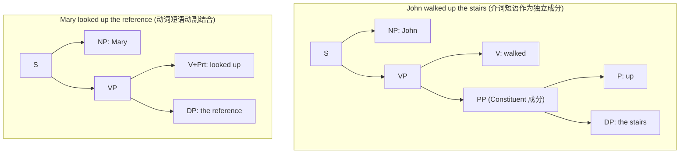
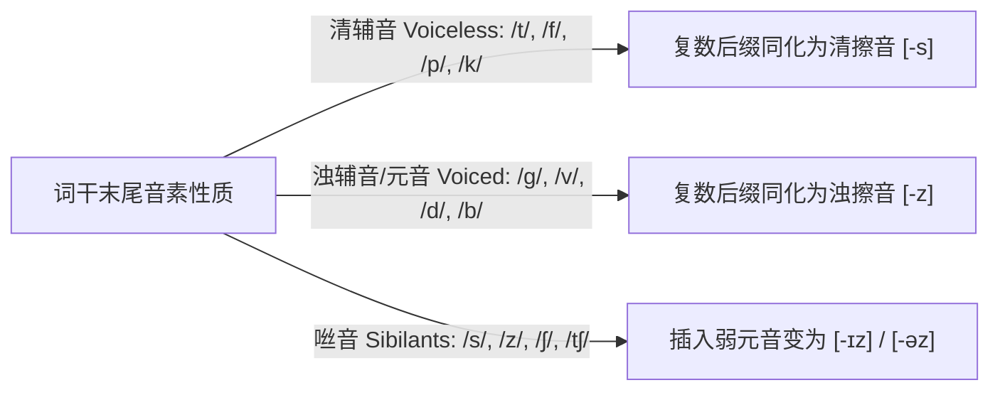
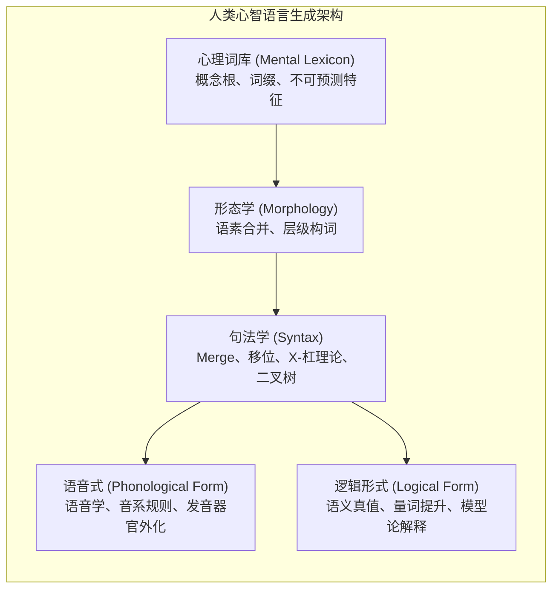

# Lec 1 导论：你掌握一门语言时，你究竟掌握了什么？

**开场白**

欢迎来到 24.900 语言学导论（Introduction to Linguistics）！  每当我们向别人提到自己在学习“语言学”时，最常见的误解往往是：“哇，那你一定精通很多门外语吧？”或者“你将来是要做同声传译吗？”但在现代认知科学与理论语言学的视野中，语言学的目标截然不同。一句话概括：

> 我们在本课程中试图探明的是：当你声称自己“掌握”一门语言时，你的大脑中究竟拥有了怎样的心智知识？以及你究竟是如何最终获得这种知识的？

你在阅读这段中文时，你的视网膜接收到的是一组组黑白像素，你的大脑在几十毫秒内自动完成了字符识别、语素切分、句法分析与语义整合；当你在聆听他人讲话时，耳蜗感受到的不过是一段连续的空气压力振动波，但你却能在完全无需刻意努力的前提下，将其解析为清晰独立的词汇与含义。

这种复杂的语言计算机制每分每秒都在你的大脑中无意识、高速而精准地运转。而语言学家的工作，正是通过严谨的实证观察与形式建模，揭示这套隐性心智系统背后的运行规律。

## TL;DR

## 句法学导引：句子如何由词汇层级建构

语言并不是单词像糖葫芦一样串在竹签上的线性排列，它具有深层的层次结构。研究句子如何由词汇组装而成的学科，被称为**句法学（*Syntax*）**

让我们观察下面两句在表面线性结构上几乎完全对称的英语句子：

1. **John walked up the stairs.**（约翰走上了楼梯。）
2. **Mary looked up the reference.**（玛丽查阅了参考文献。）

如果只看词性序列，两者看似完全一致：
$$\text{Noun} + \text{Verb} + \text{Particle/Preposition} + \text{Determiner} + \text{Noun}$$

但如果你是英语母语者，你的直觉心智会立刻告诉你：这两句话内部的词汇亲疏关系与组合方式截然不同！

### 句法成分测试

我们如何用科学实验证明这种心智直觉？语言学使用**成分测试（*Constituency Tests*）**：

#### 测试一：独立片段问答测试

独立片段问答测试（Fragment Answer Test） 尝试将介词短语 `up the ...` 单独提取出来作为反问或答句：

- 对句子 (1) 质疑：

  - *“John walked up the stairs.”* $\rightarrow$ **“Up the stairs?!”**（完全自然合法 ✅）

- 对句子 (2) 质疑：

  - *“Mary looked up the reference.”* $\rightarrow$ **\*“Up the reference?!”**（不可接受/非语法 ❌）

  > *注：语言学惯例中，星号 `*` 标在句首表示该句在母语者直觉中不符合语法（Ungrammatical）。*

#### 测试二：Wh- 疑问句移位测试

Wh- 疑问句移位测试（Wh-Fronting Test）尝试将介词及其修饰的宾语整体前移：

- 句子 (1)：**[Up which stairs] did John walk?**（完全合法 ✅）
- 句子 (2)：**\*[Up which reference] did Mary look?**（完全不合法 ❌）

#### 测试三：并列连接测试

并列连接测试（Coordination Test）只有同类的结构成分才能用 `and` 并列：

- 句子 (1)：**John walked [up the stairs] and [up the hill].**（合法 ✅）
- 句子 (2)：**\*Mary looked [up the reference] and [up the vocabulary words].**（极度别扭/不合法 ❌）

在句子 (1) 中，`[up the stairs]` 构成了一个紧密结合的**介词短语成分（Prepositional Phrase, PP）**；而在句子 (2) 中，`looked up` 是一个动词短语动副词复合体（Phrasal Verb），`up` 与动词 `look` 结合，`the reference` 则是该动词的直接宾语。`[up the reference]` 根本不是一个底层的句法成分！

## 语义学导引：句子意义如何被精确计算？

研究句子的整体意义如何从其各个组成部分的意义及结构关系中递归计算出来的学科，是**语义学（*Semantics*）**

### 人称代词的共指问题

观察人称代词在不同句式中的指代可能性。

思考以下疑问句：

- **Who did Biden ask to see him?**（Biden 要求谁去看他？）
- 在这个句子中，`him` 能否指代 `Biden` 本人？
- 母语者的直觉回答是：**不能**。`him` 必须指代除拜登之外的某个第三方男性。

对比以下句子：

- **Why did Biden ask to see him?** （约翰为什么要求见他？）
- 此时 `him` 能否指代 `Biden`？依然不能。
- 那么什么情况下可以指代自己？必须使用反身代词：*Why did Biden ask to see himself?*

### 结构不对称与代词自由度

再看主从复合句中的代词与专有名词的指代模式：

| 例句 | 句式                                        | she 与 Susan 能否共指？           |
| ---- | ------------------------------------------- | --------------------------------- |
| (a)  | **She thinks that Susan is smart.**         | **严禁共指**（she $\neq$ Susan）❌ |
| (b)  | **Susan thinks that she is smart.**         | **可以共指**（she $=$ Susan）✅    |
| (c)  | **After Susan came to MIT, she was happy.** | **可以共指**（she $=$ Susan）✅    |
| (d)  | **After she came to MIT, Susan was happy.** | **可以共指**（she $=$ Susan）✅    |

**理论深思**：为什么在句子 (a) 中，代词位于句首就**绝对不能**指代后文的 Susan；而在句子 (d) 中，代词 `she` 同样位于句首，却**完全可以**跨句指代后半句的 Susan？

这揭示出人类语言的共指法则根本不是简单的“先行词必须在前面”这种线性时间规则，而是基于树形结构层级中的**成分结构管辖（c-command, 成分统领）**！在后续第 15 讲的约束理论（Binding Theory）中，我们将彻底形式化这一惊人机制。

## 音系学导引：大脑中的语音计算系统

人类发出的声音是连续的声学模拟信号，但大脑却将其处理为离散的心理符号系统，这便是**音系学（*Phonology*）**。

### 英语复数后缀的自动交替

思考英语名词复数后缀 `-s` 的发音：

- `cat` $\rightarrow$ `cats`
- `dog` $\rightarrow$ `dogs`

如果你仔细注意自己的声带振动，你会发现：

- 在 `cats` 中，最后的字母 `s` 读作无声的清辅音 **[s]**；
- 在 `dogs` 中，最后的字母 `s` 读作声带振动的浊辅音 **[z]**！

再对比另外两组词汇：

- `dove`（鸽子，末尾是浊音 [v]） $\rightarrow$ `doves`，读作 **[dʌvz]**（浊音 [z]）；
- `reef`（暗礁，末尾是清音 [f]） $\rightarrow$ `reefs`，读作 **[riːfs]**（清音 [s]）。

你从来没有在小学英语课上被老师硬性背诵过“凡是以清辅音结尾的词加 s 读 [s]，浊辅音结尾读 [z]”这套规则；但哪怕给你一个从未存在过的全新人造词（比如 *wug*），你也会毫不犹豫地将其复数读作 *wugs* [wʌɡz]。

这证明你的大脑中早已固化了一套自动运行的**音系同化运算规则（Phonological Assimilation Rule）**！

## 知识模块地图

MIT 24.900 将人类心智语言机能解构为五大相互接口的计算模块：

1. **形态学（Morphology）**：词汇的内部构造与语素结合
2. **语音学（Phonetics）**：发音器官物理机制与声学特性；
3. **音系学 (Phonology)**：大脑内部声音系统的离散表征与规则
4. **句法学（Syntax）**：单词组装为无限句子的几何层级计算系统；
5. **语义学与语用学（Semantics & Pragmatics）**：真值条件、意义计算与会话隐涵；
6. **外延与跨学科专题**：语言习得、语言濒危与保护、手语语言学、历史语言学、方言学与社会语言学

## 5. 我的理解与批判性反思

::: insight 普遍语法的计算实质：约束先于创造
初学者常常惊叹于人类语言的“自由度”——我们可以说出无限多种句子。然而，形式语言学带来的最深邃启示恰恰相反：**人类语言之所以能够被高效理解与习得，不是因为其“自由”，而是因为其受到了普遍语法极端苛刻的几何约束（Constraints）
:::
