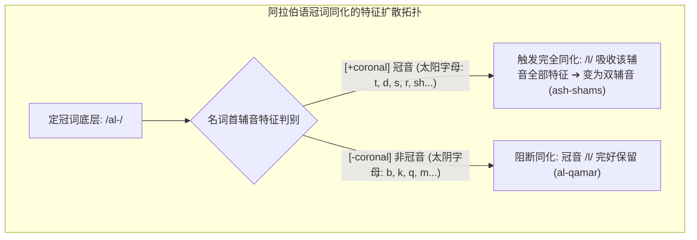
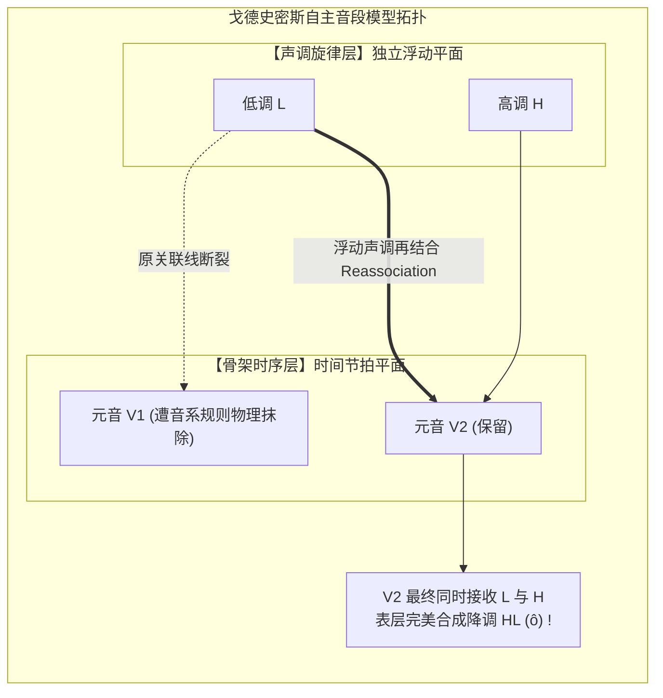

# Lec 10 音系学（三）：同化规律、元音和谐律与自主音段音系学

> MIT 24.900 · 语言学导论 · 主讲 Norvin W. Richards

## TL;DR

- 局部同化的自然类本质：阿拉伯语太阳字母同化铁证表明，触发冠词 /l/ 完全同化的不是随机字母，而是严格由舌尖/舌叶主导的舌叶冠音自然类（`[+coronal]`）。
- 跨音节的长距离和谐：芬兰语元音和谐律（Vowel Harmony）展示了前元音特征 `[+front]` 如何越过中间的阻碍辅音，向整个单词的所有后缀实施强制性声学染色。
- 自主音段音系学（Autosegmental Phonology）：约翰·戈德史密斯打破传统“串珠式”音段模型，确立骨架时序层与旋律特征层平行并立、通过关联线无交叉投射的多层几何范式。
- 声调稳定性与音节重量：浮动声调在母体元音脱落后的稳定漂移，以及基于音拍（Mora）的轻重音节度量体系。

## 1. 核心问题

### 驱动问题
为什么阿拉伯语的定冠词 *al-* 在遇到“太阳”时会变成 *ash-shams*，遇到“月亮”时却依然保持 *al-qamar*？为什么芬兰语中整个单词的元音必须集体“要么全在前、要么全在后”？当一个元音在语流中被彻底删除时，原本附着在它身上的声调为什么不会消失，反而会像幽灵一样飘到邻近的元音上？

### 形式本质：从一维线性矩阵到多维自主音段几何
在 20 世纪 70 年代中期以前，生成音系学依然沿袭经典的一维假定——认为单词就像一个由特征向量组成的二维表格，每一列代表一个绝对绑定的独立音段。

然而，1976 年约翰·戈德史密斯（John Goldsmith）在 MIT 完成的博士论文《自主音段音系学》彻底颠覆了这一图景：
音系特征（特别是声调、鼻音度、元音舌位特征）并不像囚徒一样被永远禁锢在某一个辅音或元音内部！它们栖息在相互平行的**自主音段层（Autosegmental Tiers）**上。底层的骨架时序层（Skeletal Tier）提供时间节拍，而特征层在空间中通过**关联线（Association Lines）**向外自由扩散、漂移或重新锚定。

## 2. 核心概念

| 概念 | 严密定义（用自己的话） | 容易混淆的邻居 | 典型实例 / 判据 |
|---|---|---|---|
| **完全同化（Total Assimilation）** | 一个音段在相邻音段的影响下，将其全部发音部位与方法特征完全复制，彻底变为与邻近音段相同发音的现象。 | 部分同化（Partial Assimilation 仅同化发音部位或清浊，如 /in-possible/ $\implies$ [impossible]）。 | 阿拉伯语冠词：*al- + shams* $\implies$ *ash-shams*（/l/ 完全变成 [ʃ]）。 |
| **冠音 / 舌叶音（Coronal）** | 由舌尖（Tip）或舌叶（Blade）从自然静止位置抬起，接触或靠近门齿、齿龈及硬腭区域发出的所有声音。 | 舌面音（Dorsal 由舌身与软腭接触，如 [k, g]；唇音 Labial 由嘴唇发音）。 | [t, d, s, z, n, l, r, ʃ, ʒ, tʃ, dʒ] 均属于 `[+coronal]` 自然类。 |
| **元音和谐律（Vowel Harmony）** | 单词内部（通常由词根强制辐射至所有后续词缀）的所有元音必须在某一特定区别性特征（如舌位前后、圆唇或舌根松紧）上保持全词一致的跨音节音系法则。 | 局部同化（局部同化只发生在紧邻音段之间；元音和谐能够飞越中间的辅音群在全词扩散）。 | 芬兰语后元音词根：*talo-ssa*（在房子里）；前元音词根：*metsä-ssä*（在森林里）。 |
| **自主音段层（Autosegmental Tier）** | 几何音系学中容纳特定音系特征（如声调、鼻化、元音特征）的独立平行物理平面。 | 单一线性文本（自主音段层与时序骨架层相互独立，可分别进行删除与插入运算）。 | 声调层（Tonal Tier: H, L）与时序音段层（Skeletal Tier: C, V）。 |
| **良构条件（Well-Formedness Condition, WFC）** | 支配自主音段关联线的拓扑公理：(1) 所有音段均须与特征相连；(2) 所有特征均须与时序位点相连；(3) 关联线绝不可在空间中发生交叉（No Crossing Constraint）。 | 自由随机连线（WFC 保证了多维音系投射的拓扑保真性与确定性）。 | 任何推导出关联线相互交叉的拓扑树在心智中被普遍语法直接判定非法。 |
| **声调稳定性（Tone Stability）** | 当承载声调的时序元音因形态或音节压缩规则被彻底删除时，原有的音高声调并不随之灭失，而是继续以“浮动声调（Floating Tone）”形式存在并向邻近元音二次吸附的现象。 | 物理共振阻尼（物理声音随介质消失而衰减，心智声调在自主音段层上享有独立生命）。 | 非洲班图语支洛蒙戈语（Lomongo）中的母音融合与浮动高调回弹。 |

## 3. 证据链与形式推导

### 3.1 阿拉伯语太阳字母同化的自然类揭秘
古典与现代标准阿拉伯语中，定冠词是 *al-*（الـ）。
当定冠词与后续名词合并时，展现了极其严格的两分法则：

::: example 阿拉伯语太阳字母 vs. 太阴字母对立
- **太阳字母（Sun Letters / حروف شمسية）**：后续名词的首辅音会触发定冠词末尾 `/l/` 的**完全同化**，形成长辅音：
  - “太阳”：`al- + shams` $\implies$ `ash-shams`（绝不念 \*al-shams！）
  - “男人”：`al- + rajul` $\implies$ `ar-rajul`
  - “商人”：`al- + taajir` $\implies$ `at-taajir`
  - “光明”：`al- + nuur` $\implies$ `an-nuur`
- **太阴字母（Moon Letters / حروف قمرية）**：定冠词末尾 `/l/` 保持完全独立，不发生任何同化：
  - “月亮”：`al- + qamar` $\implies$ `al-qamar`（完全保留原音！）
  - “房屋”：`al- + bayt` $\implies$ `al-bayt`
  - “书本”：`al- + kitaab` $\implies$ `al-kitaab`
  - “眼睛”：`al- + 'ayn` $\implies$ `al-'ayn`
:::

**自然类形式破译**：
将 14 个太阳字母提取出来：`[t, θ, d, ð, r, z, s, ʃ, sˤ, dˤ, tˤ, ðˤ, l, n]`。
虽然它们包含塞音、擦音、清音、浊音乃至咽化音，但在发音解剖学上，**它们 100% 全部属于冠音类（`[+coronal]`）——即全部依靠舌尖或舌叶抬起发音**！而太阴字母则属于唇音、软腭音或小舌喉音（`[-coronal]`）。

这一完全同化律的形式化表征为：冠词流音 `/l/` 处于舌叶冠音目标项之前时，发音器官为了追求最小动作路径，放弃重新定位舌尖位置，直接将后续辅音的全部声学特征复制到自身时序槽位上。

### 3.2 芬兰语的元音和谐律与跨音节特征投射
芬兰语将元音严格划分为三大阵营：
1. **后元音（Back Vowels, `[-front]`）**：`/u, o, ɑ/`
2. **前元音（Front Vowels, `[+front]`）**：`/y, ø, æ/`
3. **中性元音（Neutral Vowels）**：`/i, e/`（可出现在任何词根中）

::: example 芬兰语内格后缀的二元变体
芬兰语表示“在……里面”的格后缀拥有两个同位异语素：`-ssa`（后元音）与 `-ssä`（前元音）：
- 词根含后元音：`talo`（房子） $\implies$ `talo-ssa`（在房子里，绝不可说 \*talo-ssä！）
- 词根含前元音：`metsä`（森林） $\implies$ `metsä-ssä`（在森林里，绝不可说 \*metsä-ssa！）
- 词根含复合前元音：`tyttö`（女孩） $\implies$ `tyttö-llä`（在女孩身上）
:::

中间隔着的阻碍辅音（如 `l`, `t`, `s`）在声学上被完全“透传穿透”，后元音或前元音的特征像波纹一样在整个单词范围内实现全局染色。

## 4. 机制与形式推导：自主音段多层网络与声调稳定性

在非洲班图语支洛蒙戈语（Lomongo）中，存在极具震撼力的**声调稳定性（Tone Stability）实证**。该语言中，语素 A“他卖了”（`bǎ`）底层包含低调 L 与高调 H 构成的升调序列，而语素 B“衣服”（`ǒtswá`）底层以高调 H 开头。

当两词紧邻发生快速言语缩合时，语素 A 末尾的元音 `a` 被音系规则强行删除。令人惊叹的是：元音 `a` 虽然物理消失了，但它原本承载的低调 L 绝没有死！低调 L 向右侧漂移，与后续的元音 `o` 结合，将原本的高调强制压成了降调 HL（[ô]），表层整句输出为 `[bôtswá]`！

在传统的线性矩阵模型中，删除一个元音就必然连带删除其所有特征，根本无法解释消失的音高如何在后续元音上借尸还魂。戈德史密斯通过引入解耦的自主音段层，优雅地化解了这一难题：声调旋律层与时序骨架层分别位于独立平面上，中间通过关联线连接。当骨架层上的元音节点被剔除时，原有关联线随之断裂，使声调释放为“浮动声调（Floating Tone）”。该浮动声调随后受良构条件（WFC）驱动，向右侧最近的元音节点重新建立关联线，完美合成复合降调。

根据良构条件（WFC），浮动声调 L 绝不越过 H 去连接更远的声音，而是精准吸附到最近的有效音节核上，并且两根关联线严密平行，绝不相交！

## 5. 我的理解与批判性反思

::: insight 表征的自由度：理论突破往往源于对维度假设的解绑
自主音段音系学的诞生，在科学哲学上提供了一个关于“理论突破如何发生”的经典范本。

在科学史上，当一个现存理论变得越来越臃肿、充满无数个无法自圆其说的“补丁规则”（Ad-hoc Patches）时，往往不是因为数据错了，而是因为**理论从一开始就武断地假定了一个过于狭隘的空间维度**。经典 SPE 音系学把所有声音强制塞进一维的“串珠线性时间链条”，导致在面对声调、元音和谐和鼻化扩散时，不得不写出极其复杂的跨语素上下文重写规则。

戈德史密斯的天才之处，不在于修改某一条具体规则，而在于**升维（Dimension Lifting）**——把一维的串珠拆解为多维并行的悬挂网络。声调走声调的轨道，时序走时序的骨架，发音部位走发音部位的几何投射。一旦解除维度禁锢，原本神秘莫测的“幽灵声调漂移”与“跨辅音隔空染色”，在拓扑几何中瞬间退化为最朴素自然的短程连接（Local Spreading）。

这一形式化升维思想，不仅深远重塑了现代非线性音系学，也为当代理论生物学、神经连接组学与深度学习多模态表征解耦（Disentangled Representations）提供了跨学科的智慧源泉。
:::
